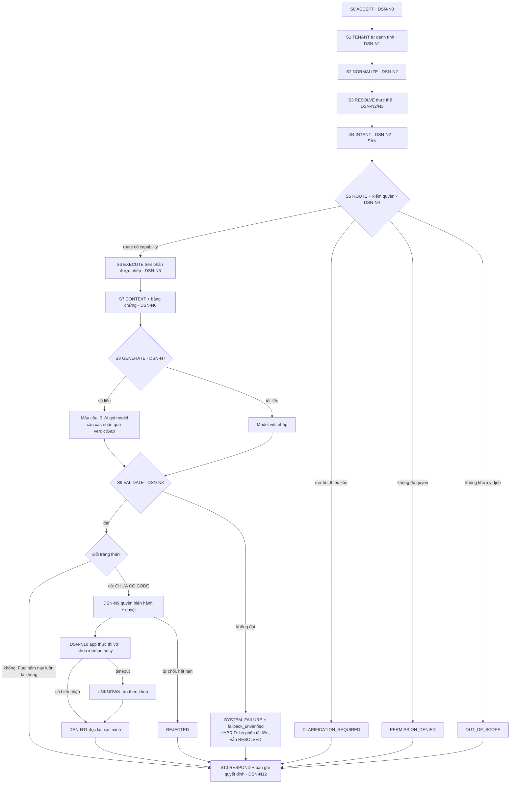
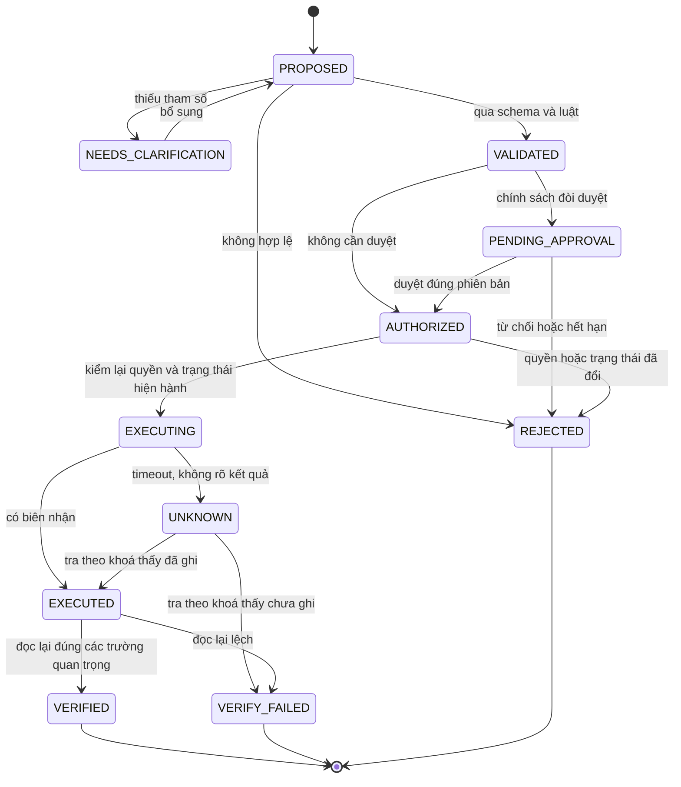
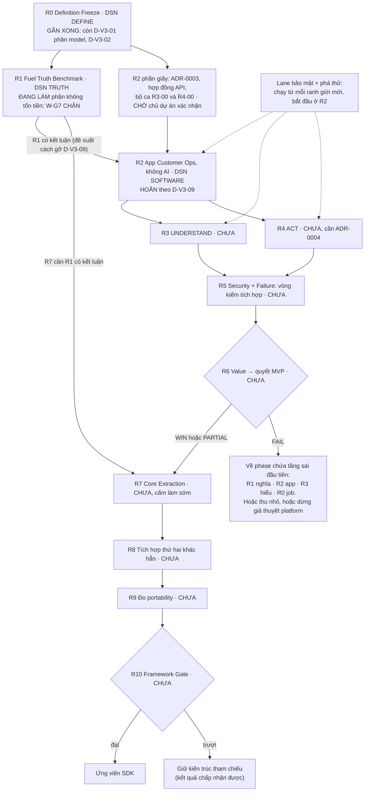

# EACL × QuânIT — Roadmap hợp nhất

> **Từ tối 21/10/2026, tệp này KHÔNG còn là roadmap hiện hành.**
> - Roadmap hiện hành: `docs/ROADMAP-DAY-DU.md` (D-RM-01, `docs/CHO-QUYET-DINH.md` §0).
> - Tệp này giữ để tra cứu: §0.4 lỗi im lặng, §1 dòng dõi, §3 bản đồ luồng, các phụ lục.
> - Không lập kế hoạch theo §4 và §5 của tệp này.

> **Viết cho:** Luân (chủ dự án). Mục đích: hiểu trọn EACL, hiểu mindset QuânIT, và hiểu cái khó thật khi đưa AI vào phần mềm doanh nghiệp. Tệp cũng dùng làm bảng tra cho người đọc repo.
>
> **Mốc:** code và tài liệu tại `8280f40` (origin/main, 21/10/2026 13:12). Phần lớn số đo chạy tại `1c8005b` rồi được chạy lại tại `8280f40` (Phụ lục C, F); chỗ nào chỉ đo ở một mốc thì ghi rõ mốc đó.
>
> **Vị trí của tệp:** đây là tài liệu HỢP NHẤT để học và tra cứu. Tệp **không** phải nguồn quyết định và **không** thay hợp đồng, ADR hay backlog. Khi tệp lệch với nguồn chuẩn, nguồn chuẩn thắng (thứ bậc ở §2.1) và tệp này phải sửa.
>
> **Gộp và thay thế:**
> - Bản nháp "Roadmap QuânIT → EACL — bản sửa mục lục V0–V9" (ngoài repo, 21/10): tệp này thay hoàn toàn.
> - Mục lục học `docs/study/README.md` (phiên khác viết, chưa commit): tệp này giữ khung V0–V9 của nó, không sửa tệp đó.
> - Bản thiết kế "EACL — Bản thiết kế tổng thể, luồng vận hành và roadmap từ đầu đến cuối", ChatGPT soạn ngày 21/10, giữ ngoài repo. Tệp này gọi tắt là **Design V1**. Bản thiết kế và hội thoại audit đi kèm đã được audit ở Phần 6.
> - Hai sơ đồ mermaid Luân đưa (ảnh 1: roadmap DSN-R0…R9; ảnh 2: luồng runtime): phân tích ở §3.3 và §4.2.
>
> **Nhãn bằng chứng:**
> - **[ĐO]**: phiên viết tệp tự chạy lệnh; lệnh ở Phụ lục C.
> - **[ĐO-agent]**: agent con chạy lệnh, phiên viết chưa chạy lại.
> - **[CODE]**: đọc thấy trong code, kèm `tệp:dòng`; chưa chạy tình huống đó.
> - **[REPO]**: tài liệu repo tự ghi, chưa chạy lại.
> - **[SUY]**: suy luận, kèm điều kiện.
> - **[DSN]**: đề xuất của Design V1, không phải hiện trạng.
>
> **Luật chống lệch phiên bản:**
> 1. Mỗi khái niệm chỉ có **một** bộ mã chuẩn, là bộ mã của repo (bảng §2.2). Bộ mã khác chỉ xuất hiện trong bảng quy đổi.
> 2. Mã của Design V1 luôn mang tiền tố `DSN-` (`DSN-R8`, `DSN-N9`, `DSN-D4`, `DSN-F04`…), vì chữ cái của chúng trùng với mã repo.
> 3. Ô trạng thái nào không có lệnh hoặc `tệp:dòng` thì ghi "chưa đo".
> 4. Khi HEAD đổi: chạy lại Phụ lục C, sửa ô nào đổi, ghi vào Phụ lục F.
> 5. Không chép trạng thái từ `docs/v3/01` (đo ở `85108c4`) hay từ báo cáo cũ mà không đo lại.
> 6. Tệp không chứa tên sản phẩm cũ (trước 21/10/2026), để không làm đỏ cổng danh tính `danh_tinh_test.go`.

## Mục lục

- [0. Đọc trong 5 phút](#0-đọc-trong-5-phút)
- [1. Bản chất: QuânIT → EACL là một dòng dõi](#1-bản-chất-quânit--eacl-là-một-dòng-dõi)
- [2. Định nghĩa và quy ước chống lệch số](#2-định-nghĩa-và-quy-ước-chống-lệch-số)
- [3. Ba bản đồ: năng lực, dữ liệu, luồng hỏi, luồng hành động](#3-ba-bản-đồ-năng-lực-dữ-liệu-luồng-hỏi-luồng-hành-động)
- [4. Roadmap giao hàng R0–R12](#4-roadmap-giao-hàng-r0r12)
- [5. Roadmap học V0–V9](#5-roadmap-học-v0v9)
- [6. Kiểm chứng: danh mục hỏng, audit Design V1, audit hội thoại](#6-kiểm-chứng-danh-mục-hỏng-audit-design-v1-audit-hội-thoại)
- [Phụ lục A. Lời QuânIT đã kiểm](#phụ-lục-a-lời-quânit-đã-kiểm)
- [Phụ lục B. 19 câu đã đo](#phụ-lục-b-19-câu-đã-đo)
- [Phụ lục C. Lệnh tái lập](#phụ-lục-c-lệnh-tái-lập)
- [Phụ lục D. Đính chính](#phụ-lục-d-đính-chính)
- [Phụ lục E. Chưa kiểm](#phụ-lục-e-chưa-kiểm)
- [Phụ lục F. Lịch sử phiên bản](#phụ-lục-f-lịch-sử-phiên-bản)

---

## 0. Đọc trong 5 phút

> Phần này dùng nhiều mã trước khi định nghĩa (S4, W-G7, H1/H3, D-V3-nn, canary…). Gặp mã lạ thì tra bảng không gian tên §2.2 và từ điển §2.3.

### 0.1 Năm câu

1. **QuânIT nói:**
   - AI "chỉ là một công nghệ".
   - Model "chỉ nằm ở giữa" một stack phần mềm: classifier, router, tool, context builder.
   - Việc doanh nghiệp "liên quan tới tiền". Với ví dụ dầu báo qua Zalo, con số "phải chính xác 100%".
   - Dữ liệu rác thì kết quả rác. Có khi phải bảo khách "chuẩn hóa cái phần mềm nội bộ" trước khi làm AI.
2. **EACL**, định nghĩa chuẩn ở `README.md` và `docs/v3/05` §2.1: *"a reference architecture and executable control layer for integrating probabilistic AI capabilities into existing enterprise applications while those applications retain authority over business truth, permissions, state, transactions and workflows."*
3. **Quan hệ:** EACL biến chẩn đoán của QuânIT thành cơ chế có test. Ngoài ra EACL thêm 5 thứ mà QuânIT không đưa ra cơ chế (§1.3), và đi khác QuânIT ở 3 chỗ (§1.4).
4. **Đang ở đâu:**
   - EACL hiện là một lõi thư viện Go, 15.746 dòng không tính test, 12.080 dòng test [ĐO tại `8280f40`].
   - Kèm theo là bộ công cụ đo, chạy trên dữ liệu giả lập của bài dầu (Fuel).
   - Chưa có `cmd/`, chưa có máy chủ HTTP, chưa có CI [ĐO].
   - R0 chỉ còn chặn ở D-V3-01 (phần chọn model) và D-V3-02.
   - R1 đang làm phần không tốn tiền. Lượt trả tiền W-G7 chưa chạy, 0 USD.
   - R2–R6 chưa có dòng code nào.
5. **Cái khó thật không nằm ở gọi model.** Nó nằm ở bốn chỗ:
   - Hiểu đúng câu hỏi: S4 là sàn của hệ, 15/15 ca đỏ của H1 quyết định ở đó [REPO].
   - Nghĩa và thẩm quyền của dữ liệu bẩn.
   - Chứng minh mà không tự chấm bài: bộ chấm W-G7 v1 còn 118/170 đòn chấm sai [ĐO].
   - Hành động có tác dụng phụ: chưa có code.

### 0.2 Hai đợt push mới nhất (sáng và trưa 21/10)

**Đợt 1: `5ee31c8` → `1c8005b`, 11 commit.**

Lọc 152 tệp đổi [ĐO]: 100 tệp chỉ đổi tên, 39 tệp đổi thật, 13 tệp mới. Năm việc chính:

| Việc | Nội dung | Bằng chứng |
|---|---|---|
| Đổi danh tính sang EACL | Module thành `github.com/luannt2002/enterprise-ai-control-layer`. Biến môi trường `EACL_MODEL_*`, `EACL_PG_ADMIN_DSN`, `EACL_PG_DSN`. GUC `eacl.tenant_id`, vai `eacl_app`, database `eacl` / `eacl_giu_lai`. `CLAUDE.md` §9 và `README.md` dùng định nghĩa EACL. Cổng `danh_tinh_test.go` chặn tên cũ quay lại, có ca âm và đột biến n42 | commit `88f4dcc`, `35c8e61`, `3c51bb0`, `fb5319e`; TASK-R0-03 và R0-05 ghi XONG [REPO] |
| H3 đóng băng | 134 ca, mỗi lớp ≥ 14. Đóng băng bằng cam kết băm sha256, nội dung giữ ở máy tới lúc chạy. Kiểm toán nhiễm người soạn: 6 cờ, cả 6 là báo oan đã phân xử | `259d38d`, `docs/g7/holdout-h3/holdout-manifest.json` (chỉ có băm và số đếm) [REPO]. **H3 chưa chạy** |
| Cổng phán quyết câu xác nhận (ADR-0009) | D-OP-10 đã quyết. Hệ chỉ nói "Đúng." / "Không." khi claim {chủ thể, chỉ số, kỳ, giá trị, đơn vị, chiều} đã giải đủ chiều VÀ mọi chữ trong câu được giải thích. Thiếu một phần thì trả số có thẩm quyền kèm câu `confirm_withheld`. Danh sách duy nhất là danh sách CHO PHÉP `claim_neutral_words` | `aa0e8d4`; `core/pipeline/claim.go`; `ask.go:425`. Vào mã **sau** khi H3 đóng băng |
| Đăng ký trước độ nhạy cho H3 | Báo riêng số ca xác nhận trượt CHỈ vì hệ trả số thay vì hỏi lại; vẫn tính TRƯỢT | `d2e8f09`, ADR-0006 §10 |
| Hạ tầng bộ giữ lại | Database riêng `eacl_giu_lai` | `1c8005b`, `docs/ops` |

Tự đo lại tại `1c8005b` [ĐO], không có PG:
- `go vet` sạch; `gofmt -l` ra 0 tệp.
- `go test -json ./...`: 442 PASS / 1 FAIL / 5 SKIP. Tổng 448 khớp số commit báo (448/0/0 khi có PG).
- Test đỏ là `TestDanhTinhChiConEACL`. Nó chỉ báo 3 tệp, đều trong `docs/study/`, thư mục chưa commit của phiên khác. Đây là đỏ **môi trường**, không phải hồi quy code. Hệ quả: commit `docs/study/` nguyên trạng sẽ làm đỏ cổng danh tính.
- 5 SKIP là 5 test PostgreSQL, gồm `TestRLSCanaryB`.

Chạy lại 19 câu (Phụ lục B) [ĐO]:
- Câu "…được cấp **con số** 3850 đúng không?" trước sai "Không… không phải 5.000 L". Nay hệ trả 3.850 L kèm "Chưa kết luận đúng hay sai…".
- Câu phủ định (trước đây ra "Đúng." [REPO]) nay không phán quyết. Hai câu thử mới, câu có "khoảng" và câu "ERP ghi…", cũng không có phán quyết.
- Câu đủ chiều "…được cấp 3850 L dầu đúng không?" vẫn ra "Đúng.".
- **Cái giá:** câu số trần "…được cấp 3850 đúng không?" trước được "Đúng.", nay mất phán quyết. Đổi độ phủ lấy an toàn, đúng như ADR-0009 ghi: bộ 117 có 23 → 18 ca có phán quyết [REPO].

**Không đổi** (tệp chỉ đổi tên): canary vô hiệu, `≈` không có tác dụng, ghi đè mã lúc nạp, cộng trùng cùng nguồn, `Open` không kiểm BYPASSRLS, `DELETE FROM` dựa vào RLS, ACL tài liệu chỉ xét vai. Bảng §0.4.

**Đợt 2: `1c8005b` → `8280f40`, 6 commit, 12:16–13:12.** 36 tệp, +3.622 dòng [ĐO].

| Việc | Nội dung | Bằng chứng |
|---|---|---|
| Vá cổng phán quyết, vòng 1 (T2.1) | Vai D soát đối kháng khoảng 352 nghìn câu: 0 câu đảo chiều, nhưng 21 câu (8 nhóm) vẫn được phán quyết khi claim chưa giải. Vá theo chiều của claim, không vá từ khoá: chủ thể, đơn vị, câu không dấu, kỳ, nguồn thật sự tạo nên con số (`UsedSources`), dấu âm, ngữ cảnh. Bộ 117: ca có phán quyết 18 → 15 | `e0a3379` [REPO] |
| Vá vòng 2 (T2.2) | Soát lại khoảng 0,77 triệu câu: 21/21 câu vòng 1 đã đóng. Còn 3 lỗ có sẵn từ trước, một lỗ CAO ("EX-03 … 3850 L, dự án A 3850 L, đúng không?" ra "Đúng." dù dự án A là 5.050 L). Ba dòng vá là bản vá thử của chính người soát; **chưa có người soát thứ ba** | `a1595f0` [REPO] |
| Độ nhạy 3 viết thành mã, cố định trước H3 | ca xác nhận đỏ chỉ vì trả số thay vì hỏi lại | `003ffa1` [REPO] |
| **H3 chạy lần duy nhất** | **109/134** ở cả hai đường; phát lại 134/134, 0 lệch. G2' và G5' phần ca KHÔNG ĐẠT; G6' phần đo được ĐẠT. Fuel WIN vẫn 0/7 | `69d568c`; `docs/g7/holdout-h3/ket-qua-h3/` [REPO; bảng lớp ĐO đọc tệp] |
| Đối chứng mốc cũ trên cùng H3 | Code cũ (`016422e`): **113/134**. Bản sửa trượt ròng 4 ca (507, 564, 602, 650); cả 4 là câu khẳng định sai mà cổng giữ lại một "Không." vốn đúng. Trên 42 câu xác nhận: cũ 28 đúng chiều / 0 sai / 13 không phán quyết; mới 16 / 0 / 26 | `69d568c` [REPO] |
| H3 thành bộ hồi quy | Nội dung `h3.yaml` đã công bố, băm khớp cam kết | `9091c84` [REPO] |

Tự đo lại tại `8280f40` [ĐO]:
- `go vet` sạch; `gofmt -l` ra 0 tệp; `go test -json` không có PG: 445 PASS / 1 FAIL / 5 SKIP, tổng 451, khớp 451/0/0 có PG mà commit báo. Test đỏ vẫn chỉ do 3 tệp `docs/study/`.
- 19 câu ở Phụ lục B cho câu trả lời **giống hệt** `1c8005b`. Thêm 7 phép thử mới, bơm dữ liệu vào bản sao trong scratchpad (Phụ lục B, phần sau).

Ba điều rút ra:
1. **An toàn và độ phủ giờ có số trên dữ liệu độc lập.** Trên H3, code cũ cũng **không** phán quyết sai câu nào. Cổng mới đổi 12 phán quyết đúng mà chưa chặn được lỗi nào trên H3. Lớp lỗi nó chặn (15/15 câu thăm dò) chỉ xuất hiện trong câu do người soát dựng. Câu đối kháng và câu tự nhiên là hai phân bố khác nhau: phải đo cả hai, và đổi bao nhiêu độ phủ lấy an toàn là quyết định của chủ dự án.
2. **H3 đã được dùng.** `HOP-DONG-G7.md` §12 vẫn ghi tập chạy lượt chính "chờ D-H1-3, khuyến nghị H3". Nay H3 đã chạy cho riêng EACL, đã công bố, và là bộ hồi quy. Lượt chính W-G7 lại **không có tập sạch** [SUY]. Cần quyết mới: chạy trên H3 với mã đóng băng ở `a1595f0`, hay soạn H4 (§4.5 việc 12).
3. **Hai ca permission đỏ trên H3 không phải rò rỉ.** WIN-I-625 bị hiểu thành "ngoài phạm vi" ở S4 thay vì "không đủ quyền"; WIN-I-632 bị chặn oan (INSUFFICIENT_EVIDENCE) dù được phép. "0 canary" vẫn vô hiệu (hở 6) [ĐO đọc tệp kết quả].

### 0.3 Bảng trạng thái một trang (`8280f40`)

| Hạng mục | Trạng thái | Bằng chứng |
|---|---|---|
| Danh tính EACL | XONG trong mã + tài liệu hiện hành | `README.md:1`, `CLAUDE.md:1`, `go.mod` [ĐO] |
| Gói định nghĩa R0 (`docs/v3/05`) | Vẫn ghi "ỨNG VIÊN đông cứng, chờ chủ dự án duyệt". DoD CHƯA: còn D-V3-01 (phần model) và D-V3-02 | `05:3`, `05` §5 [ĐO] |
| Ngưỡng Customer Ops | Bản đề xuất ở `05` §2.5 bị D-V3-02 bác vì chép khuôn D5. Phải soạn lại từ rủi ro nghiệp vụ | `CHO-QUYET-DINH.md:93` [REPO] |
| Fuel WIN (W-G1…W-G7) trên dữ liệu độc lập H1 và H3 | **0/7** cổng đạt trọn. H3: 109/134. H1: 89/104 theo bộ chấm nhị phân, ≤ 88/104 theo nội dung. G6' một phần. W-G7 chặn | `docs/STATUS.md` [REPO] |
| H1 theo lớp | representation 10/13, entity 13/13, ambiguity 12/13, semantic 11/13, source_conflict 11/13, routing 7/13, permission 13/13, unsupported_answer 12/13 | `docs/STATUS.md` [REPO] |
| Sàn của hệ | S4 (ý định): 15/15 ca đỏ của H1 quyết định ở S4; 13/15 sai **đầu tiên** ở S4, 2/15 ở S2. H3: 20/25 ca đỏ ở S4, 5 ở cổng phán quyết; 20 ca S4 đó cũng đỏ ở code cũ (báo cáo ca 21/10, `f85ee7f`) | `ket-qua-h1/phan-tich.md` [REPO] |
| Câu xác nhận | Fail-closed theo ADR-0009, vá thêm 2 vòng (T2.1, T2.2). 15 câu thăm dò: 0 phán quyết sai. 42 câu xác nhận của H3: 16 đúng chiều / 0 sai / 26 không phán quyết (code cũ: 28 / 0 / 13) | `aa0e8d4` [REPO]; 19 câu [ĐO] |
| H3 | Chạy một lần (13:08): **109/134**, code cũ trên cùng H3 113/134. Theo lớp: representation 16/17, entity 14/14, ambiguity 12/18, semantic 14/16, source_conflict 12/18, permission 16/18, unsupported_answer 14/18, routing 11/15. Nay là bộ hồi quy | `ket-qua-h3/bang-cong.md` [ĐO đọc tệp] |
| Bộ chấm W-G7 | v1: 170 đòn, 118 chấm sai [ĐO], 8 đòn tranh cãi [ĐO] (tài liệu ghi 10). v2 mới thiết kế (ADR-0007): ngoài mẫu, trượt oan 4,6%, đạt nhầm 9,0%, vượt ngưỡng 2% | `evals/testdata/g7-tan-cong*.{json,txt}` [ĐO]; ADR-0007 [REPO] |
| Hợp đồng W-G7 | CHƯA ĐÓNG BĂNG. Điều kiện 4 (test bộ chấm) CHƯA; điều kiện 6 (pilot) CHẶN vì chưa có khoá | `HOP-DONG-G7.md:3,212,214` [ĐO] |
| Câu chủ dự án chưa trả lời | D-G7-12…18, D-H1-1/2/3 (cột Trả lời rỗng), D-OP-9; tiêu chí G6' chờ duyệt. **Mới:** tập chạy lượt chính W-G7, vì H3 đã dùng. Khoá D-G7-8 là việc của chủ môi trường. Danh sách đầy đủ ở §4.5 | `CHO-QUYET-DINH.md` [ĐO] |
| R2 app Customer Ops | Hoãn implement theo D-V3-09. Không có tệp ADR-0003, không có thư mục app | `ls docs/adr` [ĐO] |
| R4 ACT | 0 dòng code: `grep Proposal` ra 0 tệp Go; TOOL/WORKFLOW trả lỗi | `ask.go:187-190` [ĐO] |
| Bảo mật đường PG | RLS FORCE có; 5 test PG SKIP khi thiếu DSN; không có CI | `pgstore_test.go:29` [ĐO] |
| Portability | `tenants/sports` chỉ có `evals/` | `ls tenants/sports` [ĐO] |

### 0.4 Lỗi im lặng còn mở

Lỗi im lặng là chỗ trả sai mà không ném lỗi. Đây là loại nguy hiểm nhất, vì không ai thấy để sửa.

| # | Lỗi | Nơi | Mức bằng chứng | Đổi ở đợt push? |
|---|---|---|---|---|
| 1 | Ước lượng hiện như số đo: `≈` khai trong lexicon nhưng `matchApprox` chỉ nhận ký hiệu `~` | `data/normalization/engine.go:198-210`, `pack/lexicon.yaml:26` | [ĐO]: EX-03 đội báo trả 4.000 L không ghi chú ước lượng, trong khi oracle của bộ sinh ghi `approx: true` cho chính dòng PDF đó; đối chứng lu 02 ("khoảng 1k2") có ghi chú. W-G1 không so cờ ước lượng nên không bắt | không |
| 2 | Bản ghi bị cách ly không bao giờ tới câu trả lời (3 phiếu kho hỏng của EX-03 ngày 19/10 biến mất) | chỉ `Facts()` đi vào luồng hỏi | [CODE] | không |
| 3 | Fact cùng loại nguồn bị cộng, không khử trùng theo mã chứng từ hay message id | `data/sourceoftruth/query.go:199-220` | [ĐO]: bơm thêm một tin gửi lại "máy 03 sáng 2k" vào bản sao dữ liệu thì tin được nạp, và câu "hôm qua đội báo máy 03" chuyển sang fallback `SYSTEM_FAILURE`. Không cộng gấp đôi im lặng vào câu trả lời, nhưng mất câu trả lời. Dữ liệu seed 42 không có ca trùng nào | không |
| 4 | Mã theo nguồn trùng khoá bị ghi đè lúc nạp: fact của máy này gán cho máy kia | `data/ingestion/ingest.go:94` | [CODE] | không |
| 5 | Lệch **trong** dung sai không thành xung đột và không được nhắc (EX-07 trả 1.500 L, ERP 1.510 L không nói) | `query.go:132-144` | [ĐO-agent]: seed 42 có 256 cặp | không |
| 6 | Canary tenant B không thể đỏ: harness chỉ nạp tenant A, nên "0 rò rỉ" không phải bằng chứng cách ly | `winrun/winrun.go:116-118`, `g7run/main.go:633` | [ĐO] đọc dòng | không |
| 7 | HYBRID: phần tài liệu bị S9 chặn thì câu trả lời ghi "Chưa có tài liệu bạn được xem…", tức nói sai lý do, còn `Verdict.Pass` vẫn `true` | `ask.go:482-487`, `templates.yaml:35` | [CODE] | không |
| 8 | Usage của model bị bỏ rơi; bản ghi quyết định chỉ ở bộ nhớ, không có bảng `interactions` dù chú thích nhắc | `ask.go:68`, `ask.go:518-522` | [CODE] | không |
| 9 | `pgstore.Open` không kiểm vai BYPASSRLS / superuser, trong khi `Load` chạy `DELETE FROM <bảng>` không WHERE, dựa vào RLS. Nhầm DSN superuser có thể xoá dữ liệu mọi tenant | `platform/pgstore/pgstore.go:24-34`, `load.go:28` | [ĐO] đọc dòng + [SUY] | không |
| 10 | ACL tài liệu chỉ xét vai, bỏ `entity_scope`: vai có scope `attribute` đọc mọi tài liệu vai đó được đọc | `intelligence/rag/rag.go:134-144` | [CODE] | không |
| 11 | "đội báo lệch cảm biến bao nhiêu?" trả 68 L (kho xuất − cảm biến) thay vì 218 L: chữ "lệch" luôn tính một cặp chỉ số cố định | ca H1 342, `phan-tich.md` | [REPO] | không |
| 12 | Dòng PDF không khớp mẫu bị bỏ qua, không vào cách ly | `data/ingestion/readers.go` | [ĐO-agent] | không |
| 13 | Số trong tên thiết bị bị đọc thành lượng: "máy 03" cạnh "dầu" thành 3 L | `engine.go:656-690`; 6 ca H1 | [REPO] | không |
| 14 | Bộ chấm WIN so số bằng chuỗi con: "3.850" khớp cả trong "13.850" | `evals/runner.go:72-81` | [CODE] | không |
| 15 | Tin đính chính thành báo cáo mới: "hôm qua báo nhầm, máy 03 là 3k" gửi 20/10 được nạp thành 3.000 L đội báo của **ngày 20/10**; ngày 19/10 vẫn 4.000 L | `ingest.go:234`, `ingest.go:255-290` | [ĐO] bơm tin vào bản sao dữ liệu | không |
| 16 | Tin kế hoạch được nạp như việc đã xảy ra: "mai cần 4k máy 03" gửi 19/10 thành quan sát đội báo của ngày 19/10, không phải 20/10. Câu hỏi về 19/10 chuyển sang fallback | như trên | [ĐO] | không |
| 17 | Số bằng chữ "một tỷ hai" đọc thành 1.000.000.002 | bảng số bằng chữ trong `data/normalization` | [ĐO] tại `1c8005b`. Tại `8280f40` cổng miền giá trị của T2.1 làm hệ không phán quyết, nên lỗi không còn hiện ra; lỗi đọc vẫn còn [SUY] | che một phần |

**Đã đóng ở đợt push:** câu xác nhận lật phán quyết vì một chữ ("con số", `qualifier.go:143`). ADR-0009 làm câu đó không còn phán quyết [ĐO 19 câu].

### 0.5 Mười hai việc mở đường găng (đánh số như bảng §4.5)

Việc 1–4, 8 và 12 là quyết định của chủ dự án; không agent nào làm thay được. Đề xuất trả lời cho từng việc, đã qua phản biện: §4.7.

1. Trả lời D-H1-1/2/3: cổng tính theo bộ nào, sửa S4 thế nào, lượt chính chạy trên tập nào. H3 đã chạy theo khuyến nghị A của D-H1-3 (109/134), nhưng cột Trả lời vẫn rỗng.
2. Trả lời D-G7-15/16/17/18: hồ sơ bộ chấm v2, ai chấm mù, PASS cần bất biến bốn ô độ nhạy, trần chi phí.
3. Ghi một câu cho phép thử khói và pilot chi tiền trong trần, để gỡ vòng tròn câu chữ (§4.4).
4. Làm rõ D-V3-09: "đường găng" kết thúc khi R1 có kết luận bất kỳ, hay khi W-G7 PASS? Phần giấy của R2 (ADR-0003, hợp đồng API, bộ ca R3-00/R4-00) có được làm trước không?
5. Chủ môi trường đặt `EACL_MODEL_API_KEY` (D-G7-8).
6. Soát đối kháng ADR-0009 (vai D, tức phiên soát độc lập của dự án): đã xong 2 vòng trước khi chạy H3; 3 dòng vá của vòng 2 chưa có người soát thứ ba.
7. Sửa harness canary (nạp hai tenant + đối chứng dương) trước khi tin bất kỳ số "0 rò rỉ" nào.
8. Quyết sửa **trước hay sau** W-G7 các lỗi im lặng 1–5 và 9 ở §0.4. Đây là cùng loại câu với D-G7-10.
9. Sửa S4 theo D-H1-2: H1 làm bộ hồi quy, đo trên bộ mới; so rule / model / hybrid theo cổng `CLAUDE.md` §19, kèm ca âm.
10. Cập nhật `docs/v3/06`, `01`, `09` cho khớp `CHO-QUYET-DINH.md`.
11. Xử lý `docs/study/` trước khi commit (tên cũ làm đỏ cổng danh tính).
12. Chọn tập chạy lượt chính W-G7, vì H3 đã dùng: chạy trên H3 với mã đóng băng ở `a1595f0`, hay soạn bộ H4. Câu này mới phát sinh sau đợt push trưa 21/10.

---

## 1. Bản chất: QuânIT → EACL là một dòng dõi

### 1.1 Tám tầng

| Tầng | Là gì | Số đo |
|---|---|---|
| 1. Video QuânIT | Chẩn đoán thực trạng AI trong doanh nghiệp, nói tự do | Transcript là phụ đề tự động trên một dòng, 32.394 ký tự [ĐO]. Tên "AI is Just Another Tech Stack" không có trong transcript (grep ra 0) [ĐO], chỉ có trong ghi chú ChatGPT, nên chưa chắc là tên thật của video |
| 2. Ghi chú học | ChatGPT dựng study guide và roadmap từ video, trộn khoá Production RAG và tài liệu web | v0 3.151 dòng, v1 7.329 dòng; lời QuânIT chỉ nằm ở một dòng (v1 dòng 4) [ĐO] |
| 3. Sổ yêu cầu | Chưng cất ghi chú và 11 brief thành yêu cầu có mã | 422 REQ, 294 gắn MVP, 38 REQ có rationale mở đầu `[VIDEO]` [ĐO]. Nay là tài liệu lịch sử V1/V2 (`05` C8) |
| 4. Kiến trúc + hợp đồng WIN Fuel | P1–P13 (`docs/01`); WIN = W-G1…W-G7 (`docs/04` §6). Chọn đúng ví dụ dầu Zalo của QuânIT làm bài thử | — |
| 5. Code Fuel | Luồng hỏi S0–S10 tất định; model chỉ chạm phần tài liệu | 15.746 dòng Go không tính test [ĐO tại `8280f40`] |
| 6. Bằng chứng | Bộ 117 (người đã đọc pack soạn) 117/117; H1 độc lập 89/104 cận trên; W-G7 0 USD | [REPO] |
| 7. EACL V3 | Đổi định nghĩa: app có sẵn của khách giữ sự thật; MVP Customer Ops; Fuel thành R1 (D-V3-00) | Chưa có code V3 [ĐO] |
| 8. Design V1 | Bản thiết kế 1.274 dòng của ChatGPT, trục DSN-R0…R9. Tự nhận là ĐỀ XUẤT, "chưa audit lại checkout" | Audit ở Phần 6 |

### 1.2 "Mindset QuânIT" bạn học thật ra đến từ bảy lớp nguồn

| Lớp | Đóng góp | Cách nhận ra |
|---|---|---|
| 1. QuânIT (video) | Chẩn đoán và ví dụ đời thật: tech stack, GIGO, việc critical, chuẩn hoá trước, không tất định, hallucination, "model nằm ở giữa", classifier/router, context builder, Zalo 4k, SLA, benchmark overfit, fine-tune khác RAG, MCP, YOLO | Có câu tương ứng trong transcript (`grep -F`), xem Phụ lục A |
| 2. Slide / ảnh Luân đưa ChatGPT | Hình "satellite systems" (model ở giữa; RAG, Router, Tools, Skills, MCPs quanh nó) và dòng "Recursive training" | Không có trong lời nói: "satellite" ra 0 trong transcript [ĐO] |
| 3. Ghi chú ChatGPT | Khẩu hiệu "deterministic shell quanh probabilistic core"; study guide, roadmap, Problem Map; các phản biện QuânIT và phản biện slide | Toàn bộ v0, và v1 trừ dòng 4 |
| 4. Khoá Production RAG + tài liệu web | Chunking, hybrid + rerank, 5 kiểu hỏng RAG, "agentic patterns là core cho production" (ChatGPT phản biện câu này) | Tiếng Anh, có "prompt injection", "semantic cache" |
| 5. Luật dự án | `CLAUDE.md` gốc (1.287 dòng, tiêu đề EACL từ `3c51bb0`) là luật hiện hành. `docs/study/CLAUDE-EACL-DRAFT.md` chỉ là nháp, "chưa được kích hoạt" | `CLAUDE.md:1` [ĐO] |
| 6. Tài liệu V3 | Blueprint và Playbook (giữ ngoài repo; bản công khai là TASK-R0-04 chưa làm), `docs/v3/*`, `docs/study/*` | — |
| 7. Design V1 + hội thoại audit | Thêm Adaptive Chunking (nguồn ngoài, chưa kiểm) và các bộ mã N/D/C/A/F | Phần 6 |

Quy tắc ghi nguồn:
- Câu nào có trong transcript mới được ghi "QuânIT nói". Không có thì ghi đúng lớp: "ghi chú ChatGPT", "slide", "khoá RAG", "luật dự án", "Design V1".
- Không dùng tên QuânIT để tăng độ chắc cho một quyết định chưa đo.

Năm sắc thái của QuânIT hay bị làm mất [ĐO grep]:
- **Không tất định:** QuânIT tách hai trường hợp. Biến thiên là tốt khi viết "bài thơ về đồng quê", là chết với "doanh thu của 2026".
- **Không cấm người nghiệp vụ góp ý:** câu "đừng có góp ý" nói về kiến trúc và hạ tầng. Ngay sau đó ông mời "hẹn tao một cuộc họp" để brainstorm, có điều kiện (nếu đủ khả năng, họp 3 tiếng). Ở một đoạn khác, khi bàn triển khai, ông nói "vẫn phải có ba xuống phân tích" dữ liệu.
- **"Fine-tune khác RAG" là chính QuânIT tách:** fine-tune là "trend trực tiếp ở trong cái wave" (phụ đề, tức weight), RAG là "tối ưu cái phần context". Ghi chú ChatGPT cũng ghi đây là ý của video. Chỗ coi nó là "lời QuânIT cần hiệu chỉnh" nằm ở hội thoại audit đi kèm Design V1, và chỗ đó sai.
- **Context builder** "không liên quan gì tới ai cả" (phụ đề, "ai" tức AI) là lời QuânIT nguyên văn. Hội thoại ChatGPT hiệu chỉnh, và EACL theo: quyền quyết định thuộc phần mềm, nhưng một số bước dựng ngữ cảnh có thể dùng model (rerank, tóm tắt).
- **Reward / RL** chỉ là "một trong những cái cơ chế" huấn luyện.

Phụ đề tự động làm sai chữ:
- "RAG" không xuất hiện; chỉ có "rều", "rá". "fine-tune" thành "file tuning". "weight" thành "wave".
- Có "enticentic router" và "identic router", có lẽ là agentic router. "Jeff" và "tinker/Thinker" chưa rõ là ai.
- Vì vậy mọi câu "QuânIT nói RAG…" là bản tái dựng.

### 1.3 EACL = chẩn đoán của QuânIT + năm thứ EACL thêm

QuânIT nêu **vấn đề**; EACL biến từng vấn đề thành **cơ chế có test**. Năm thứ dưới đây là những chỗ video không đưa cơ chế.

| # | EACL thêm | QuânIT nói gì | Cơ chế trong code | Hiện trạng và chỗ hở |
|---|---|---|---|---|
| 1 | Nghĩa nghiệp vụ + thẩm quyền nguồn | "có một cái bảng khác cũng là báo cáo tài chính nhưng mà nó là cái số khác"; dữ liệu "mâu thuẫn thì sao" | 4 chỉ số (cấp / tiêu thụ / đội báo / hoá đơn). Thẩm quyền chỉ so trong cùng chỉ số, có dung sai, ngang hạng mà lệch thì `HUMAN_REVIEW_REQUIRED`. Hoà giải lúc truy vấn (`Catalog.Query`) | TESTED trên Fuel; hở 3, 5 ở §0.4 |
| 2 | Quyền + tenant | Không nói về quyền hay tenant | Tenant chỉ lấy từ danh tính (`ask.go:91-95`); RLS FORCE theo GUC `eacl.tenant_id`; capability + phạm vi dự án, đóng mặc định (`router.go:127-160`) | FAILURE-TESTED trên đường hỏi Fuel [REPO `docs/v3/00` I1, I2, đo ở `85108c4`, chưa đo lại]; hở 6, 9, 10 |
| 3 | Ràng buộc từng con số + kết quả có kiểu | "ép nó về một cái hệ quy chiếu" | Con số không bao giờ lấy từ model: câu số liệu dựng bằng mẫu, qua `Fidelity` + `BindClaims` 6 chiều (`ask.go:460-461`). 8 giá trị Outcome | Hở: `Bound` chỉ kiểm ID; hở 7 |
| 4 | Kỷ luật chứng minh | Benchmark "giống như là những cái bài kiểm tra", hãng "cố tình" overfit | Bộ giữ lại do người không đọc mã soạn, đóng băng bằng băm; đột biến 35 danh mục; người soát độc lập; cổng chặn chi tiền | Bộ chấm v1 hỏng; H1 đã lộ; H3 chưa chạy |
| 5 | Ranh giới sở hữu (V3) | Không nói. Câu gần nhất, "là nội bộ của người ta người ta phải cung cấp cho mình", nói việc khách phải đưa dữ liệu thì mới làm được | App của khách giữ sự thật, quyền, trạng thái, giao dịch, workflow; EACL là lớp kiểm soát | Chỉ trên giấy |

### 1.4 Ba chỗ EACL đi khác QuânIT, và một độ căng

| Chủ đề | QuânIT nói | EACL làm | Hệ quả |
|---|---|---|---|
| Hiểu câu hỏi | "build các cái classifier"; router là classifier hoặc "enticentic router"; "try and fail" | Chỉ luật từ khoá trong pack. `Confidence: 1` cứng (`intent.go:412`). `unmatched_route: REJECT` (`intents.yaml:4`). Cổng "Model Intent Classifier" chỉ mở khi luật thất bại đo được (`CLAUDE.md:841`) | Sàn của hệ là S4. Điều kiện mở cổng đã có bằng chứng: 15/15 ca đỏ của H1 [REPO] |
| Dữ liệu bẩn | "anh đừng có làm ai chứ bắt anh chuẩn hóa cái phần mềm nội bộ của anh trước đi" | Trên giấy nhận (REQ-DAT-001). Không có cổng "dữ liệu đã sẵn sàng chưa" (REQ-MND-039, sổ cũ). Code đọc chữ tự do bằng luật. V3 tự viết app sạch để thử | [SUY] app sạch né bài toán app bẩn của khách thật |
| Đồ nghề nâng cao | MCP, RAG / fine-tune, train: cần hiểu để nói chuyện với khách. YOLO là lời cảnh báo: đừng "slap yolo vô" mọi bài, mỗi môi trường phải train riêng | Đóng cổng (`CLAUDE.md` §19; xác nhận ADR-0001 ở `CHO-QUYET-DINH.md:21`; `05` §2.10 mặc định DEFER) | Đúng kỷ luật, nhưng xem dòng 1 |
| **Độ căng:** ai sở hữu quyền và thẩm quyền | — | `CLAUDE.md:647-650` giao Context Engine "permission filtering; authority", ngược với V3 (app sở hữu) | Phải sửa khi V3 thành luật (D-V3-06 cho phép, có điều kiện) |

### 1.5 Cái khó thật khi đưa AI vào phần mềm doanh nghiệp

Mười một điểm khó. Mỗi điểm ghi: vì sao khó, bằng chứng đang có trong repo, và câu hỏi còn mở. Đây là phần nên đọc kỹ nhất.

1. **Hiểu đúng người ta hỏi gì.**
   - Vì sao khó: ý định, phủ định, so sánh, mệnh đề phụ đều đổi nghĩa con số. Một bộ luật đóng không bao giờ liệt kê hết cách nói.
   - Bằng chứng:
     - 15/15 ca đỏ H1 quyết định ở S4 [REPO];
     - "được xuất 4k" ra OUT_OF_SCOPE [ĐO];
     - trước ADR-0009, "không được cấp 3850 L đúng không?" ra "Đúng." [REPO]; nay không phán quyết [ĐO].
   - Câu hỏi mở: so rule / model / hybrid trên cùng bộ ca thì cái nào rẻ hơn tính cả công bảo trì?
2. **Một con số, nhiều nghĩa.**
   - Vì sao khó: cấp, đốt, đội báo, tính tiền là bốn sự thật khác nhau. "Mai cần 4k" là kế hoạch, không phải việc đã xảy ra.
   - Bằng chứng:
     - "đốt" ra 3.782 L, "được cấp" ra 3.850 L [ĐO];
     - tin Zalo bị gán `reported_fuel` theo loại nguồn (`ingest.go:234`); không có khái niệm "dự kiến" [CODE].
   - Câu hỏi mở: ai trong doanh nghiệp xác nhận nghĩa của từng con số?
3. **Nguồn mâu thuẫn và ai có quyền nói.**
   - Vì sao khó: "mới nhất" không đồng nghĩa "có thẩm quyền"; thẩm quyền khác nhau theo từng loại fact.
   - Bằng chứng: phiếu kho 3.850 thắng ERP 3.900 (lệch 50 > dung sai 10) [ĐO]; lệch trong dung sai thì im lặng (hở 5).
   - Câu hỏi mở: dung sai do ai đặt, và có hiện cho người dùng không?
4. **Dữ liệu bẩn và cách biểu diễn.**
   - Vì sao khó: "4k", "4.000", "bốn ngàn", "≈ 4 m³", "3 850 lít", "máy 03" đều là chuỗi có số. Đổi biểu diễn có thể âm thầm đổi nghĩa.
   - Bằng chứng:
     - D-OP-9: hai bản sửa nhóm nghìn đều bị soát bác [REPO];
     - "máy 03" bị đọc thành 3 L ở 6 ca H1 [REPO];
     - `≈` không có tác dụng (hở 1).
   - Câu hỏi mở: ở công ty thật, đọc chữ tự do hay đổi cách báo (form, bot có trường lượng)?
5. **Danh tính đối tượng.**
   - Vì sao khó: một máy có 4 tên theo 4 nguồn. Gộp nhầm và tách nhầm đều sai, theo hai kiểu khác nhau.
   - Bằng chứng: lúc hỏi thì hỏi lại đúng ("máy 07" ra hai ứng viên) [ĐO]; lúc nạp thì ghi đè im lặng (hở 4).
   - Câu hỏi mở: ai giữ danh mục mã máy?
6. **Quyền và cách ly, và chứng minh được nó.**
   - Vì sao khó: con số "0 rò rỉ" chỉ có nghĩa khi phép thử *có thể* đỏ.
   - Bằng chứng: canary vô hiệu (hở 6); `TestRLSCanaryB` SKIP khi thiếu DSN [ĐO]; không có CI [ĐO].
   - Câu hỏi mở: dựng đối chứng dương cho mọi cổng "0 vi phạm" thế nào?
7. **Hành động có tác dụng phụ.**
   - Vì sao khó: "đã gửi request" khác "task đã tạo đúng". Có trạng thái **chưa biết** (UNKNOWN). Idempotency phải nằm ở ranh giới ghi của app.
   - Bằng chứng: chưa có dòng code; I5–I7 NOT_FOUND [REPO `docs/v3/00`, đo ở `85108c4`].
   - Câu hỏi mở: app tham chiếu có primitive chống trùng đủ mạnh không (ADR-0003, ADR-0004)?
8. **Chứng minh mà không tự chấm bài.**
   - Vì sao khó: bộ chấm cũng phải bị chấm; oracle phải độc lập với code; mỗi bộ giữ lại chỉ dùng được một lần.
   - Bằng chứng:
     - bộ chấm v1 118/170 đòn chấm sai [ĐO];
     - WIN-I-264 ĐẠT với câu trả lời sai [REPO];
     - 3 kỳ vọng sửa sau lần đo đầu; 15 ca lộ trước đóng băng [REPO].
   - Câu hỏi mở: ai chấm mù để hiệu chỉnh bộ chấm v2 (D-G7-16)?
9. **Giá trị so với cách đơn giản.**
   - Vì sao khó: phải thắng B1 (LLM đọc thô) và B2+ (RAG có năng lực) trên cùng model, cùng bộ ca, tính cả công kiểm/sửa.
   - Bằng chứng: W-G7 chưa chạy, 0 USD; B0 hoãn tới R6 [REPO].
   - Câu hỏi mở: nếu B2″ (RAG + luật miền viết trong prompt) ngang EACL thì phần nào của EACL còn đáng giữ?
10. **Tái sử dụng.**
    - Vì sao khó: hai pack chưa có nghĩa là portable. Chỉ trích core khi hai tích hợp cần **cùng hành vi cùng nghĩa**.
    - Bằng chứng: Sports chỉ có `evals/` [ĐO]; từ miền xây dựng nằm trong lõi chung (D-OP-8) [REPO].
    - Câu hỏi mở: domain thứ hai nào "khác hẳn" mà vẫn đo được?
11. **Vận hành.**
    - Vì sao khó: không truy được thì không sửa được, không tính được chi phí.
    - Bằng chứng: bản ghi quyết định không lưu bền, usage bị bỏ rơi (hở 8); không có CI [ĐO].
    - Câu hỏi mở: run record tối thiểu cần những trường nào ([DSN] §15.1)?

### 1.6 Sợi chỉ xuyên suốt: ví dụ gốc của QuânIT đi qua EACL

Máy EX-03, ngày 19/10, dữ liệu giả lập seed 42 [ĐO]. Manifest sinh lại tại `1c8005b` giống hệt lần sinh trước.

| Bản ghi thô | Nguồn | Quan sát chuẩn | Chỉ số (nghĩa) | Hạng |
|---|---|---|---|---|
| Zalo "máy 03 sáng 2k" + "chiều thêm 2k" (tin 2 mượn tên máy của tin 1) | tin nhắn | 2.000 + 2.000 L | đội báo | 2 |
| PDF "Machine 03 ≈ 4 m³" | báo cáo ngày | 4.000 L | đội báo | 1 |
| CSV `R-004,PX-0912,EX-03,…,3850,L` | phiếu kho | 3.850 L | kho xuất | 1 |
| JSON `asset-8392 … "3900"` | ERP | 3.900 L | kho xuất | 2 |
| CSV `R-006,EX003,…,3782` | cảm biến | 3.782 L | tiêu thụ | 1 |
| CSV `R-007,HD-5521,EX-03,…,4100` | hoá đơn | 4.100 L | hoá đơn | 1 |
| 3 phiếu kho hỏng cùng ngày (ô trống; 400 triệu lít; đơn vị kg) | phiếu kho | **cách ly** | — | — |

Hỏi "Hôm qua máy 03 được cấp 4k dầu đúng không?", hệ trả: "Không. Dầu kho xuất của Máy xúc EX-03 ngày 19/10/2026 theo nguồn có thẩm quyền là 3.850 L, không phải 4.000 L. Nguồn khác lệch số: ERP 3.900 L; … Các số khác cùng kỳ: dầu theo hoá đơn 4.100 L; dầu tiêu thụ đo được 3.782 L; dầu đội báo 4.000 L." [ĐO]

Hai chỗ hở nằm ngay trên sợi chỉ này:
- "4.000 L đội báo" là **ước lượng** ("≈ 4 m³") nhưng hiện ra như số chắc chắn (hở 1).
- Ba phiếu kho hỏng cùng ngày không xuất hiện trong câu trả lời và không được báo cho ai (hở 2).

---

## 2. Định nghĩa và quy ước chống lệch số

### 2.1 Thứ bậc nguồn khi mâu thuẫn

Có hai loại câu hỏi, và mỗi loại có thứ bậc nguồn riêng.

**"Hệ đang làm gì?"** Code tại revision đang xét, cộng lệnh chạy, thắng mọi tài liệu. Nhưng "code làm X" chưa có nghĩa "X đúng".

**"Hệ phải làm gì, đã quyết gì?"**
1. `docs/CHO-QUYET-DINH.md`: câu trả lời của chủ dự án, nguồn duy nhất cho quyết định.
2. ADR đã chấp nhận (`docs/adr/`), kể cả lời xác nhận ADR-0001 (`CHO-QUYET-DINH.md:21`).
3. Hợp đồng: `docs/04-core-mvp.md` (hợp đồng của R1, cổng W-G1…W-G7) và `docs/g7/HOP-DONG-G7.md` (W-G7, chưa đóng băng).
4. Bộ V3 (`docs/v3/`): `05` gói R0 (ỨNG VIÊN), `04` DAG, `06` backlog, `03` truy vết, `08` rủi ro, `09` bằng chứng. `00` và `01` đo ở `85108c4` nên đã cũ.
5. `CLAUDE.md`: luật vận hành.
6. Tệp này.
7. Nguồn ý tưởng: `docs/study/*` (chưa commit), Design V1, ghi chú ChatGPT, khoá RAG.

### 2.2 Bảng không gian tên

| Ký hiệu | Nghĩa | Nguồn chuẩn | Trùng chữ với | Dùng trong tệp này |
|---|---|---|---|---|
| V0…V9 | 10 vòng học | `docs/study/README.md` §4; thẻ ở Phần 5 | "EACL V3" (phiên bản sản phẩm), "V1/V2" (lịch sử) | "Vòng V3" là vòng học; "EACL V3" là sản phẩm |
| R0…R12 | Phase giao hàng của EACL V3 | `docs/v3/05` §2.8 (đề xuất trong gói R0 chưa duyệt) và `04` | DSN-R0…R9, "bài giảng R0–R9", rủi ro R-nn | **Chuẩn** |
| DSN-R0…R9 | Phase của Design V1 (DEFINE…FRAMEWORK?). Trùng cột "Bài giảng" của `05` §2.8 và trục ở ảnh 1 | Design V1 §20–21 | R0…R12 | Chỉ ở bảng quy đổi §4.1; tên DEFINE/TRUTH/… dùng làm nhãn |
| P0…P7 (hội thoại V3 cũ) | Cột "Hội thoại cũ" | `05` §2.8 | P1…P13 | Quy đổi |
| P0…P7, M0…M7 (ChatGPT) | Lộ trình và mốc quyết định ChatGPT đề trong hội thoại audit | ngoài repo | M0–M9, M0–M8 lịch sử | Quy đổi |
| P1…P13 | Nguyên tắc kiến trúc | `docs/01-architecture.md` | P0…P7 | Chuẩn |
| I1…I13 | Bất biến V3 | `docs/v3/00` | — | Chuẩn |
| S0…S10 | 11 chặng luồng hỏi | `core/pipeline/ask.go:1` | Severity S1–S4 (`contracts.go`); nhãn [S1]/[S2] của bản soát | Chuẩn |
| DSN-N0…N12 | Node luồng request | Design V1 §8.2 | nhóm lỗi N1–N8 của H1 (`phan-tich.md` §3) | Quy đổi ở §3.3 |
| DSN-D0…D11 | Node luồng dữ liệu | Design V1 §6.2 | D0–D4, D1–D17, D-xx-n | Quy đổi ở §3.2 |
| D0…D4 | Thang dữ liệu: tay → bẩn → sinh → giống thật → thật | `docs/03-proof-harness.md` | — | Chuẩn. Fuel ở D2 |
| D1…D17 | Quyết định trong ADR-0001 (D1–D6) và ADR-0002 (D7–D17). **D5** là luật thắng W-G7, sửa ở ADR-0005 | `docs/adr/` | — | Chuẩn |
| D-V3-nn, D-G7-nn, D-H1-n, D-OP-n | Câu hỏi chờ chủ dự án | `CHO-QUYET-DINH.md` | — | Chuẩn |
| C1…C19 | Mâu thuẫn tìm thấy khi lập gói R0 | `05` §3 | C1–C5 (`docs/04`), cụm C2–C7 của ADR-0009, DSN-C01…C20 | Chuẩn trong `05` |
| DSN-C01…C20 | Bản đồ năng lực Design V1 | Design V1 §5 | — | Quy đổi ở §3.1. Chuẩn là ma trận `docs/v3/01` |
| G1…G6 | Cổng V3: UNDERSTAND, TRUTH, ROUTE, CONTROL, PROOF, VALUE | `05` §2.3 | W-G; "G7" | Chuẩn |
| W-G1…W-G7 | 7 cổng WIN của Fuel: DATA, IDENTITY, TRUTH, DECISION, CONTROL, PROOF, VALUE | `docs/04` §6, đổi tên ở `05` §2.3 | `README.md`, `STATUS.md`, `CHO`, `HOP-DONG`, `docs/g7/`, `evals/g7.go` vẫn viết G1…G7 | "G7" trong các tệp đó = W-G7. "G6'" = W-G6 theo tiêu chí sửa đổi đang chờ duyệt |
| A1…A10 | Tiêu chí WIN cũ | `05` C6 | DSN-A01…A12, Job A, tenant A, mức chunk A–E | Chỉ nhắc lịch sử |
| DSN-A01…A12 | Sản phẩm bàn giao Design V1 | Design V1 §24.1 | — | Quy đổi sang TASK-* ở §4.3 |
| TASK-Rx-yy | Việc của V3 | `docs/v3/06` | — | Chuẩn |
| V3-AC / APP / SEC / FAIL / VAL / COST / OBS / FUEL-nn | Yêu cầu truy vết V3 | `docs/v3/03` | — | Chuẩn |
| EV-<phase>-nn | Dòng bằng chứng | `docs/v3/09` §4 (chưa có dòng nào) | — | Chuẩn |
| R-nn | Rủi ro | `docs/v3/08` | R0…R12 | Viết "rủi ro R-08" |
| REQ-xxx-nnn | Yêu cầu của sổ cũ | `docs/requirements/catalog.yaml` | — | Lịch sử V1/V2 |
| CON-F-nnn (68) / CON-T-nnn (100) | Danh mục hỏng và bộ ca miền xây dựng | `docs/tenants/construction/07-failure-catalog.md`, `tenants/construction/evals/cases.yaml` | DSN-F, nhãn F1–F7 trong báo cáo đêm | Chuẩn, nhưng `evals/cases_test.go` chỉ kiểm schema, không chạy ca nào |
| DSN-F01…F36 | Danh mục hỏng Design V1 | Design V1 §26 | — | Quy đổi ở §6.1 |
| 10 lớp lỗi V3 / 8 lớp Fuel | Phân loại ca | `05` §2.6 / `docs/04` §5 | — | Chuẩn |
| E0…E6 | Mức bằng chứng Blueprint | `docs/v3/00` | — | Đi kèm thang trạng thái (§2.6) |
| B0…B3, B2+, B2″, B2-oracle | Baseline | `05` §2.4, `CHO` mục 1b | Design V1 §16.4 khớp | Chuẩn |
| H1, H2, H3, pilot | Bộ ca giữ lại | ADR-0006 | — | Chỉ H1 và `ket-qua-h1/` được đọc để học |
| L1…L7 | Tiêu chí học | `docs/study/README.md` §3 | — | Dùng ở Phần 5 |
| Q1…Q22 | Lời QuânIT đã kiểm | Phụ lục A | — | Nội bộ tệp này |

### 2.3 Từ điển

**Dữ liệu**

| Thuật ngữ | Nghĩa | Trong code | Dễ nhầm với |
|---|---|---|---|
| pack | Thư mục cấu hình một tenant: từ vựng, chỉ số, ý định, quyền, mẫu câu, nguồn. Pack mô tả chính sách, code cài hành vi (P12); khác biệt giữa các khách chỉ nằm ở pack (P6) | `tenants/construction/pack/*.yaml` | "domain module", vốn là code |
| bản ghi thô | Dòng, tin hoặc tệp mà nguồn ghi nhận ban đầu; giữ nguyên văn | `Observation.Raw` | — |
| quan sát | "Nguồn X nói Y" sau chuẩn hoá. Chưa phải sự thật | `data/ingestion` → `Observation` | fact có thẩm quyền |
| cách ly | Bản ghi không nạp được, kèm lý do (ô trống, ngoài miền, sai chiều đo) | `ingest.go`, `Quarantine` | xoá. Hiện cách ly không tới câu trả lời (hở 2) |
| fact theo nguồn | Quan sát đã có kiểu, thực thể, chỉ số, kỳ, nguồn gốc | `sourceoftruth.Fact` | kết quả có thẩm quyền |
| chỉ số (metric) | Nghĩa nghiệp vụ của con số. Fuel có 4: `reported_fuel` (đội báo), `issued_fuel` (kho xuất), `measured_consumption` (tiêu thụ đo), `billed_fuel` (hoá đơn). Gán theo loại nguồn | `ingest.go:234`, `pack/metrics.yaml` | đơn vị |
| thẩm quyền | Hạng của nguồn **trong một chỉ số**. Không có bảng xếp hạng nguồn chung | `catalog.go`, `metrics.yaml` | "mới nhất", "giống nhất" |
| dung sai | Độ lệch cho phép giữa các nguồn cùng chỉ số (kho xuất: 10 L) | `metrics.yaml` | sai số đo |
| kết quả có thẩm quyền | Số được chọn hoặc gộp theo chính sách thẩm quyền lúc truy vấn. Có phạm vi, không phải chân lý tuyệt đối | `Catalog.Query` | sự thật ngoài đời |
| fact dẫn xuất | Tính từ fact khác lúc hỏi (chênh lệch kho xuất − tiêu thụ) | `Derive` | fact nguồn |
| ước lượng | Số có giả định ("≈ 4 m³"); phải giữ cờ ước lượng | cờ `Approx`; hỏng với `≈` (hở 1) | số đo |
| đề xuất (proposal) | Nội dung hoặc hành động ứng viên: chưa xảy ra, chưa được phép | chưa có trong code | hành động |
| 4 loại thời gian [DSN §6.4] | Thời điểm sự kiện, thời điểm ghi, khoảng hiệu lực, thời điểm nạp | Fuel chỉ có ngày theo nguồn; `ObservedAt` / `ReportedBy` không sang fact (`bridge.go`) | — |

**Hỏi**

| Thuật ngữ | Nghĩa | Trong code | Dễ nhầm với |
|---|---|---|---|
| principal | Người hỏi đã xác định: tenant, vai, phạm vi. Hiện dựng từ `world.yaml`, chưa có xác thực | `contracts.Principal` | tài khoản đăng nhập |
| capability | Quyền làm một loại việc (đọc số dầu, đọc tài liệu). Đóng mặc định | `pack/policy.yaml`, `router.go:127-160` | route |
| phạm vi (scope) | Tập dự án / máy người hỏi được xem | như trên | tenant |
| ý định (intent) | Người hỏi muốn gì: tra chỉ số nào, xác nhận, chênh lệch, quy trình. Ở S4, bằng luật từ khoá | `intelligence/intent`, `pack/intents.yaml` | route |
| khe (slot) | Tham số của ý định: máy, kỳ, vật tư | `contracts.Slot` | — |
| route | Năng lực được chọn. Có 12 giá trị, 7 được nối | `contracts.go:204-215` | ý định |
| câu xác nhận | "… đúng không?". Kết thúc bằng phán quyết, trả số không phán quyết, hoặc hỏi lại | `ask.go:132-133`, `claim.go` | câu tra số |
| phán quyết | Chữ "Đúng." / "Không." mở đầu câu xác nhận. Chỉ được nói khi claim giải đủ chiều (ADR-0009) | `verdictGap` (`ask.go:425`) | `Verdict` của S9 |
| `Verdict` (S9) | Kết quả bộ kiểm: `Pass` + `Action` (accept / clarify / escalate) + danh sách vi phạm | `contracts.Verdict` | phán quyết |
| bằng chứng vs ngữ cảnh [DSN §10.1] | Bằng chứng là thông tin có nguồn để hỗ trợ hoặc kiểm một claim. Ngữ cảnh là gói đưa cho một capability: bằng chứng, schema, chỉ thị, lịch sử, độ bất định | `ContextPackage` | — |
| ràng buộc claim | Mỗi con số trong câu trả lời gắn với bằng chứng theo 6 chiều: chủ thể, chỉ số, kỳ, giá trị, đơn vị, chiều đo | `BindClaims` (chỉ đường mẫu câu, `ask.go:461`) | `Bound` |
| `Bound` | Kiểm ID bằng chứng có nằm trong ngữ cảnh (đường model). **Không** kiểm câu có được bằng chứng hỗ trợ | `reliability/validation/knowledge.go` | kiểm suy diễn |
| bản ghi quyết định + phát lại | Vết mỗi lượt (chuẩn hoá, thực thể, ý định, route, bằng chứng, phán quyết, phiên bản pack và dữ liệu) và chạy lại phần tất định | `observability/traces/decision.go`, `Replay` | log lưu bền (chưa có) |
| 3 kiểu tái hiện [DSN §15.2] | Xem lại vết; phát lại tất định; chạy lại model (không hứa trùng chữ) | `Replay` = kiểu 2 | — |
| tầng sai đầu tiên | Chặng đầu tiên mà đầu ra lệch kỳ vọng. Sửa ở chặng sau không chữa được | — | chặng báo lỗi |

**Thuật ngữ khác**

| Thuật ngữ | Nghĩa |
|---|---|
| ảnh 1, ảnh 2 | Hai sơ đồ mermaid Luân đưa: ảnh 1 là roadmap DSN-R0…R9, ảnh 2 là luồng runtime |
| vai D | Phiên soát đối kháng độc lập của dự án, theo cách chia vai trong commit `aa0e8d4` |
| khuyến nghị A | Lựa chọn A của D-H1-3: soạn bộ giữ lại mới H3 trước khi sửa mã |
| bốn ô độ nhạy | 2 hồ sơ bộ chấm (STRICT, LENIENT) × 2 hệ (EACL, baseline); D-G7-17 đòi kết luận không đổi giữa bốn ô |
| k | Số lượt chạy lặp mỗi ca ở W-G7; lấy trung vị (D-G7-1: k = 3 trước pilot) |
| hybrid | Ba nghĩa: route `HYBRID_RETRIEVAL` (số liệu + tài liệu); truy xuất lai từ khoá + vector; cách hiểu câu hỏi kết hợp luật và model |

**Kiểm và đánh giá**

| Thuật ngữ | Nghĩa |
|---|---|
| bộ 117 | Bộ ca nhà, do người đã đọc pack soạn. Nay là bộ hồi quy |
| bộ giữ lại | Do người không đọc mã soạn, đóng băng bằng băm trước khi chạy, chỉ chạy một lần (ADR-0006). H1: 104 ca, đã chạy, đã lộ, nay là hồi quy. H2: 62 ca, không đủ n ≥ 12 mỗi lớp. H3: 134 ca, đóng băng, chưa chạy |
| cam kết băm | Commit chỉ sha256 của tệp ca; nội dung công bố lúc chạy |
| kiểm toán nhiễm | Kiểm xem người viết mã hay người soạn có thấy thứ không được thấy |
| ratchet | Test giữ danh sách ca đã đạt không được tụt. Xoá một ca khỏi YAML hiện không làm ratchet đỏ [CODE] |
| đột biến | Cố ý cài lỗi để chứng minh test bắt được: 35 danh mục [ĐO] |
| bộ chấm | Chương trình chấm câu trả lời. Chính nó phải bị chấm, bằng các "đòn tấn công bộ chấm" |
| oracle | Đáp án nghiệp vụ độc lập với code và với bộ sinh dữ liệu |
| canary | Dữ liệu mồi của tenant B để bắt rò rỉ |
| RLS / GUC | Row Level Security của PostgreSQL, lọc theo biến phiên `eacl.tenant_id` |
| luật D5 | Luật thắng W-G7 (ADR-0001, sửa ở ADR-0005): mọi lớp không thua; ≥ 4/7 lớp (bỏ permission, chỉ tính lớp ≥ 12 ca) hơn ≥ 20 điểm; 0 rò rỉ, 0 số không căn cứ, 0 lộ số bị bảo vệ, ở mọi lượt; McNemar khi đủ cặp lệch |

### 2.4 Kết cục (Outcome): một bộ chuẩn duy nhất

Bộ chuẩn là 8 giá trị ở `core/contracts/contracts.go:298-305`. Design V1 §10.5 đề 9 giá trị; bảng dưới quy đổi.

| Code (chuẩn) | Nghĩa | Ai sinh ra hôm nay | Design V1 |
|---|---|---|---|
| `RESOLVED` | Đã trả lời, đã kiểm | đường số liệu và đường tài liệu | ANSWERED |
| `CLARIFICATION_REQUIRED` | Mơ hồ, cần hỏi lại | router (mơ hồ ý định, thiếu khe); câu xác nhận có nhiều số hoặc mốc không đọc được (`ask.go:132-133`) | giống |
| `INSUFFICIENT_EVIDENCE` | Thiếu bằng chứng | thiếu fact, thiếu đoạn tài liệu | giống |
| `SOURCE_CONFLICT` | Xung đột nguồn | **không chỗ nào sinh ra**: chỉ được khai ở `contracts.go:301` [ĐO] | giống |
| `PERMISSION_DENIED` | Không có quyền | router: capability hoặc phạm vi | gộp vào REJECTED |
| `HUMAN_REVIEW_REQUIRED` | Cần người quyết | nguồn ngang hạng lệch nhau (`ask.go:349-359`). Chỉ trả trạng thái, không tạo việc cho người duyệt | giống |
| `OUT_OF_SCOPE` | Ngoài phạm vi | route REJECT (không khớp ý định nào) | gộp vào REJECTED |
| `SYSTEM_FAILURE` | Lỗi hệ, hoặc câu trả lời không qua S9 | S9 không đạt: trả mẫu `fallback_unverified`, `Action: Fallback` (`ask.go:463-466`, `ask.go:533`) [ĐO] | FAILED |
| — | — | — | PARTIAL: **chưa có**. HYBRID hỏng phần tài liệu hiện vẫn RESOLVED; muốn thêm phải có ADR |
| — | — | — | OUTCOME_UNKNOWN: trạng thái của **hành động** (R4), không phải kết cục câu hỏi |

Repo tách `PERMISSION_DENIED` khỏi `OUT_OF_SCOPE` vì hai lý do. Cách trả lời người dùng khác nhau. Và "không có quyền" không được để lộ thứ bị chặn là gì.

### 2.5 Các loại WIN: không được tráo

| Thuật ngữ | Nghĩa | Nguồn | Design V1 gọi là | Hiện trạng |
|---|---|---|---|---|
| Learning WIN | Luân tự làm được L1–L7 trên một ca mới | `docs/study/README.md` §3 | Learning WIN | chưa nghiệm thu |
| Fuel WIN | 7/7 cổng W-G + scale smoke | `docs/04` §6 | — | 0/7 trên H1 |
| R1 có kết luận | WIN / PARTIAL / FAIL so với B1 và B2+ bằng model thật. Đóng được bằng PARTIAL hay FAIL trung thực (C12) | `05` §2.5, C12 | Truth Proof (Design V1 đòi "đáng tin", chặt hơn câu chữ repo) | chưa |
| Architecture Proof | G1–G5 đạt trên Customer Ops | `05` §2.9 | (Design V1 bỏ sót) | chưa |
| MVP WIN | G1–G6 đạt trên Customer Ops | `05` §2.9 | Product MVP WIN | chưa |
| V3 WIN | MVP WIN + R1 có kết luận có baseline + một tích hợp thứ hai khác hẳn dùng lại core mà không thiết kế lại, tức là tới R9 | `05` §2.9 | Full V3 thesis WIN | chưa |
| Framework Gate | R10. Đạt thì thành ứng viên SDK; trượt thì giữ kiến trúc tham chiếu. Cả hai đều là kết quả chấp nhận được | `04` §3 | Framework readiness | chưa |

### 2.6 Thang trạng thái, thang dữ liệu, baseline

- **Thang trạng thái (chuẩn):** LEARNED → DEFINED → IMPLEMENTED → REACHABLE → TESTED → FAILURE-TESTED → VERIFIED → VALUE-PROVEN (`docs/v3/00`). `docs/v3/01` thêm NOT_FOUND và DEFINED_ONLY. Design V1 §22.3 đề một thang thứ ba (NOT_DEFINED → … → ACCEPTED): **không dùng**.
- **Các thang khác trong tệp này**, quy về thang chuẩn:

  | Thang | Dùng ở | Quy về thang chuẩn |
  |---|---|---|
  | ABSENT / PARTIAL / IMPLEMENTED / TESTED | §3.1–3.3 | ABSENT = NOT_FOUND; PARTIAL = có một phần, chưa tới REACHABLE trọn; còn lại giữ tên |
  | PROVEN / PARTIAL / OPEN / NA | §6.1 (danh mục hỏng) | PROVEN ≈ FAILURE-TESTED có ca âm; OPEN = lỗ có thật; NA = Fuel không có ranh giới này |
  | ĐẠT\* / HỞ / SÀN / GIẤY / CHƯA ĐO | §5.3 (vòng học) | tóm tắt cho người học, không phải trạng thái cổng |
  | ĐẠT / KHÔNG ĐẠT / CHẶN | §4.4 (cổng W-G) | theo tiêu chí `docs/04` §6 |

  Chữ "PARTIAL" vì vậy có ba nghĩa: năng lực có một phần (§3), lỗi được chặn một phần (§6.1), và kết luận benchmark (R1, R6). Chữ "NA" cũng có hai nghĩa: "không áp dụng cho Fuel" (§6.1) và "không dùng" (con số 5% ở Vòng V0).
- **E0–E6** đối chiếu: E0 = LEARNED; E1 = DEFINED / IMPLEMENTED; E2 = REACHABLE; E3 = TESTED; E4 = VERIFIED trên runtime dev; E5 = FAILURE-TESTED có phục hồi; E6 = dữ liệu dạng production hoặc phát lại.
- **Thang dữ liệu D0–D4:** Fuel ở D2 (dữ liệu sinh có seed). Một khẳng định ghi cả hai mức, ví dụ "W-G3: FAILURE-TESTED, D2".
- **Luật chung:** SKIP không được tính là đã kiểm. Code có chưa có nghĩa là đã nối vào đường chạy.
- **Baseline:**
  - B0: người tự làm trên app thường. Ở R6 chỉ báo cáo; Fuel không đo.
  - B1: LLM trực tiếp đọc toàn bộ bản ghi thô. Với Fuel: gồm cả `entities.json`, cửa sổ ngày của ca ± 1.
  - B2: RAG đơn giản, top-k = 10.
  - B2+: B2 có bí danh và mã theo nguồn. Đây là baseline cổng.
  - B2″: B2+ cộng luật miền viết trong prompt. Chỉ báo cáo; nó trả lời câu "lợi thế đến từ tri thức hay từ kiến trúc".
  - B2-oracle: đưa đúng đoạn bằng chứng. Chỉ báo cáo.
  - B3: EACL.
- **Luật công bằng:** cùng model (`claude-sonnet-5-5` cho W-G7, D-G7-2); prompt đông cứng trước; cùng bộ ca; app vẫn tự kiểm quyền.
  - Lưu ý: `05` §2.4 còn ghi "temperature 0", nhưng D-G7-1 đã chọn không gửi temperature, vì model hiện hành trả lỗi 400.

### 2.7 Những thứ không được đồng nhất

| Cặp | Vì sao khác | Ví dụ trong repo |
|---|---|---|
| Tất định ≠ nhất quán nghĩa ≠ đúng nghiệp vụ | Luật có thể thực thi rất ổn định một giả định sai | Trước ADR-0009, câu "con số 3850" phát lại 0 lệch mà vẫn sai |
| Có trích dẫn ≠ claim đúng | Nguồn có thể không hỗ trợ câu văn | `Bound` chỉ kiểm ID |
| Độ tương đồng 0,95 ≠ 95% đúng | Gần nghĩa không phải xác suất đúng | Phản biện của ChatGPT với câu "95% là true" của QuânIT |
| Gần nghĩa, mới nhất ≠ có thẩm quyền | Thẩm quyền theo từng loại fact | phiếu kho thắng ERP cho chỉ số kho xuất |
| Dữ liệu có cấu trúc ≠ sự thật | Schema hợp lệ vẫn sai nghĩa | tin Zalo thành `reported_fuel` dù là kế hoạch |
| Tool ≠ hành động có kiểm soát; MCP ≠ an toàn; skill ≠ quyền | Thiếu quyền, luật, giao dịch, phục hồi, xác minh | route TOOL chưa có capability |
| RAG ≠ vector store | QuânIT gọi việc gom A–E, kể cả query database, là RAG | RAG của repo là từ khoá |
| Quan sát ≠ kết quả có thẩm quyền ≠ câu trả lời đúng | Mỗi bước có thể sai riêng | `docs/study/README.md` §V5 |
| Hoàn thành kỹ thuật ≠ thao tác đã xác minh ≠ tác động kinh doanh [DSN §1.3] | "API trả 200" chưa có nghĩa task đúng | R4 |
| "Không thấy trong nguồn đã đọc" ≠ "không có" [DSN §10.4] | Nguồn có thể thiếu hoặc lỗi | hở 2 |
| Có hai pack ≠ portable | Phải đo công tích hợp và phần core phải sửa | Sports chỉ có `evals/` |
| Code có ≠ nối vào đường chạy ≠ có test ≠ đã xác minh | Thang §2.6 | 5 route chỉ là enum |
| SKIP ≠ PASS; `rc=0` ≠ đúng; test xanh ≠ WIN | — | 5 test PG SKIP khi thiếu DSN |
| Uncertainty chỉ chọn nhánh, không thành quyền | Bất định chỉ được dẫn tới trả lời, hỏi lại, đề xuất hoặc chuyển người | hội thoại đi kèm Design V1; Design V1 §2.2 #2, #5, #8 gần ý |
| Không phán quyết ≠ sai | Sau ADR-0009, mất phán quyết là an toàn nhưng tốn độ phủ | bộ 117: 23 → 18 ca có phán quyết |

---

## 3. Ba bản đồ: năng lực, dữ liệu, luồng hỏi, luồng hành động

Design V1 §3.1 tách ba bản đồ không được trộn:
- **Bản đồ năng lực:** hệ có những trách nhiệm gì.
- **Luồng chạy:** một job chạy thế nào.
- **Roadmap:** xây và chứng minh theo thứ tự nào.

Phần này trình bày hai bản đồ đầu, đối chiếu với code tại `1c8005b`. Roadmap ở Phần 4. Ba luồng của `docs/study/README.md` khớp như sau:
- Luồng A (thế giới → tri thức) là luồng dữ liệu, §3.2.
- Luồng B (người dùng → nhu cầu) là luồng hỏi, §3.3.
- Luồng C (quyết định → thế giới) là luồng hành động, §3.4.

### 3.1 Bản đồ năng lực (DSN-C01…C20 ↔ code)

Chuẩn của repo là ma trận 34 dòng `docs/v3/01`. Ma trận đó đo ở `85108c4`, khi `ask.go` mới có 856 dòng; nay là 1.279 dòng [ĐO tại `8280f40`]. Bảng dưới đo lại theo khung của Design V1. Nhãn TESTED nghĩa là có test liên quan, và lượt `go test` ở §0.2 xanh mọi test trừ cổng danh tính (đỏ môi trường) và 5 test PG bị bỏ qua.

| Mã | Năng lực | Trạng thái | Bằng chứng | Còn thiếu | Phase |
|---|---|---|---|---|---|
| DSN-C01 | Sản phẩm và miền: job, actor, thuật ngữ, chi phí lỗi, nghiệm thu | PARTIAL | `pack/metrics.yaml`, `win/world.yaml` | Customer Ops: 0 dòng | R0, R2 |
| DSN-C02 | Danh tính và phạm vi | PARTIAL: TESTED cho số liệu (tenant + vai + phạm vi); tài liệu chỉ lọc theo vai | `ask.go:91-95`, `router.go:127-160`, `rag.go:134-144` | xác thực, uỷ quyền, quyền theo field, `entity_scope` cho tài liệu | R2, R5 |
| DSN-C03 | Tích hợp nguồn | PARTIAL: đọc tệp cục bộ csv/xlsx/json/jsonl/pdf_lines | `data/ingestion/readers.go`, `sources.go` | connector API, cursor, đồng bộ, xoá | R2, R3 |
| DSN-C04 | Chuẩn bị dữ liệu | TESTED, còn lỗ | cách ly có lý do; `data/normalization` | `≈`; ghi đè mã; miền `min "0"` | R1 |
| DSN-C05 | Nghĩa và thẩm quyền | TESTED, còn lỗ | `data/sourceoftruth/query.go`, `catalog.go` | khử trùng; lệch trong dung sai; dự kiến / thực tế | R1 |
| DSN-C06 | Tài liệu | PARTIAL, tối thiểu: mỗi dòng một chunk, IDF từ khoá, ngưỡng 2,0 | `rag.go`; đường PG dựng lại chỉ mục mỗi câu hỏi | version, metadata, layout | R12 (RAG khách DEFER) |
| DSN-C07 | Hiểu yêu cầu | PARTIAL: chỉ luật | `intent.go:412` | model / hybrid có cổng; trạng thái hội thoại | R3; sửa S4 có thể ở R1 |
| DSN-C08 | Định tuyến | PARTIAL: nối 7/12 route; `plan.Steps` không được thực thi, pipeline rẽ theo `plan.Route` | `router.go:170-261`, `ask.go:187-190` | ngân sách, hạn chót | R3 |
| DSN-C09 | Bằng chứng và ngữ cảnh | PARTIAL: bằng chứng có nguồn và kỳ | `ContextPackage`; `knowledgeK = 3` (`ask.go:38`) | độ tươi, độ phủ, ngân sách token | R3 |
| DSN-C10 | Cổng gọi model | TESTED với máy chủ giả: retry, backoff, chặn `stop_reason` hỏng, chỉ cho https/loopback; biến `EACL_MODEL_*` | `intelligence/models/messages.go` | provider dự phòng; version prompt / schema; usage bị bỏ rơi | R3 |
| DSN-C11 | Kiểm đầu ra | TESTED, còn lỗ | `ask.go:460-461`, `ask.go:528`, `claim.go` (mới) | `Bound` chỉ kiểm ID; HYBRID Pass=true | R3 |
| DSN-C12 | Hành động có kiểm soát | ABSENT | `grep Proposal` ra 0 tệp Go [ĐO] | toàn bộ | R4 |
| DSN-C13 | Workflow và phục hồi | ABSENT (chỉ có retry khi gọi model) | — | toàn bộ | R4 |
| DSN-C14 | Tool / MCP / skill | ABSENT: chỉ có tên enum | `contracts.go:204-215` | — | R4, R12 |
| DSN-C15 | Bảo mật và quản trị | PARTIAL | RLS FORCE (`db/migrations/0001_win.sql`); prompt chống chèn lệnh; che URL trong lỗi truyền tải | kiểm BYPASSRLS; chính sách lưu giữ; quyền xem trace | R5, R11 |
| DSN-C16 | Quan sát và chi phí | PARTIAL | `observability/traces`, `Decision`, `Replay`; bảng giá + trần USD chỉ có trong `g7run` | lưu bền; usage; chi phí ở sản phẩm | R3, R6 |
| DSN-C17 | Đánh giá | TESTED, còn lỗ | `evals/`, `winrun`, `g7run`; 35 danh mục đột biến [ĐO] | canary vô hiệu; bộ chấm v1 hỏng | R1, R5 |
| DSN-C18 | UX và vận hành người | PARTIAL: chỉ có mẫu câu | hỏi lại; `needs_review` | UI; hàng đợi duyệt | R3, R4 |
| DSN-C19 | Triển khai và vận hành | ABSENT | không có `cmd/`, không có `.github/workflows` [ĐO]; compose chỉ có Postgres [ĐO-agent] | toàn bộ | R8 (HTTP), R11 |
| DSN-C20 | Tái sử dụng | PARTIAL | `architecture_test.go`, `danh_tinh_test.go`, `core/tenant/pack.go` | Sports không có pack | R7–R10 |

### 3.2 Luồng A — dữ liệu (DSN-D0…D11 ↔ code)

Mã DSN-D trùng chữ với thang dữ liệu D0–D4 và quyết định D1–D17. Vì vậy ngoài bảng này, tệp chỉ dùng tên bước.

| Mã | Bước | Code hôm nay | Trạng thái | Chỗ hở |
|---|---|---|---|---|
| DSN-D0 | Danh mục nguồn | `pack/sources.yaml`: loại, chỉ số, tệp, trường | PARTIAL | thiếu chủ nguồn, mục đích, quyền dùng, tần suất đổi |
| DSN-D1 | Thu nhận | glob tệp (`ingest.go`); harness băm `manifest.json` | PARTIAL | không có connector hay cursor. W-G1 đối chiếu với đáp án của bộ sinh, không phải với nguồn thật |
| DSN-D2 | Phân loại | đọc theo `FileSpec.Format` khai tay | PARTIAL: khai báo, không tự nhận dạng | — |
| DSN-D3 | Parse | `PdfToText`, `readPDFLines` | PARTIAL | PDF chỉ đọc theo dòng; dòng không khớp mẫu bị bỏ qua, không vào cách ly [ĐO-agent] |
| DSN-D4 | Chuẩn hoá | `data/normalization`: số kiểu Việt, số bằng chữ, hậu tố k/tr, đơn vị, ngày tương đối; số giữ bằng `big.Rat`; mỗi span nhớ luật sinh ra nó | TESTED, còn lỗ | `≈`; miền `min "0"` nhận lượng 0; nhóm nghìn "3 850" (D-OP-9) |
| DSN-D5 | Gán nghĩa | chỉ số theo loại nguồn (`ingest.go:234`); mã thiết bị theo nguồn | PARTIAL | không có đã xảy ra / báo cáo / dự kiến theo từng bản ghi; ghi đè mã (`ingest.go:94`) |
| DSN-D6 | Quyết định chất lượng | nhận, hoặc cách ly kèm lý do | TESTED | không có mức "một phần"; cách ly không vào bằng chứng |
| DSN-D7 | Biểu diễn | `Result.Facts()` → kho bộ nhớ hoặc bảng `facts` | IMPLEMENTED | `observed_at` là NULL vì `bridge.go` không chép `ObservedAt` |
| DSN-D8 | Chia đoạn | mỗi dòng tài liệu một chunk (`rag.go`) | IMPLEMENTED, tối thiểu | ID dạng `doc#seq` (`rag.go:189`), không có version |
| DSN-D9 | Chỉ mục | IDF từ khoá trong bộ nhớ. Đường PG nạp mọi tài liệu được phép rồi dựng chỉ mục ở mỗi câu hỏi | IMPLEMENTED, chỉ từ khoá | O(corpus) mỗi câu hỏi; trần quy mô chưa đo. IDF tính trên tập khác nhau giữa hai đường, nên điểm có thể lệch [CODE][SUY] |
| DSN-D10 | Công bố | `Load` thay toàn bộ dữ liệu tenant trong một giao dịch; DataVersion là băm manifest do harness tính | PARTIAL | không có rollback; core không quản version |
| DSN-D11 | Vòng đời | — | ABSENT | không cập nhật, thu hồi hay xoá từng bản ghi |

**Câu thử cho mọi bước chuyển đổi:** "Thông tin nào bị mất khi đi từ bản gốc sang biểu diễn này?"
- PDF → text: quan hệ giữa ô và tiêu đề cột.
- Tin nhắn → bản ghi: trạng thái sự kiện, phủ định, người gửi.
- Bản ghi → chunk: điều kiện nằm ở dòng khác.
- Nhiều nguồn → ngữ cảnh: xung đột, nguồn lỗi.

**Bài "4k" có năm tầng.** Đây là ý mở rộng trong hội thoại ChatGPT, không phải lời QuânIT:
1. Biểu diễn: "4k", "4.000", "bốn ngàn", "4.".
2. Đơn vị: lít, khối, kg.
3. Trạng thái sự kiện: đã đổ, dự kiến, phủ định, báo nhầm.
4. Đối tượng và thời gian: máy nào, ngày nào. Ngày gửi tin khác ngày sự kiện.
5. Thẩm quyền: con số này được vào báo cáo nào.

Bộ nạp Fuel giải tầng 1–2 và gắn ngày gửi tin. Tầng 3 chưa có (`ingest.go:255-290`) [CODE].

### 3.3 Luồng B — câu hỏi (S0–S10 ↔ DSN-N0…N12)

| Chặng (chuẩn) | Làm gì | Code | DSN-N | Trạng thái | Chỗ hở |
|---|---|---|---|---|---|
| S0 ACCEPT | kiểm đầu vào | `validateRequest` | N0 | PARTIAL | không có transport, không rate limit; TraceID sinh ở bước sau (`ask.go:150`) |
| S1 TENANT | so tenant của principal với runtime | `ask.go:91-95` | N1 | PARTIAL | principal là tham số tin sẵn; chưa có xác thực, hạn chót, uỷ quyền |
| S2 NORMALIZE | đọc số, đơn vị, ngày | `data/normalization` | N2 (một phần) | IMPLEMENTED (luật) | xem DSN-D4 ở §3.2 |
| S3 RESOLVE | nhận thực thể; mơ hồ thì nêu ứng viên | `data/entityresolution/resolver.go` | N2 (nhận ứng viên) + N3 (gỡ mơ hồ) | IMPLEMENTED | khoá so khớp bỏ số 0 đầu; không có khớp mờ |
| S4 INTENT | chọn ý định và khe | `intelligence/intent` | N2 | IMPLEMENTED, chỉ luật. **SÀN của hệ** | `Confidence: 1` cứng; từ vựng đóng |
| S5 ROUTE | chọn route; kiểm capability + phạm vi; hỏi lại hoặc từ chối | `router.go:170-261` | N4 (+ phần thu hẹp của N3) | IMPLEMENTED | không có ngân sách. Hỏi lại vì mơ hồ ý định đứng **trước** kiểm quyền (`router.go:173-184`); kiểm quyền đứng **trước** hỏi lại vì thiếu khe (`router.go:198-224`) |
| S6 EXECUTE | SQL / tính / truy xuất, chỉ trên phần được phép | `Metrics.Query/Derive/Compare`; `Knowledge.Retrieve` (`ask.go:505`) | N5 | PARTIAL | không báo trạng thái nguồn (timeout, thiếu một phần, cũ); lỗi thoát thẳng |
| S7 CONTEXT | gói bằng chứng | `ContextPackage` | N6 | PARTIAL | không có độ phủ, độ tươi, ngân sách token |
| S8 GENERATE | số liệu: mẫu câu, 0 lời gọi model. Tài liệu: model viết nháp. **Câu xác nhận đi qua `verdictGap` trước khi chọn mẫu** | `ask.go:425` (cổng), `claim.go`; `Model.Generate` (`ask.go:520`) | N7 | IMPLEMENTED | usage bị bỏ rơi |
| S9 VALIDATE | đường số liệu: `Fidelity` + `BindClaims`. Đường tài liệu: `Bound`, `Fidelity`, `ForbidDimensions`, `ForbidUnitWords` | `ask.go:460-461`, `ask.go:528` | N8 | TESTED, còn lỗ | `Bound` chỉ kiểm ID; HYBRID Pass=true (`ask.go:482-487`) |
| S10 RESPOND | trả Outcome + bản ghi quyết định | `ask.go` | N12 | PARTIAL | bản ghi quyết định không lưu bền |
| — | kiểm quyền hiện hành, duyệt trước khi ghi | — | N9 | ABSENT | R4 |
| — | app thực thi với khoá idempotency | — | N10 | ABSENT | R4 |
| — | đọc lại, đối soát, kết quả chưa rõ | — | N11 | ABSENT | R4 |

**Một vòng của luồng mới nhất** (`1c8005b`, câu "Hôm qua máy 03 được cấp 4k dầu đúng không?", người hỏi `u-director`) [ĐO đầu ra, CODE đường đi]:
1. **S0–S1:** tenant `abc-infra` khớp runtime.
2. **S2:** "4k" thành 4.000; "hôm qua" thành 19/10 theo múi giờ của tenant.
3. **S3:** "máy 03" thành EX-03.
4. **S4:** ý định `fuel_issued` (từ khoá "được cấp"); câu có cụm xác nhận.
5. **S5:** route SQL_QUERY; kiểm capability và phạm vi. Câu xác nhận chỉ có một con số, không có mốc nghi ngờ, nên không bị chuyển sang hỏi lại (`ask.go:132-133`).
6. **S6:** `Catalog.Query`. Phiếu kho 3.850 L (hạng 1) thắng ERP 3.900 L (hạng 2, lệch 50 > dung sai 10).
7. **Cổng phán quyết (`verdictGap`):** thực thể, kỳ, từ khoá ý định, thuật ngữ "dầu", "4k" (dạng lượng), cụm xác nhận đều được giải thích. Phần dư rỗng, nên **được phán quyết**.
8. **S8:** mẫu `confirm_no`.
9. **S9:** `Fidelity` + `BindClaims` kiểm mọi con số trong câu.
10. **S10:** RESOLVED, kèm bản ghi quyết định.

Thêm hai chữ "con số" thì "con số" thành phần dư. Hệ trả 3.850 L kèm `confirm_withheld`, không phán quyết.

**Sơ đồ luồng hỏi, đã sửa theo code:**



**Phân tích ảnh luồng runtime Luân đưa:** ảnh đi đúng hướng chung. Có bảy chỗ cần sửa:
1. **Thứ tự quyền.** "Evidence và context được phép dùng" đứng **sau** "API, query, calculation hoặc retrieval". Nếu hiểu là đọc xong mới lọc quyền thì dữ liệu đã lộ ở bước giữa; chính Design V1 §7.4 cũng cảnh báo điều này. EACL kiểm capability và phạm vi ở S5 trước khi đọc, rồi lọc ngay lúc đọc (RLS, ACL hai lớp). Sửa: đưa "kiểm quyền đọc" lên trước bước đọc.
2. **Gộp ba kết cục làm một.** Nút "Rõ nghĩa và đủ điều kiện?" đứng trước router và chỉ có một nhánh "hỏi lại hoặc từ chối". Trong code, router chính là chỗ quyết ba kết cục khác nhau: hỏi lại (mơ hồ), ngoài phạm vi, không đủ quyền. Ba kết cục có Outcome khác nhau, và "không đủ quyền" không được để lộ thứ bị chặn.
3. **"Kiểm kết quả" không có nhánh không đạt.** Trong code, S9 không đạt thì trả `SYSTEM_FAILURE` kèm mẫu `fallback_unverified` (`ask.go:463-466`, `ask.go:533`) [ĐO]. Riêng HYBRID thì bỏ phần tài liệu và vẫn RESOLVED (§2.4). Hỏi lại, thiếu bằng chứng, chuyển người đều được quyết ở S5–S6, trước S9.
4. **Nhánh hành động thiếu hai lối.** Thiếu "từ chối hoặc hết hạn duyệt" và "chờ duyệt". "Outcome chưa rõ" phải vòng về tra theo khoá, không đi thẳng tới "Giao câu trả lời" như thể đã xong.
5. **Quyết ghi hay không đặt sai chỗ.** "Có thay đổi trạng thái?" đứng **sau** khi model sinh. Quyết định có ghi hay không phải đến từ kiểu yêu cầu (hỏi hay ra lệnh, đọc ở S4), không từ thứ model sinh ra. Nếu không, câu chỉ hỏi có thể bị ghi (DSN-F32).
6. **Thiếu bước ghi vết.** Cuối luồng không có bản ghi quyết định, usage, chi phí; DSN-N12 có "trace/cost record".
7. **Nhánh "Hỏi lại" kết thúc cụt.** Cần giữ trạng thái chờ (Design V1 §8.5): "đúng rồi" chỉ áp cho mục đang chờ, còn hạn, cùng người hỏi và cùng phạm vi.

### 3.4 Luồng C — hành động (chưa có code)

Đây là Job B của EACL V3. Hôm nay chưa có dòng code nào: route TOOL/WORKFLOW trả lỗi (`ask.go:187-190`); I5–I7 NOT_FOUND [REPO `docs/v3/00`, đo ở `85108c4`]. Phần này là thiết kế để đọc **trước** khi viết ADR-0004.

**Mười bước tối thiểu** [DSN §11.1]:
1. Tách ý định làm việc khỏi yêu cầu chỉ hỏi.
2. Tạo đề xuất có đích, các trường, hạn, tham chiếu.
3. Resolve đích qua app; schema và danh sách trường được phép.
4. Phần mềm xác lập actor, tenant, quyền cần có, rủi ro, chính sách duyệt.
5. Kiểm quyền và luật nghiệp vụ; nếu cần duyệt thì đưa đúng nội dung cho đúng người.
6. Gắn hạn, phiên bản kỳ vọng, idempotency.
7. Lúc thực thi, kiểm lại quyền, trạng thái, điều kiện. Lần duyệt cũ không tự đủ.
8. App thực hiện giao dịch, trả biên nhận.
9. Đọc lại từ nguồn chính thức.
10. Trả "đã xác minh" hoặc "chưa biết"; ghi audit.

**Ai tạo trường nào** [DSN §11.2]. Model chỉ được đề xuất đích, trường và ngày. Mọi thứ còn lại do phần mềm phía server tạo.

| Trường | Nguồn có thẩm quyền |
|---|---|
| actor, tenant, phạm vi uỷ quyền | phiên đăng nhập đã xác thực |
| quyền cần có | định nghĩa hành động phía server |
| mức rủi ro, có cần duyệt | chính sách có version |
| đích, trường, ngày | có thể từ model; phải resolve và kiểm |
| người duyệt, lúc duyệt | dịch vụ duyệt / app |
| khoá idempotency | cơ chế quản lý thao tác logic; không tin khoá do model gửi |
| trạng thái / phiên bản kỳ vọng | trạng thái chính thức của app |
| kết quả thực thi | app |

**Hai bộ tên trạng thái.** ADR-0004 chưa có tệp, nên bộ tạm chuẩn là `docs/v3/06` (TASK-R4-01, R4-06).

| `docs/v3/06` (tạm chuẩn) | Design V1 §11.3 |
|---|---|
| PROPOSED | Proposed |
| — (thiếu) | NeedsClarification |
| PENDING_APPROVAL | AwaitingApproval |
| VALIDATED → AUTHORIZED | Ready |
| — (thiếu) | Rejected |
| EXECUTING | Executing |
| EXECUTED | Verifying (đã có biên nhận) |
| UNKNOWN | OutcomeUnknown |
| VERIFIED | VerifiedSucceeded |
| VERIFY_FAILED | VerifiedFailed |

Khuyến nghị cho ADR-0004: dùng tên của `06`, và thêm hai trạng thái mà `06` thiếu (REJECTED, NEEDS_CLARIFICATION).



Trạng thái UNKNOWN có thể phải chờ có giới hạn khi app nhất quán chậm. Không được tạo lại ngay chỉ vì đọc chưa thấy.

**Tám bất biến** [DSN §11.4], ánh xạ vào I5–I7 và V3-FAIL của repo:
1. Thử lại cùng một thao tác logic không tạo tác dụng phụ trùng.
2. Cùng khoá mà khác nội dung thì phải xung đột hoặc từ chối, không âm thầm chấp nhận.
3. Model sửa đề xuất sau khi đã duyệt thì lần duyệt mất hiệu lực.
4. Không báo "đã tạo" chỉ vì đã xếp hàng hoặc đã gửi HTTP.
5. App không có primitive chống trùng đủ mạnh thì ghi gap. Không tuyên bố exactly-once nhờ một lần kiểm trước ở EACL.
6. Đọc lại phải kiểm các trường quan trọng, không chỉ kiểm có ID.
7. Nhất quán chậm thì chờ hoặc tra có giới hạn, không tạo lại ngay.
8. Bù trừ (compensation) là một hành động riêng, cần quyền và bằng chứng.

**Bị chặn ba lớp:**
1. Xác nhận ADR-0001 cấm mở COMMAND trước khi đóng W-G7 (`CHO-QUYET-DINH.md:21`).
2. ADR-0004 chưa có tệp [ĐO].
3. R4 cần R2 PASS (`docs/v3/04` §3), mà R2 đang hoãn theo D-V3-09.

### 3.5 Bốn vòng đời [DSN §3.2]

| Vòng đời | Gồm | Ở repo |
|---|---|---|
| Dữ liệu | nhận, chuẩn bị, công bố, cập nhật, sửa, thu hồi, xoá | luồng A; thu hồi và xoá: ABSENT |
| Yêu cầu / hành động | từ lúc nhận job tới kết quả hoặc "chưa biết" | luồng B (có), luồng C (chưa) |
| Model / capability | chọn, đánh giá, version, triển khai, giám sát, rollback | chỉ có cổng gọi model và `g7run`. Fine-tune và RLHF thuộc vòng này, không phải bước của mỗi câu hỏi; phản hồi người dùng không tự sửa trọng số |
| Sản phẩm / kỹ thuật | định nghĩa → chứng minh → pilot → đo giá trị → mở rộng hoặc dừng | Phần 4 |

---

## 4. Roadmap giao hàng R0–R12

### 4.1 Quy đổi mọi bộ số về R0–R12

| Repo (chuẩn) | Bài giảng = ảnh 1 = Design V1 | P (hội thoại V3 cũ, `05` §2.8) | P (ChatGPT) | M (ChatGPT) | Roadmap V1/V2 (`docs/05`) |
|---|---|---|---|---|---|
| R0 Definition Freeze | DSN-R0 DEFINE | P0 | P0 Chốt công việc và hợp đồng WIN | M0 Product contract | — |
| R1 Fuel Truth Benchmark | DSN-R1 TRUTH (Design V1 ôm thêm nghĩa nguồn của MVP, xem thẻ R1) | P1 | P1 Làm cho phép đo đáng tin | M1 Measurement contract | Phase 0 (WIN, W-G7) |
| R2 App Customer Ops (không AI) | DSN-R2 SOFTWARE | P2 | P2 Chốt ranh giới với app | M2 App contract | — |
| R3 UNDERSTAND | DSN-R3 UNDERSTAND | P2 | P3 | M3 | — |
| R4 ACT | DSN-R4 ACT | P3 | P4 | M4 | Phase 1 |
| R5 Security + Failure | DSN-R5 CONTROL | — | P5 Kiểm lỗi xuyên suốt | M5 Controlled pilot (một phần) | — |
| R6 Value → quyết MVP | DSN-R6 VALUE | P4 | P6 Đo giá trị | M6 Value decision | — |
| R7 Core Extraction | DSN-R7 EXTRACT CORE | P5 | P7 (nửa đầu) | M7 (một phần) | — |
| R8 Tích hợp thứ hai khác hẳn | DSN-R8 PORTABILITY (gộp R8 + R9) | P6 | P7 | M7 Portability decision | Phase 4 |
| R9 Đo portability | DSN-R8 PORTABILITY | P6 | P7 | M7 | Phase 4 |
| R10 Framework Gate | DSN-R9 FRAMEWORK? | P7 | — | — | — |
| R11 Enterprise hardening (chỉ khi có lý do) | "Sau DSN-R9 (= sau R10 của repo), theo nhu cầu" | — | — | — | Phase 5, 9 |
| R12 RAG nâng cao / Agent / Fine-tune (có cổng) | "Sau DSN-R9 (= sau R10 của repo), theo nhu cầu" | — | — | — | Phase 6, 7, 8 |

Ghi chú:
- Phase 2 Workflow và Phase 3 Event của roadmap V1/V2 **không có** trong V3. V3 dùng workflow của app.
- Cột "Bài giảng" không ghi rõ nguồn. Trục R0–R9 không có trong transcript QuânIT: grep "R0" ra 0 [ĐO].
- Chính `05` §2.8 cũng chỉ là ĐỀ XUẤT trong một gói chưa duyệt, và Design V1 §20.2 tự ghi cần ADR. Chốt bộ số là một phần của việc duyệt R0.
- Chỗ dễ hiểu sai nhất: "V3 WIN cần tới R9" nghĩa là R9 **của repo** (đo portability), tức DSN-R8.

### 4.2 Sơ đồ roadmap đã sửa, kèm trạng thái



R3 và R4 chạy song song sau phần dùng chung R3-01 (adapter) và R3-02 (resolver) (`docs/v3/04` §2).

**Phân tích ảnh roadmap DSN-R0…R9 Luân đưa (ảnh 1):** có tám chỗ đã sửa trong sơ đồ trên.

| # | Ảnh vẽ | Sửa thành | Lý do |
|---|---|---|---|
| 1 | Cạnh R1 → R3 | Bỏ; thêm R1 → R7 | R3 phụ thuộc R2, không phụ thuộc R1. Kết luận của R1 mở R7 (`04` §3: R7 "bị chặn bởi R6 WIN/PARTIAL; R1 có kết luận") |
| 2 | R0 → R2 nét liền, song song R1 | Tách R2 thành phần giấy và phần implement | D-V3-09: "**Chưa** implement khi G7 / Fuel còn là đường găng" (`CHO-QUYET-DINH.md:100`) |
| 3 | R5 chỉ đứng sau R3/R4 | Thêm lane bảo mật từ R2 | Chính chú thích dưới sơ đồ Design V1 ghi "permission bắt đầu R2, failure tests đi cùng R3/R4". R5 chỉ là vòng kiểm tích hợp |
| 4 | "Chưa WIN" luôn quay về R0 | Quay về phase chứa tầng sai đầu tiên | Lỗi nghĩa thì sửa ở R1, lỗi app ở R2, lỗi hiểu ở R3; chỉ lỗi job/giá trị mới về R0 |
| 5 | R7 chỉ mở khi WIN | Mở khi WIN **hoặc** PARTIAL, và R1 có kết luận | `04` §3 |
| 6 | DSN-R8 PORTABILITY, DSN-R9 FRAMEWORK | R8 + R9 của repo, R10 | Số va nhau (§4.1) |
| 7 | R3 → R4 nối tiếp | R3 ∥ R4 sau R3-01/R3-02 | `04` §2: Job B cần adapter và resolver, không cần phần brief của Job A |
| 8 | Không có trạng thái, không ai gỡ chặn | Ghi trạng thái trong từng nút; ai gỡ ở §4.5 | Sơ đồ phải đọc được như bản đồ hiện trạng, không chỉ là kế hoạch |

### 4.3 Thẻ từng phase

Mỗi thẻ có các mục: **Là gì · Câu hỏi · Vào khi · Việc (repo) · Thêm từ Design V1 · Sản phẩm · Ra khi · Dừng hoặc thu nhỏ khi · Hiện trạng `1c8005b` · Bị chặn / ai gỡ · Học ở vòng**.

#### R0 — Definition Freeze (DSN-R0 DEFINE)

- **Là gì:** đông cứng tên, định nghĩa, giả thuyết, hai job, non-goals, G1–G6 kèm ngưỡng, baseline, mẫu task và luật kiểm soát thay đổi. Điều kiện: 0 blocker định nghĩa (`05` §5).
- **Câu hỏi:** giải vấn đề gì, cho ai, thắng nghĩa là gì, đo bằng gì.
- **Vào khi:** luôn mở.
- **Việc (repo `06`):**
  - TASK-R0-01 chụp nguồn V3 có băm: XONG.
  - R0-02 duyệt gói và chốt D-V3-01…10: `06` vẫn ghi BLOCKED, dù `CHO` đã trả lời D-V3-00…10. Thực tế chỉ còn hai việc: D-V3-02 chưa đóng băng ngưỡng; D-V3-01 để R3/R6 tự chọn model nhỏ nhất đủ dùng.
  - R0-03 đổi tên trong tài liệu + nhãn lịch sử: XONG 21/10.
  - R0-04 bản công khai của Blueprint và Playbook (ẩn danh hệ cũ): READY sau R0-02, mà R0-02 còn ghi BLOCKED trong `06`.
  - R0-05 đổi tên module, thư mục, repo: XONG 21/10.
  - R0-06 ghi revision gói R0 vào `09`: `06` ghi BLOCKED vì D-V3-08, nhưng D-V3-08 đã làm.
- **Thêm từ Design V1** (dùng làm checklist):
  - DSN-R0.2 quan sát cách làm tay, đo công chuẩn bị, kiểm, sửa. Repo hoãn B0 tới R6 (D-V3-04).
  - DSN-R0.4 từ vựng cho Customer Ops: fact, concern, recommendation, complete, verified, unknown.
  - DSN-R0.5 bốn đường mẫu: happy, mơ hồ, từ chối, lỗi.
  - DSN-R0.8 sổ ẩn số theo mẫu §24.3 của Design V1: ẩn số · ảnh hưởng · cách kiểm · chủ · chặn phần nào.
  - Thêm việc riêng: chốt bộ số phase (§4.1).
- **Sản phẩm:** gói `05` §2. Design V1 gọi là DSN-A01 MVP contract.
- **Ra khi:** `05` §5 đủ ô; revision ghi ở `09` (tag `v3.0.0-r0` hoặc commit).
- **Dừng khi:** chưa có người dùng hay job rõ, hoặc app đơn giản đã giải đủ với chi phí thấp. Không xây platform để né việc thiếu business case.
- **Hiện trạng:** GẦN XONG.
  - `05:3` vẫn ghi "ỨNG VIÊN đông cứng, chờ chủ dự án duyệt".
  - DoD CHƯA, vì `05` §5 còn ghi D-V3-01 (phần model) và D-V3-02 [ĐO]. Câu trả lời D-V3-01 của chủ dự án đã giao việc chọn model cho từng benchmark R3/R6, nên phần này nên được gỡ khỏi danh sách chặn khi cập nhật `05`.
  - Ngưỡng Customer Ops phải soạn lại.
  - Repo chưa có tag nào [ĐO].
- **Bị chặn / ai gỡ:** chủ dự án (duyệt `05`; soạn lại ngưỡng theo D-V3-02).
- **Học ở vòng:** V0, V9.

#### R1 — Fuel Truth Benchmark (DSN-R1 TRUTH, phạm vi hẹp hơn)

- **Là gì:** trả lời câu "bộ máy nghĩa + thẩm quyền có đáng độ phức tạp không" bằng WIN / PARTIAL / FAIL. So với B1 và B2+ bằng model thật (W-G7), trên bộ ca sạch.
- **Câu hỏi:** "đúng" nghĩa là gì, ai quyết, và phép chấm có đáng tin không.
- **Vào khi:** sau R0. Lượt trả tiền cần hợp đồng W-G7 đóng băng, có khoá, và nằm trong trần chi phí: 15 USD cho toàn bộ W-G7, pilot lẫn lượt chính (D-G7-3). Dự toán có một lần chạy lại trọn lượt là 23,44 USD, vượt trần, nên D-G7-18 hỏi có nâng trần không.
- **Việc (repo `06`):**
  - R1-01 giữ hồi quy Fuel xanh: liên tục.
  - R1-02 ghi chú xung đột đúng phạm vi (OBS-01).
  - R1-03 B1.
  - R1-04 ước chi phí offline. Đã đo khô: kỳ vọng 12,74 USD cho hệ cổng với k = 3; 23,44 USD nếu chạy lại trọn lượt (`HOP-DONG-G7.md:216`) [ĐO đọc dòng].
  - R1-05 bộ ca đội đỏ.
  - R1-06 chạy thật k = 3.
  - R1-07 báo cáo.
  - R1-08 soát độc lập.
- **Việc đang phải làm nhưng chưa thành TASK** (đề xuất):
  - hiện thực bộ chấm v2 (ADR-0007), hiệu chỉnh mù (D-G7-16), rồi đóng băng;
  - chạy H3 khi đủ điều kiện (ADR-0006 §10);
  - soát đối kháng ADR-0009 (vai D) xong trước H3;
  - sửa harness canary: nạp hai tenant, có đối chứng dương;
  - quyết sửa trước hay sau W-G7 các lỗi im lặng 1–5 và 9 (§0.4);
  - sửa S4 theo D-H1-2, khi chủ dự án trả lời.
- **Thêm từ Design V1:**
  - GIỮ DSN-R1.6: kiểm bộ chấm bằng ca đúng, sai, đánh lừa, tranh cãi.
  - GIỮ DSN-R1.7: đối chiếu revision và nợ bộ chấm trước khi dùng bất kỳ số nào.
  - GIỮ DSN-R1.8: giữ bộ giữ lại sạch.
  - Áp DSN-R1.1–DSN-R1.3 cho Fuel: tách đã xảy ra / dự kiến / báo cáo / ước lượng; thẩm quyền theo fact; bí danh, mơ hồ, luật thời gian.
  - **BỎ** khỏi R1: DSN-R1.4 (pipeline dữ liệu cho nguồn MVP) và DSN-R1.5 (chọn parser / chunk). Nguồn Customer Ops là adapter API thuộc R2/R3; RAG cho tài liệu khách đang DEFER.
- **Sản phẩm:**
  - DSN-A02 bản đồ nguồn và thẩm quyền = `metrics.yaml` + `sources.yaml`.
  - DSN-A03 báo cáo oracle và bộ chấm = ADR-0007 + bộ đòn tấn công bộ chấm.
  - DSN-A05 manifest dữ liệu = `manifest.json` + danh sách cách ly.
- **Ra khi:**
  - Báo cáo có số thô, revision, model, chi phí, phương pháp, thất bại, kết luận. R1 đóng được bằng PARTIAL hay FAIL trung thực (C12).
  - W-G7 chỉ PASS khi kết luận không đổi giữa bốn ô độ nhạy của bộ chấm (D-G7-17, chưa trả lời).
- **Dừng khi:** bộ chấm không phân biệt được đúng với sai, hoặc kỳ vọng còn tranh cãi. Khi đó không công bố kết luận.
- **Hiện trạng:** ĐANG LÀM phần không tốn tiền. W-G7 chưa chạy, 0 USD. Số chi tiết ở §0.3 và §4.4.
- **Bị chặn / ai gỡ:**
  - D-G7-8 khoá: chủ môi trường.
  - D-G7-15/16/17/18 và D-H1-1/2/3: chủ dự án.
  - Bộ chấm v2: phiên kỹ thuật, ước 10–15 ngày công [REPO].
  - Vòng tròn câu chữ chi tiền: chủ dự án, một câu (§4.4).
- **Học ở vòng:** V1–V9. Fuel là sân luyện.

#### R2 — App tham chiếu Customer Ops, không AI (DSN-R2 SOFTWARE)

- **Là gì:** một ứng dụng nghiệp vụ nhỏ, đứng độc lập. Theo hướng ADR-0003 đã duyệt (D-V3-09): tiến trình riêng, DB riêng, REST bằng `net/http`, cấm import hai chiều với EACL.
  - Có: Customer, Activity, Task, Document; người dùng, vai, quyền, tenant.
  - Contact: DEFER (C9).
- **Câu hỏi:** bỏ AI đi, phần mềm gốc có đọc và ghi đúng không?
- **Vào khi:** hướng ADR-0003 đã duyệt nhưng tệp chưa có; phần giấy chờ D-V3-09. Code chỉ được bắt đầu khi có tệp ADR-0003 **và** D-V3-09 được gỡ ("Chưa implement khi G7 / Fuel còn là đường găng").
- **Việc (repo `06`):**
  1. R2-01 ADR-0003 + hợp đồng API (lead làm).
  2. R2-02 lược đồ, migration, seed tất định.
  3. R2-03 xác thực, quyền, cách ly tenant.
  4. R2-04 API đọc.
  5. R2-05 tạo task có idempotency và kiểm hợp lệ.
  6. R2-06 móc bơm lỗi, chỉ dùng trong test.
  7. R2-07 soát độc lập + báo cáo.

  Song song sau R2-01: R3-00 và R4-00 soạn bộ ca độc lập.
- **Thêm từ Design V1:**
  - GIỮ DSN-R2.5 (idempotency nguyên tử theo hợp đồng app), DSN-R2.7 (trace, audit, trạng thái thao tác để phục hồi), DSN-R2.8 (triển khai nhỏ nhất).
  - LƯU Ý DSN-R2.1 ("dùng app hiện hữu; chưa có thì xây app nhỏ"): repo chọn xây app tham chiếu, nên mang rủi ro sân nhà R-08. [SUY] App sạch né bài toán app bẩn của khách thật.
- **Sản phẩm:** DSN-A04 hợp đồng adapter của app.
- **Ra khi:**
  - Bộ tích hợp tất định xanh từ môi trường sạch.
  - Soát độc lập không còn phát hiện mức chặn.
  - 0 import giữa app và EACL.
  - Thử lại hoặc gọi đồng thời không tạo trùng.
- **Dừng khi:** app không có primitive cho hành động an toàn. Khi đó ACT chỉ còn đề xuất, ghi PARTIAL, không gọi là ACT WIN.
- **Hiện trạng:** CHƯA BẮT ĐẦU. Không có tệp ADR-0003, không có thư mục app [ĐO].
- **Bị chặn / ai gỡ:** chủ dự án, qua D-V3-09: định nghĩa thế nào là "hết đường găng", và có cho làm phần giấy trước không.
- **Học ở vòng:** phụ lục học ở §5.5.

#### R3 — UNDERSTAND (Job A)

- **Là gì:** câu "Acme 30 ngày qua thế nào? Có gì cần chú ý?" phải ra một brief có bằng chứng, trong đó:
  - fact chính xác khớp trạng thái app;
  - claim không căn cứ bị chặn hoặc đánh dấu bất định.

  Phải đạt G1, G2, G3, G5, và phần quyền đọc của G4.
- **Câu hỏi:** brief có đúng, đủ, dễ kiểm hơn cách làm hiện tại không?
- **Vào khi:** R2 PASS; bộ ca Job A (R3-00) đã đông cứng.
- **Việc (repo `06`):**
  - R3-00 bộ ca Job A, tác giả độc lập.
  - R3-01 adapter; R3-02 resolver. Hai việc này dùng chung cho Job A và Job B.
  - R3-03…R3-08: NEEDS_DETAIL, lập chi tiết khi phase mở.
- **Thêm từ Design V1, viết lại cho khớp code:**
  - DSN-R3.1 "Implement DSN-N0…N4" viết lại thành: **tái dùng và mở rộng S0–S5 cho pack Customer Ops, và sửa S4**.
  - DSN-R3.2 so rule / model / hybrid trên cùng bộ câu. Đây đúng là chỗ mở cổng classifier (`CLAUDE.md` §19), kèm ca âm.
  - DSN-R3.3 lấy nguồn có cấu trúc qua API app. Tài liệu chỉ thêm khi R3-08 cho thấy truy vấn tất định không đủ (RAG khách đang DEFER).
  - DSN-R3.4 cổng gọi model đã có. Việc còn lại: thêm version cho prompt và schema, và giữ usage.
  - DSN-R3.5 brief tách fact, tổng hợp, đề xuất, bất định. Schema đề xuất (Design V1 §10.4): `customer_ref`, `period`, `as_of`, `facts[]`, `summaries[]`, `attention_items[]`, `recommendations[]`, `conflicts[]`, `missing_sources[]`, `evidence_refs[]`, `validation_status`.
  - DSN-R3.6 kiểm claim với bằng chứng, các trường tất định, chỗ bỏ sót; đo cả chặn oan.
  - DSN-R3.7 UX hiện bằng chứng và hỏi lại; đo công kiểm và sửa từ sớm.
  - DSN-R3.8 so baseline; giữ bộ hồi quy.
- **Sản phẩm:** DSN-A06 gói vết UNDERSTAND: ca đúng, ca mơ hồ, ca thiếu hoặc xung đột nguồn.
- **Ra khi:** đạt G1, G2, G3, G5 và quyền đọc (G4) trên tập đông cứng; người dùng hiểu giới hạn và tự kiểm được.
- **Dừng khi:**
  - Brief chỉ lặp lại dữ liệu app mà không giảm công.
  - Tầng sai đầu tiên nằm ở nguồn hay nghĩa: quay về R1/R2, không đổi model để che.
- **Hiện trạng:** CHƯA BẮT ĐẦU.
  - Có sẵn từ Fuel: S0–S10, cổng gọi model (thử với máy chủ giả), các bộ kiểm.
  - Chưa có: adapter API, brief, trạng thái hội thoại, cổng classifier.
- **Bị chặn / ai gỡ:**
  - R2.
  - D-V3-02 (ngưỡng): chủ dự án.
  - Model cho R3 chọn lúc benchmark (D-V3-01).
- **Học ở vòng:** V4, V6, V7.

#### R4 — ACT (Job B)

- **Là gì:** câu "Tạo task follow-up cho Acme vào thứ Hai" phải ra đúng **một** task, với các điều kiện:
  - qua đường có quyền;
  - đã kiểm hợp lệ;
  - idempotent;
  - đã đọc lại xác minh;
  - có audit.

  Phải đạt G4 và G5, kể cả khi bơm lỗi.
- **Câu hỏi:** từ một đề xuất bằng ngôn ngữ, hệ có tạo đúng một task hợp lệ và chứng minh được không?
- **Vào khi:**
  - R2 PASS;
  - ADR-0004 được duyệt;
  - R4-00 đã đông cứng;
  - lời xác nhận ADR-0001 được nới (hiện cấm mở COMMAND trước khi đóng W-G7).
- **Việc (repo `06`):**
  - R4-00 bộ ca Job B: ≥ 30 ca; ≥ 5 ca cho lớp Action Safety.
  - R4-01 ADR-0004 (lead làm).
  - R4-02 phân tích tất định câu follow-up. Diễn giải bằng model nằm sau một cổng đóng mặc định.
  - R4-03 validator + quyền + policy, cho ra `AuthorizedAction`.
  - R4-04 executor: khoá, máy trạng thái, thử lại, đọc lại.
  - R4-05 audit lưu bền, có RLS.
  - R4-06 móc duyệt tối thiểu.
  - R4-07 test lỗi + test kiến trúc "chỉ một đường ghi".
  - R4-08 runner + báo cáo G4/G5.
- **Thêm từ Design V1:**
  - Toàn bộ §11 là đầu vào cho ADR-0004: các bước, ai tạo trường nào, máy trạng thái, 8 bất biến, nội dung màn duyệt. Đã tóm ở §3.4.
  - DSN-R4.1 tách câu hỏi khỏi câu ra lệnh (DSN-F32).
  - DSN-R4.6 theo dõi thao tác logic bền qua lần khởi động lại.
- **Sản phẩm:** DSN-A07 gói vết ACT: thành công, từ chối, trùng, chưa biết và phục hồi.
- **Ra khi:**
  - G4 và G5 cho ACT đạt; task đúng từng trường.
  - 0 task trùng trong các ca bắt buộc.
  - Mất phản hồi không dẫn tới báo sai, cũng không dẫn tới thử lại mù.
- **Dừng khi:**
  - Mới chỉ có định nghĩa tool, thành công giả lập hoặc nhãn "đã duyệt": chưa tính là đạt.
  - Không mở thêm tool khi một hành động chưa xong.
- **Hiện trạng:** 0 dòng code [ĐO]; I5–I7 NOT_FOUND [REPO `docs/v3/00`, đo ở `85108c4`].
- **Bị chặn / ai gỡ:** bị chặn ba lớp (§3.4); chủ dự án gỡ.
- **Học ở vòng:** V8.

#### R5 — Security + Failure Injection (DSN-R5 CONTROL)

- **Là gì:** chứng minh không bất biến kiểm soát nào phụ thuộc vào việc model nghe lời. Đây là **vòng kiểm tích hợp**, không phải lúc mới bắt đầu làm bảo mật.
- **Câu hỏi:** khi dữ liệu, model, quyền và hạ tầng cùng có thể lỗi, hệ còn giữ được bất biến nào?
- **Vào khi:** R3 và R4 đã có test đạt.
- **Việc (repo `06`):**
  - R5-01 bộ đối kháng hợp nhất cho Job A, Job B và Fuel, do đội đỏ không đọc mã soạn.
  - R5-02 bơm lỗi transport: timeout, 429/5xx, JSON hỏng, cắt kết nối sau commit.
  - R5-03 quét prompt và log: không có bí mật.
  - R5-04 báo cáo rủi ro còn lại.
- **Thêm từ Design V1:**
  - GIỮ DSN-R5.1–DSN-R5.7 làm danh sách ca thử.
  - DỜI sang R11: runbook, dashboard, rollout/shadow, model registry, chính sách lưu giữ (DSN-R5.8, §15.3, §18).
  - Kill switch cho ACT: chỉ cần một cờ cấu hình, khi có pilot.
- **Sản phẩm:** DSN-A08 ma trận lỗi chạy được.
- **Ra khi:** 0 vi phạm nghiêm trọng trong bộ cổng bắt buộc; lỗ đã biết không bị che; kết cục đúng khi gặp lỗi.
- **Dừng khi** gặp một trong ba dấu hiệu:
  - kiểm soát dựa vào việc model tuân prompt;
  - test chỉ chạy đường vui;
  - test bảo mật tích hợp bị SKIP mà vẫn báo PASS.
- **Hiện trạng:** mới có phần đường hỏi của Fuel.
  - I1, I2, I4, I8, I9 FAILURE-TESTED trên Fuel [REPO `docs/v3/00`, đo ở `85108c4`, chưa đo lại]; RLS FORCE có.
  - Lỗ: hở 6, 9, 10 ở §0.4; 5 test PG SKIP khi thiếu DSN; không có CI [ĐO].
  - Bản ghi quyết định lưu nguyên văn câu hỏi và câu trả lời, không che, không kiểm quyền xem [CODE `decision.go`].
- **Học ở vòng:** V8.

#### R6 — Baseline + Value → quyết MVP (DSN-R6 VALUE)

- **Là gì:** chạy B0 (lấy mẫu, chỉ báo cáo), B1, B2, B3 trên cùng bộ ca. Kết luận MVP WIN / PARTIAL / FAIL theo ngưỡng đã đông cứng từ trước.
- **Câu hỏi:** công kiểm lại, thời gian và chi phí có giảm mà không đổi lấy lỗi nghiêm trọng không?
- **Vào khi:** R5 PASS; D-V3-01 và D-V3-02 đã chốt; phương pháp đã băm.
- **Việc (repo `06`):**
  - R6-01 đông cứng phương pháp và ngưỡng: BLOCKED vì D-V3-02.
  - R6-02 harness B1/B2 cho Customer Ops.
  - R6-03 bảng giá + chi phí trên mỗi kết quả đã xác minh.
  - R6-04 đo công tích hợp.
  - R6-05 giao thức B0: BLOCKED vì D-V3-04.
  - R6-06 chạy thật k = 3.
  - R6-07 báo cáo quyết định MVP.
- **Thêm từ Design V1:**
  - GIỮ DSN-R6.3: báo độ phủ và tỉ lệ từ chối cùng với chất lượng.
  - GIỮ DSN-R6.4: pilot với người dùng, đo công kiểm, sửa, bỏ dở.
  - GIỮ DSN-R6.5: chi phí tính cả các lần thất bại vào tử số (Design V1 §16.6).
  - GIỮ DSN-R6.6: phân nhóm lỗi theo tầng sai đầu tiên; ablation có kiểm soát.
- **Sản phẩm:** DSN-A09 báo cáo giá trị.
- **Ra khi:** G1–G6 đạt theo hợp đồng; lợi ích đủ lớn trong giới hạn chi phí và công tích hợp. Không đặt phần trăm thắng sau khi đã thấy kết quả.
- **Dừng khi** gặp một trong ba dấu hiệu:
  - baseline đơn giản cho kết quả tương đương;
  - công kiểm tăng nhiều hơn công tiết kiệm;
  - chỉ thắng trên fixture đã tối ưu.

  Khi đó giữ phần có ích, thu nhỏ EACL, hoặc dừng giả thuyết platform.
- **Hiện trạng:** CHƯA BẮT ĐẦU.
- **Học ở vòng:** V9.

#### R7 — Core Extraction (DSN-R7 EXTRACT CORE)

- **Là gì:** so Fuel với Customer Ops theo hành vi lúc chạy. Chỉ nâng lên core những hợp đồng thật sự dùng chung; mỗi trừu tượng nâng lên phải có ADR.
- **Vào khi:** R6 WIN hoặc PARTIAL, **và** R1 đã có kết luận (`04` §3).
- **Việc:** lập task khi R6 có kết luận. Design V1 DSN-R7.1–DSN-R7.6 dùng làm checklist. Các hợp đồng ứng viên:
  - phạm vi;
  - tham chiếu bằng chứng;
  - kết quả capability;
  - phong bì đề xuất;
  - quyết định policy;
  - trace.

  Repo đã có danh sách ứng viên ở `docs/v3/core-candidates.md`.
- **Sản phẩm:** DSN-A10 ADR trích core.
- **Ra khi:** hai bộ test vertical xanh sau khi tách; core không tăng nhánh theo miền.
- **Dừng khi** gặp một trong ba dấu hiệu:
  - chỉ gom interface mà mọi bản cài vẫn khác nhau;
  - YAML biến thành DSL;
  - core khó dùng hơn code miền.

  Khi đó giữ trừu tượng cục bộ.
- **Hiện trạng:** CẤM LÀM SỚM (C17: không tái cấu trúc trước R7). Nợ đã biết:
  - D-OP-8: từ của miền xây dựng nằm trong `qualifier.go` của lõi;
  - D-OP-6: từ dừng tiếng Việt trong `rag`.

#### R8 — Tích hợp thứ hai khác hẳn (DSN-R8, phần 1)

Thẻ R8–R12 là thẻ rút gọn: các phase này chưa mở, nên chưa có hiện trạng để ghi ngoài dòng "chưa có".

- **Là gì:** tích hợp một miền khác hẳn qua adapter hoặc module miền. Ghi lại mọi thay đổi bắt buộc phải làm vào core.
- **Ứng viên (`04` §3):**
  - thể thao: sự kiện thời gian thực, đã có tài liệu ở `docs/tenants/sports/`;
  - soát hồ sơ mua sắm;
  - phân loại sự cố vận hành.
- HTTP API của EACL được hoãn tới phase này (`06`, mục DEFERRED).
- **Dừng khi:** app mới phải nhường quyền hay trạng thái cho EACL, hoặc phải sửa miền cho vừa core.
- **Hiện trạng:** CHƯA BẮT ĐẦU. `tenants/sports` chỉ có `evals/` [ĐO].

#### R9 — Đo portability (DSN-R8, phần 2)

- **Đo:**
  - số dòng mã miền;
  - số thay đổi vào core;
  - công ánh xạ;
  - thời gian tới kết quả hữu ích đầu tiên.
- Ngưỡng phải đông cứng trước khi bắt đầu. Danh sách chỉ số có ở `05` §2.5, mục G6.
- **Sản phẩm:** DSN-A11 báo cáo portability.

#### R10 — Framework Gate (DSN-R9 FRAMEWORK?)

- **Đạt:** thành ứng viên SDK, gồm hợp đồng công khai ổn định, chính sách version, hướng dẫn adapter và bộ kiểm tuân thủ.
- **Trượt:** giữ kiến trúc tham chiếu hoặc thư viện. Cả hai kết quả đều chấp nhận được.
- **Sản phẩm:** DSN-A12, bản ghi quyết định framework.
- Không dựa vào số sao, số thư mục hay số test để quyết.

#### R11 — Enterprise hardening (chỉ khi có lý do)

Nhận các mục Design V1 đã dời khỏi R5: runbook, dashboard, rollout và shadow, model registry, chính sách lưu giữ, quyền điều tra.

#### R12 — Năng lực nâng cao, có cổng

Mặc định là DEFER (`05` §2.10): Agent, MCP, fine-tune, RAG nâng cao, workflow chung, ontology toàn cục, chợ connector. Bảng điều kiện mở (Design V1 §19.2):

| Năng lực | Điều kiện mở hợp lệ | Bằng chứng cần | Hiện trạng |
|---|---|---|---|
| Model hiểu ý định / trích xuất | ngôn ngữ khó; phải so rule / hybrid / model | chất lượng + chi phí + công bảo trì + kiểm soát | **Năng lực duy nhất mà điều kiện mở đã có bằng chứng (S4); đã kéo lên R1/R3, xem §4.5 #9** |
| Reranker | đã lấy được bằng chứng nhưng xếp hạng yếu | recall / precision + cải thiện ở bước sau | chưa |
| Adaptive chunking | mất nghĩa hoặc ranh giới theo tài liệu | giữ parser cố định; đo chunk, truy xuất, job | repo đang ở mức thấp nhất (một dòng một chunk), chưa tới lượt [CODE] |
| Graph retrieval | quan hệ nhiều bước | lớp câu hỏi + lợi ích tái lập được | chưa |
| Semantic cache | lưu lượng lặp; kiểm được độ tươi và phạm vi | đúng, cách ly, vô hiệu hoá, tiết kiệm | chưa |
| Queue | việc bền, thông lượng, hạn chót | test phục hồi + chi phí vận hành | chưa |
| Agent | bước tiếp theo không mô tả được bằng workflow có giới hạn | tỉ lệ hoàn thành, giới hạn, an toàn, chi phí | chưa; ADR-0001 cấm trước W-G7 |
| MCP | nhiều consumer hưởng lợi từ giao thức | công tích hợp + kiểm soát tương đương | chưa; ADR-0001 cấm trước W-G7 |
| Memory | job xuyên phiên thật sự cần | phạm vi, nguồn gốc, sửa và xoá được, hữu ích | chưa |
| Fine-tuning | lỗi hành vi có dữ liệu để cải thiện | lợi ích trên bộ giữ lại, không phá kiểm soát | chưa |

Luật: bất biến cần thiết có thể đưa vào **trước** khi có sự cố, bằng phân tích rủi ro cộng ca âm. "Có cổng" không có nghĩa là phải đợi sự cố thật.

### 4.4 Sổ cổng

**G1–G6 (EACL V3, Customer Ops).** Ngưỡng cho cả sáu cổng: bản đề xuất ở `05` §2.5 đã bị D-V3-02 bác, phải soạn lại. Trạng thái của cả sáu cổng: chưa có code.

| Cổng | Nội dung | Bằng chứng cần | Ai chốt |
|---|---|---|---|
| G1 UNDERSTAND | ý định, thực thể, thời gian đúng, hoặc hỏi lại đúng | ca độc lập + vết | miền + kỹ thuật |
| G2 TRUTH | claim quan trọng có nguồn đúng nghĩa, đúng thẩm quyền | oracle, nguồn gốc, ca xung đột | chủ dữ liệu |
| G3 ROUTE | chọn năng lực vừa đủ theo chính sách | ca route, usage và chi phí | kỹ thuật |
| G4 CONTROL | tenant, quyền, trạng thái, luật không bị vượt | test âm, test tích hợp, test lỗi | chủ app / bảo mật |
| G5 PROOF | giải thích được câu trả lời và hành động bằng bằng chứng | vết, version, phát lại | kỹ thuật / đánh giá |
| G6 VALUE | lợi ích hơn baseline đủ bù chi phí | pilot, baseline, tổng chi phí | chủ sản phẩm |

**W-G1…W-G7 (Fuel, R1)** [REPO `docs/STATUS.md`, `docs/bao-cao/2026-10-21-overnight.md`]:

| Cổng | Nghĩa | Ứng với G | Bộ 117 (20/10) | H1 (21/10, dữ liệu độc lập) |
|---|---|---|---|---|
| W-G1 DATA | nạp đủ, 0 bản ghi rơi im lặng, metamorphic | G2 | ĐẠT: 2.739/2.739; metamorphic 0 lệch | representation 10/13: KHÔNG ĐẠT |
| W-G2 IDENTITY | thực thể; mơ hồ thì hỏi lại | G1 | ĐẠT có điều kiện (ca 107, 108) | entity 13/13, ambiguity 12/13: KHÔNG ĐẠT |
| W-G3 TRUTH | nghĩa, thẩm quyền, dung sai | G2 (+ G1) | ĐẠT | semantic 11/13, source_conflict 11/13: KHÔNG ĐẠT |
| W-G4 DECISION | định tuyến, đếm lời gọi model | G3 | ĐẠT | routing 7/13: KHÔNG ĐẠT |
| W-G5 CONTROL | tenant, quyền, ràng buộc claim, chèn lệnh | G4 (+ G2) | ĐẠT có điều kiện | permission 13/13, unsupported_answer 12/13: KHÔNG ĐẠT. Canary vô hiệu |
| W-G6 PROOF | bộ ca đông cứng, vết, phát lại, đột biến | G5 | FAIL theo tiêu chí gốc (bộ 117 băm 12 phút **sau** lần chạy đầu) | G6' PARTIAL; tiêu chí sửa đổi chờ chủ dự án phê |
| W-G7 VALUE | so baseline bằng model thật | G6 của Fuel | CHẶN | CHẶN |

- **Tổng:** 3/7 vô điều kiện trên bộ 117, nhưng bộ 117 không phải bằng chứng độc lập. **Trên H1: 0/7.**
- **H3 (21/10 13:08, mã T2.2, bộ dữ liệu độc lập thứ hai):** 109/134. Theo lớp: representation 16/17, entity 14/14, ambiguity 12/18, semantic 14/16, source_conflict 12/18, permission 16/18, unsupported_answer 14/18, routing 11/15. G2' và G5' phần ca KHÔNG ĐẠT; G6' phần đo được ĐẠT [REPO; bảng lớp ĐO đọc tệp]. Vẫn **0/7**.
- **Lưu ý:** `README.md` và `STATUS.md` vẫn viết các cổng này là "G1…G7", chưa theo luật đổi tên của `05` §2.3.

**Vòng tròn câu chữ chi tiền của W-G7** [REPO, đọc theo chữ]:
1. Điều kiện 2 của quyền chi tiền: hợp đồng W-G7 phải FROZEN (`CHO-QUYET-DINH.md:25`).
2. Muốn đóng băng thì "Pilot xong" (điều kiện 6, `HOP-DONG-G7.md:214`), mà pilot gọi model thật, tức là tốn tiền.
3. Thử khói 3 ca bằng model thật trước khi đóng băng cũng tốn tiền.

Harness thì miễn cho pilot điều kiện "bộ chấm đã đóng băng" (`g7run/main.go:214-237`) [CODE], và câu trả lời D-G7-9 mục 14 cho pilot chạy "trong trần 15 USD". Vậy đây là câu chữ tự mâu thuẫn, không phải ý định. Chủ dự án gỡ được bằng một câu: "thử khói và pilot được chi trong trần 15 USD trước khi đóng băng".

### 4.5 Đường găng hôm nay và việc đầu tiên

**Đường găng trên giấy** (`docs/v3/04` §1): R0-02 → R2-01 → R2-02 → R2-03 → R2-05 → R3-01 → R3-02 → {R3-03…08 ∥ R4-01…08} → R5 → R6-01 → R6-06 → R6-07.

**Đường găng thật hôm nay:** D-V3-09 đặt R2 sau Fuel, nên chuỗi thực tế là
1. chủ dự án chốt các quyết định;
2. bộ chấm v2 đóng băng;
3. chạy H3 và W-G7;
4. R1 có kết luận;
5. gỡ D-V3-09;
6. R2 → R3 ∥ R4 → R5 → R6.

| # | Việc | Ai | Mở khoá gì | Ghi chú |
|---|---|---|---|---|
| 1 | Trả lời D-H1-1/2/3 | chủ dự án | trạng thái cổng thật; cách sửa S4; tập chạy lượt chính | H3 đã chạy theo khuyến nghị A (109/134), nhưng cột Trả lời vẫn rỗng; dòng câu còn mở `CHO:28` chưa liệt kê D-G7-18, D-H1-1/2/3, D-OP-9 |
| 2 | Trả lời D-G7-15/16/17/18 | chủ dự án | đóng băng bộ chấm v2; trần chi phí | D-G7-16: không có người chấm mù thật thì không đóng băng được |
| 3 | Một câu gỡ vòng tròn chi tiền | chủ dự án | thử khói và pilot | §4.4 |
| 4 | Định nghĩa "hết đường găng" của D-V3-09; cho hay không cho làm phần giấy của R2 | chủ dự án | R2 | Đề xuất [SUY]: R1 có kết luận bất kỳ, kể cả PARTIAL hay FAIL trung thực (C12) |
| 5 | Đặt `EACL_MODEL_API_KEY` | chủ môi trường | mọi lời gọi model thật | D-G7-8 |
| 6 | Soát đối kháng ADR-0009 (vai D) | phiên soát độc lập | tin được cổng phán quyết | XONG 2 vòng (`e0a3379`, `a1595f0`); 3 dòng vá của vòng 2 chưa có người soát thứ ba |
| 7 | Sửa harness canary: nạp hai tenant, có đối chứng dương | phiên kỹ thuật | số "0 rò rỉ" có nghĩa | trước khi tin W-G5 / G4 |
| 8 | Quyết sửa trước hay sau W-G7 các lỗi im lặng 1–5 và 9 | chủ dự án | độ tin của W-G7 | cùng loại câu với D-G7-10 |
| 9 | Sửa S4 theo D-H1-2; so rule / model / hybrid có cổng | phiên kỹ thuật, sau việc 1 | sàn của hệ | ca âm theo `CLAUDE.md` §19 |
| 10 | Cập nhật `docs/v3/06` (R0-02, R0-06), `01` (đo lại tại HEAD), `09` (ghi dòng EV) | phiên V3 | hết lệch tài liệu | §6.3 |
| 11 | Xử lý `docs/study/` trước khi commit (tên cũ làm đỏ cổng danh tính) | phiên viết `docs/study` | test xanh | §0.2 |
| 12 | Chọn tập chạy lượt chính W-G7: H3 với mã đóng băng ở `a1595f0`, hay soạn H4 | chủ dự án | W-G7 | `HOP-DONG-G7.md` §12 còn ghi "chờ D-H1-3, khuyến nghị H3"; H3 nay đã chạy, đã công bố, là hồi quy [SUY] |

Câu khác còn mở nhưng không nằm trên đường găng: D-G7-12…14, tiêu chí G6' (chờ duyệt), D-V3-04 (hoãn tới R6), D-OP-3 (giấy phép), D-OP-9 (nhóm nghìn "3 850"). Team thêm sau H3 (`7998751`): D-OP-11 (tập ứng viên khi hỏi lại vì bí danh mơ hồ; khuyến nghị (b), làm trong vòng sửa S4 sau khi H4 đóng băng) và D-OP-12 (luật chấm câu xác nhận chưa giải: chỉ nhận hỏi lại / thiếu bằng chứng, hay cả trả số không phán quyết; khuyến nghị giữ cho H4, quyết trước H5).

### 4.6 Giữ, xây, thử, hoãn (Design V1 §27, chỉnh theo repo)

| Nhóm | Quyết định | Theo repo |
|---|---|---|
| Job, nghĩa nguồn, quyền, bằng chứng, bộ chấm | chốt sớm; là nền | R0, R1 |
| Một brief + một hành động | xây trọn trước khi mở rộng | R3, R4 |
| Cổng gọi model tối thiểu, trace, usage | có trong MVP để kiểm và đo | đã có cổng gọi; thiếu usage và lưu bền |
| Parser và truy xuất hợp với nguồn thật | baseline nhỏ, đánh giá theo job | RAG khách DEFER |
| Adaptive chunking, reranker, hybrid | thử khi có lỗi và dữ liệu phù hợp | R12 |
| MCP | theo lợi ích của consumer | R12; ADR-0001 cấm trước W-G7 |
| Queue, cache | theo bất biến và số đo | `CLAUDE.md` §19 |
| Agent, memory, fine-tune | hoãn nếu workflow cố định đã đủ | R12 |
| Core dùng chung, framework | sau khi có bằng chứng tái dùng và giá trị | R7–R10 |
| Báo "100% đúng" | không dùng ngoài phạm vi đo; luôn ghi mẫu số và giới hạn | — |

### 4.7 Bàn quyết định của chủ dự án: đề xuất đã phản biện, CHỜ chủ dự án

> Đây là **đề xuất**, không phải quyết định. Một quyết định chỉ có hiệu lực khi chủ dự án ghi vào `docs/CHO-QUYET-DINH.md`. Mục này gộp danh sách việc ở §4.5 với một bản phản biện từ ngoài (ChatGPT, chiều 21/10), cộng chỗ phiên viết tệp này tự sửa.

**Ba loại việc, ba người quyết:**

| Loại | Ai quyết | Ví dụ |
|---|---|---|
| 1. Kỹ thuật | team agent tự làm, có soát độc lập | sửa harness canary; kiểm BYPASSRLS ở `pgstore.Open`; chạy test; soát đối kháng; chọn cách cài cho một bất biến đã chốt |
| 2. Chính sách bằng chứng / sản phẩm | chủ dự án, sau khi hiểu | tập nào được tính là bằng chứng; STRICT hay LENIENT; độ phủ của cổng phán quyết; bất biến của "3 850"; chính sách nghiệp vụ "thiếu loại vật tư" |
| 3. Tài nguyên / quyền | chỉ chủ dự án | chi tiền; khoá model; người chấm mù |

Ranh giới không tuyệt đối: repo đã uỷ quyền cho agent tự quyết việc **đảo được** và ghi ADR (luật chạy đêm 20→21/10; D-G7-7). Chỉ việc đổi "cái gì được tính là sự thật / bằng chứng", việc chi tiền và chính sách nghiệp vụ mới bắt buộc về tay chủ dự án.

**Luật trước / sau khi đo:**
- Sửa **trước** benchmark mọi thứ làm **phép đo** mất giá trị: harness, bộ chấm, đối chứng dương.
- Đóng băng rồi mới sửa **hệ đang bị đo** (hành vi sản phẩm). Lỗi đã biết ghi vào báo cáo.

| # | Câu (số theo §4.5 và danh sách 16 câu đã gửi) | Đề xuất sau phản biện | Loại | Đổi so với đề xuất trước |
|---|---|---|---|---|
| 1 | Tập chạy lượt chính W-G7 | **Chưa chốt "H3 + ghim `a1595f0`".** ADR-0006 §10 ghi "H3 thành REGRESSION" sau lần chạy, và §7 coi tập đã chạy, đã dùng để quyết định là hồi quy. Ghim mã chỉ chặn một nguồn nhiễm (EACL chỉnh theo H3). Còn một nguồn nữa: bộ chấm v2 và các baseline B1/B2+ đang được dựng **sau** khi H3 công bố, nên có thể vô tình khớp H3. Hướng sạch: soạn **H4** ngay, song song với bộ chấm v2 (việc dài nhất, ước 10–15 ngày công). Muốn dùng H3 thì phải là ngoại lệ có ghi, kèm báo cáo độ nhạy. Báo cáo ca 21/10 của team (`f85ee7f`) cũng ghi việc kế tiếp là "đóng băng H4 trước vòng sửa S4" | 2 | **Có:** rút khuyến nghị cũ (Phụ lục D) |
| 2 | D-G7-16: người chấm mù | 2 người chấm + 1 người phân xử. Điều kiện: không biết câu trả lời là của hệ nào (EACL hay baseline); không dùng code hay pack để suy đáp án; chấm theo rubric và bằng chứng nghiệp vụ đã đóng băng | 3 | thêm điều kiện "mù danh tính hệ" |
| 3 | D-G7-15 | STRICT làm cổng, LENIENT chỉ báo cáo; định nghĩa đóng băng trước khi chạy | 2 | không |
| 4 | D-G7-17 | Có; báo riêng từng ô, không chỉ kết luận gộp | 2 | thêm "báo từng ô" |
| 5–6 | Trần chi phí + câu cho phép chi | Cho phép thử khói và pilot trong trần 15 USD. Vượt trần thì **dừng và báo**; không cắt thiết kế benchmark cho vừa tiền (khớp D-G7-3) | 3 | thêm luật "không cắt cho vừa tiền" |
| 7 | Khoá model | việc của chủ môi trường | 3 | không |
| 8 | D-H1-1 | Cổng tính theo dữ liệu độc lập. H1, H3 là bằng chứng độc lập **lịch sử**, nay là hồi quy; lần chứng minh sau cần tập mới | 2 | thêm phân biệt "lịch sử" và "mới" |
| 9 | D-H1-2 | Đổi tên thành **"điều tra S4"**: gom ca đỏ theo thuộc tính thiếu → rút bất biến → dựng ca âm → so rule / model / hybrid → chọn cách nhỏ nhất đủ. Model chỉ vào sau cổng `CLAUDE.md` §19. "S4 là nút thắt" chưa chứng minh "cần model" | 2 (hướng) rồi 1 (làm) | đổi tên, siết thứ tự |
| 10 | Độ phủ của cổng phán quyết | Giữ fail-closed tới hết W-G7; sau đó quyết mức rủi ro bằng số đo | 2 | không |
| 11 | Sửa lỗi im lặng trước hay sau W-G7 | Theo luật trước / sau khi đo: harness canary **trước**; kiểm BYPASSRLS làm lúc nào cũng được (an ninh, không đổi số đo); `≈`, tin đính chính, tin kế hoạch **sau**, ghi vào báo cáo W-G7 | 1 | thêm luật chung |
| 12 | D-OP-9 "3 850" | Chủ dự án chỉ chốt bất biến: "3 850 L" phải đọc được thành 3.850 L; không nuốt số trong tên thiết bị; chỗ mơ hồ thì cách ly hoặc hỏi lại, không tự bịa lượng. Team chọn cách cài, có soát độc lập | 2 (bất biến) + 1 (cách cài) | **Có:** không bắt chủ dự án chọn thuật toán |
| 13 | D-G7-12: thiếu loại vật tư | c: người nghiệp vụ thật quyết. Không dùng kiến trúc để bịa chính sách nghiệp vụ | 2 | chọn c |
| 14 | Tiêu chí G6' | Duyệt khi tiêu chí nói rõ **thuộc tính** được chứng minh: quy trình độc lập (đóng băng trước, người soạn không viết mã) **và** mỗi cổng đỏ khi thuộc tính bị phá (đột biến từng cổng). Không duyệt vì số test nhiều hơn | 2 | thêm điều kiện |
| 15 | D-V3-09 | Hết đường găng = R1 có **kết luận đáng tin**, WIN, PARTIAL hay FAIL đều được. Cho làm phần giấy của R2 song song; không code, không trích core, không tuyên bố R2 xong | 2 | thêm giới hạn |
| 16 | Gói R0 | Duyệt có phạm vi: định nghĩa, luận đề, ranh giới. **Chưa** duyệt ngưỡng Customer Ops: phải suy từ rủi ro nghiệp vụ | 2 | không |
| — | D-H1-3, D-G7-13, D-G7-14 | Đã làm theo khuyến nghị; chỉ cần ghi xác nhận vào `CHO` | — | — |

**Yêu cầu team audit lại ROADMAP, trả lời câu hỏi và commit phản hồi:** `docs/PROMPT-AUDIT-ROADMAP.md` (tệp phản hồi: `docs/bao-cao/2026-10-21-phan-hoi-roadmap.md`).

**Việc team agent làm được ngay, không cần chờ chủ dự án** (loại 1, không đổi hệ đang bị đo):
1. Sửa harness canary: nạp hai tenant, thêm đối chứng dương chứng minh canary có thể đỏ.
2. Kiểm vai BYPASSRLS / superuser ở `pgstore.Open`, có ca âm.
3. Điều tra S4: gom 15 ca đỏ của H1 và 25 ca đỏ của H3 theo tầng sai đầu tiên và thuộc tính thiếu. Chưa sửa hành vi trước W-G7.
4. Soát lần thứ ba cho 3 dòng vá T2.2.
5. Sửa tài liệu lệch: dòng câu còn mở `CHO:28`, `docs/v3/06`, `01`, `09`, nhãn W-G trong `README.md` / `STATUS.md`.
6. Viết đặc tả soạn H4 (tác giả độc lập, ≥ 13 ca mỗi lớp). Chưa soạn ca cho tới khi chủ dự án chọn ở #1.

**Bài học cho Vòng V0, ngay trong bàn quyết định này:** agent đề xuất → bằng chứng hỗ trợ → chủ dự án hoặc chính sách quyết → phần mềm thi hành → kết quả được xác minh. Đó là luận đề của EACL, hiện ra ngay trong cách xây EACL. Chính phiên viết tệp này cũng là ví dụ: khuyến nghị #1 ban đầu trái ADR-0006 §10, và chỉ lộ ra khi có người phản biện độc lập.

---

## 5. Roadmap học V0–V9

### 5.1 Cách học

1. **Mỗi buổi một vòng**, theo thứ tự: đọc thẻ → đọc các tệp ở mục "Đọc" → làm bài debug (cách chạy ở §5.2) → trả lời câu tự hỏi → rồi mới đọc lời giải.
2. **Khuôn buổi học** gồm 8 mục (`docs/study/README.md` §7):
   1. Nguyên lý gốc.
   2. Định nghĩa.
   3. Phía dữ liệu.
   4. Phía câu hỏi.
   5. Thực tế của EACL: chỉ là khái niệm, đã cài, hay đã xác minh.
   6. Kiểu hỏng: tầng sai đầu tiên, điều kiện tái hiện, bất biến bị vi phạm.
   7. Cập nhật mô hình trong đầu: CONFIRM / REFINE / REJECT / OPEN.
   8. Luân tự lý giải trong 2–4 câu.
3. **Phiếu debug:** câu gốc · người hỏi và phạm vi · đồng hồ · phiên bản dữ liệu, pack, code · kỳ vọng nghiệp vụ và lý do · kết quả thật · tầng sai đầu tiên · bằng chứng · bất biến bị vi phạm · phép thử có thể bác chẩn đoán.
4. **Tiêu chí học xong L1–L7** (`docs/study/README.md` §3). Nghiệm thu trên một ca luyện tập mới, tách khỏi bộ giữ lại. Mỗi tiêu chí ghi một trong ba mức: tự làm được / cần gợi ý / chưa làm được.

   | Mã | Làm được trên ca mới |
   |---|---|
   | L1 Hiểu job | Nói rõ người dùng muốn biết hay làm gì; phân biệt cấp, tiêu thụ, đội báo, hoá đơn |
   | L2 Giải thích dữ liệu | Phân biệt bản ghi, quan sát, fact theo nguồn, kết quả có thẩm quyền, fact dẫn xuất; truy về nguồn |
   | L3 Đọc vết | Đi từ câu hỏi qua chuẩn hoá, thực thể, ý định, route, bằng chứng, kiểm, tới câu trả lời |
   | L4 Chẩn đoán | Tìm tầng sai đầu tiên; giải thích vì sao tầng sau chạy đúng mà câu trả lời vẫn sai |
   | L5 Thiết kế phép thử | Viết kỳ vọng độc lập với code; có ca đúng, ca sai, ca mơ hồ; tách lỗi sản phẩm khỏi lỗi bộ chấm |
   | L6 Chọn giải pháp | Chọn cách nhỏ nhất đủ giải; biết khi nào luật hay SQL đủ, khi nào bất định thật sự cần AI |
   | L7 Biết giới hạn kết luận | Tách số tự đo, số repo báo, suy luận, giả thuyết; không dùng test xanh để tuyên bố WIN |

5. **Bài cuối:** lấy một nguồn dữ liệu và một câu hỏi thật ở công ty bạn. Đi đủ V0–V9 bằng phiếu debug, rồi chọn một lát AI nhỏ có tiêu chí thành công kiểm được.
6. **Không nhảy tầng:** tầng dưới chưa đứng thì không dùng công nghệ tầng trên để che.
7. **Không dùng bộ giữ lại để học.** Chỉ H1 và `docs/g7/holdout/ket-qua-h1/` được đọc. Không mở bất kỳ tệp nào khác trong `docs/g7/holdout/` hay `docs/g7/holdout-h3/`: đọc là làm nhiễm.

### 5.2 Cách chạy một câu (tại `1c8005b`)

```bash
# Ở gốc repo. Máy yếu: thêm GOMAXPROCS=2 GOMEMLIMIT=2GiB trước mỗi lệnh go.
go run ./tenants/construction/win/gen/cmd/gen -world tenants/construction/win/world.yaml -out /tmp/win -profile functional -seed 42
# Viết tệp ca /tmp/cau.yaml như mẫu dưới, rồi:
go run ./tenants/construction/win/winreport -data /tmp/win -cases /tmp/cau.yaml -v
```

```yaml
suite: win
tenant: abc-infra
reference_date: 2026-10-20
cases:
  - {id: WIN-A-901, failure_class: routing, authored_by: author, principal: u-director,
     question: "Hôm qua máy 03 được cấp 4k dầu đúng không?",
     expect: {route: REJECT, outcome: SYSTEM_FAILURE}}
```

- **Đặt `expect` sai có chủ ý:** khi đó dòng báo đỏ in ra route, outcome và câu trả lời thật. Nếu route thật trùng `REJECT` thì dòng đó không in route.
- **Đồng hồ** cố định ngày 20/10/2026 theo `world.yaml`, nên "hôm qua" luôn là 19/10.
- **Người hỏi có sẵn:**
  - `u-director`: xem hết.
  - `u-accountant`.
  - `u-eng-a`: phạm vi dự án A.
  - `u-eng-b`: phạm vi dự án B.
  - `u-driver`: không có capability nào.
- **Đường PostgreSQL:** dựng container theo `README.md`, đặt `EACL_PG_ADMIN_DSN` và `EACL_PG_DSN`, rồi chạy `winreport -pg`. Nếu môi trường chỉ còn biến DSN tiền tố cũ, test PG báo lỗi thay vì bỏ qua.
- **Vết từng chặng** (chuẩn hoá, thực thể, ý định…) chưa có lệnh in sẵn. `ket-qua-h1/phan-tich.md` mục 5 tả cách thêm đoạn in tạm. Chỉ làm việc đó trên bản sao, không sửa repo.

### 5.3 Mục lục V0–V9

Trạng thái:
- **ĐẠT\*:** đạt trên bộ ca hiện có, còn lỗi đọc thấy trong code nhưng chưa đo.
- **HỞ:** có lỗi đo được.
- **SÀN:** chỗ nghẽn chính.
- **GIẤY:** chỉ có tài liệu.
- **CHƯA ĐO:** chưa có phép đo nào.

Cột Trạng thái tóm từ phần lời giải của từng thẻ ở §5.4; nhãn bằng chứng nằm ở đó.

| Vòng | Câu hỏi gốc | QuânIT (Phụ lục A) | EACL làm | Chặng / DSN | Phase | Trạng thái |
|---|---|---|---|---|---|---|
| **V0** Bản chất, job, giá trị | Ta giải việc gì; AI đứng ở đâu; có đáng không? | Q1–Q3 | model là một capability; chọn bài dầu vì dính tiền; W-G7 sẽ đo giá trị | — | R0, R6 | CHƯA ĐO |
| **V1** Dữ liệu thô, độ sẵn sàng | Dữ liệu ở đâu, của ai; khi nào nên "đừng làm AI"? | Q4–Q6, Q14 | mỗi bản ghi thành quan sát hoặc bị cách ly; W-G1 | DSN-D0–D3, D6 | R1 | HỞ |
| **V2** Biểu diễn | "4k", "4.000", "bốn ngàn" có cùng nghĩa? | Q11 | chuẩn hoá tiếng Việt; `big.Rat`; mỗi span nhớ luật sinh ra nó | S2, DSN-D4 | R1 | HỞ |
| **V3** Thực thể, hỏi lại | "máy 03" là máy nào; thiếu thì sao? | Q20 | bí danh + mã theo nguồn; mơ hồ thì hỏi lại | S3, DSN-N2/N3, DSN-D5 | R1, R3 | HỞ |
| **V4** Nghĩa ở hai phía | Con số đo gì; người hỏi muốn gì; "đúng không" khẳng định số nào? | Q8, Q9 | nghĩa theo nguồn; S4 luật từ khoá; cổng phán quyết ADR-0009 | S4, DSN-N2 | R1, R3 | **SÀN** |
| **V5** Thẩm quyền, sự thật, thời gian | Cùng nghĩa thì nguồn nào đúng; kỳ nào? | Q21 | thẩm quyền trong chỉ số; dung sai; ngang hạng thì người duyệt | S6, DSN-D5, DSN-N6 | R1 | HỞ |
| **V6** Route → truy xuất → ngữ cảnh | Năng lực nhỏ nhất là gì; đưa gì cho model? | Q8, Q10, Q15, Q16 | 7 route; số liệu 0 lời gọi model; RAG từ khoá + ACL | S5–S7, DSN-N4–N6 | R3 | HỞ |
| **V7** Model và kiểm soát | AI được làm gì; kiểm đầu ra thế nào? | Q7, Q13, Q19 | số đi từ mẫu câu; nháp của model qua 4 bộ kiểm | S8–S9, DSN-N7–N8 | R3 | HỞ (chưa gọi model thật) |
| **V8** Quyền, vết, hành động | Ai thấy gì; sai thì truy về đâu; hành động kiểm thế nào? | Q6, Q12, Q17 | RLS + capability + phạm vi; bản ghi quyết định; hành động chỉ trên giấy | S1, S5, S10, DSN-N9–N11 | R2, R4, R5 | HỞ / GIẤY |
| **V9** Đánh giá và giá trị | Sao biết đúng mà không tự chấm; có hơn cách đơn giản không? | Q13 | bộ giữ lại, đột biến, kiểm toán nhiễm, W-G7 với luật D5 | — | R1, R6 | phương pháp HỞ (bộ chấm v1 chấm sai 118/170 [ĐO]); giá trị CHƯA ĐO |
| Phụ lục học A | EACL V3: Job A hiểu, Job B hành động | — | app giữ sự thật | — | R2–R4 | GIẤY |
| Phụ lục học B | Các cổng đang đóng | Q17, Q18 | đóng tới khi có lỗi đo được đòi | — | R12 | GIẤY (cố ý) |

**Thứ tự học:** đi từ V0 tới V9; học §5.2 trước để tự chạy được câu hỏi. V4 là chỗ nghẽn. Muốn thấy luồng chạy **đúng** trông thế nào trước khi mổ chỗ hỏng thì đọc V6 trước V4.

### 5.4 Thẻ từng vòng

Mỗi thẻ đi theo thứ tự: **QuânIT nói → Ghi chú ChatGPT thêm → Design V1 thêm → EACL làm → Đọc → Bài debug → Tự hỏi**. Phần **Lời giải** nằm sau cùng: làm bài trước, đọc lời giải sau.

#### V0 — Bản chất, job, giá trị

- **QuânIT nói:**
  - "ai chỉ là một công nghệ thôi"; "nó cũng chỉ là một cái statistical model thôi".
  - Gắn AI vào đồ gia dụng thì phải hỏi "nó đem lại giá trị gì cho người dùng".
  - "theo cái thống kê của Mỹ thì chỉ có khoảng 5%" (không nêu tên nguồn).
  - Việc doanh nghiệp "liên quan tới tiền nó sẽ liên quan tới vận hành"; "cái AI model nó chỉ nằm ở giữa thôi".
- **Ghi chú ChatGPT thêm:** khẩu hiệu "deterministic shell quanh probabilistic core"; công thức "AI product = 12 thành phần"; đoán con số 5% là báo cáo GenAI Divide 2025 (chưa kiểm).
- **Design V1 thêm:**
  - Đơn vị giá trị là một job được hoàn thành đúng, trong phạm vi được phép, kiểm chứng được.
  - Ba mức giá trị: hoàn thành kỹ thuật ≠ thao tác đã xác minh ≠ tác động kinh doanh.
  - (Ý này từ hội thoại đi kèm, không từ Design V1.) Câu hỏi sống còn: **"bỏ lớp EACL thì mất lợi ích gì, thêm rủi ro gì, hoặc phải viết lại bao nhiêu logic?"** Bốn kết luận phải chấp nhận được từ trước khi chạy benchmark: giữ lớp chung, chỉ giữ thư viện miền, chỉ giữ kiến trúc tham chiếu, hoặc thu nhỏ.
- **EACL làm:** P1 "Model ≠ System"; chọn đúng bài dầu Zalo vì dính tiền; con số 5% xếp NA, không dùng.
- **Đọc:**
  - transcript (giữ ngoài repo; đọc bằng `fold -s -w 500 <tệp> | cat -n`);
  - `docs/01-architecture.md` §1; `docs/04-core-mvp.md` §0–3;
  - `tenants/construction/win/world.yaml`; `pack/metrics.yaml`, `pack/policy.yaml`;
  - `docs/study/README.md` §4 V0: năm câu bắt buộc và bảng đầu ra.
- **Bài debug:** chạy 3 câu: một câu số liệu, một câu quy trình, câu "chào buổi sáng". Đoán trước câu nào cần model.
- **Tự hỏi:**
  1. Bỏ hẳn model thì EACL còn trả lời được những loại câu nào?
  2. Khách hỏi "đúng bao nhiêu %, ký SLA được không?". Bằng chứng hiện có trả lời được gì?
  3. Thay EACL bằng B2″ (RAG + luật miền viết trong prompt) thì mất gì?

**— Lời giải —**
- **Bằng chứng:**
  - Chỉ đường tài liệu (RAG, HYBRID) có nhánh gọi model, trong `answerKnowledge` (`ask.go:479` trở đi) [CODE].
  - Trên H1, EACL gọi model ở khoảng 4/104 ca [SUY: `h1.yaml` có 6 ca kỳ vọng gọi model; `winreport-bo-nho.txt` ghi 2 trong số đó không gọi]. W-G7: 0 USD.
  - "chào buổi sáng" ra OUT_OF_SCOPE, vì pack chỉ khai "xin chào", "chào bạn", "chào anh", "chào chị", "hello" (`intents.yaml:130`) [ĐO].
- **Hở:**
  - Thế giới Fuel do team tự viết; chưa có người nghiệp vụ thật xác nhận (D-G7-12).
  - [SUY] Vì model hiếm khi được gọi, W-G7 sẽ chủ yếu đo phần vỏ tất định. Câu tự hỏi (3) chính là câu B2″ được thiết kế để trả lời.

#### V1 — Dữ liệu thô, độ sẵn sàng

- **QuânIT nói:**
  - "garbage in garbage out"; "những cái khóa nun" (phụ đề, tức khoá null).
  - "mình phải đánh giá cái dữ liệu của người ta"; "vẫn phải có ba xuống phân tích".
  - "anh đừng có làm ai chứ bắt anh chuẩn hóa cái phần mềm nội bộ của anh trước đi".
  - PDF bảng có "cái số total"; công cụ trả tiền mạnh nhất "cũng chỉ 95%".
- **Ghi chú ChatGPT thêm:** đặt tên khung cho các ý rời rạc: pipeline "Data Audit trước AI" 8 bước; pipeline dựng quanh tên "data digestion" (tên này QuânIT nói).
- **Design V1 thêm:** 6 loại dữ liệu [DSN §6.3]: bản ghi thô, quan sát, fact có thẩm quyền, dẫn xuất, ước lượng, đề xuất.
- **Hội thoại ChatGPT thêm:** câu thử "chuyển đổi này làm mất thông tin gì", và bài "4k" có năm tầng (cả hai tóm ở §3.2 của tệp này).
- **EACL làm:**
  - Nhận "chuẩn hoá trước" trên giấy (REQ-DAT-001). Không có cổng "dữ liệu sẵn sàng chưa" (REQ-MND-039 trong sổ cũ).
  - Mỗi bản ghi thành quan sát, hoặc bị cách ly kèm lý do. Nghĩa gán theo loại nguồn (`ingest.go:234`).
  - W-G1 đối chiếu từng mã bản ghi với đáp án của bộ sinh.
  - PDF chỉ đọc dạng văn bản.
- **Đọc:** `pack/sources.yaml`; `data/ingestion/{readers,ingest,bridge,sources}.go`; `win/world.yaml`; `win/winrun/winrun.go:265-325`; dữ liệu đã sinh ở `/tmp/win/abc-infra/`.
- **Bài debug:**
  - Lần theo R-023 (400 triệu lít) từ `warehouse.csv` tới cách ly.
  - Lần theo tin "chiều thêm 2k" (không có tên máy) tới quan sát.
  - Đếm trong `manifest.json` xem bao nhiêu bản ghi là chữ tự do.
  - Lập bảng "chuyển đổi → thông tin mất" cho 4 chuyển đổi ở §3.2.
- **Tự hỏi:**
  1. Tin "kho vừa cấp máy 03 4k" sẽ thành chỉ số nào?
  2. Với nhóm Zalo thật ở công ty bạn: nên đọc chữ tự do, hay đổi cách báo (form, bot có trường lượng)?

**— Lời giải —**
- **Bằng chứng:**
  - Tenant A có 2.702 quan sát + 37 cách ly = 2.739; W-G1 2.739/2.739 [ĐO tại `1c8005b`].
  - Chữ tự do chỉ chiếm 4/2.739 bản ghi (0,15%), cả 4 đều sạch [ĐO; dữ liệu sinh lại giống hệt].
- **Hở:**
  - 37 bản ghi cách ly đều ở `warehouse.csv` và chỉ thuộc 4 lý do bộ nạp đã biết sẵn [ĐO-agent].
  - W-G1 không bắt được mã trùng hay mã nằm ở cả hai tập, vì `checkG1` dùng map (`winrun.go:274-322`) [CODE].
  - Bản ghi cách ly không tới câu trả lời, cũng không tới chủ dữ liệu [CODE].
  - "mai cần 2k", "kho vừa cấp 4k", "hôm qua báo nhầm, là 3k" đều thành `reported_fuel`, gắn **ngày gửi tin** (`ingest.go:234`, `ingest.go:244-250`) [CODE; chưa chạy].
  - Số trần nhận đơn vị mặc định là L và lọt miền `min "0"` (`ingest.go:316-323`) [CODE].
  - Dòng PDF không khớp mẫu bị bỏ qua, không vào cách ly [ĐO-agent].

#### V2 — Biểu diễn

- **QuânIT nói:**
  - "có ông thì nhắn là 4k có ông thì nhắn là 4000 viết riêng có ông thì nhắn là bốn rồi chữ ngàn".
  - "nó phải chính xác 100% tại vì cái đó là critical". Nhập 4k thành 4 L vào báo cáo là "một cái sự chênh lệch lớn".
- **Ghi chú ChatGPT thêm:** đầu ra chuẩn `{quantity, unit}`; các câu hỏi về locale, dấu ".", hậu tố "k".
- **Design V1 thêm:** "đổi biểu diễn không được âm thầm đổi nghĩa"; kiểm cả ca tương đương lẫn ca khác nghĩa.
- **EACL làm:**
  - `data/normalization` đọc số kiểu Việt, số bằng chữ, hậu tố k/tr, đơn vị và quy đổi, ngày tương đối.
  - Số giữ dạng thập phân (`big.Rat`); mỗi span nhớ luật sinh ra nó và vị trí byte.
  - Dùng chung một bộ chuẩn hoá cho cả lúc nạp lẫn lúc hỏi.
- **Đọc:** `core/contracts/contracts.go` (kiểu Span, Value); `data/normalization/{engine,decimal,numwords_vi,text,qualifier}.go`; `pack/lexicon.yaml`; `data/normalization/engine_test.go` (vector NRM-V).
- **Bài debug:** hỏi xác nhận cùng một lượng bằng 6 cách viết: "4k", "4.000 lít", "bốn ngàn lít", "4 m3", "4. lít", "4 lít". Ghi lại cách nào có phán quyết, cách nào không, cách nào sai.
- **Tự hỏi:**
  1. Chuẩn hoá đúng "4k = 4.000 L" đã đủ chưa, khi chưa biết đó là lượng cấp hay lượng đốt?
  2. Với một bộ luật, "máy 03" và "03 lít" khác nhau ở đâu?

**— Lời giải —**
- **Bằng chứng [ĐO tại `1c8005b`]:**
  - "bốn ngàn lít" → "Không… không phải 4.000 L".
  - "4 lít" → "Không… không phải 4 L".
  - "4." → trả 3.850 L, không phán quyết, không kèm ghi chú: hỏng an toàn.
- **Hở:**
  - "máy 03" bị gắn 3 L khi đứng cạnh "dầu" (`unitsFromTerms`, `engine.go:656-690`); lỗi này lộ ở 6 ca H1 [REPO].
  - **Nhóm nghìn "3 850 lít"** (D-OP-9, chờ chủ dự án) [REPO]:
    - nhánh chính gộp, trừ khi đứng sau từ nhãn, từ đếm hoặc từ chỉ kỳ;
    - lỗi còn đo được: "tổng số 3 850 lít" → "không phải 850 L";
    - hai bản thay thế đều bị soát bác: một bản sinh số mồ côi ("sửa chữa 500 000 đồng" → 500 L), một bản nuốt số trong tên thiết bị.
  - Miền `min "0"` để lọt lỗi lệch 1000 lần [CODE].
  - `≈` không có tác dụng (hở 1).
  - Tra viết tắt phân biệt hoa thường ("Da" không thành "DA"), trong khi tên máy thì được gấp chữ thường (`engine.go:120`, `resolver.go:167-170`) [CODE].
  - "một tỷ hai" có thể ra 1.000.000.002; bảng số bằng chữ có thể không tất định giữa các lần khởi động [SUY, chưa đo].
  - Từ miền xây dựng viết cứng trong lõi (D-OP-8) [REPO].

#### V3 — Thực thể, hỏi lại

- **QuânIT nói:** không bàn riêng về nhận dạng thực thể, nhưng nói rõ: "nó bị thiếu khóa thiếu này thiếu kia thì sao hoặc là người ta người ta trình bày chưa có rõ sao clarification question".
- **Design V1 thêm:**
  - Trùng tên thì hỏi lại; không chọn theo độ giống đơn thuần.
  - Chỉ hiện ứng viên người hỏi được quyền thấy.
  - Giữ trạng thái chờ: "đúng rồi" chỉ áp cho mục đang chờ, còn hạn, cùng người hỏi [DSN §8.5].
- **EACL làm:**
  - Danh mục thực thể của tenant, kèm bí danh.
  - **Mã theo từng nguồn:** EX-03 = `asset-8392` (ERP) = `EX003` (cảm biến) = `Machine 03` (PDF).
  - Khớp cụm dài nhất; mơ hồ thì CLARIFICATION_REQUIRED kèm ứng viên.
  - Gỡ mơ hồ theo dự án nêu trong câu, hoặc theo phạm vi người hỏi.
- **Đọc:** `data/entityresolution/resolver.go`; `world.yaml` (mục equipment, `source_ids`); `intelligence/router/router.go:47-110`.
- **Bài debug:** hỏi cùng một câu bằng 4 tên của EX-03; hỏi "máy 07" bằng `u-director`, rồi bằng `u-eng-a`.
- **Tự hỏi:** Gộp nhầm hai máy và tách nhầm một máy, cái nào nguy hiểm hơn? Ở công ty thật, ai chịu trách nhiệm danh mục mã máy?

**— Lời giải —**
- **Bằng chứng:** "máy 07" → hỏi lại kèm EX-07 và RL-07 [ĐO]; trên H1 entity 13/13 nhưng ambiguity 12/13, nên W-G2 KHÔNG ĐẠT [REPO].
- **Hở:**
  - Khoá so khớp bỏ số 0 đầu và dấu gạch (`resolver.go:169-208`). Với hai máy chỉ khác số 0 (EX-03 / EX-003):
    - **lúc hỏi:** mọi cách gọi đều thành mơ hồ và bị hỏi lại (`resolver.go:99-106`);
    - **lúc nạp:** mã theo nguồn trùng khoá bị ghi đè im lặng, nên fact của máy này gán cho máy kia (`ingest.go:94`) [CODE].
  - Không có khớp mờ: gõ sai tên thì không ra máy nào.
  - [SUY] Gỡ mơ hồ bằng phạm vi quyền nghĩa là hệ chọn thay người hỏi.
  - Chưa có trạng thái hội thoại: câu trả lời cho lần hỏi lại phải đi lại từ đầu.

#### V4 — Nghĩa ở hai phía (SÀN)

- **QuânIT nói:**
  - "build các cái classifier"; "có khi một số cái chẳng cần ai" (phụ đề, "ai" tức AI).
  - Router là "classifier theo bình thường thôi hoặc là anh em có thể sử dụng là enticentic router" (phụ đề), kèm cặp "90%" / "100%" (lời kể, không có số đo).
  - "anh em cứ phải try and fail thôi".
- **Ghi chú ChatGPT thêm:**
  - Roadmap router 7 nấc: luật → classifier → semantic → LLM → hybrid → độ tin cậy + đường lùi → đánh giá router.
  - Phản biện: router làm **hệ thống** dễ đoán hơn, không làm LLM tất định.
- **Design V1 thêm:**
  - Nguyên tắc 4: diễn giải ngôn ngữ có thể dùng rule, model hoặc hybrid; không bắt viết từ khoá vô hạn trước khi được thử model.
  - Kiểm theo mục đích cho bước hiểu ý định: ý định được phép, khe có kiểu, phủ định và đa ý định, ca mơ hồ.
- **EACL làm:**
  - **Phía dữ liệu:** nghĩa gán theo loại nguồn, 4 chỉ số.
  - **Phía câu hỏi:**
    - S4 khớp từ khoá của pack: khớp dài nhất, theo ưu tiên, hoà thì hỏi lại.
    - Không khớp thì đi `unmatched_route: REJECT` (`intents.yaml:4`), tức OUT_OF_SCOPE.
    - Không có classifier (`Confidence: 1`, `intent.go:412`), dù REQ-RTE-007 có đòi nấc "độ tin cậy + đường lùi".
  - **Câu xác nhận (từ 21/10):** cổng phán quyết fail-closed theo ADR-0009.
    - Danh sách CHO PHÉP `claim_neutral_words` ở `intents.yaml`.
    - Hàm `verdictGap` ở `ask.go:425` và `core/pipeline/claim.go`.
    - Nhiều số khác nhau, hoặc mốc không đọc được, thì vẫn hỏi lại (`ask.go:132-133`).
- **Đọc:**
  - `pack/intents.yaml` (toàn bộ); `intelligence/intent/intent.go`;
  - `core/pipeline/ask.go` (S4–S5, `claimedValue` ở dòng 624), `core/pipeline/claim.go`, `data/normalization/qualifier.go`;
  - ADR-0009; `tenants/construction/pipeline_cong_phan_quyet_test.go`; `scripts/dot-bien/n43-cong-phan-quyet.sh`;
  - `ket-qua-h1/phan-tich.md` mục 2–3.
- **Bài debug:**
  1. Giữ máy, giữ ngày; đổi động từ: "được cấp / đốt / đội báo / được xuất".
  2. Bốn câu sau; đoán trước câu nào có phán quyết:
     - "…được cấp 3850 đúng không?"
     - "…được cấp con số 3850 đúng không?"
     - "…được cấp 3850 L dầu đúng không?"
     - "…không được cấp 3850 L đúng không?"
  3. Viết 10 cách hỏi kiểu công nhân nhắn tin; đoán trước câu nào lọt.
- **Tự hỏi:**
  1. Tầng sai đầu tiên của "được xuất 4k" ở đâu?
  2. Nếu mở classifier, đầu ra của nó phải qua kiểm gì để vẫn đúng nguyên tắc "model đề xuất, phần mềm quyết"?
  3. Phán quyết "Đúng / Không" đáng giá bao nhiêu so với rủi ro sai im lặng? Mất phán quyết ở câu số trần có chấp nhận được với người dùng không?

**— Lời giải —**
- **Bằng chứng [ĐO tại `1c8005b`]:**
  - "được cấp" → 3.850; "đốt" → 3.782; "đội báo" → 4.000; "được xuất 4k" → OUT_OF_SCOPE.
  - Bốn câu ở bài 2:
    - số trần → không phán quyết (trước ADR-0009 là "Đúng.");
    - "con số" → không phán quyết. Trước ADR-0009 là "Không… không phải 5.000 L", tức SAI: chữ "số" nằm trong danh sách nhãn `labelBefore` (`qualifier.go:143`), nên 3850 bị bỏ và hệ lấy 5000 ở mệnh đề trước;
    - có "L dầu" → "Đúng.";
    - phủ định → không phán quyết (trước ADR-0009 là "Đúng.") [REPO cho các trạng thái trước].
- **Bằng chứng [REPO]:**
  - H1 routing 7/13.
  - Cả 15 ca đỏ của H1 được **quyết định** ở S4; 13/15 sai **đầu tiên** ở S4, 2/15 ở S2.
  - 15 câu thăm dò đối kháng: đầu đêm sai 8/15, bản cuối sai 15/15, nay 0 phán quyết sai.
  - **H3 (dữ liệu độc lập):** trên 42 câu xác nhận, code cũ 28 đúng chiều / 0 sai / 13 không phán quyết; code mới 16 / 0 / 26. Cổng mới trượt ròng 4 ca, đều là "Không." đúng bị giữ lại. Bài học: câu đối kháng và câu tự nhiên là hai phân bố khác nhau, phải đo cả hai.
- **Hở:**
  - Từ vựng đóng: "xuất" đứng một mình, "hơn" không có "nhiều", "ERP ghi…" đều không được nhận làm ý định.
  - "lệch" luôn được tính là kho xuất − cảm biến. Vì vậy câu "đội báo lệch cảm biến bao nhiêu?" trả 68 L thay vì 218 L: **sai im lặng** (H1 ca 342) [REPO].
  - Kiến trúc vẽ "không chắc thì hỏi lại" (`docs/01-architecture.md:239-247`), còn pack chọn từ chối [REPO ↔ CODE].
  - ADR-0009 không đụng tầng ý định (cụm C3–C7), cũng không đụng mốc "Q3", "tuần 44" (cụm C2).
  - 55 dòng kỳ vọng test đổi sang "không phán quyết". Việc này hợp lệ vì hợp đồng đổi có chủ ý (`CLAUDE.md` §22), nhưng soát đối kháng (vai D) chưa xong. Tên test `TestCauXacNhanMotVeVanPhanQuyet` và chú thích dòng 58 vẫn nói câu có "phiếu 912", "ca 2" "vẫn được phán quyết", trong khi kỳ vọng ở dòng 65–68 là không phán quyết [ĐO].
  - Độ phủ phán quyết giảm: bộ 117 từ 23 xuống 18 ca; H1 từ 6 xuống 5 ca [REPO].
  - D-H1-2 (sửa S4 thế nào) chưa có câu trả lời.

#### V5 — Thẩm quyền, sự thật, thời gian

- **QuânIT nói:** "có một cái bảng khác cũng là báo cáo tài chính nhưng mà nó là cái số khác"; khi dữ liệu lấy ra "có cái sự mâu thuẫn thì sao".
- **Ghi chú ChatGPT thêm:** các câu hỏi như "mới nhất có đồng nghĩa có thẩm quyền không?", ai sở hữu nguồn, ưu tiên nguồn nào.
- **Design V1 thêm:**
  - Thẩm quyền theo từng fact; không có bảng xếp hạng chung kiểu "PDF < CRM < sensor".
  - 4 loại thời gian.
  - Chính sách thẩm quyền thuộc miền / app; bộ dựng ngữ cảnh chỉ áp dụng nó.
- **EACL làm** (phần EACL thêm nhiều nhất):
  - Thẩm quyền **trong cùng chỉ số**: phiếu kho hạng 1 > ERP hạng 2; dung sai 10 L.
  - Lệch quá dung sai thì lộ xung đột; ngang hạng mà lệch thì HUMAN_REVIEW_REQUIRED.
  - Chênh lệch là fact dẫn xuất, tính lúc hỏi.
  - Hoà giải lúc truy vấn (`Catalog.Query`), không lưu sẵn "sự thật".
  - "hôm qua" tính theo múi giờ tenant (`datetime.go`).
- **Đọc:** `pack/metrics.yaml`; `data/sourceoftruth/{catalog,query}.go`; `data/normalization/datetime.go`; `docs/01-architecture.md` §5.0; `docs/study/README.md` mục V5.
- **Bài debug:**
  - Từ `manifest.json`, tính tay 4 ô ngày 19/10 (EX-03, EX-07, RL-07, DZ-05), rồi hỏi hệ.
  - Hỏi "hôm nay", "hôm qua", "19/10", và so kỳ trong câu trả lời.
- **Tự hỏi:**
  1. Nếu chủ nghiệp vụ nói ERP mới là nguồn chuẩn, câu trả lời nào đổi?
  2. Tin "hôm qua báo nhầm, là 3k" nên gắn vào ngày nào?

**— Lời giải —**
- **Bằng chứng:** 3.850 thắng 3.900 (lệch 50 > 10); câu trả lời có dòng "Nguồn khác lệch số" [ĐO].
- **Hở:**
  - Lệch **trong** dung sai không thành xung đột, và câu trả lời không nhắc. EX-07 trả 1.500 L, không nói ERP 1.510 L; seed 42 có 256 cặp như vậy [ĐO-agent]. Fact ERP vẫn nằm trong bằng chứng và trong bản ghi quyết định (`query.go:124-126`, `query.go:142-144`) [CODE].
  - Fact cùng nguồn **cố ý** được cộng, vì nhiều lần cấp là nhiều sự kiện (`query.go:199-200`). Nhưng không có khử trùng: tin gửi lại hay phiếu nạp hai lần làm tổng gấp đôi mà không cảnh báo [CODE]. Ca CON-T-028 đã đặc tả đúng tình huống này nhưng chưa chạy được (§6.1).
  - Tài liệu miền xếp phiếu kho và ERP cùng hạng 1, dung sai 0,5%; pack xếp hạng 1/2, dung sai 10 L. Hợp đồng WIN (`docs/04`) thắng [REPO ↔ CODE].
  - Ngày gửi tin khác ngày sự kiện. Đính chính muộn và dữ liệu song thời đang DEFER [REPO]. `ObservedAt` / `ReportedBy` không đi sang fact (`bridge.go`) [CODE].

#### V6 — Route → truy xuất → ngữ cảnh

- **QuânIT nói:**
  - "có khi một số cái chẳng cần ai" (tức AI); gọi tool vào database để lấy dữ liệu ra.
  - Context builder "không liên quan gì tới ai cả mà nó chỉ thuần là về architecture và lập trình".
  - Về RAG: "tao cần A B C D E thông tin". A thì query database, B thì lấy PDF đổi embedding, gom lại rồi mới đưa cho model.
  - Về semantic search: "95% là true thì cứ kệ nó cứ cho nó là true".
- **Ghi chú ChatGPT thêm:**
  - Context khác RAG; RAG chỉ là một nguồn cấp context (diễn đạt lại; ghi chú còn gán ý này cho video). Ý này ngược với cách QuânIT gọi việc gom A–E là RAG.
  - "Độ tương đồng 0,95 ≠ 95% đúng".
  - Pipeline context builder: retrieve → normalize → resolve conflicts → filter permissions → fit budget.
- **Design V1 thêm:**
  - Bằng chứng ≠ ngữ cảnh.
  - Bộ dựng ngữ cảnh có 8 việc [DSN §10.2]: kiểm quyền trước khi truyền, chọn nguồn theo loại fact, giữ nghĩa, khử trùng mà không xoá mâu thuẫn, tách phát biểu nguồn với phép tính, ưu tiên nội dung bắt buộc dưới ngân sách token, tạo tham chiếu, giữ nguồn lỗi.
  - Mọi ứng viên đưa vào reranker hay model bên ngoài phải được phép **trước** đó.
- **EACL làm:**
  - Hợp đồng có 12 route; luồng hỏi nối 7: `SQL_QUERY`, `CALCULATION`, `RAG`, `HYBRID_RETRIEVAL`, `CLARIFICATION`, `REJECT`, `HUMAN_ESCALATION`.
  - Kiểm quyền rồi mới lấy dữ liệu. Số liệu đi SQL + hoà giải, 0 lời gọi model.
  - Tài liệu đi RAG **từ khoá**: điểm IDF theo từng dòng, ngưỡng 2,0; lọc tenant + ACL hai lớp; không có embedding hay vector.
  - HYBRID ghép số liệu với đoạn trích SOP.
- **Đọc:** `intelligence/router/router.go`; `core/pipeline/ask.go` (`Handle`, `answerMetric` ở dòng 309, `answerKnowledge` ở dòng 475); `intelligence/rag/rag.go`; `platform/pgstore/pgstore.go`; `/tmp/win/abc-infra/docs/*.md`.
- **Bài debug:** với 5 câu, đoán route trước rồi mới chạy; tính tay điểm IDF của câu H1 387 trên 5 dòng SOP.
- **Tự hỏi:**
  1. `router.go` hỏi lại vì mơ hồ ý định **trước** khi kiểm quyền (`173-184`), nhưng kiểm quyền **trước** khi hỏi lại vì thiếu khe (`198-224`). Thứ tự đó có làm lộ thông tin gì không?
  2. "Ngữ cảnh" của một câu số liệu có đi vào model không?

**— Lời giải —**
- **Bằng chứng [ĐO]:**
  - Câu số liệu → `SQL_QUERY`.
  - Câu ghép → `HYBRID_RETRIEVAL`: 68 L + trích SOP.
  - `u-eng-b` hỏi máy của dự án A → PERMISSION_DENIED.
- **Hở:**
  - 5 route `DIRECT_LLM`, `FULL_TEXT_SEARCH`, `TOOL`, `WORKFLOW`, `AGENT` có trong hợp đồng (`contracts.go:204-215`) nhưng rơi vào nhánh mặc định và trả lỗi (`ask.go:187-190`) [CODE].
  - Ca H1 387 [REPO]:
    - tầng sai đầu tiên là S4: chữ "lệch" kéo câu sang ý định chênh lệch;
    - lỗi thứ hai ở S6–S9: đoạn SOP bị chèn lệnh đứng hạng 1. S9 chặn đúng con số 5.000 L giả, nhưng bỏ luôn cả phần quy trình hợp lệ, và câu trả lời ghi "Chưa có tài liệu bạn được xem…" là sai lý do (hở 7).
  - Đường PG lọc ACL **trước** rồi mới dựng chỉ mục, còn đường bộ nhớ tính IDF trên cả tenant **rồi** mới lọc. Cùng một câu có thể ra đoạn khác nhau tuỳ đường lưu trữ và tuỳ vai [CODE][SUY].
  - ACL tài liệu bỏ qua `entity_scope` (hở 10).
  - Hỏi bằng từ không có trong tài liệu thì ra 0 đoạn. Kiến trúc đích (vector + RRF) khác code hiện tại [REPO ↔ CODE].

#### V7 — Model và kiểm soát

- **QuânIT nói:**
  - "hỏi 100 lần nó ra 100 câu trả lời khác nhau"; "ép nó về một cái hệ quy chiếu".
  - Biến thiên là tốt với "bài thơ về đồng quê", là chết với "doanh thu của 2026".
  - Hallucination: từ chuyên ngành đổi nghĩa theo lĩnh vực; MoE (tái dựng từ phụ đề) route nhầm expert.
  - "hai cái vấn đề lớn nhất". Câu này đứng sau đoạn benchmark; hiểu đó là cặp không tất định và hallucination chỉ là một cách hiểu, chưa chắc.
- **Ghi chú ChatGPT thêm:** hallucination có nhiều nguyên nhân; câu sai chưa chắc do hallucination, vì lỗi parse ở thượng nguồn trông rất giống.
- **Hội thoại ChatGPT thêm:** ba thuộc tính khác nhau: lặp lại giống nhau ≠ nhất quán về nghĩa ≠ đúng nghiệp vụ.
- **Design V1 thêm:**
  - Trước, trong, sau mỗi lời gọi model [DSN §9]:
    - **Trước:** mục đích, tối thiểu dữ liệu, ngân sách, chính sách provider.
    - **Trong:** timeout và usage. Timeout không chứng minh bên cung cấp chưa xử lý.
    - **Sau:** parse → schema → tham chiếu → giá trị → claim / bằng chứng. Sửa lại có giới hạn và không được "sửa" bằng chứng.
- **EACL làm:**
  - Con số không bao giờ lấy từ model. Câu số liệu dựng bằng mẫu câu, qua `Fidelity` + `BindClaims` 6 chiều (`ask.go:460-461`).
  - Bản nháp của model (nhánh tài liệu) qua `Bound`, `Fidelity`, `ForbidDimensions`, `ForbidUnitWords` (`ask.go:528` và lân cận).
  - Client model mặc định không gửi temperature (model hiện hành trả lỗi 400). Biến môi trường: `EACL_MODEL_*`, vẫn đọc tiền tố tương thích cũ khi chưa đặt.
  - W-G7 chạy k lượt và lấy trung vị để sống chung với "100 lần 100 câu".
- **Đọc:** `intelligence/models/{models,messages}.go`; `reliability/validation/{numeric,binding,knowledge}.go`; `core/pipeline/ask.go` (`answerMetric`, `answerKnowledge`); `docs/g7/HOP-DONG-G7.md` (tham số model).
- **Bài debug:** viết một câu trả lời sai mà cả bốn bộ kiểm của nhánh tài liệu đều cho qua.
- **Tự hỏi:** Phần nào của "hệ quy chiếu" code kiểm được, phần nào phải nhờ người?

**— Lời giải —**
- **Bằng chứng:** mới đo bằng model giả tất định; chưa gọi model thật lần nào [REPO].
- **Hở:**
  - Bộ kiểm không kiểm được câu văn có suy đúng từ bằng chứng hay không. Nó cũng không kiểm **vai trò** của con số (xem V4) [CODE].
  - HYBRID có phần tài liệu bị chặn vẫn trả `Verdict.Pass = true` (`ask.go:482-487`) [CODE].
  - Còn những dạng viết lọt cả hai lớp kiểm: "5 mét  khối", "5.000 liters" [REPO].
  - Usage của model bị bỏ rơi, chưa tính được chi phí ở sản phẩm (hở 8).
  - `docs/04` §6 và `docs/v3/05` §2.4 còn ghi "temperature 0", trong khi hợp đồng W-G7 bỏ tham số này, nên mỗi lượt là ngẫu nhiên [REPO ↔ REPO].

#### V8 — Quyền, vết, hành động

- **QuânIT nói:**
  - Về quyền và tenant: không nói. (Câu "là nội bộ của người ta người ta phải cung cấp cho mình" nói việc khách phải đưa dữ liệu.)
  - Về trách nhiệm: "phải ký một cái giống như là SLA", "ai là người chịu trách nhiệm".
  - Về hành động có tác dụng phụ: không nói. Gần nhất là MCP để AI gọi API hay tool.
- **Ghi chú ChatGPT thêm:** chuỗi hành động an toàn: đề xuất → schema → quyền → luật nghiệp vụ → duyệt → thực thi → kiểm → audit.
- **Design V1 thêm:** toàn bộ [DSN §11] (tóm ở §3.4 của tệp này): ai tạo trường nào, máy trạng thái có trạng thái UNKNOWN, 8 bất biến. Thêm 8 ranh giới phải kiểm [DSN §4.2] và độ đúng của cache [DSN §14.3].
- **EACL làm:**
  - Tenant chỉ lấy từ danh tính.
  - RLS FORCE theo GUC `eacl.tenant_id`; vai app `eacl_app` không có BYPASSRLS.
  - Quyền theo vai (capability) + phạm vi dự án, đóng mặc định.
  - Bản ghi quyết định + `Replay`.
  - Hành động: chỉ có trên giấy.
- **Đọc:** `core/contracts/tenantctx.go`; `db/migrations/0001_win.sql`; `platform/pgstore/{pgstore,load}.go`; `intelligence/router/router.go:125-161`, `router.go:192-234`; `pack/policy.yaml`; `observability/traces/decision.go`; `core/pipeline/ask.go` (bản ghi quyết định quanh dòng 228, `Replay` quanh dòng 300).
- **Bài debug:**
  - Đọc migration rồi trả lời: chưa đặt biến phiên tenant thì truy vấn trả gì?
  - Hỏi một câu bằng `u-driver` và bằng `u-eng-b`; giải thích vì sao cả hai bị chặn nhưng ở hai bước khác nhau.
- **Tự hỏi:**
  1. Con số "0 rò rỉ" nào có đối chứng dương?
  2. Sau một sự cố thật, bản ghi quyết định còn thiếu trường nào?
  3. Câu chỉ hỏi "nên tạo task không?" có thể dẫn tới ghi dữ liệu ở đâu, nếu thiết kế sai (DSN-F32)?

**— Lời giải —**
- **Bằng chứng [ĐO]:**
  - `u-eng-b` → PERMISSION_DENIED ở bước kiểm phạm vi.
  - `u-driver` bị chặn ở bước kiểm capability, vì không có capability nào.
  - Phát lại 19/19 câu, 0 lệch.
- **Hở:**
  - Chưa có xác thực; danh tính dựng từ `world.yaml` [CODE].
  - Tài liệu hứa "khởi động từ chối vai có quyền vượt RLS", nhưng code không kiểm (hở 9) [CODE + SUY].
  - Canary B **không có hiệu lực** ở bộ ca WIN, H1 và W-G7 (hở 6). Đối chứng dương duy nhất là `TestRLSCanaryB` (`pgstore_test.go:88`, bị SKIP khi thiếu DSN) và `rag_test.go` [CODE].
  - Bản ghi quyết định chỉ nằm trong bộ nhớ; lượt lỗi không để lại bản ghi; `Replay` không kiểm phiên bản code [CODE].
  - Phát lại chứng minh hệ **ổn định**, không chứng minh hệ **đúng**.

#### V9 — Đánh giá và giá trị

- **QuânIT nói:**
  - Benchmark "giống như là những cái bài kiểm tra", chứ không phải bài toán thực tế; có hãng "cố tình" overfit.
  - Doanh nghiệp ký SLA về mức chính xác.
- **Ghi chú ChatGPT thêm:** evaluation "nên bổ sung mạnh hơn video": golden dataset, chỉ số cho từng thành phần, vòng hồi quy.
- **Design V1 thêm:**
  - Ba đối tượng phải chấm riêng: sản phẩm, **bộ chấm**, giá trị.
  - Oracle không được suy từ cùng logic với code.
  - Bộ giữ lại đã xem thì chuyển thành hồi quy.
  - Đo trên toàn bộ job: không để hệ "trông chính xác" nhờ từ chối phần khó.
  - Chi phí mỗi job thành công = (model + hạ tầng + thử lại + công kiểm/sửa + vận hành) / số job đã xác minh. Tính cả thất bại vào tử số.
- **EACL làm:**
  - Tách bộ phát triển / hồi quy / giữ lại / pilot; người viết ca không đọc mã.
  - Đóng băng bằng băm + push trước khi chạy; H3 đóng băng bằng **cam kết băm** (chỉ commit sha256, nội dung công bố lúc chạy).
  - Kiểm toán nhiễm (`scripts/kiem-nhiem-soan.py`); đột biến 35 danh mục.
  - W-G7 so EACL với B1 và B2+, cùng model, k lượt, theo luật D5 (§2.3).
- **Đọc:**
  - `docs/03-proof-harness.md`; `docs/adr/0005…`, `0006…` (cả §10), `0007…`;
  - `docs/g7/HOP-DONG-G7.md` (§7, §13); `docs/CHO-QUYET-DINH.md:25`;
  - `evals/runner.go:45-110`; `evals/g7.go`; `tenants/construction/win/g7run/main.go:200-260`;
  - `scripts/cam-ket-giu-lai.py`; `scripts/mutate.sh`.
- **Bài debug:** viết một câu trả lời sai mà bộ chấm WIN vẫn cho đạt; vẽ lại các điều kiện để được chi tiền chạy W-G7.
- **Tự hỏi:**
  1. Vì sao mỗi bộ giữ lại chỉ dùng được một lần?
  2. Câu "EACL hơn RAG" cần tối thiểu gì để là bằng chứng chứ không phải lời khai?
  3. Nếu B2″ ngang EACL, kết luận nào trong bốn kết luận ở V0 được chọn?

**— Lời giải —**
- **Bằng chứng [REPO]:**
  - Bộ 117: 117/117.
  - H1: 89/104 theo bộ chấm nhị phân, ≤ 88/104 theo nội dung (ca 264 đạt nhưng câu trả lời sai).
  - 3 kỳ vọng bị sửa sau lần đo đầu; 15 ca lộ gợi ý trước khi đóng băng.
  - H3: 134 ca, chạy một lần 13:08 ngày 21/10: 109/134 (code cũ trên cùng H3: 113/134); nay là bộ hồi quy.
  - W-G7: chưa chạy, 0 USD.
- **Bằng chứng [ĐO]:** bộ chấm W-G7 v1 có 170 đòn tấn công, 118 đòn vẫn chấm sai.
- **Hở:**
  - Bộ chấm WIN không có trường riêng cho phán quyết. Chuỗi cấm trong ca ("Đúng rồi", "Không đúng") không khớp mẫu câu thật "Đúng." / "Không." (`templates.yaml:22-23`), nên hầu như không ca nào kiểm phán quyết. Thêm nữa, số được so bằng chuỗi con: "3.850" khớp cả trong "13.850" (`evals/runner.go:72-81`) [CODE].
  - Xoá một ca khó khỏi YAML không làm ratchet đỏ [CODE].
  - Nguyên mẫu bộ chấm v2: trong mẫu chỉ lệch 8/170; ngoài mẫu trượt oan 4,6% và đạt nhầm 9,0%, vượt ngưỡng 2% [REPO ADR-0007]. [SUY] Khoảng cách này gợi ý chính bộ chấm cũng đang khớp đề.
  - Vòng tròn câu chữ chi tiền (§4.4).
  - Người soạn bộ giữ lại được đọc bản đồ miền còn ngữ nghĩa cũ. ADR-0006 §2 đã đặt thứ tự ưu tiên giữa các nguồn; rủi ro còn lại là những chỗ lệch chưa ai liệt kê [REPO].
  - Chưa có con số SLA nào.

### 5.5 Phụ lục học

**A. EACL V3 (trên giấy)**
- **Định nghĩa:** app có sẵn của khách giữ sự thật, quyền, trạng thái, giao dịch, workflow. EACL chỉ là lớp kiểm soát, gọi API bằng token của người dùng.
- **Job A, Job B:** xem thẻ R3 và R4 ở §4.3; luồng hành động ở §3.4.
- **Hở:**
  - [SUY] V3 tự viết một app sạch để thử, tức là **né** bài toán app bẩn của khách. QuânIT nói thẳng: "chuẩn hóa cái phần mềm nội bộ của anh trước".
  - Chủ dự án hoãn implement R2 khi W-G7 còn là đường găng (D-V3-09).
  - `docs/v3/01` được đo ở commit cũ.
- **Đọc:** `docs/v3/05` §2; `docs/v3/04`; `docs/v3/06`; `docs/CHO-QUYET-DINH.md` (các mục D-V3-*).
- **Tự hỏi:** Trước khi gắn AI vào CRM thật của bạn, cần kiểm những gì của chính CRM đó? "Gọi API trả 200" khác "việc đã xảy ra đúng" ở đâu?

**B. Các cổng đang đóng**
- **QuânIT nhắc tới:**
  - MCP ("mcp này là một cái chuẩn", "MCP protocol").
  - Fine-tune ("trend trực tiếp ở trong cái wave") khác RAG ("tối ưu cái phần context").
  - Chi phí train. YOLO là lời cảnh báo: đừng "slap yolo vô" mọi bài, mỗi môi trường camera phải train riêng.
  - Nói chuyện với khách một cách "intelligently".
- **Ghi chú ChatGPT thêm:** MCP là giao thức client/server, không bắt buộc. MCP không phải Tool. "Recursive training" trên slide nên hiểu là vòng cải tiến **hệ thống**, không phải model tự sửa trọng số.
- **EACL:**
  - Tất cả đóng cổng (`CLAUDE.md` §19, P7; ADR-0001).
  - Chỉ mở khi có lỗi đo được, cách nhỏ hơn không giải được, và có chỉ số + cổng hồi quy.
  - Adaptive Chunking (nguồn ngoài, chưa kiểm) chỉ là ứng viên cho bước chia tài liệu. Chỉ thử khi đo được lỗi mất ranh giới tài liệu; giữ parser, retriever, model cố định; so dưới cùng ngân sách token.
- **Bài debug:** trả lời 6 câu của P7 cho việc mở classifier ý định ở V4.

---

## 6. Kiểm chứng: danh mục hỏng, audit Design V1, audit hội thoại

### 6.1 Danh mục hỏng hợp nhất (DSN-F01…F36 ↔ Fuel)

Nhãn trạng thái:
- **PROVEN:** đã chứng minh trên Fuel, có ca âm.
- **PARTIAL:** có một phần.
- **OPEN:** lỗ có thật.
- **NA:** Fuel không có ranh giới này. Không được dùng Fuel làm bằng chứng cho mục NA.

Phân bố sau khi soát: **1 PROVEN · 11 PARTIAL · 8 OPEN · 16 NA**.

| Mã | Hỏng | Ranh giới | Fuel | Bằng chứng | Thành ca chạy được ở |
|---|---|---|---|---|---|
| DSN-F01 | Body giả tenant | DSN-N1 → S1 | PARTIAL | `AskRequest` không có trường tenant; `ask.go:91-95`; test sai tenant [CODE]. Chưa có HTTP nên chưa thử "body giả" thật | R2, R5 |
| DSN-F02 | Thực thể của tenant khác | DSN-N3/DSN-N5 → S3/S6 | PARTIAL | `TestRLSCanaryB` (SKIP khi thiếu DSN); harness chỉ nạp tenant A nên "0 canary" vô hiệu | R1 (sửa harness), R5 |
| DSN-F03 | Trùng tên → hỏi lại | DSN-N3 → S3 | PARTIAL | lúc hỏi: hỏi lại đúng ("máy 07") [ĐO]; lúc nạp: ghi đè im lặng (`ingest.go:94`) | R1 |
| DSN-F04 | "Mai cần 4k" thành đã cấp | DSN-D5/DSN-N2 | OPEN | không có khái niệm dự kiến; tin chat thành `reported_fuel` (`ingest.go:234`); `world.yaml` chưa có fixture nào cho ca này | R1 |
| DSN-F05 | Sai đơn vị / locale | DSN-D4 → S2 | OPEN | WIN-I-264 "1 490 lít" ĐẠT với câu trả lời sai; D-OP-9 | R1 |
| DSN-F06 | PDF mất quan hệ bảng | DSN-D3 | PARTIAL | PDF do bộ sinh tạo nên đọc được; không có cơ chế gắn cờ hay sửa quan hệ bảng | R12 |
| DSN-F07 | Chunk xé ngoại lệ | DSN-D8/DSN-N5 | OPEN | mỗi dòng một chunk; không báo thiếu điều kiện [CODE, chưa đo] | R3, nếu mở RAG |
| DSN-F08 | Chồng lấn bị cộng hai lần | DSN-N5 / tính | PARTIAL | chồng lấn giữa các nguồn khác nhau: giải bằng thẩm quyền. Trong cùng nguồn: cộng, không khử trùng (`query.go:199-220`). **CON-T-028** đã đặc tả đúng ca này (hai message id, `duplicates_merged: 1`), nhưng `expected_route: TOOL` là route chưa có capability | R1 |
| DSN-F09 | Tài liệu đã xoá còn trong cache | DSN-D11/DSN-N5 | NA | không có cache; `Load` thay cả tenant | R12 |
| DSN-F10 | Bỏ sót trang API | DSN-N5 | NA | không có connector API | R3 |
| DSN-F11 | Nguồn cũ | DSN-N6 → S7 | OPEN | không có trường độ tươi; `ObservedAt` chỉ dùng để sắp thứ tự | R3 |
| DSN-F12 | Hoà giải nhầm các chỉ số khác nhau | DSN-N6 | PARTIAL | tầng nguồn sự thật tách đúng (`TestBonChiSoKhacNhauKhongDeNhau`); S4 và bộ nạp vẫn trộn nghĩa | R1 |
| DSN-F13 | Mất phủ định khi diễn giải | DSN-N2/DSN-N5 → S2/S4 | OPEN, đã giảm | Fuel không viết lại câu bằng model, nhưng luật tất định từng bỏ phủ định: "không được cấp 3850 L đúng không?" ra "Đúng.". Từ ADR-0009 câu này không còn phán quyết [ĐO]. Nên mở rộng mục này thành "diễn giải bỏ phủ định / so sánh", áp cho cả luật lẫn model | R1, R3 |
| DSN-F14 | ID bằng chứng bịa | DSN-N8 → S9 | **PROVEN** | `Bound` có ca âm "KHAC#9" bị chặn (`knowledge_test.go`). Chỉ với model giả | R3 (model thật) |
| DSN-F15 | Bằng chứng có nhưng không hỗ trợ claim | DSN-N8 | OPEN | `Bound` chỉ kiểm ID | R3 |
| DSN-F16 | JSON hợp lệ nhưng sai đích | DSN-N8/DSN-N9 | NA | không có đường hành động | R4 |
| DSN-F17 | Chèn lệnh trong tài liệu | DSN-N5–DSN-N9 | PARTIAL | ca 387: S9 chặn đúng 5.000 L giả. Còn lọt "5 mét  khối", "5.000 liters". Phần quy trình bị bỏ và câu trả lời nói sai lý do (hở 7) | R1, R5 |
| DSN-F18…F25 | Tự cấp quyền; duyệt hết hạn; quyền đổi trước khi ghi; thử lại đồng thời; cùng khoá khác nội dung; timeout sau commit; đọc lại lệch hạn; worker khởi động lại giữa chừng | DSN-N9–DSN-N11 | NA (8 mục) | không có COMMAND / WORKFLOW; ADR-0001 cấm trước W-G7 | R4 (V3-FAIL-05/06/08–12) |
| DSN-F26 | Hết ngân sách | gateway | PARTIAL | `budgetGateway` + `TestBudgetCapStopsCalls` chỉ có trong `g7run`, không có ở gateway sản phẩm | R3, R6 |
| DSN-F27 | Lùi sang provider không được phép | gateway | NA | không có chuỗi lùi; chỉ chặn chuyển hướng | R11 |
| DSN-F28 | Cache trúng từ phạm vi rộng hơn | cache | NA | không có cache | R12 |
| DSN-F29 | Bộ chấm chấm tốt câu bịa | đánh giá | PARTIAL | lỗi đã được ghi: 89/104 luôn đi kèm "≤ 88/104"; G7 từ chối khi bộ chấm chưa đóng băng. Còn mở: bộ chấm WIN không kiểm phán quyết; v1 còn nợ 118 đòn | R1 |
| DSN-F30 | Từ chối hết để đạt độ chính xác | đánh giá | PARTIAL | câu rỗng hay giả rỗng tính là từ chối, trượt ở ca không kỳ vọng từ chối (`evals/g7.go`). Chưa có cổng độ phủ riêng theo lớp. Sau ADR-0009 cần đo thêm tỉ lệ "trả số không phán quyết" | R1, R6 |
| DSN-F31 | Nguồn lỗi bị giấu | DSN-N6/DSN-N12 | OPEN | cách ly không tới câu trả lời (hở 2); HYBRID nói sai lý do (hở 7) | R1, R3 |
| DSN-F32 | Chỉ hỏi mà tool lại ghi | DSN-N2/DSN-N9 | NA | không có đường ghi | R4 |
| DSN-F33 | Ngữ cảnh do máy sinh bị coi là nguyên văn | DSN-D8/DSN-N8 | NA | không có chunk sinh | R12 |
| DSN-F34 | Đầu ra tool hay skill đòi mở quyền | tích hợp | NA | không có tool | R12 |
| DSN-F35 | Trộn chỉ mục cũ và mới | DSN-D10/DSN-N5 | PARTIAL | `Load` thay cả tenant trong một giao dịch; bản ghi quyết định có `PackVersion` / `DataVersion`; chunk không mang version | R3 |
| DSN-F36 | Dữ liệu nhạy cảm trong vết | quan sát | OPEN | bản ghi quyết định lưu nguyên văn; chỉ che URL trong lỗi truyền tải | R5 |

### 6.2 Lỗi tìm thấy trong repo mà danh mục của Design V1 không có

1. Hiểu sai ý định của câu hỏi số liệu ở S4: 15/15 ca đỏ của H1. Design V1 không nhắc H1 lần nào.
2. Phán quyết lật vì một chữ ("con số"). Nay đã chặn bằng ADR-0009.
3. Canary vô hiệu (hở 6).
4. `≈` không có tác dụng: ước lượng hiện như số đo (hở 1).
5. Gộp thực thể im lặng lúc nạp: khoá so khớp bỏ số 0 đầu, cộng với ghi đè mã (hở 4).
6. Số trong tên thiết bị bị đọc thành lượng: "máy 03" thành 3 L, ở 6 ca H1.
7. Bộ chấm không kiểm phán quyết hay cực tính của câu trả lời (repo cụ thể hoá DSN-F29).
8. Bộ ca nhà overfit: 117/117 so với 89/104 trên H1; 3 kỳ vọng sửa sau lần đo đầu; 15 ca lộ trước đóng băng.
9. Bản sửa sinh hồi quy: 3 bản sửa trong đêm 20→21/10. Có test từng khoá hành vi sai; ADR-0009 đã đổi kỳ vọng của test đó, nhưng tên và chú thích chưa đổi theo.
10. Đột biến chỉ phủ các dạng viết đã biết: bắt hết danh mục mà vẫn lọt dạng mới.
11. Lệch trong dung sai không được báo (hở 5). Tài liệu chèn lệnh chiếm hạng 1 trong truy xuất vì trùng chữ (ca 387).
12. HYBRID: phần tài liệu bị chặn thì mất cả phần quy trình, `Verdict` vẫn Pass, câu trả lời nói sai lý do (hở 7; repo cụ thể hoá DSN-F17/F31).
13. Từ của miền viết cứng trong lõi (D-OP-8): hỏng kiến trúc, cản tenant thứ hai.
14. Harness đánh giá từng tiêu tiền thật khi bỏ qua bước kiểm, và từng lộ khoá trong URL. Cả hai đã sửa [REPO, báo cáo đêm 21/10 §7].
15. `pgstore.Open` không kiểm BYPASSRLS, cộng `DELETE FROM` dựa vào RLS (hở 9).
16. Usage bị bỏ rơi; bản ghi quyết định không lưu bền (hở 8).
17. `plan.Steps` không được thực thi. Cụm "kế hoạch có giới hạn" của Design V1 dễ bị hiểu nhầm là đã có.
18. Không có CI; 5 test PG SKIP khi thiếu DSN.

### 6.3 Ba danh mục lỗi chưa đối chiếu, và các tài liệu đang lệch

**Ba danh mục lỗi** chưa có bảng ánh xạ nào giữa chúng:
- 68 CON-F, ánh xạ sang 100 CON-T;
- 36 DSN-F;
- 15 ca đỏ của H1, chia nhóm N1–N8 ở `phan-tich.md` §3.

Nên lập bảng ánh xạ ở R0/R5, trước khi biến DSN-F thành fixture. `evals/cases_test.go` chỉ chạy `Load` + `Validate`, tức chỉ kiểm schema [ĐO]. Vì vậy cả 100 CON-T vẫn là giấy cho tới khi có runner.

Về tên: báo cáo đêm 21/10 dùng nhãn F1–F7 (soát C3) và F1–F5 (lớp lỗi câu xác nhận), trùng dạng với DSN-F. Phải luôn giữ tiền tố.

**Tài liệu đang lệch.** Bảng ghi theo khuôn Quan sát → Ảnh hưởng → Đề xuất (`CLAUDE.md` §33). Tệp này không sửa các tệp đó.

| Quan sát | Ảnh hưởng | Đề xuất |
|---|---|---|
| `docs/v3/06` ghi TASK-R0-02 và R0-06 là BLOCKED, dù các câu đã trả lời | tưởng R0 còn chặn nhiều hơn thực tế | cập nhật `06` |
| `docs/v3/01` đo ở `85108c4`; dòng Fuel ghi "VERIFIED cho cổng cũ G1–G6 (117 ca)", trái với kết quả H1 | đánh giá sai mức sẵn sàng | đo lại ma trận tại HEAD |
| `docs/v3/09` §4 chưa có dòng EV nào | không có chỗ truy bằng chứng của V3 | ghi EV khi R0 được duyệt |
| Dòng câu còn mở `CHO-QUYET-DINH.md:28` thiếu D-G7-18, D-H1-1/2/3, D-OP-9, dù các câu này chưa có trả lời | dễ bỏ sót blocker | bổ sung vào `CHO:28` |
| `README.md`, `STATUS.md` gọi cổng Fuel là "G1–G7" | lẫn với G1–G6 của V3 | áp luật `05` §2.3 |
| `05` §2.4 còn ghi "temperature 0" | lệch với D-G7-1 | sửa câu chữ |
| `CLAUDE.md:647-650` giao Context Engine "permission filtering; authority" | ngược ranh giới sở hữu của V3 | sửa khi V3 thành luật (D-V3-06) |
| `CLAUDE.md` §9 ghi hai tenant tham chiếu (Construction, Sports Data) "để kiểm chứng abstraction", trong khi Sports chỉ có `evals/` | nói quá về portability | ghi đúng hiện trạng |
| Tên và chú thích dòng 58 của `TestCauXacNhanMotVeVanPhanQuyet` nói "vẫn được phán quyết", nhưng kỳ vọng mới là không phán quyết | đọc test sẽ hiểu ngược | đổi tên hoặc chú thích |
| `docs/study/` (chưa commit) còn tên sản phẩm cũ | commit nguyên trạng sẽ làm đỏ `TestDanhTinhChiConEACL` | sửa trước khi commit |
| Tài liệu ghi 10 đòn tranh cãi; dữ liệu có 8 đòn `dispute: true` [ĐO] | số lệch nhau | đối chiếu lại |

### 6.4 Audit Design V1: giữ, sửa, bỏ

Design V1 tự nhận là ĐỀ XUẤT: không thay ADR, và cần ADR mới được đổi bộ số (dòng mở đầu, §10.5, §20.2). Vì vậy phần lớn chỗ lệch dưới đây là **lệch khi áp dụng**, không phải thiết kế cố ý đè quyết định.

**Mức CAO**

| # | Design V1 viết | Thực tế repo | Sửa |
|---|---|---|---|
| 1 | R1 và R2 làm song song; làm "app adapter trong lúc kiểm scorer Fuel" (§20.1, §23.2, điều kiện dừng của R1) | D-V3-09: chưa implement R2 khi G7 / Fuel còn là đường găng. `04` cũng từng vẽ R1 ∥ R2; Design V1 chép lối cũ mà chưa áp câu trả lời D-V3-09. Lời xác nhận ADR-0001 chặn R4, không trực tiếp chặn R2 | R2 chỉ làm phần giấy cho tới khi chủ dự án gỡ D-V3-09 |
| 2 | DSN-R1 ôm việc của Customer Ops: pipeline dữ liệu cho nguồn MVP (DSN-R1.4), chọn parser / chunk (DSN-R1.5) | app Customer Ops là chủ dữ liệu; RAG khách DEFER; R1 là Fuel | R1 chỉ Fuel |
| 3 | DSN-F01…F36 trình bày như backlog mới | repo đã có 68 CON-F ↔ 100 CON-T (chỉ kiểm schema), 10 lớp lỗi và V3-FAIL | hợp nhất; ghi cả hai danh mục là giấy cho tới khi có runner |

**Mức VỪA**

| # | Design V1 viết | Thực tế repo | Sửa |
|---|---|---|---|
| 4 | Trục DSN-R0…R9 | R0–R12 (`05` §2.8, cũng chỉ là đề xuất) | dùng số repo, tên Design V1 làm nhãn; chốt bằng một ADR đặt tên |
| 5 | R7 chỉ mở khi WIN | WIN hoặc PARTIAL, và R1 có kết luận | theo `04` |
| 6 | Thang trạng thái thứ ba (§22.3) | thang của repo + D0–D4 | dùng thang repo |
| 7 | Outcome 9 giá trị; PARTIAL dùng cho 3 nghĩa | code có 8 giá trị | giữ bộ của code; "chưa biết" (UNKNOWN) là trạng thái hành động; PARTIAL chỉ thêm qua ADR |
| 8 | Khi ánh xạ sang code, DSN-N2 và DSN-N3 cùng chồng lên S3 (Design V1 không nhắc S3) | — | DSN-N2 = S2 + S4 + phần nhận ứng viên của S3; DSN-N3 = phần gỡ mơ hồ của S3 + phần thu hẹp ở router |
| 9 | "EACL có thể bắt đầu như module trong ứng dụng" (§1.1) | ADR-0003 (hướng đã duyệt): app tham chiếu là tiến trình riêng, DB riêng, cấm import hai chiều | với app tham chiếu: theo ADR-0003. Với app thật của khách: chưa quyết |
| 10 | DSN-R3.1 "Implement DSN-N0–DSN-N4"; DSN-R3.4 "Model gateway": câu chữ hàm ý xây mới | S0–S5 đã chạy; cổng gọi model đã có | viết lại thành "tái dùng, mở rộng, sửa S4" |
| 11 | Phình: 17/20 năng lực gắn "MVP"; 1.274 dòng; có runbook, dashboard, rollout, registry, retention | `05` §2.10 mặc định DEFER; R11 chỉ làm "khi có lý do" | cắt về những năng lực hai job thực sự chạm tới; phần còn lại sang R11 / R12 |
| 12 | Bảng 2.1 bỏ mất ý mạnh nhất của QuânIT: chuẩn hoá trước, có khi khuyên đừng làm AI (Q5); §1.5 làm nhẹ ý đó mà không ghi là lệch nguồn | — | thêm một hàng "chỗ đi khác QuânIT" (§1.4 của tệp này) |
| 13 | (Ở hội thoại đi kèm, không ở Design V1) Gán sai nguồn: coi "context builder không liên quan model" và "RAG khác fine-tune" là chỗ cần hiệu chỉnh | cả hai là lời QuânIT; ghi chú ChatGPT cũng ghi "RAG khác fine-tune" là ý của video | ghi rõ "QuânIT nói X; hội thoại hiệu chỉnh Y" |

**Mức THẤP**

| # | Design V1 viết | Thực tế | Sửa |
|---|---|---|---|
| 14 | (Ở hội thoại đi kèm, không ở Design V1) "enticentric router" | transcript ghi "enticentic router" | trích đúng phụ đề |
| 15 | §29.2 chỉ liệt kê 4 nguồn ngoài | hội thoại còn dựa vào blog MoE, InstructGPT, hướng dẫn của OpenAI (ChatGPT đọc, chưa kiểm) | liệt kê đủ; gắn nhãn chưa kiểm |
| 16 | §8.3 ví dụ "API count" như thể đã có | chưa có client gọi API nghiệp vụ; mới có đường "kho fact → mẫu câu" | adapter API là đầu ra của R2/R3 |
| 17 | §7.3 cấm ID chunk dạng số thứ tự | `rag.go:189` đang dùng `doc#seq` | ghi là nợ, trả khi RAG lên đường chính |
| 18 | Nguyên tắc 4 nêu như nguyên tắc chung | trùng P13 và `CLAUDE.md` §19 | dẫn cổng §19 kèm số H1 |
| 19 | DSN-R0.2 quan sát cách làm tay | B0 hoãn tới R6 (D-V3-04) | giữ làm checklist, không làm cổng |
| 20 | Có Contact trong DSN-R2.1 | Contact DEFER (C9) | bỏ |

**Design V1 thiếu hẳn** (điểm mù):
- Mã quyết định D-*, H1/H2/H3, bộ chấm v2, trần 15 USD.
- Ai quyết: "chủ dự án" xuất hiện 0 lần. Số USD: 0 lần. Tham chiếu tới TASK-*, V3-*, ADR-000x: 0 lần.
- Sàn S4; canary vô hiệu; BYPASSRLS; các lỗi im lặng đã đọc thấy.
- Điều kiện vào R2.
- Liên kết với lộ trình học V0–V9 và L1–L7.
- Ca âm cho từng cổng capability.
- Danh sách tài liệu nào là chuẩn, tài liệu nào chỉ để tham khảo.

**Nên giữ từ Design V1:**
- **Sản phẩm và ranh giới:** §1.3 ba mức giá trị; §2.3 bảng phân biệt; §4.1 bảng sở hữu; §4.2 tám ranh giới phải kiểm; §4.3 "kiểm sớm để trả lời tốt, app vẫn kiểm ở ranh giới ghi".
- **Dữ liệu:** §6.3 loại dữ liệu; §6.4 bốn loại thời gian; §7.3 "chỉ mục phục vụ tìm kiếm không phải sổ cái để SUM".
- **Luồng hỏi:** §8.3 đếm lời gọi model bằng usage lúc chạy, không suy từ tên route; §8.5 trạng thái hội thoại.
- **Model và bằng chứng:** §9 trước / trong / sau mỗi lời gọi model; §10.1 bằng chứng ≠ ngữ cảnh; §10.2 tám việc của bộ dựng ngữ cảnh; §10.4 schema brief và "không thấy ≠ không có".
- **Hành động: §11 Controlled Action.** Đây là phần mới có giá trị nhất, vì I5–I7 của repo đang NOT_FOUND (theo `docs/v3/00`, đo ở `85108c4`).
- **Vận hành và an toàn:** §12.2 bảng xử lý lỗi; §13.1 hợp đồng tool; §14.2 regex không chứng minh được an toàn trước chèn lệnh; §14.3 độ đúng của cache; §15.2 ba kiểu tái hiện.
- **Đánh giá:** §16.1 ba đối tượng phải chấm riêng; §16.3 quản trị bộ dữ liệu; §16.4–16.6 baseline, ablation, công thức giá trị.
- **Cổng mở rộng:** §19.2 bảng cổng mở, và câu "bất biến có thể đưa vào trước khi có sự cố".
- **Roadmap:** điều kiện dừng / thu nhỏ của từng phase (§21); §22.1 không tráo các loại WIN; §22.2 không nhầm G với W-G; §23.1 đường găng; §24.2 mẫu task; §24.3 sổ ẩn số; §25.3 các biến thể cần thử; §29.4 quy tắc kết luận.

### 6.5 Audit hội thoại ChatGPT đi kèm Design V1

**Cấu trúc tệp:**
- Dòng 1568–3132 trùng nguyên văn dòng 2–1566 [ĐO], tức hội thoại thực chất là hai bản chép. Khi đếm "số vòng audit" phải chia đôi.
- Câu hỏi thật duy nhất của Luân còn trong tệp là dòng 1.
- Phần thiết kế (dòng 3135–4408) giống từng byte với bản "EACL_MASTER_ARCHITECTURE_AND_ROADMAP_V1" giữ ngoài repo [ĐO].

**Khẳng định đúng** (đã kiểm với code):
- route Agent / Tool / Workflow chưa được nối;
- HUMAN_REVIEW_REQUIRED không tạo việc cho người duyệt;
- bộ chấm còn 118/170 đòn chấm sai;
- test PG bị SKIP khi thiếu DSN;
- nghĩa của con số gán theo loại nguồn;
- S4 chỉ dùng luật từ khoá.

**Sai, hoặc chỉ đúng một phần:**
- "Mindset QuânIT chưa đối chiếu nguồn gốc": **đúng lúc ChatGPT nói**, vì khi đó nó chưa có bản chép lời. Chính hội thoại đã tự cập nhật khi đọc bản chép lời (dòng 852 của tệp hội thoại). Repo nay đối chiếu bằng `grep -F` (Phụ lục A).
- Ví dụ minh hoạ giả định "hệ hiểu 'đốt' thành 'được cấp'" (hội thoại tự ghi là minh hoạ): trên Fuel không tái hiện. "đốt" là từ khoá của chỉ số tiêu thụ (`intents.yaml:76`), đo ra 3.782 L [ĐO]. Lỗi thật đã đo được là "con số" lật phán quyết.
- Tách Truth / Product / Portability proof: ChatGPT trình bày như ý mới, nhưng Blueprint §0.2 đã chia sẵn.
- "CLAUDE.md dùng Construction và Sports để chứng minh abstraction": **đúng một phần**. `CLAUDE.md:349` viết "để kiểm chứng abstraction", `CLAUDE.md:1000` viết "để PHÁ abstraction" [ĐO].
- "Cổng chỉ mở khi lỗi đã xảy ra": **đúng một phần**. `CLAUDE.md` §19 mặc định đóng, và classifier ý định cũng chỉ mở khi luật tất định trượt trên ca đo được (`CLAUDE.md:841-842`). Nhưng dòng cuối §19 đòi ca âm cho mọi cổng, và Design V1 §19.2 nhắc bất biến có thể đưa vào trước sự cố.
- Bảng "ai tạo trường nào" trong đề xuất hành động: Blueprint đã có nguyên tắc "AI never marks its own proposal as authorized". Phần thật sự mới là bảng nguồn gốc của từng trường.

**Trái quyết định đã có:**
- Đề xuất khảo sát adapter Customer Ops song song với việc sửa bộ chấm: khảo sát thì hợp. Lối R1 ∥ R2 có code (Design V1 §20.1, §23.2) thì trái D-V3-09.
- Thêm bộ số M0–M7, trong khi `05` C3 đã cảnh báo có ≥ 6 bộ số.

**Mười hai ý đáng giữ:**
1. Thứ tự làm có thể linh hoạt, nhưng **thứ tự tuyên bố** phải chặt. Chưa được nói "Truth Proof" khi bộ chấm còn 118 đòn chấm sai.
2. Câu hỏi sống còn là "bỏ EACL thì mất gì". Bốn kết luận có thể có phải được chấp nhận từ trước khi chạy benchmark.
3. Debug phải nhìn cả hai phía (dữ liệu và yêu cầu), tìm tầng sai đầu tiên, không vá ở cuối.
4. Model được giúp diễn giải ý định, nhưng diễn giải không bao giờ thành quyền thực thi. Đây cũng là cách gỡ sàn S4 mà không phá kỷ luật.
5. Trong đề xuất hành động, chỉ đích, trường, hạn được lấy từ model. Actor, quyền, rủi ro, duyệt, khoá do phần mềm tạo.
6. "Đã gửi request" khác "task đã tạo đúng". Cần trạng thái UNKNOWN, idempotency ở ranh giới ghi của app, và đọc lại kiểm từng trường.
7. Bộ chấm phải bị chấm riêng. Oracle không được suy từ cùng logic với bộ sinh và với code.
8. Vi phạm nghiêm trọng là điều kiện chặn. Đo trên toàn bộ job, để hệ không "trông chính xác" nhờ từ chối phần khó.
9. Công kiểm lại của người dùng là một phần chất lượng. Chi phí thật nằm ở adapter, ánh xạ, nghĩa, danh tính, không chỉ ở token.
10. Brief tách fact, tổng hợp, đề xuất. "Không thấy" không có nghĩa là "không có".
11. Một scenario chỉ thành test khi có đủ: fixture, đầu vào, kỳ vọng, điều cấm, thứ quan sát được, điểm bơm lỗi, chủ.
12. Chỉ trích core khi hai tích hợp cần cùng hành vi với cùng nghĩa. Hai miền cùng có trường `status` không có nghĩa là chung một máy trạng thái.

**Không kiểm được:** số liệu Adaptive Chunking (33 tài liệu / 99 câu; 67,68; 78,01; 65/99; chấm bằng GPT-4.1; `en_core_web_sm`) và các nguồn ngoài. ChatGPT đọc các nguồn đó; phiên này chưa mở.

**Không rõ nguồn:** đoạn "ba vấn đề lớn (garbage in garbage out, non-deterministic, hallucination)…" xuất hiện hai lần trong tệp. Đây không phải lời QuânIT nguyên văn; QuânIT nói "hai cái vấn đề lớn nhất".

### 6.6 Đánh giá hai đợt push (`5ee31c8` → `8280f40`)

**Đợt 1 (`5ee31c8` → `1c8005b`)**

**Tốt:**
- Cổng phán quyết dùng danh sách CHO PHÉP thay cho danh sách chặn đóng. Đó là sửa đúng lớp nguyên nhân (danh sách từ khoá đóng) cho phần câu xác nhận, thay vì vá từng ca. Có test thuộc tính (75 phép chen) và đột biến 20/20 [REPO]; 19 câu của tệp này xác nhận [ĐO].
- Thứ tự đúng: H3 đóng băng **trước** khi bản sửa vào mã, nên H3 vẫn là phép thử độc lập cho bản sửa.
- Đổi danh tính có cổng chặn tên cũ quay lại, kèm ca âm và đột biến. Đúng luật "cổng phải từng chặn được ít nhất một lần".
- Test PG nay báo lỗi thay vì bỏ qua lặng lẽ khi môi trường chỉ còn biến cũ.
- H3 công khai các chỗ lệch quy trình: hai người sửa, ghi mù, lỡ thấy khoảng 40 ký tự gợi ý.

**Rủi ro và câu hỏi:**
- **Đổi độ phủ lấy an toàn:** câu số trần mất phán quyết. Câu `confirm_withheld` ("…vì câu có phần hệ chưa kiểm được") không nói phần nào chưa kiểm. Người nghiệp vụ có chấp nhận không? Cần đo tỉ lệ này trên H3.
- **55 dòng kỳ vọng test đổi:** hợp lệ theo hợp đồng mới, nhưng soát đối kháng chưa xong, và tên / chú thích một test chưa đổi theo.
- [SUY] Danh sách cho phép có "có", "là", "được", "ghi", "đo". Cần soát xem có câu nào dùng các từ này để mang claim mà vẫn được phán quyết sai, ví dụ "đo" đi với nguồn cảm biến. 19 câu đã đo chưa thấy ca sai.
- Đợt push không đụng sàn S4 (15/15 ca đỏ H1), cũng không đụng các lỗi im lặng ở §0.4.
- D-H1-3 vẫn chưa có câu trả lời, dù H3 đã đóng băng theo khuyến nghị A.
- R0: đổi tên xong, nhưng gói `05` vẫn là "ỨNG VIÊN".

**Đợt 2 (`1c8005b` → `8280f40`)**

**Tốt:**
- Quy trình bộ giữ lại làm đúng: H3 đóng băng bằng cam kết băm trước mọi bản sửa; độ nhạy đăng ký và viết thành mã trước khi chạy; chạy một lần; công bố nội dung khớp băm; báo cả kết quả bất lợi (thua mốc cũ 4 ca) và không chỉnh theo kết quả.
- Đối chứng mốc cũ trên cùng H3 là cách đúng để biết bản sửa có tổng quát hoá không.
- Vá theo chiều của claim, không vá từ khoá; mỗi nhánh mới có đột biến (n43 41/41) [REPO].

**Rủi ro và câu hỏi:**
- **Kết quả trái kỳ vọng phải được đọc thẳng.** Trên dữ liệu tự nhiên, cổng phán quyết chưa chặn được lỗi nào mà làm mất 12 phán quyết đúng. Cổng vẫn có giá trị, vì lớp lỗi đối kháng là có thật. Nhưng mức độ phủ chấp nhận được là quyết định sản phẩm. Ví dụ một hướng [SUY]: cho phép "Không." khi số khẳng định khác hẳn số có thẩm quyền và phần dư chỉ là tên người nói hay nguồn.
- **T2.2 chưa có người soát thứ ba.** Ba dòng vá do chính người soát viết, phiên chính áp nguyên văn: đúng kiểu "người chấm = người làm", ở mức nhỏ.
- **H3 đã dùng.** Lượt chính W-G7 cần tập mới (§4.5 việc 12). Mỗi bộ giữ lại tốn công soạn độc lập, nên quyết trước khi sửa thêm theo H3.
- **Không đụng:** sàn S4 (trên H3: routing 11/15, ambiguity 12/18), các lỗi im lặng §0.4, canary vô hiệu.

---

## Phụ lục A. Lời QuânIT đã kiểm

Mọi trích dẫn dưới đây đã kiểm có nguyên văn trong transcript bằng `grep -F` [ĐO]. Transcript là phụ đề tự động trên **một dòng** (giữ ngoài repo), nên trích theo chữ, không theo "dòng N". Tên riêng có thể bị phụ đề làm sai.

| Q | Ý | Trích |
|---|---|---|
| Q1 | AI là một tech stack | "ai chỉ là một công nghệ thôi"; "nó cũng chỉ là một cái statistical model thôi" |
| Q2 | Hype và giá trị | "nó đem lại giá trị gì cho người dùng"; "theo cái thống kê của Mỹ thì chỉ có khoảng 5%" |
| Q3 | Việc doanh nghiệp là critical | "liên quan tới tiền nó sẽ liên quan tới vận hành" |
| Q4 | GIGO | "garbage in garbage out"; "những cái khóa nun" |
| Q5 | Chuẩn hoá trước | "anh đừng có làm ai chứ bắt anh chuẩn hóa cái phần mềm nội bộ của anh trước đi" |
| Q6 | Quy trình triển khai, dữ liệu nội bộ | "mình phải đánh giá cái dữ liệu của người ta"; "là nội bộ của người ta người ta phải cung cấp cho mình" |
| Q7 | Không tất định | "hỏi 100 lần nó ra 100 câu trả lời khác nhau"; "ép nó về một cái hệ quy chiếu" |
| Q8 | Stack quanh model | "build các cái classifier"; "có khi một số cái chẳng cần ai"; "cái AI model nó chỉ nằm ở giữa thôi" |
| Q9 | Router | "classifier theo bình thường thôi hoặc là anh em có thể sử dụng là enticentic router"; "identic router"; "try and fail" |
| Q10 | Context builder | "không liên quan gì tới ai cả mà nó chỉ thuần là về architecture và lập trình" |
| Q11 | Dầu báo qua Zalo | "có ông thì nhắn là 4k có ông thì nhắn là 4000 viết riêng có ông thì nhắn là bốn rồi chữ ngàn"; "nó phải chính xác 100% tại vì cái đó là critical" |
| Q12 | SLA, trách nhiệm | "phải ký một cái giống như là SLA"; "ai là người chịu trách nhiệm" |
| Q13 | Hallucination, đánh giá | "giống như là những cái bài kiểm tra"; "hai cái vấn đề lớn nhất" |
| Q14 | Đọc tài liệu khó | "cái số total"; "cũng chỉ 95%" |
| Q15 | RAG khác fine-tune | "tao cần A B C D E thông tin"; "trend trực tiếp ở trong cái wave"; "tối ưu cái phần context" |
| Q16 | Semantic search | "95% là true thì cứ kệ nó" |
| Q17 | MCP | "mcp này là một cái chuẩn"; "MCP protocol" |
| Q18 | Train, vision | "slap yolo vô"; "intelligently" |
| Q19 | Sáng tác khác số liệu | "bài thơ về đồng quê"; "doanh thu của 2026" |
| Q20 | Thiếu khoá, hỏi lại | "nó bị thiếu khóa thiếu này thiếu kia thì sao hoặc là người ta người ta trình bày chưa có rõ sao clarification question" |
| Q21 | Nhiều bảng, mâu thuẫn | "có một cái bảng khác cũng là báo cáo tài chính nhưng mà nó là cái số khác" |
| Q22 | Người nghiệp vụ, BA, huấn luyện | "vẫn phải có ba xuống phân tích"; "đừng có góp ý"; "hẹn tao một cuộc họp"; "brainstorm"; "một trong những cái cơ chế"; "tùy nhân phẩm" |

Có trong ghi chú hoặc trong tệp hội thoại / Design V1, nhưng **không** có trong transcript [ĐO grep ra 0]: "satellite", "Just Another", "R0", "enticentric".

## Phụ lục B. 19 câu đã đo

Mốc `1c8005b`, dữ liệu seed 42 sinh lại tại mốc này, đường bộ nhớ [ĐO]. Câu 1–15 là bộ đã đo ở `5ee31c8`; câu 16–19 thêm để kiểm ADR-0009. Người hỏi là `u-director` nếu không ghi khác.

| # | Câu | Route / Outcome | Trả lời rút gọn | So với `5ee31c8` |
|---|---|---|---|---|
| 1 | Hôm qua máy 03 được cấp 4k dầu đúng không? | SQL_QUERY / RESOLVED | Không. 3.850 L, không phải 4.000 L; ERP 3.900 L; các số khác cùng kỳ | như cũ |
| 2 | Hôm qua máy 03 được cấp bao nhiêu dầu? | SQL_QUERY / RESOLVED | 3.850 L; ERP 3.900 L | như cũ |
| 3 | Hôm qua máy 03 đốt bao nhiêu dầu? | SQL_QUERY / RESOLVED | 3.782 L | như cũ |
| 4 | Hôm qua đội báo máy 03 bao nhiêu dầu? | SQL_QUERY / RESOLVED | 4.000 L (thật ra là ước lượng, hở 1) | như cũ |
| 5 | Hôm qua máy 03 được xuất 4k dầu đúng không? | REJECT / OUT_OF_SCOPE | "nằm ngoài phạm vi" | như cũ |
| 6 | Hôm qua máy 07 được cấp bao nhiêu dầu? | CLARIFICATION / CLARIFICATION_REQUIRED | ứng viên EX-07, RL-07 | như cũ |
| 7 | EX-03 hôm qua kho xuất và cảm biến chênh bao nhiêu, và quy trình xử lý chênh lệch là gì? | HYBRID_RETRIEVAL / RESOLVED | 68 L + trích SOP | như cũ |
| 8 | (`u-driver`) Hôm qua máy ủi 05 được cấp bao nhiêu dầu? | REJECT / PERMISSION_DENIED | không có quyền | như cũ |
| 9 | Định mức 5000 L, vậy hôm qua máy 03 được cấp con số 3850 đúng không? | SQL_QUERY / RESOLVED | 3.850 L + "Chưa kết luận đúng hay sai…" | **đổi:** trước là "Không… không phải 5.000 L" (SAI) |
| 10 | Hôm qua máy 03 được cấp 4. lít dầu đúng không? | SQL_QUERY / RESOLVED | 3.850 L, không phán quyết, không ghi chú | như cũ |
| 11 | Hôm qua máy 03 được cấp bốn ngàn lít dầu đúng không? | SQL_QUERY / RESOLVED | Không… không phải 4.000 L | như cũ |
| 12 | Hôm qua máy 03 được cấp 4 lít dầu đúng không? | SQL_QUERY / RESOLVED | Không… không phải 4 L | như cũ |
| 13 | Định mức 5000 L, vậy hôm qua máy 03 được cấp 3850 đúng không? | SQL_QUERY / RESOLVED | 3.850 L + "Chưa kết luận…" | **đổi:** trước là "Đúng." (mất phán quyết vì số trần) |
| 14 | Câu 9 chạy lại | SQL_QUERY / RESOLVED | như câu 9 | **đổi**, như câu 9 |
| 15 | (`u-eng-b`) Hôm qua máy 03 được cấp bao nhiêu dầu? | REJECT / PERMISSION_DENIED | máy 03 thuộc dự án A, ngoài phạm vi | như cũ |
| 16 | Hôm qua máy 03 không được cấp 3850 L đúng không? | SQL_QUERY / RESOLVED | 3.850 L + "Chưa kết luận…" | mới. Trước ADR-0009, câu cùng dạng ra "Đúng." [REPO] |
| 17 | Hôm qua máy 03 được cấp 3850 L dầu đúng không? | SQL_QUERY / RESOLVED | Đúng. 3.850 L | mới |
| 18 | Hôm qua máy 03 được cấp khoảng 4k dầu đúng không? | SQL_QUERY / RESOLVED | 3.850 L + "Chưa kết luận…" | mới |
| 19 | ERP ghi hôm qua máy 03 được cấp 3900 L dầu đúng không? | SQL_QUERY / RESOLVED | 3.850 L + "Chưa kết luận…" | mới |

Phát lại: 19/19 câu có bản ghi quyết định, 0 lệch khi phát lại. Băm dữ liệu (manifest) `31172355…`.

Chạy lại tại `8280f40` [ĐO]: 19/19 câu cho đúng câu trả lời như ở `1c8005b`; phát lại 19/19, 0 lệch.

### Phép thử thêm: bơm dữ liệu vào bản sao trong scratchpad, không đụng repo [ĐO]

| # | Thử gì | Cách | Kết quả `1c8005b` | Kết quả `8280f40` |
|---|---|---|---|---|
| 20 | Cờ ước lượng với "khoảng" (đối chứng) | "Hôm qua đội báo lu 02 bao nhiêu dầu?" (nguồn: tin "lu 02 khoảng 1k2") | 1.200 L + "Trong tổng có số liệu ước lượng." | như cũ |
| 21 | Cờ ước lượng với `≈` | "Hôm qua đội báo máy 03 bao nhiêu dầu?" (nguồn hạng 1: PDF "Machine 03 ≈ 4 m³"; oracle ghi `approx: true`) | 4.000 L, **không** có ghi chú ước lượng | như cũ |
| 22 | Số bằng chữ lớn | "…được cấp một tỷ hai lít dầu đúng không?" | "Không… không phải **1.000.000.002 L**" | trả số, không phán quyết (cổng miền giá trị của T2.1) |
| 23 | Số bằng chữ thường | "…được cấp ba nghìn tám trăm năm mươi lít dầu đúng không?" | "Đúng." | như cũ |
| 24 | Tin kế hoạch | thêm tin "mai cần 4k máy 03" gửi 19/10 18:00 | nạp thành quan sát (2.703 quan sát). "Hôm qua đội báo máy 03" → fallback `SYSTEM_FAILURE`. "Hôm nay…" → INSUFFICIENT_EVIDENCE: tin gắn ngày gửi, không gắn ngày "mai" | như cũ |
| 25 | Tin gửi lại | thêm bản sao tin "máy 03 sáng 2k" với mã mới | nạp thành quan sát; "hôm qua đội báo máy 03" → fallback | như cũ |
| 26 | Tin đính chính | thêm tin "hôm qua báo nhầm, máy 03 là 3k" gửi 20/10 | ngày 19/10 vẫn 4.000 L; ngày 20/10 thành **3.000 L đội báo** | như cũ |

Cũng đo được [ĐO]: trong manifest seed 42, không mã bản ghi nào nằm ở hơn một tệp, và chỉ một nhóm (thực thể, ngày, nguồn) có hơn một quan sát: tin 2k + 2k của EX-03, cố ý.

## Phụ lục C. Lệnh tái lập

Chạy ở gốc repo. Cột chú thích là kết quả tại `8280f40`.

```bash
git rev-parse --short HEAD                                      # 8280f40
git diff --name-status 5ee31c8 1c8005b | wc -l                  # 152
# Sự thật trong code
sed -n 186,190p core/pipeline/ask.go                            # nhánh default: "route ... chưa có capability"
grep -n 'verdictGap' core/pipeline/ask.go                       # 425
grep -n 'Confidence: 1' intelligence/intent/intent.go           # 412
grep -n 'var labelBefore' data/normalization/qualifier.go       # 143, danh sách có "số"
sed -n 198,210p data/normalization/engine.go                    # matchApprox chỉ nhận ký hiệu "~"
grep -n 'approx_markers' tenants/construction/pack/lexicon.yaml # 26, có "≈"
sed -n 94p data/ingestion/ingest.go                             # ghi đè mã theo nguồn
sed -n 116,118p tenants/construction/win/winrun/winrun.go       # chỉ nạp thư mục cfg.Tenant
sed -n 633p tenants/construction/win/g7run/main.go              # như trên
sed -n 24,34p platform/pgstore/pgstore.go                       # Open chỉ Ping
sed -n 28p platform/pgstore/load.go                             # DELETE FROM <bảng>, dựa vào RLS
grep -rniE 'bypassrls|rolsuper' --include=*.go . | wc -l        # 0
grep -rl 'Proposal' --include=*.go . | wc -l                    # 0
grep -rn 'OutcomeSourceConflict' --include=*.go . | grep -v _test   # chỉ dòng khai báo, contracts.go:301
ls cmd .github/workflows                                        # không tồn tại
ls docs/adr                                                     # 0001 0002 0005 0006 0007 0008 0009
ls tenants/sports                                               # evals
sed -n 3p docs/v3/05-R0-DEFINITION-FREEZE.md                    # ỨNG VIÊN đông cứng
# Số đếm
find . -name '*.go' ! -name '*_test.go' -not -path './.git/*' -print0 | xargs -0 cat | wc -l   # 15746
find . -name '*_test.go' -not -path './.git/*' -print0 | xargs -0 cat | wc -l                   # 12080
wc -l < core/pipeline/ask.go                                    # 1279
git tag | wc -l                                                 # 0
grep -c 'id: REQ-' docs/requirements/catalog.yaml               # 422
grep -c 'phase: MVP' docs/requirements/catalog.yaml             # 294
# 38 REQ có rationale mở đầu [VIDEO]: tách khối theo "- id: REQ-", đếm khối có rationale bắt đầu bằng [VIDEO]
# 100 tệp chỉ đổi tên / 39 đổi thật / 13 tệp mới: thay tên cũ trong bản 5ee31c8 rồi diff từng tệp với 1c8005b
ls scripts/dot-bien/*.sh | wc -l                                # 35
grep -c 'id: CON-T-' tenants/construction/evals/cases.yaml      # 100
python3 -c "import json;a=json.load(open('evals/testdata/g7-tan-cong.json'))['attacks'];print(len(a),sum(1 for x in a if x.get('dispute')))"   # 170 8
grep -vc '^\s*#' evals/testdata/g7-tan-cong-lech.txt            # 118
# Test (không có PG): đếm mọi sự kiện pass / fail / skip của go test -json, kể cả test con
go vet ./... && gofmt -l . | wc -l                              # sạch; 0
go test -count=1 -json ./... > /tmp/t.json                      # 445 pass, 1 fail (TestDanhTinhChiConEACL do docs/study), 5 skip
# 19 câu: cách chạy ở §5.2, tệp ca dựng từ bảng Phụ lục B; dòng "NẠP abc-infra" in 2702 quan sát, 37 cách ly
```

Kiểm lời QuânIT cần tệp transcript (giữ ngoài repo): `grep -oF "<câu>" <transcript> | wc -l`.

## Phụ lục D. Đính chính

| Từng nói (bản trước hoặc phiên trước) | Đúng ra |
|---|---|
| "G7 chỉ chờ API key" | Còn cần bộ chấm v2, hợp đồng đóng băng, bộ ca sạch (nay H3 đã đóng băng), và câu gỡ vòng tròn chi tiền |
| "72 yêu cầu gắn `[VIDEO]`" | 38 REQ có rationale mở đầu `[VIDEO]`; 72 là số dòng chứa chuỗi đó |
| Câu "con số 3850" sai vì "số có đơn vị được ưu tiên" | Sai vì chữ "số" nằm trong danh sách nhãn (`qualifier.go:143`). Từ ADR-0009, câu này không còn phán quyết sai |
| Tài xế bị chặn là ví dụ kiểm phạm vi | Tài xế không có capability nào; ví dụ phạm vi đúng là `u-eng-b` |
| "4." (không phải lời QuânIT; phụ đề chỉ có "bốn chấm") thành 4 L | Phía hỏi: không phán quyết, tức hỏng an toàn [ĐO]. Phía nạp tin Zalo: [SUY], chưa đo |
| Transcript 41.570 ký tự | 41.570 **byte**; 32.394 ký tự |
| Hình "satellite systems" là của ChatGPT | Là slide / ảnh Luân đưa cho ChatGPT |
| "Agentic chưa phải mặc định" là ý của khoá RAG | Là ChatGPT phản biện khoá RAG; khoá nói ngược lại |
| "Fine-tune khác RAG" là ChatGPT hiệu chỉnh QuânIT | Là ý của chính QuânIT |
| Khoá thực thể bị gộp khi hỏi | Lúc hỏi thì hỏi lại; chỉ lúc nạp mới gộp im lặng (`ingest.go:94`) |
| `BindClaims` kiểm mọi câu trả lời | Chỉ kiểm đường mẫu câu |
| H1 đạt 89/104 | 89/104 là cận trên; theo nội dung ≤ 88/104 |
| "Phát lại 15/15" | Bản trước chỉ xem 9/9; bản này phát lại 19/19 [ĐO] |
| Bộ chấm nhị phân có kiểm "Đúng." / "Không." | Chỉ 1/117 ca của bộ 117 và 0/104 ca của H1 kiểm phán quyết [ĐO-agent] |
| Có test khoá hành vi sai "ca 2 → Đúng." | ADR-0009 đã đổi kỳ vọng thành không phán quyết; tên và chú thích test chưa đổi |
| Tên video là "AI is Just Another Tech Stack" | Tên này không có trong transcript, chỉ có trong ghi chú ChatGPT |
| R0 còn bị chặn bởi D-V3-03 | D-V3-03 đã làm ngày 21/10 |
| Khuyến nghị chạy lượt chính W-G7 trên H3, ghim mã ở `a1595f0` | Trái ADR-0006 §10 (H3 thành REGRESSION sau lần chạy). Bộ chấm v2 và các baseline dựng sau khi H3 công bố nên có thể khớp H3. Hướng sạch là H4 (§4.7) |

## Phụ lục E. Chưa kiểm

- Chưa chạy đường PostgreSQL (5 test PG SKIP). Số "451/0/0 khi có PG" là [REPO].
- Chưa chạy bộ 117, H1, H3 tại `8280f40`. Các số 117/117, 89/104, 109/134 là [REPO].
- Chưa chạy đột biến. Các số đột biến (633 bị bắt / 0 sống ở T2.1; n43 41/41 ở T2.2) là [REPO].
- Chưa đo:
  - "4." ở phía nạp tin Zalo;
  - tính tất định của bảng số bằng chữ giữa các lần khởi động;
  - các phép thử bơm dữ liệu trên đường PostgreSQL (mới chạy đường bộ nhớ).
- Chưa đối chiếu từng mã trong 13/38 REQ `[VIDEO]` được cho là đã có code.
- Chưa xác định nguồn của hình "satellite systems", tên thật của video, và "Jeff", "tinker/Thinker" trong transcript.
- Chưa kiểm số liệu và nguồn ngoài: Adaptive Chunking, blog MoE, InstructGPT, hướng dẫn của OpenAI.
- Chưa đọc Blueprint và Playbook bản gốc (giữ ngoài repo), ngoài các mục được trích.
- Ba dòng vá T2.2 chưa có người soát thứ ba. Chưa đọc tầng sai đầu tiên của 25 ca đỏ H3 (team ghi ở báo cáo ca).
- Không đọc tệp bộ giữ lại chưa chạy. H3 chỉ được đọc sau khi đã chạy và công bố (bảng kết quả, 2 ca permission đỏ).

## Phụ lục F. Lịch sử phiên bản

| Ngày | Mốc code | Thay đổi |
|---|---|---|
| 21/10/2026 sáng | `5ee31c8` | Bản nháp "18 bước", rồi "bản sửa mục lục V0–V9" (ngoài repo) |
| 21/10/2026 trưa | `1c8005b` | Bản hợp nhất này. Gộp bản V0–V9; audit Design V1, hội thoại đi kèm và hai sơ đồ; cập nhật theo đợt push 11 commit (đổi danh tính, H3, ADR-0009). Đặt ở `docs/ROADMAP.md`, chưa commit |
| 21/10/2026 chiều | `8280f40` | Soát độc lập 3 góc rồi vá (89 chỗ, thêm tiền tố DSN-). Pull đợt push trưa: H3 109/134, T2.1, T2.2. Dời 22 tham chiếu dòng. Thêm 7 phép thử bơm dữ liệu và câu quyết định mới về tập chạy W-G7 |
| 21/10/2026 chiều | `8280f40` | Thêm §4.7: bàn quyết định đã phản biện, rút khuyến nghị "W-G7 trên H3". Commit và push lên origin để team agent audit |
| 21/10/2026 chiều | `f85ee7f` | Thêm prompt `docs/PROMPT-AUDIT-ROADMAP.md` gửi team agent: 15 khẳng định cần xác nhận hoặc bác, 13 câu hỏi, khuôn tệp phản hồi bắt buộc |
