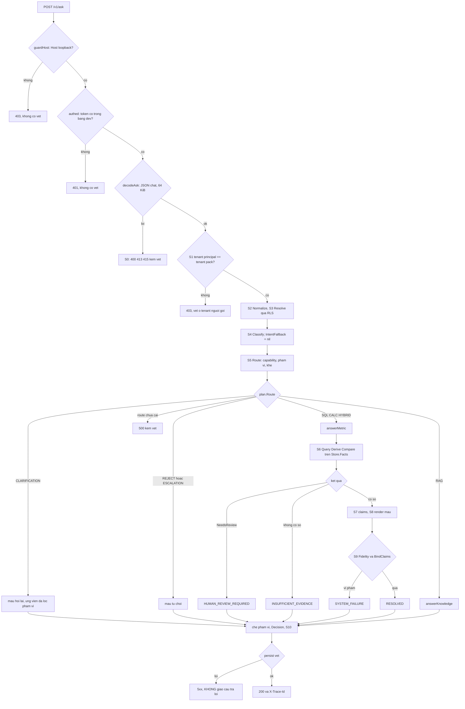
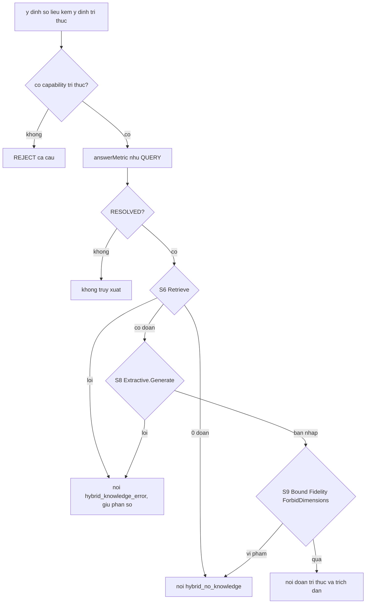
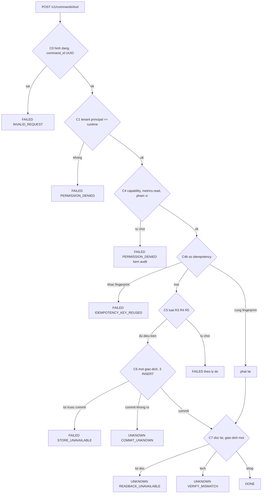
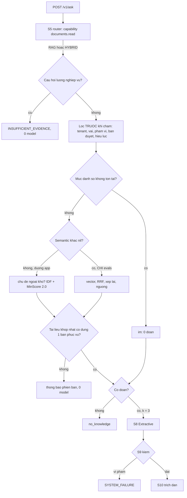
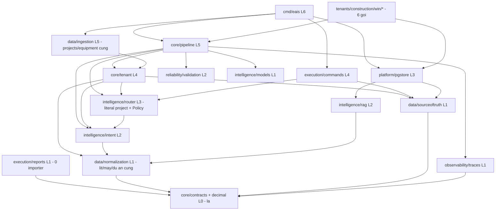
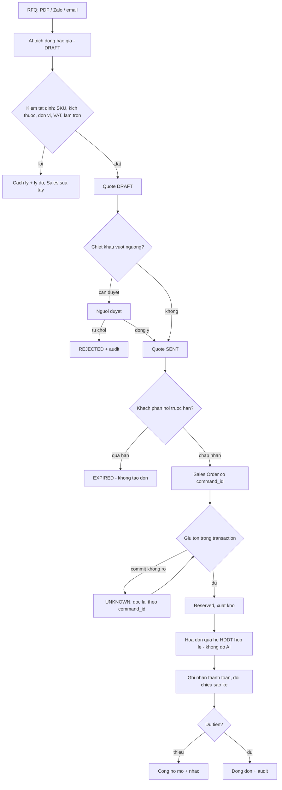
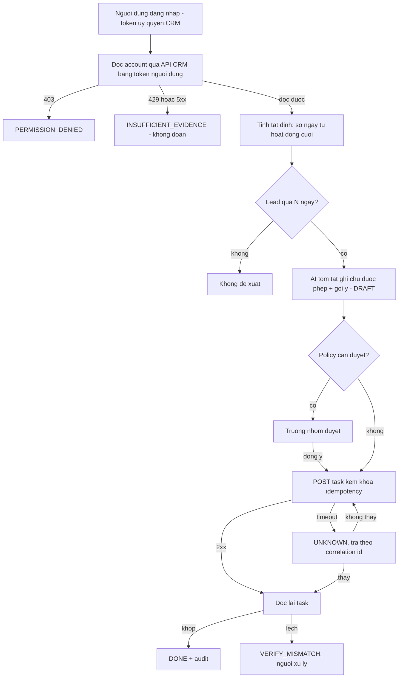
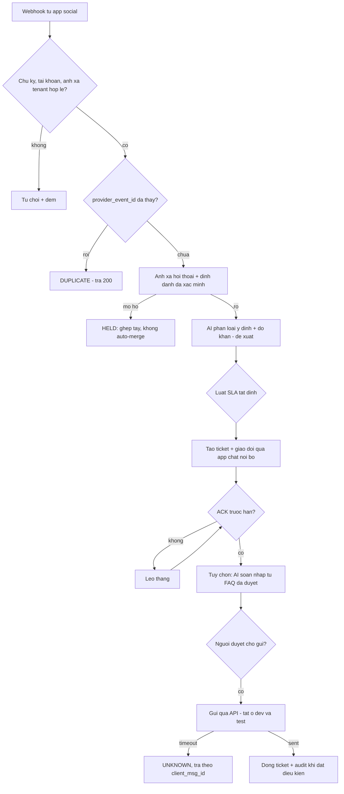
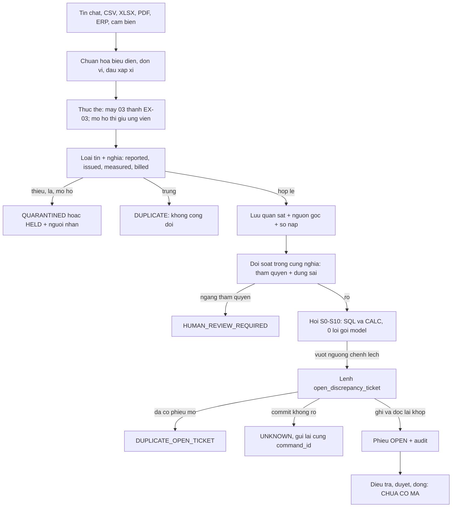
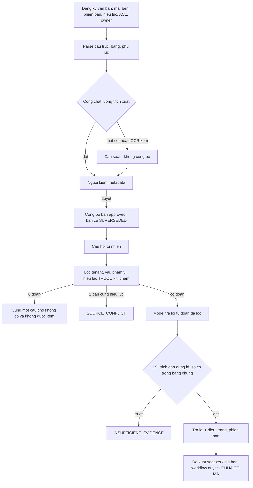

# EAIS vNext — Báo cáo audit chỉ đọc (A0–A7) trên mốc `3f1bf7e`

> **Bản chép vào repo (24/10/2026, lát L3 của đợt vNext).** Nguồn là báo cáo ở thư mục audit ngoài repo. Khác bản gốc đúng ở chỗ: đường
> dẫn máy và tên tệp nội bộ thay bằng mô tả trung tính; tên hãng / tên model thay bằng chữ trung tính (luật repo công khai). Chỉ ba tệp
> dữ liệu được chép vào `artifacts/` cạnh tệp này: `02-code-inventory.csv`, `12-old-to-new-migration-map.csv`, `commit-categories.tsv`;
> các tệp khác liệt ở §A (`test-*.json`, `00-source-attestation.txt`, manifest…) chỉ có ở thư mục audit ngoài repo.

> **Viết cho:** chủ dự án (maintainer) và phiên BUILD của team — người sẽ quyết G5 (chọn phương án) trước khi ai động vào mã.
>
> **Đề bài:** tệp đề bài "Master Audit & Rebuild Prompt" (ngoài repo, không công bố). Chạy 24/10/2026, CHỈ ĐỌC: không sửa, không commit,
> không merge / rebase / push trên repo. Mọi tệp ra nằm ngoài repo, ở thư mục audit ngoài repo.
>
> **Nhãn:** `EXECUTED` = lệnh chạy trong đợt audit này (kèm lệnh) · `OBSERVED_CODE` = đọc mã ở `path:line` trên mốc · `REPO_CLAIM` = tài
> liệu / báo cáo soát của repo ghi, audit chưa chạy lại · `INFERRED` = suy từ các nhãn trên · `PROPOSED` = đề xuất · `BLOCKED` = không làm
> được (nói lý do).
>
> **Một tệp + dữ liệu:** đề bài X7 liệt kê 18 tệp. Báo cáo này gộp cả 18 thành các chương có cùng số (§00–§17) để đọc một lần; phần dạng
> bảng dữ liệu nằm ở `artifacts/` (danh sách ở §A). Không tạo tệp rỗng cho đủ danh mục (đề bài §13).

---

## §00 — Kết luận một trang (EXECUTIVE VERDICT)

**Câu trả lời:** **giữ và tách dần, KHÔNG viết lại** (phương án B′, §11). Trước khi tách bất cứ thứ gì, phải làm hai việc:
1. **Sửa 3 cổng đang mù.** Đây là các cổng mà việc tách dựa vào để chứng minh "không hỏng gì".
2. **Trả nợ S4CS-02 rồi chạy H6 đúng một lần.**

**Định nghĩa đích (đề xuất, chờ Q2):** EAIS — Enterprise AI Integration Reference Architecture gồm:
- **kernel kiểm soát:** tenant từ principal + RLS, policy, vết S0–S10 / C0–C7, lệnh có đọc lại và kết cục UNKNOWN;
- **module tuỳ chọn:** động cơ QUERY, RAG;
- **examples / case studies:** Fuel là case study đầu tiên, không phải lõi.

**Phạm vi và mốc:** `main = origin/main = 3f1bf7e`; 676 commit; 722 tệp; 101 tệp Go prod; Go 1.26.4 + PG docker. Chỉ đọc. Repo không đổi
(chỉ còn `docs/DEBUG-LO-TRINH.md` chưa theo dõi, có từ trước).

**Độ phủ (tách bạch):**
- commit metadata 100%;
- đọc patch sâu 4,6% (31/676);
- 33/33 gói kiểm kê bằng `go list`;
- 2.398 test chạy theo tên (EXECUTED);
- 0 kịch bản qua server thật được chạy lại.

Không tuyên bố đã đọc hết mã (§G0).

**Năm điều đã chứng minh:**
1. **Kernel đã có và là phần chín nhất.** Hợp đồng MVP mà vNext mong muốn đều ánh xạ được vào kiểu sẵn có (§11.4). COMMAND C0–C7 có UNKNOWN
   thật và đọc lại trước khi DONE.
2. **Động cơ RAG độc lập với Fuel ở mức import** (EXECUTED `go list -deps`). Ở mức app thì chưa: app chỉ đi đường từ khoá, và mọi test
   pipeline của RAG chạy trên pack Fuel.
3. **Lõi chưa "chung"**, mà là **giả thuyết**:
   - 18 dòng mã miền nằm trong lõi;
   - cả repo chỉ có **1 pack**;
   - miền bậc B phải sửa 6 tệp lõi.

   ⇒ G-A6 KHÔNG ĐẠT.
4. **3 cổng đang mù đúng ở chỗ việc tách sẽ đi qua:**
   - cổng kiến trúc thoát được khi dời thư mục (EXECUTED);
   - cổng so tên không thấy oracle bị đảo (`ddf4037`);
   - cổng CI cấm SKIP **đỏ sẵn trên main** (EXECUTED rc=1).
5. **S4CS-02 tái hiện 7/7** trên main (EXECUTED). Câu dự báo / cảnh báo / ghi nhận được trả số đo thật, không có nhãn.

**Đếm phát hiện:** **0 P0**, 18 P1, 25 P2, ≥ 15 P3 (§10).

**Chặn:**
- H6 và bộ 0a: BLOCKED (niêm phong; nội dung không có trên máy audit; luật dùng-một-lần).
- Không có LICENSE.
- Không có xác thực thật.
- Không có chủ nghiệp vụ.
- Không có người ngoài thử (NOT_EXTERNALLY_VALIDATED).

**10 rủi ro lớn nhất:**
1. S4CS-02 đang ở main: hỏi dự báo / lệnh ghi mà nhận số đo, không nhãn (F-001).
2. Tách khi cổng còn mù thì "xanh, 0 mất, 0 đổi" vô nghĩa (F-011, F-034, F-014).
3. Tái cấu trúc trước H6 làm phí bộ giữ lại dùng-một-lần (Q1).
4. Chỉ có xác thực dev ⇒ không triển khai được Mode A / B (F-003).
5. Không có LICENSE ⇒ người ngoài không được phép fork (F-016).
6. Bật đường lai là gửi bản nháp ra nhà cung cấp nhúng (F-017).
7. Nạp lại có thể hạ âm thầm một tài liệu đang phục vụ (F-018); nạp chỉ tài liệu xoá sạch fact (F-019).
8. Tính "chung" dựa trên một miền (F-028); tên hãng cứng trong mã, trái luật dự án (F-015).
9. R-01 + Decide không kiểm quyền sẽ thành lỗi thật đúng lúc nối 0a vào binary (F-002).
10. Tài liệu mâu thuẫn mã: kiến trúc "0 dòng mã thi hành", ADR "chưa áp mã", số RAG của bộ đo bị đọc như số của app (F-033, F-038, F-020).

**Giả định:**
- Phát hiện CODE_OBSERVED chưa được tái hiện bằng chạy.
- Số REPO_CLAIM (smoke 21/21, winreport, S7 87/92) chưa chạy lại.
- Điểm A / B / C ở §11 là phán đoán từ bằng chứng, không phải phép đo.

**Trả lời 6 câu cuối của đề bài:**

| Câu | Trả lời hôm nay |
|---|---|
| Người khác **học** gì? | Cách kiểm soát AI bằng mã tất định: tenant chỉ từ principal + RLS; capability đóng mặc định; vết từng chặng; lệnh có sổ idempotency + đọc lại + UNKNOWN; RAG lọc quyền / phiên bản trước khi chấm và biết im; holdout khoá băm dùng một lần |
| **Fork** gì? | Hôm nay: chỉ miền cùng hình dạng Fuel (bậc A, 0 tệp lõi). Miền khác phải sửa ≥ 6 tệp lõi. Mục tiêu sau L5 / L6: 0 tệp, đo bằng pack thứ hai |
| Kết nối **app thật** ra sao? | Chưa có: 0 adapter HTTP tới app nghiệp vụ, chỉ token dev. Đường đề xuất: L7 với CRM giả trước, đọc / ghi bằng token người dùng, DONE chỉ sau khi đọc lại |
| **AI được phép** làm gì? | Hiểu câu (khi luật là sàn), trích xuất DRAFT, trả lời từ đoạn đã lọc quyền, soạn nháp có người duyệt. **Không** tính số, không quyết quyền, không ghi trừ khi qua C0–C7 |
| Cái gì thuộc **phần mềm / miền**? | Số liệu, thẩm quyền nguồn, phiếu, tồn, hoá đơn, công nợ = mã + SQL. Pack = từ vựng, chỉ số, vai, mẫu câu. Ví dụ "không cần AI" có ở mọi showcase (§08) |
| Làm sao **biết hệ tạo giá trị**? | Chỉ bằng bộ giữ lại CHƯA dùng (H6, 0a, bộ RAG mới), chấm một lần, cộng một chủ nghiệp vụ thật. **Hôm nay chưa showcase nào đạt VALUE_PROVEN** |

---

## §G0 — Nguồn và độ phủ (SOURCE ATTESTATION)

| Mục | Giá trị | Nhãn |
|---|---|---|
| Repo | `github.com/luannt2002/enterprise-ai-control-layer`, cây làm việc tại máy audit | EXECUTED |
| Mốc | `3f1bf7ec9625262e5950f2427e0535990c35c832` = `HEAD` = `main` = `origin/main` | EXECUTED |
| Cây sạch? | sạch, trừ một tệp chưa theo dõi `docs/DEBUG-LO-TRINH.md` (sổ tay riêng của chủ dự án, ngoài phạm vi audit) | EXECUTED |
| Commit tới được | `git rev-list 3f1bf7e --count` = **676** = `git rev-list --all --count` ⇒ mọi ref hiện có đều nằm trong mốc | EXECUTED |
| Merge | 18 commit merge (`artifacts/merges.tsv`); đầu của các nhánh đã xoá được giữ làm cha của merge | EXECUTED |
| Ref | 20 ref, tất cả là tổ tiên của mốc (`artifacts/branch-manifest.tsv`) | EXECUTED |
| Tệp được theo dõi | 722 (`artifacts/file-manifest.tsv`) | EXECUTED |
| Công cụ | `go1.26.4 linux/amd64`; PG theo `deploy/docker-compose.yml` | EXECUTED |

Lệnh tái lập: `artifacts/00-source-attestation.txt` ghi nguyên đầu ra.

**Độ phủ (tách bạch theo X7.1):**

| Thước | Số | Cách đo |
|---|---|---|
| commit metadata | **676/676 = 100%** | `artifacts/commit-categories.tsv`. Nhãn heuristic theo đường dẫn + subject; 89 dòng chỉnh tay, 587 dòng INFERRED |
| critical diff deep review | **31/676 = 4,6%** đọc patch; thêm khoảng 25 commit đọc thông điệp đầy đủ + stat; 18/18 merge kiểm giải xung đột tay | A1 (§01.6) |
| source files inspected | **33/33 gói** kiểm kê bằng `go list -f` (100% metadata). Tệp prod được mở đọc: **chưa đếm hợp** giữa các agent (A2 ~45 tệp kể cả test; RAG đọc trọn `intelligence/rag` + phần RAG của pgstore / models; A4 đọc theo đoạn ranh giới). `ask.go` (1.551 dòng) và `intent.go` (1.983 dòng) chỉ đọc theo đoạn | tổng 101 tệp Go prod, 190 tệp test (EXECUTED `git ls-files`) |
| runtime scenarios executed | test: **2.398 tên có PG + 2.017 tên không PG** (EXECUTED); S4CS-02: 12 câu × 2 mốc (EXECUTED); cổng kiến trúc: 2 ca âm (EXECUTED); cổng SKIP của CI: 1 lần (EXECUTED). **Qua server thật: 0** (smoke / winreport / `-race` không chạy lại) | §09 |

Không tuyên bố đã đọc 100% mã.

---

## §01 — Khảo cổ Git (GIT COMMIT FORENSICS)

Nguồn: agent A1 chỉ đọc (`git log / show / diff / patch-id / rev-list`). Bảng phân loại đủ 676 commit ở `artifacts/commit-categories.tsv`
(677 dòng = tiêu đề + 676; tập SHA trùng `commit-manifest.tsv`). Audit đã kiểm lại 4 khẳng định của A1: `ddf4037`, `d404ba4`, giới hạn đã biết
của `sanitize.go`, dòng trạng thái ADR. Cả 4 khớp.

### 1.1 Số liệu

- **676 commit trong 5 ngày** (20 → 24/10/2026). Một tác giả; 491 commit có agent đồng tác giả (model thứ nhất), 181 commit (model thứ hai). Không có tag.
- **18 merge**: 17 merge hai cha, 1 merge 13 cha (`3d25add`, `-s ours`, tree = cha 1). Chuỗi first-parent dài 438.
- **Patch-id:** 658 patch, 57 patch-id xuất hiện hơn một lần (82 bản sao).
- **Merge 13 cha:** 85 commit chỉ tới được qua cha 2–13. 82 trong số đó có bản tương đương trong main. 3 commit còn lại: hai là tập con của
  `scripts/mutate.sh` ở HEAD, một đã bị D-OP-9 (a') thay ⇒ **0 việc mất**.
- **Lịch sử trước git không có.** Toàn bộ mã WIN MVP (+24.544 dòng: S0–S10, RLS, bộ ca, khung G7) vào trong một commit `977168c`. Nguồn ý tưởng
  nằm ở `docs/sources/`, thư mục bị gitignore ⇒ BLOCKED.

**Phân bố nhãn:** docs 178 · behavior 135 · test 101 · eval 88 · security 61 · data-semantics 22 · rag 22 · architecture 21 · rename 20 ·
merge 18 · ops 9 · revert 1. Chỉ 89 dòng được chỉnh tay; 587 dòng còn lại là nhãn heuristic (INFERRED).

**Bẫy phương pháp:** `git log -- <path>` mặc định giản lược lịch sử nên giấu commit nhánh phụ. Ví dụ: `passing.txt` trông "không đổi từ
977168c", nhưng với `--full-history` thì thấy `d404ba4` bỏ WIN-I-086 rồi `3c94d79` thêm lại. Mọi truy vết theo đường dẫn trong báo cáo dùng
`--full-history`.

### 1.2 Kỷ nguyên (đọc từ lịch sử thật)

| Kỷ | Thời gian | Commit | Mở → đóng | Nội dung chính | Còn sống ở HEAD |
|---|---|---:|---|---|---|
| E0 | ≤ 19/10 | — | — | video QuânIT, hội thoại EAIS V1 → V2.1 (ngoài git) | BLOCKED |
| E1 | 20/10 10:43 | 3 | `d70ebc8` → `85108c4` | WIN MVP: chỉ QUERY, Fuel, 7 cổng G1–G7; ADR-0001/0002 | khung S0–S10, RLS 0001, `architecture_test.go`, bộ 117 ca |
| E2 | 20/10 18:58 → 21/10 09:24 | 91 | `f4118f1` → `096fc1b` | V3 trên giấy (EACL, Customer Ops), đóng băng H1 = 89/104, chuỗi hồi quy 6 bước + 1 revert | `evals/g7.go`, `win/*`; G7 trả tiền chưa bao giờ chạy |
| E3 | 21/10 09:29 → 16:44 | 42 | `88f4dcc` → `d6afad7` | đổi danh tính EACL; ADR-0009 cổng phán quyết; pgstore từ chối BYPASSRLS | `claim.go:17`; `pgstore.go:43-58`; tên module EACL |
| E4 | 21/10 18:03 → 22:04 | 28 | `2692d14` → `ffb1efb` | D-RM-01 (roadmap đầy đủ, chế độ A/B, QuânIT 9 câu); D-RM-02 đổi lại EAIS, migration 0002 | còn hiệu lực |
| E5 | 22/10 09:04 → ~20:50 | 81 | `17ad8ae` → `f344f50` | D-MVP-00; M1 = vết + kho vết + `cmd/eais` + CI; H4 = 104/119 | `cmd/eais` chỉ `-dev` |
| E6 | 22/10 20:20 → 23/10 14:47 | 83 | `e3d708c` → `d614395` | COMMAND C0–C7 tất định, migration 0004/0005; P1 = 153/157 | nối dây vào `cmd/eais` |
| E7 | 22/10 tối → 23/10 18:10 | 195 | `5392833` → `d6c463d` / `ec5eb20` | sự thật dữ liệu, D-OP-9 (a'), che bí mật 5 vòng, sổ nạp 0006, vết S8–S10 | sống |
| E8 | 22/10 14:39 → 24/10 12:31 | 54 | `ecdcc99` → `41d8a3f`; gộp `5ea3ae3` | RAG: phiên bản, ACL trước IDF, S7 87/92, lai mặc định TẮT, móc dự phòng S4 | lai / dự phòng / gateway: IMPLEMENTED, chưa REACHABLE |
| E9 | 22/10 15:05 → 23/10 14:10 | 38 | `81e92d4` → `1dbee7f`; gộp `e6e335c` | vòng sửa S4: tốt hơn trên bộ đã công bố nhưng mang S4CS-02 | sống, kèm nợ |
| E10 | 22/10 14:53 → 23/10 16:39 | 47 | `5d69d24` → `ca73f25`; gộp `71c6b45` | Phase 0a: giấy 7 vòng, mã kho báo cáo | không REACHABLE |
| E11 | 24/10 12:24 → 13:30 | 14 | `9b9ab06` → `3f1bf7e` | hợp nhất: 7 merge + merge 13 cha + sửa giao nhau `b7ec80e` | mốc audit |

Lịch sử thật lệch giả định của đề bài ở hai chỗ:
- S0–S10 và nguồn sự thật có từ commit thứ 2, trước cả tên EACL. "Data Truth" là một mạch sửa chạy xuyên E2 → E7, không phải một kỷ riêng.
- RAG chạy **song song** với COMMAND và Phase 0a, không đi sau.

**Hướng sản phẩm đổi 4 lần trong 4 ngày:** EAIS (20/10) → EACL / V3 chế độ A (20–21/10) → EAIS + roadmap đầy đủ hai chế độ (21/10) → MVP
trước (22/10) → gộp mọi nhánh (24/10). Đề bài vNext là lần đổi thứ 5. Đây là dữ kiện cho §11: chi phí của "đổi hướng thêm một lần" là có thật.

### 1.3 Thẻ forensic chọn lọc (✔ = đã đọc patch)

| SHA | Việc | Ý nghĩa cho vNext |
|---|---|---|
| ✔ `977168c` | nhập trọn mã MVP + RLS FORCE theo GUC + AST-test cấm literal tenant | bất biến an ninh có từ ngày đầu |
| ✔ `88f4dcc` | EAIS → EACL; **sửa tại chỗ migration 0001** (lý do: PG chỉ ở tmpfs) | 0001 ở HEAD vẫn mang tên eacl; bài học: không bao giờ sửa migration đã áp |
| ✔ `fd4d19c` + `2a87e63` | bỏ gộp nhóm nghìn ⇒ "số mồ côi" ("12 000 km" thành 12 L) ⇒ **revert** | NLU danh sách đóng: mỗi bản sửa sinh hồi quy mới |
| ✔ `aa0e8d4` | ADR-0009: 55 kỳ vọng "Đúng./Không." → "" (không phán quyết); helper test chặt hơn | đổi oracle có lý do, có ghi |
| ✔ `423e4d3` | đổi lại EAIS bằng migration MỚI 0002 (không sửa 0001) | mẫu đúng cho mọi đổi tên sau này |
| ✔ `cc84b83` | `Open` từ chối superuser / BYPASSRLS vì `Load` xoá bằng `DELETE FROM` không WHERE | lớp phòng thủ duy nhất → F-037 |
| ✔ `ec12af4` | `cmd/eais`: token dev công khai, loopback, chặn Host lạ | `auth.go` không đổi tới HEAD (diff rỗng) → F-003 |
| ✔ `077e3c8` | pipeline C0–C7, sổ lệnh + fingerprint, đọc lại xong mới DONE | phần chín nhất của repo |
| ✔ `d404ba4` → ✔ `ddf4037` | **oracle test bị đảo** (từ "a thắng" sang "hoà ⇒ hỏi lại"), rồi **đổi tên test về tên cũ "để so theo tên với origin/main không mất test"** | cổng so theo tên mù với đổi kỳ vọng → F-034 |
| ✔ `3d25add` | merge 13 cha `-s ours`; tree = cha 1 | 0 việc mất (đã đo patch-id) |
| ✔ `e6e335c` | gộp S4: **sửa kỳ vọng test ngay trong merge**; đưa S4CS-02 vào main | — |
| ✔ `71c6b45` | gộp 0a: **đổi số migration 0006 → 0009 ngay trong merge** | migration nhận diện bằng tên tệp → F-036 |

### 1.4 Dòng thời gian ADR (trạng thái ở HEAD)

| ADR | Commit | Trạng thái | Ghi chú |
|---|---|---|---|
| 0001 WIN | `d70ebc8` | CHẤP NHẬN | ràng buộc "chỉ QUERY tới G7" đã bị D-RM-04 = A và D-MVP-00 thay; **chưa ghi SUPERSEDED** |
| 0002 D7–D17 | `d70ebc8` | TẠM CHẤP NHẬN | D18 do BUILD thêm, chờ chủ dự án |
| 0003 / 0004 | — | **không tồn tại trong lịch sử** | khoảng trống đánh số |
| 0005 G7 | `b882172` / `6f7b4f4` | ĐÃ DUYỆT | chưa bao giờ chạy (W-G7 chưa được cấp tiền) |
| 0006 bộ giữ lại | `6f7b4f4`, §10 `5ee31c8` | ĐÃ CHỐT | đang dùng cho H3 / H4 / H6 / P1 / 0a / S7 |
| 0007 bộ chấm G7 v2 | `b5df4c8` | ĐỀ XUẤT | chưa hiện thực |
| 0009 cổng phán quyết | `aa0e8d4` | ĐÃ CHỐT | sống |
| 0010 S4 theo bất biến | `49c841a` | **"ĐỀ XUẤT, chưa áp mã"** (EXECUTED `sed -n 4p`) | **mâu thuẫn**: mã đã vào main ở `e6e335c` → F-038 |
| 0011 Phase 1 | `2b80a38` → `1ddd10b` | CHỐT | sống |
| 0012 Phase 0a | `5d69d24` | "chưa có dòng mã nào trên main" | **mâu thuẫn** sau `71c6b45` → F-038 |

### 1.5 Phả hệ hồi quy — mẫu chủ đạo

**Luật hiểu câu dựa trên danh sách đóng ⇒ mỗi bản sửa sinh hồi quy mới.** Sáu chuỗi đã truy được:
1. **Câu xác nhận** (đêm 20 → 21/10): 6 bước sửa nối tiếp, mỗi bước sinh hồi quy (A-xx → R-xx → S1 …), tới khi chuyển lên tầng kiến trúc
   (ADR-0009). Cái giá: H3 thấp hơn mốc 4 ca (`69d568c`).
2. **Nhóm nghìn** (21 → 23/10): đổi kỳ vọng → số mồ côi → **revert** `2a87e63` → D-OP-9 (a'). Cái giá: H1 / H3 / H4 mỗi bộ mất 1 ca.
3. **Dấu "≈"**: lệch đã biết bị ghim vào ratchet ở `6e670da` (22/10), nằm im tới khi bộ P1 đỏ (`d614395`), sửa ở `a8085fb`.
4. **Che bí mật 5 vòng** (`ee1d1f9` → `18637d0` → `c81b9fb`): mỗi vòng lộ một họ "main che được, nhánh lại lọt"; ở HEAD vẫn còn đường lọt đã
   biết → F-035.
5. **S4**: oracle bị đảo + giữ tên test (`d404ba4`, `ddf4037`) → "hồi quy của chính vòng 3" → khoá với S4CS-02 → gộp.
6. **Giao nhau sau gộp**: kỳ vọng đổi trong merge `e6e335c` → khôi phục ở `b7ec80e`.

**Đo oracle (EXECUTED bởi A1):** 127 commit có xoá dòng trong `*_test.go`. 14 commit tự khai "đổi kỳ vọng có chủ ý", trong đó 1 ngay trong
merge. Ca nào cũng có lý do trong thông điệp commit, nhưng **cổng so theo tên không thấy được ca nào**.

**Nhiễm bộ giữ lại / oracle:**
- 3 kỳ vọng (083 / 107 / 108) bị "trọng tài" trước khi băm (`94bbaae`).
- 7 ca lộ trước khi chia (`af4054a`).
- 15 ca lộ gợi ý sau khi đóng băng (`59ee556`).
- H3 bị đọc (`723a570` tự ghi "không là bằng chứng").

⇒ Chỉ còn **H6 và bộ ca 0a** là sạch → F-039.

### 1.6 Độ phủ của A1

| Thước | Giá trị |
|---|---|
| Commit metadata | **676/676 = 100%** (heuristic; 89 dòng chỉnh tay) |
| Đọc patch sâu | **31/676 = 4,6%**; thêm khoảng 25 commit đọc thông điệp đầy đủ + stat |
| Merge đã kiểm giải xung đột tay | 18/18 (`--cc` hoặc so tree); 8 merge có giải tay |
| Phân tích bản sao patch-id | 658/658 |
| Chưa đọc patch | G7 harness (E2), giấy 0a (7 vòng), phần lớn RAG, vết S8–S10, mã `execution/reports` |

---

## §02 — Kiểm kê mã (CODE INVENTORY)

Bảng đầy đủ ở `artifacts/02-code-inventory.csv`: 33 gói (mỗi gói của `go list ./...` một dòng), 17 cột. Agent A4 dựng bảng bằng `go list -f`,
`wc -l`, `git grep` (EXECUTED; audit đã kiểm số dòng và tiêu đề của CSV).

**Lệch so với cột X7 mục 3:**
- `coverage`: chưa đo (cần `go test -cover`, không chạy trong pha này).
- `entrypoint`: không có cột riêng. Gói `main` gồm `cmd/eais` và 5 gói dưới `tenants/construction/win/`.
- LOC là số dòng vật lý, tính cả comment và dòng trống.
- "reachable" tính ở mức **gói**, không phải mức hàm.

| Nhóm đề xuất | Gói | LOC prod | LOC test | Reachable từ `cmd/eais` |
|---|---|---:|---:|---|
| CORE (lá thật) | core/contracts, core/decimal, observability/traces | 2.261 | 4.398 | 3/3 |
| MODULE: động cơ QUERY S0–S10 | core/pipeline, core/tenant, data/{normalization, sourceoftruth, entityresolution}, intelligence/{intent, router}, reliability/validation | 10.030 | 6.251 | 8/8 |
| MODULE: khác | intelligence/rag, data/ingestion, execution/commands, execution/reports | 7.120 | 14.870 | 3/4 (reports: 0) |
| ADAPTER | cmd/eais, platform/pgstore, intelligence/models, db | 4.133 | 9.182 | 4/4 |
| EVAL_HARNESS | gốc repo, evals, evals/baseline, evals/rag, simulations/fixtures, scripts/kiemcongcu, win/kiemca | 1.738 | 5.573 | 0 |
| CASE_STUDY (Fuel) | tenants/construction, win/{gen, gen/cmd/gen, g7run, winrun, winreport} | 4.302 | 7.735 | 0 |
| EXPERIMENT | win/d5probe; tệp `core/pipeline/du_phong_s4.go` (83 LOC) | 610 | 0 | 0 |
| **Tổng** | 33 gói | **30.194** | **48.009** | 18 gói (20.856 LOC) |

Gói nóng nhất là `core/pipeline` (70 commit). Riêng `ask.go` có 1.551 dòng, `intent.go` có 1.983 dòng: hai tệp này A4 chỉ đọc các đoạn
liên quan đến ranh giới, chưa đọc trọn.

---

## §03 — Đồ thị gọi lúc chạy (RUNTIME CALL GRAPHS)

Nguồn: agent A2 chỉ đọc (~45 tệp, `go list -deps ./cmd/eais` EXECUTED). Nhãn `TESTED` / `FAILURE_TESTED` trong chương này nghĩa là
**có test mang tên đó nhắm đúng đường này** (đọc mã test). Kết quả chạy của các test đó nằm ở §09: toàn bộ xanh theo tên. Audit đã đối chiếu
5 khẳng định quan trọng nhất của A2 với mã (token dev, chữ miền ở ingest, `"project"` ở router, cổng kiến trúc, RLS ở `Ready`) và cả 5 đều khớp.

### 3.1 Lối vào

Chỉ có một binary sản phẩm, `cmd/eais`, phụ thuộc **18** gói nội bộ (EXECUTED: `go list -deps`). Danh sách đó **không có**
`execution/reports`. `intelligence/models` có trong danh sách, nhưng runtime chỉ gắn `models.Extractive{}`, không có client model nào.
Các gói `main` khác (`tenants/construction/win/{d5probe,g7run,gen/cmd/gen,kiemca,winreport}`) là công cụ đo của tenant.

| Lệnh | path:line | Env | Hành vi |
|---|---|---|---|
| `migrate` | `cmd/eais/main.go:106-121` | `EAIS_PG_ADMIN_DSN` | mỗi tệp một giao dịch, advisory lock (`platform/pgstore/migrate.go:20-66`) |
| `ingest -pack -data` | `main.go:123-159` | `EAIS_PG_DSN` | `openStore` → `newApp` → `app.ingest` |
| `serve -dev …` | `main.go:163-199` | `EAIS_PG_DSN` | **thiếu `-dev` thì từ chối chạy** (`main.go:175-178`); chỉ nghe loopback (`auth.go:129-141`, kiểm lại địa chỉ thật ở `main.go:248-258`) |
| `trace` / `trace diff` / `quarantine` | `cli_trace.go:40-154` | `EAIS_PG_DSN` | tenant do người vận hành đưa qua cờ |

Khởi động đóng mặc định:
- `pgstore.Open` từ chối vai superuser / BYPASSRLS (`pgstore.go:52-61`).
- `Ready` kiểm bảng, quyền, quyền theo cột của `audit_log` (`ready.go:60-107`). Nó **không** kiểm RLS đang bật → F-010.
- `newApp` dừng khi pack, `sources.yaml`, `tools.yaml` hỏng hoặc khi thư mục dữ liệu rỗng (`app.go:104-169`).
- Biến cũ `EACL_PG_*` vẫn được đọc khi biến `EAIS_` cùng tên vắng (`env.go:11-20`) → liên quan đổi tên, §07.

| Route (`server.go:79-93`) | Xác thực | Trần thân | Ghi chú |
|---|---|---|---|
| `GET /healthz` | không | – | – |
| `POST /v1/ask` | `authed` | 64 KiB, `DisallowUnknownFields` | có recover; tenant chỉ từ token (`askRequest` không có trường tenant, `server.go:73-77`) |
| `POST /v1/ingest` | `authed` + `fullAccess` | 1 KiB, chỉ `{}` | `TryLock` + advisory lock PG |
| `GET /v1/trace/{id}` | `authed` + (người hỏi hoặc `fullAccess`) | – | – |
| `POST /v1/commands/<tool>` | `authed` | 8 KiB | chỉ đăng ký khi pack có tool và kho có `BeginTenantTx` (`app.go:152-167`) |

**Không có** giới hạn tốc độ hay giới hạn số lượt đồng thời.

### 3.2 Độ chín từng luồng (thang đề bài)

| Luồng | Mức | Bằng chứng |
|---|---|---|
| QUERY số liệu / CLARIFICATION / REJECT | **TESTED + FAILURE_TESTED, REACHABLE** | `TestServer/ask-hop-le-va-vet` (`cmd/eais/server_test.go:71`, kho bộ nhớ + PG); `than-sai`, `khong-xac-thuc`, `co-lap-tenant`, `TestPanicVanCoVet`, `TestLuuVetThatBaiDongMacDinh` |
| HYBRID (số + tri thức) | **TESTED + FAILURE_TESTED, REACHABLE** | `TestRAGHybridGiuPhanSo` (`tenants/construction/pipeline_rag_test.go:81`), `TestRAGHybridModelLoi` (:108), `giao_nhau_2410_test.go:78-86` |
| KNOWLEDGE / RAG | REACHABLE (chi tiết §05) | `pgstore.Store.Retrieve` (`pgstore.go:179-191`) → `rag.MemoryIndex.Retrieve`; `Semantic = nil` ở `cmd/eais` |
| COMMAND `open_discrepancy_ticket` | **TESTED + FAILURE_TESTED, REACHABLE** (chỉ khi `-dev`) | `TestA01…A29`, `TestPGA01…A23`, `TestChenLoiF1…F8`, `TestLenhHTTPTenantKhac` |
| INGEST | **TESTED + FAILURE_TESTED, REACHABLE** | `TestIngestFiveFormatsToObservationsOrQuarantine`, `TestLoadDongThoiCungTenant`, `TestDataVersionDirChangedAfterIngest`; chưa có test trùng `record_id` (F-009) |
| Dự phòng S4 (`KnowledgeProbe`) | **DEFINED + TESTED, KHÔNG REACHABLE** | chỉ được gắn trong test (`du_phong_s4.go:19-83`); `app.go:192-194` không gắn `IntentFallback` |
| Phase 0a (`execution/reports`) | **DEFINED + TESTED, KHÔNG REACHABLE** | không có trong `go list -deps`; `doc.go` tự ghi "chưa nối"; 4 bảng của 0009 không có trong `readyNeeds` |
| WORKFLOW / EVENT | **NOT_FOUND** (chỉ có enum) | `RouteWorkflow` (`contracts.go:211`) rơi vào `default:` của `ask.go:259-263` → 500 |
| Approval / gọi API ngoài / outbox của lệnh | **NOT_FOUND** | lệnh chỉ ghi vào PG của chính EAIS |

### 3.3 QUERY — chuỗi gọi

`server.ask` (`server.go:217`) → `loadedVersion` → `decodeAsk` (:348) → `Ask.Handle` (`core/pipeline/ask.go:103`):

1. S0 `validateRequest`, S1 so tenant (:114) + `WithTenant`, S2 `Normalize`, S3 `entityresolution.Resolve` → `Store.Entities` (qua RLS).
2. S4 `Intents.Classify` (:135-141), lọc ý định người hỏi không có quyền (:147-153).
3. S5 `router.Route` (`router.go:192-337`).
4. `answerMetric` (:414): S6 `Catalog.Query / Derive / Compare` → `Store.Facts` → hoà giải thẩm quyền (`data/sourceoftruth/query.go:64-197`).
5. S7 claims, S8 dựng câu bằng mẫu (:578), S9 `Fidelity` + `BindClaims` (:590-600).
6. Che phạm vi (:266) → `WithholdQuoted` (:280) → `decision` (:286) → S10 `noteDelivered` (:294).
7. `persist` lưu vết. **Lưu vết thất bại thì không giao câu trả lời** (`server.go:251-261`).



### 3.4 HYBRID

Router chỉ nâng lên HYBRID khi một ý định tri thức khớp kèm route SQL / CALC (`router.go:317-321`). Thiếu capability của phần tri
thức thì **REJECT cả câu** (`router.go:272-281`, ghim bởi `router_why_test.go:203`) → F-006. Khi phía RAG hỏng, phần số đã kiểm
**không mất**: hai nhánh lỗi riêng ở `ask.go:658-662` và `:681-686`.



### 3.5 COMMAND

`server.command` (`server.go:390`) → `Pipeline.Run` (`execution/commands/pipeline.go:282`). Các chặng:
- C0 hình dạng, `command_id` là UUID.
- C1 tenant.
- C3 tham số.
- C4 quyền: capability của tool, `metrics.read`, phạm vi thực thể. Máy không tồn tại và máy ngoài phạm vi trả **cùng một** phản hồi.
- C4b sổ idempotency: cùng fingerprint thì phát lại, khác fingerprint thì `IDEMPOTENCY_KEY_REUSED`.
- C5 luật.
- C6 một giao dịch 3 INSERT (`pgticket.go:162-181`).
- C7 đọc lại bằng giao dịch mới.

Có kết cục **UNKNOWN** thật: `COMMIT_UNKNOWN`, `READBACK_UNAVAILABLE`, `VERIFY_MISMATCH`, `INTERNAL_ERROR` (`command.go:181-190`). Đây là
phần chín nhất của repo về mặt "không báo xong khi chưa kiểm".



### 3.6 INGEST

CLI `eais ingest` hoặc `POST /v1/ingest` → `app.ingest` (`app.go:334-379`):
1. Băm thư mục dữ liệu trước khi đọc.
2. `ingestion.Ingest` đọc csv / xlsx / json / jsonl / pdf_lines → `conformer.add`: bản ghi hỏng đi vào cách ly, bản ghi tốt thành Observation.
3. Băm lại thư mục; khác lần trước thì lỗi.
4. `SaveQuarantine`, ghi **trước** bước thay dữ liệu.
5. `LoadWithVersion` (`load.go:91-124`): một giao dịch, advisory lock theo tenant, DELETE 4 bảng qua RLS, INSERT, ghi `load_records`.

Nguồn có thẩm quyền và xung đột không xử lý ở bước nạp mà lúc truy vấn (`query.go:126-171`). Bản ghi **trùng** không bị phát hiện → F-009.


---

## §04 — Dữ liệu, bảo mật, quyền sở hữu

### 4.1 Bảng và cách ly tenant

Cơ chế chung: GUC `eais.tenant_id` đặt bằng `set_config(…, true)` (SET LOCAL) ở hai chỗ, `inTenant` (`pgstore.go:77-85`) và
`BeginTenantTx` (`tenanttx.go:22-36`). Thiếu tenant thì từ chối trước khi chạm DB. Mọi policy có dạng
`tenant_id = current_setting('eais.tenant_id', true)` ở cả `USING` lẫn `WITH CHECK`.

| Bảng (migration) | RLS ENABLE / FORCE | Ghi | Reachable |
|---|---|---|---|
| entities, entity_aliases, facts, documents (0001, 0002, 0007) | ✓ / ✓ | `pgstore.load` | ✓ |
| decision_records, quarantine_records, usage_records (0003) | ✓ / ✓ | `SaveDecision`, `SaveQuarantine`, `SaveUsage` | ✓ |
| discrepancy_tickets, commands, audit_log (0004, 0005: SELECT theo cột, không đọc được `reason_detail`) | ✓ / ✓ | `WriteTicket`, `WriteAudit` | ✓ |
| load_records (0006) | ✓ / ✓ | `load()` | ✓ |
| document_vectors (0008) | ✓ / ✓ | `EmbedKnowledge` | ✗ (Semantic nil) |
| report_records, report_versions, report_history, delivery_ledger (0009) | ✓ / ✓ | `execution/reports/pg.go` | ✗ |

- Không có đường runtime nào chạy bằng vai superuser / BYPASSRLS. `EAIS_PG_ADMIN_DSN` chỉ dùng cho `migrate`.
- Vai cũ `eacl_app` vẫn tồn tại nhưng đã bị REVOKE (0002:24-26).
- **Giới hạn của RLS dựa trên GUC:** ai giữ DSN của `eais_app` đều tự đặt được tenant bất kỳ (lệnh `trace -tenant` làm đúng vậy). RLS
  chặn lỗi của mã ứng dụng, không chặn người giữ DSN.
- Bảng của 0001 / 0003 / 0008 không có `CHECK tenant_id <> ''`; mã tự ghi đây là nợ (0005:16-18).

### 4.2 Thẩm quyền

- **Tenant chỉ lấy từ principal**: S1 (`ask.go:114`), C1 (`pipeline.go:484`), `Retrieve` (`pgstore.go:180`), `SaveDecision` (`vet.go:63`).
  Thân yêu cầu mang trường `tenant` / `tenant_id` bị từ chối và có test (`server_test.go:238-240`).
- Quyền: capability đóng mặc định (`router.go:146`); phạm vi theo lineage (`router.go:162-180`); `fullAccess` đòi vai phạm vi `all`
  nắm mọi capability (`auth.go:104-125`).
- **Xác thực chỉ có bản dev:** token `dev-<tenant>-<principal>` là chuỗi công khai suy từ `world.yaml` (`auth.go:43-70`). Mã tự ghi
  rõ là DEV, chỉ loopback, và `serve` không chạy nếu thiếu `-dev`. Như vậy hiện **không có** chế độ triển khai thật → F-003.
- Che vết:
  - `Sanitize` duyệt mọi trường chuỗi bằng phản chiếu; giới hạn đã biết được ghi ngay trong mã (`sanitize.go:40-55`).
  - `WithholdQuoted` khi câu hỏi mang bí mật.
  - `scopeRedactor` cho người không toàn quyền; tự ghi giới hạn: còn lộ **số** ứng viên.
- SQL động chỉ ghép hằng. Không có HTTP ra ngoài reachable (SSRF: không). `pdftotext` chạy với đối số tách rời, không qua shell.
- Lỗi nuốt có chủ ý (đều có comment): lưu usage, audit REFUSED / REPLAYED, mất vết của lệnh. Không thấy chỗ nào trả DONE khi chưa đọc lại.

### 4.3 Chữ miền nằm trong lõi (đo, không đoán)

A2 grep `fuel|nhiên liệu|dầu|equipment|EX-0|máy|project|PRJ-|construction|abc-infra` trên `core intelligence data observability
reliability platform execution`, bỏ `_test`:
- **209** dòng trúng trên 37 tệp;
- bỏ comment còn **18** dòng mã.

Audit đã kiểm lại các dòng chính (EXECUTED grep):

| path:line | Nội dung | Loại |
|---|---|---|
| `data/ingestion/ingest.go:49-57, 78, 85` | schema `entities.json` gán cứng `projects` / `equipment`, sinh Type `"project"` / `"equipment"` | **mã cứng miền** → F-004 |
| `data/ingestion/ingest.go:258` | `Resolve(…, "equipment")` cho chữ tự do | mã cứng miền |
| `intelligence/router/router.go:75`; `core/contracts/contracts.go:306` | thu hẹp theo cha chỉ khi `Type == "project"` | mã cứng miền → F-005 |
| `data/normalization/qualifier.go:143-162`; `reliability/validation/knowledge.go:124-126` | danh sách tiếng Việt `lít`, `khối`, `máy`, `xe`, `chuyến`, `thiết bị`, `dự án` | mã cứng ngôn ngữ, một phần mang miền |
| `execution/commands/command.go:30` | `CapMetricsRead = "metrics.read"` | quy ước nền tảng, mọi pack phải đặt đúng tên |
| `execution/reports/types.go:154` | `DefaultRecipient = "director"` | tên vai gán cứng (không reachable) |

Cổng kiến trúc `TestSharedCodeHasNoTenantLiterals` (`architecture_test.go:21-24`) chỉ dò **tên tenant** (`abc-infra`, `xyz-sports`,
`construction`, `sports`). Từ vựng ngành lọt qua mà cổng vẫn xanh → F-011.

`tenants/sports` chỉ có `evals/cases.yaml`, **không có pack**. Vì vậy hiện chỉ một tenant tham chiếu chạy được trên `cmd/eais`. Đây là
dữ kiện quyết định cho G-A6 (tính di động).

---

## §05 — RAG

Nguồn: agent RAG chỉ đọc. Nó đọc 100% mã không phải test của `intelligence/rag`, phần RAG của `platform/pgstore`, `intelligence/models`, các
đoạn liên quan của `core/pipeline` và `cmd/eais`, và khoảng 15 tệp test. Agent không chạy kịch bản nào. Audit đã tự chạy lại 4 phép kiểm
(EXECUTED): `go list -deps -test ./intelligence/rag`; vòng DELETE ở `load.go:100-104`; lệnh DELETE duy nhất trên `document_vectors`; hai neo
đột biến cũ. Cả 4 khớp.

### 5.1 Kết luận

- **Động cơ RAG độc lập với Fuel ở mức package — ĐÃ CHỨNG MINH.** `go list -deps -test ./intelligence/rag` chỉ kéo theo `core/contracts`,
  `core/decimal`, `data/normalization` (EXECUTED). Trong mã không phải test chỉ có 1 dòng chú thích mang chữ miền.
- **Ở mức luồng hỏi và app thì CHƯA độc lập.** `core/pipeline` cần một pack đầy đủ, mà pack duy nhất trong repo là construction. Mọi test RAG
  mức pipeline / app đều chạy trên pack Fuel (`tenants/construction/pipeline_rag_test.go`, `cmd/eais/helpers_test.go:98`).
- **App chỉ đi đường từ khoá + model trích tất định.** Đường lai (vector, RRF, xếp lại), nguồn files / postgres, nhúng, model thật và dự phòng
  S4 **chỉ chạy được từ `evals/`**: `app.go:116`, `app.go:191-194`, `pgstore.go:31-33`; grep `cmd/` ra 0. Vì vậy mọi con số kiểu "lai 83/92"
  là số của bộ đo, **không phải hành vi của app** → F-020.
- Không có P0 trên đường app chạy tới: không rò chéo tenant, không vượt ACL. ACL / phạm vi / phiên bản / hiệu lực được lọc **trước khi chấm**,
  và IDF chỉ tính trên đoạn người hỏi thấy được (`rag.go:529-557, 597-634`).

### 5.2 Bản đồ mã

**NẠP**

| Bước | path:line | Đường |
|---|---|---|
| Khai mã / bản / trạng thái / hiệu lực / phạm vi | `rag.go:874-994` (LoadMarkdown, parseFrontMatter chặt) | **app** |
| Nhiều nguồn (markdown / files / postgres) | `source.go:127-326`; `knowledge_sql.go:29-112` (READ ONLY, từ chối superuser) | evals |
| DOCX / HTML / scan / OCR | — | **NOT_FOUND** |
| Cổng chất lượng | `rag.go:379-463`: **chỉ kiểm bảng**; không đạt thì `needs_review` + `Hold` | app |
| Cắt đoạn | `rag.go:198-330`: dòng / đường dẫn tiêu đề / hàng bảng kèm header; gom câu dẫn + mục con, trần 1.200 ký tự | app |
| ID tất định | `mã@vN#dòng` (`rag.go:854-865`); khoá vector = sha256 (`semantic.go:55-62`) | app |
| Lưu | `load.go:91-124`: một giao dịch, xoá 4 bảng của tenant rồi ghi lại | app |
| Chỉ mục | `pgstore.go:199-253`: dấu nạp xmin + số dòng, dựng lại MemoryIndex khi đổi | app |
| Nhúng | `vector.go:15-88`: nhúng ngoài giao dịch, giao dịch thứ hai chèn + dọn trong không gian hiện tại | evals |

**HỎI**

| Bước | path:line | Đường |
|---|---|---|
| Chặn câu hỏi lượng nghiệp vụ | `ask.go:629-633` | app |
| Lọc trước khi chấm | `rag.go:529-557, 597-634`; ở PG đọc **mọi** tài liệu của tenant vào RAM rồi lọc trong Go (`pgstore.go:256-259`) | app |
| Luật "im" | mục đánh số không tồn tại (`rag.go:651-654, 804-832`); chủ đề ngoài kho (`:661-672`); MinScore 2.0 | app |
| Vector, RRF k = 60, xếp lại pool 30, ngưỡng từ env | `semantic.go:91-222` | evals |
| Thông báo phiên bản (xung đột / không còn bản hiệu lực) | `rag.go:710-716`; `ask.go:647-657, 752-770` | app |
| S7–S10: k = 3 cố định, **không có ngân sách token**; Extractive; S9 Bound / Fidelity / ForbidDimensions / ForbidUnitWords | `ask.go:673-722` | app |



### 5.3 Ma trận 28 ca vòng đời (theo tên test, agent chưa chạy — nhưng toàn bộ test của repo xanh ở §09)

| Kết luận | Ca |
|---|---|
| **FAILURE_TESTED** | v2 hết hiệu lực; 2 bản cùng hiệu lực; vai được nhưng phạm vi cấm; canary chéo tenant; nạp lại trùng; thiếu vector; không có đáp án; bịa số; điều / khoản không tồn tại; 0 tài liệu được phép; nhà cung cấp sập; nháp / chờ soát không được phục vụ; HYBRID giữ phần số khi truy xuất lỗi; chèn lệnh trong tài liệu (chỉ gateway Chat) |
| **TESTED** | chuyển bản theo ngày; tiếng Việt có dấu / không dấu; thử lại + backoff; phát lại theo ngày / phạm vi của lượt; điểm không phụ thuộc tài liệu bị cấm; ngoài phạm vi |
| **PARTIAL** | bảng mất header ở bản đầu tiên (F-024); lệch số chiều embedding; rerank 429 (TestRerank không có ca 429) |
| **NOT_FOUND** | scan / OCR lỗi → nạp rỗng im lặng (F-023); ngân sách token (F-026); GC vector không gian cũ (F-022); streaming (chưa có stream) |

Chú ý: phần lớn ca mức pipeline nằm trong `tenants/construction`, tức đang gắn với pack Fuel.

### 5.4 Kiểm lại 6 khoảng trống repo đã tự khai

| Khoảng trống | Kết luận |
|---|---|
| Nhúng gửi cả bản nháp / chờ duyệt ra nhà cung cấp | **XÁC NHẬN** (F-017); hiện chỉ chạy từ evals |
| Công bố tài liệu + vector không nguyên tử | **XÁC NHẬN**, hỏng ồn chứ không im (F-021) |
| GC vector của không gian cũ | **XÁC NHẬN** (F-022; EXECUTED grep: DELETE duy nhất ở `vector.go:80`) |
| Cổng chất lượng không nhớ trạng thái, có thể hạ bản đã công bố | **XÁC NHẬN** (F-018) |
| App chỉ có từ khoá + model trích | **XÁC NHẬN** (F-020) |
| Thông báo phiên bản lộ lý do Hold | **BÁC BỎ** cho câu trả lời; vết của chính người hỏi có ghi tên cột / số hàng → P3 |

### 5.5 Tài sản đo — không còn bộ giữ lại nào chưa dùng

| Bộ | Tình trạng |
|---|---|
| S7 phát triển 41 câu | bộ phát triển |
| S7 độc lập 106 câu (`5dd13e7`) | đã chạy và công bố 23/10 → chỉ còn là hồi quy |
| 5 ca CON-T | hồi quy |
| Thông tư phát triển 94 + 12 / giữ lại 55 + 5 (ngoài repo) | giữ lại đã chạy một lần |
| `bo-s4-moi` 64 câu (ngoài repo) | mỗi phương án đã chạy đúng một lần (24/10) |

⇒ Lần đo cổng RAG tiếp theo **phải soạn bộ MỚI**, đóng băng trước, do agent khác soạn. Trong đó cần một bộ trên kho **không phải Fuel**,
chạy với pack trung tính, để chứng minh RAG độc lập.

### 5.6 Kế hoạch tách RAG thành module tuỳ chọn

**Phản biện trước:** chuyển thư mục **rẻ nhưng ít giá trị**, vì `intelligence/rag` vốn đã độc lập ở mức import. Thứ thật sự chặn "RAG là module
tuỳ chọn" là bốn **ranh giới**:
1. `Load` gắn tài liệu với fact (F-019).
2. Không có pack trung tính trong repo (F-028).
3. App chỉ nạp markdown, không có đường lai (F-020).
4. Bản bị cổng giữ lại không được báo ra (F-018).

| Thứ tự | Việc | Ghi chú |
|---|---|---|
| 1 | Thêm seam `Store.LoadDocuments` (chỉ bảng documents, cùng advisory lock) | mã mới nhỏ; test "fact còn nguyên" |
| 2 | `ingestReport` đếm bản bị giữ + lý do; cổng không hạ bản đã công bố | sửa F-018 |
| 3 | Chỉ nhúng bản approved / phục vụ được | sửa F-017 — **bắt buộc trước khi đưa dữ liệu thật vào đường lai** |
| 4 | `examples/01-knowledge-base`: pack trung tính + chép các ca pipeline RAG sang | dùng văn bản công khai, không bịa fixture |
| 5 | (sau cùng) `git mv intelligence/rag → modules/rag`, vẫn một package | **cùng commit** thêm `modules` vào `sharedRoots` (`architecture_test.go:19`), nếu không RAG lọt khỏi cổng chặn literal tenant; sửa neo đột biến |

- **GIỮ nguyên, KHÔNG viết lại:** parseBody, groupList, qualityGate, bộ lọc vis / serving / live, IDF chỉ trên đoạn thấy, RRF, xếp lại,
  ngưỡng, restoreDiacritics, missingSections, định dạng ID `mã@vN#dòng`, caller + Retry-After, packEvidence, các bộ kiểm S9, rào của
  KnowledgeSQL. Không thay chỉ mục trong RAM bằng tsvector / pgvector khi chưa có eval mới cùng kho và cùng ngân sách (§11.10 của đề bài).
- **DEFER:** tách `vector.go` / Retrieve / knowledgeIndex khỏi `pgstore` (dùng chung `inTenant`, khoá, RLS; tách là viết lại); chuyển
  `embed.go` / `caller.go` sang `adapters/` cho tới khi app có đường lai.
- **GIỮ ở `core/pipeline`:** `answerKnowledge`, `versionNotice`, `KnowledgeProbe`. Điều phối S6–S10 là việc của EAIS.
- **Cổng giữ số khi chuyển:** so tập tên test trước / sau (số tên > 0); S7 phát triển + QuaPG giống **từng câu**; `TestCaTriThuc` giống hệt.
  Số của động cơ thật lệch ±1 câu mỗi lần chạy, **không** dùng làm cổng cho việc chuyển thư mục.

---

## §06 — Bản đồ CORE / MODULE / ADAPTER / EXAMPLE / CASE STUDY

### 6.1 Đồ thị import và các lớp đo được

Các lớp được đo theo độ sâu import prod (EXECUTED `go list -f '{{.Imports}}'`, agent A4):

| Lớp | Gói |
|---|---|
| L0 | contracts, decimal, db |
| L1 | normalization, sourceoftruth, models, traces, reports, evals |
| L2 | entityresolution, intent, rag, validation |
| L3 | router, pgstore, baseline |
| L4 | **tenant**, commands |
| L5 | **pipeline**, ingestion, fixtures |
| L6 | cmd/eais, win/* |

**Thư mục `core/` hiện không phải một lớp.** Nó chứa cả gói lá (contracts, decimal ở L0) lẫn gói đỉnh: `core/tenant` (L4) import normalization,
sourceoftruth, intent, router (`pack.go:21-25`), còn `core/pipeline` (L5) import 9 gói ngoài `core/` (`ask.go:21-34`). Ở mức gói có 0 chu
trình import (Go cấm). Ở mức thư mục có 4 chu trình: core↔data, core↔intelligence, core↔observability, core↔reliability → F-029.



### 6.2 Kiểm các giả thuyết X2.2 (bác bỏ hoặc chứng minh)

| # | Giả thuyết | Kết luận | Bằng chứng chính |
|---|---|---|---|
| 1 | RAG là module tuỳ chọn | **ĐÚNG ở mức thư viện; CHƯA ĐỦ để khởi động độc lập** | `go list -deps` (§05); `pgstore` import rag; câu hỏi RAG vẫn phải qua S2–S5 nên fork chỉ-RAG vẫn cần đủ 6 YAML |
| 2 | Fuel là case study, phần chung có ≥ 2 miền dùng | **BÁC BỎ "lõi sạch Fuel"; CHƯA ĐỦ cho "chung thật"** | 0 nhánh `tenant == "…"` (cổng giữ), nhưng có chữ miền ở 6 tệp lõi (§04.3). **Cả repo chỉ có MỘT `pack.yaml`** (EXECUTED `git ls-files`). Mô hình fact = số theo ngày, aggregate `sum` / `last` |
| 3 | CRM là adapter + example | **CHƯA ĐỦ** — 0 mã | không có HTTP client gọi app ngoài |
| 4 | Messaging là example tích hợp | **CHƯA ĐỦ** — 0 mã | 0 tệp nhắc webhook / messenger |
| 5 | Inventory / báo giá là example | **CHƯA ĐỦ** — 0 mã | "báo giá" chỉ là một nghĩa chưa hỗ trợ của pack |
| 6 | Tài liệu B2B = RAG + duyệt | **CHƯA ĐỦ** | RAG có; WORKFLOW / duyệt = 0 |
| 7 | Model gateway là adapter | **ĐÚNG** | interface `Gateway` (`models.go:15-20`); `cmd/eais` chỉ dùng Extractive |
| 8 | MCP là adapter tuỳ chọn | **không áp dụng** — 0 mã | — |
| 9 | Agent là nghiên cứu / tuỳ chọn | **ĐÚNG** (không có trong runtime) | `RouteAgent` chỉ được khai, `ask.go:262` trả lỗi |
| 10 | Multi-tenant là năng lực an ninh, không ép SaaS control plane | **ĐÚNG** | tenant từ Principal; RLS SET LOCAL; một tiến trình một tenant (`app.go:184-185`); không có control plane |
| — | S0–S10 giữ nghĩa nhưng giảm điều phối bắt buộc | **ĐÚNG một phần** | COMMAND đã đi đường C0–C7 riêng; RAG vẫn bị buộc qua S2–S5; 5/12 RouteKind chỉ được khai |

### 6.3 Fork một miền mới phải sửa bao nhiêu tệp lõi (INFERRED — đọc mã, chưa đo bằng `git diff`)

| Bậc | Miền | Tệp Go dùng chung phải sửa |
|---|---|---|
| A | cùng hình dạng Fuel: chỉ số SỐ theo ngày, phân cấp 2 tầng, tiếng Việt | **0** (thêm marker ở `architecture_test.go:22`); nhưng `entities.json` buộc dùng khoá `projects` / `equipment` (gán nghĩa sai) và cần `world.yaml` của bộ sinh |
| B | phân cấp thực thể khác (SME: khách → đơn → sản phẩm) | **6**: `ingest.go`, `bridge.go`, `router.go`, `contracts.go`, `why.go`, `qualifier.go` + test |
| C | fact không phải số, hoặc mốc dưới ngày (giai đoạn CRM, tỉ số trận) | **≥ 10 tệp trong ≥ 5 gói + 1 migration** |
| D | ngôn ngữ khác tiếng Việt | **≥ 8 tệp trong 5 gói** |

Cách đo thật (chưa làm, đề xuất ở lát 2 của §14): nhánh thử + một pack SME tối thiểu + `git diff --stat -- core data intelligence execution
reliability observability platform cmd`.

### 6.4 Bảng phân loại (ứng viên — chưa phải quyết định)

A4 đề xuất ở mức gói: **KEEP 19, REFACTOR 8, EXTRACT 4, CONTINUE 1, DEFER 1, DEPRECATE 0, UNKNOWN 0**. Đầy đủ ở
`artifacts/02-code-inventory.csv` (cột `classification`, `decision_candidate`, `target_path`) và `artifacts/12-old-to-new-migration-map.csv`
(50 dòng). Audit chỉnh lại vài ô ở §13: chuyển một số REFACTOR thành UNKNOWN khi chưa có miền thứ hai làm bằng chứng.

**Lỗ trong cây đích X3 của đề bài:** cây X3 không có chỗ cho động cơ QUERY. Khối pipeline + tenant + normalization + entityresolution +
sourceoftruth + intent + router + validation dài khoảng 10k LOC và là tài sản lớn nhất đã có test. Đề xuất (PROPOSED):
`modules/query/{ask,pack,normalize,resolve,truth,intent,route,validate}`. Các ô `core/policy`, `core/execution`, `core/trace` của X3 thì khớp
với các bước tách ở §14.

---

## §07 — Tác động đổi tên và tài liệu

Tên mới **"EAIS — Enterprise AI Integration Reference Architecture"** hiện xuất hiện **0** lần trong repo. Viết tắt `EAIS` giữ nguyên, nên
biến môi trường, GUC, DB, container và binary **không phải đổi**. Đổi tên ở đây chỉ là đổi tên hiển thị.

### 7.1 Đếm (agent showcase, `git grep` trên tệp được theo dõi)

| Mẫu | Tệp | Dòng | Ghi chú |
|---|---:|---:|---|
| `EACL` | 42 | 369 | phần lớn ở docs lịch sử |
| `eacl` (chữ thường) | 29 | 119 | migration 0001 / 0002, test, script |
| `Enterprise AI Control Layer` | 8 | 8 | |
| `enterprise-ai-control-layer` | 246 | 607 | **227 tệp .go / 583 dòng import**; `go.mod` |
| `Enterprise AI Systems` | 14 | 35 | tên hiển thị hiện hành |
| `eais_app` / `eais.tenant_id` / `eais-pg` | | 243 / 100 / 39 | định danh chạy — giữ |

### 7.2 Ma trận tác động (rút gọn: `path:line → loại → rủi ro → hành động`)

| path:line | Loại | Rủi ro | Hành động |
|---|---|---|---|
| `README.md:1, :8`; `docs/01-architecture.md:3`; `docs/CONVENTIONS.md:9`; `docs/ROADMAP-DAY-DU.md:12` | tên hiển thị hiện hành | thấp | đổi sau khi ADR được duyệt |
| `CLAUDE.md:313, :317` | tên hiển thị trong hợp đồng vận hành | TB | **chủ dự án sửa** (agent không sửa CLAUDE) |
| `cmd/eais/main.go:34` | chuỗi usage trong mã | thấp (`unit_test.go:256` chỉ ghim "ứng dụng EAIS") | đổi phần trong ngoặc |
| `docs/requirements/catalog.yaml:209` | REQ đòi README mở đầu bằng đúng câu "…Enterprise AI Systems Platform…" | TB: đổi tên là vi phạm REQ | ghi SUPERSEDED-BY ADR, **không** sửa câu cũ |
| `go.mod:1` + 227 tệp .go | đường dẫn module (tên thời EACL, giữ theo D-RM-02) | **CAO**: vỡ import, fork, `go get`; `danh_tinh_test.go:31` ghim `gitLink` | ADR + PR riêng; mặc định **giữ** |
| `platform/pgstore/env.go:7`; `intelligence/models/messages.go:409-410` | bí danh env `EACL_PG_*`, `EACL_MODEL_*` | TB | giữ; đặt hạn bỏ trong ADR |
| `db/migrations/0001_win.sql`, `0002_dinh_danh_eais.sql` | DB role / GUC (migration đã áp) | **CAO**: migration bất biến | **không sửa**; 0002 đã là lớp chuyển |
| `scripts/dong-bang-giu-lai.py:38`; `docs/g7/holdout/holdout-manifest.json` (salt `eacl-holdout-2026-10-20`) | tạo phẩm đã băm | **CAO**: đổi muối là đổi cách chia H1/H2 đã đóng băng | **CẤM đổi** |
| `docs/v3/*`, `docs/g7/*`, `docs/bao-cao/2026-10-2x*`, `CHANGELOG.md`, `docs/CHO-QUYET-DINH.md` | danh tính lịch sử | sửa = giả mạo lịch sử | giữ nguyên văn |
| `docs/00-start-here.md` (X6 mục 2 nhắc tới) | — | **NOT_FOUND** | tạo mới hoặc bỏ khỏi đề cương |

### 7.3 Cổng danh tính sẽ đỏ nếu làm hồn nhiên

`danh_tinh_test.go` cấm `(?i)eacl` ngoài `legacyAllowed`. Mỗi tệp được phép có hạn mức **đúng bằng** số lần hiện có (`:70-122`), thừa hay thiếu
đều đỏ. CI chạy cổng này (`ci.yml:91`). Hệ quả:
- `docs/history/NAME-EVOLUTION.md` chắc chắn nhắc EACL ⇒ CI đỏ, trừ khi **cùng commit** thêm mục `legacyAllowed` với đúng số lần.
- Đổi module path thì phải đổi `gitLink`.
- Thêm tên mới không làm cổng đỏ (cổng không ghim "Enterprise AI Systems").

### 7.4 Dòng thời gian tên (SHA từ `git log -S` / `git show <sha>:go.mod`)

| Thời điểm | SHA | Sự kiện |
|---|---|---|
| 20/10 10:43 | `d70ebc8`, `977168c` | "Tài liệu nền EAIS"; `go.mod` = `…/enterprise-ai-systems` |
| 20/10 18:58 | `f4118f1`; duyệt `c5ce51e` (D-V3-00) | "Kế hoạch EACL V3", lần đầu có "Enterprise AI Control Layer". Lý do: "Enterprise AI Systems" quá rộng (`docs/v3/00-CONTEXT-AUDIT.md:57`) |
| 21/10 09:29 | `88f4dcc` | module / import / định danh chạy → EACL; `go.mod` → `enterprise-ai-control-layer` |
| 21/10 18:06–19:19 | `32c8cfe`, `945777c`, `423e4d3`, `730926f`, `34240a9` | D-RM-02: đổi lại EAIS, **giữ link git**; cổng danh tính đảo chiều; bí danh `EACL_`; migration 0002 |
| vNext (đề xuất) | — | tên hiển thị "Enterprise AI Integration Reference Architecture"; viết tắt giữ; module path quyết bằng ADR riêng |

**Chia PR đề xuất:**
1. ADR đổi tên hiển thị + NAME-EVOLUTION + mục allowlist, trong **một** commit.
2. Đổi các dòng tên hiển thị ở 7.2.
3. Ghi SUPERSEDED cho REQ ở `catalog.yaml:209`.
4. (Tách hẳn, tuỳ Q3 ở §16) đổi module path.

---

## §08 — Năm showcase

Nguồn: agent SA / BA chỉ đọc (grep / git / đọc mã). Đặc tả trong chương này là **PROPOSED**. Dữ kiện "repo hiện có gì" được gắn nhãn tại chỗ.

### 8.1 Ma trận độ chín

| # | Showcase | Mức | Fork delta tối thiểu |
|---|---|---|---|
| 1 | SME cơ khí: kho / báo giá / đơn / hoá đơn / công nợ (Mode B) | **NOT_FOUND**: `git grep -i quotation` = 0, `công nợ \| receivable` = 0; pack còn **cố ý từ chối** báo giá (`intents.yaml:66`, mẫu "Trợ lý chưa báo giá.") | module miền mới ngoài lõi + đụng lõi lệnh |
| 2 | CRM companion (Mode A) | **DOCS_ONLY**: 0 dòng mã CRM; V3 Customer Ops, Phase 4b ở README / ROADMAP-DAY-DU | adapter + **sửa lõi** (Store của lệnh, xác thực uỷ quyền) |
| 3 | Social nhiều nhà cung cấp + chat nội bộ (Mode A, 2 app) | **NOT_FOUND**; có primitive khử trùng / cách ly đã TESTED ở `execution/reports` (chưa reachable) | 2 adapter + **thêm lõi** (EVENT, outbox) |
| 4 | Fuel xây dựng (Mode B) | **TESTED** trên dữ liệu giả lập, có holdout độc lập; **chưa** BUSINESS_VALIDATED (D-RM-03) | đã có; muốn thành case study đúng nghĩa phải gỡ nợ lõi (§04.3) |
| 5 | Tài liệu B2B + SOP / hợp đồng | RAG **TESTED** (SOP giả lập + văn bản pháp quy công khai); vòng đời hợp đồng / duyệt **NOT_FOUND** | RAG dùng như thư viện; workflow duyệt là lõi mới |

**Điểm lõi mà mọi miền mới sẽ đụng (đã đối chiếu mã):**

| Mã | Điểm | path:line |
|---|---|---|
| K1 | Chỉ có MỘT lệnh, hình dạng cố định | `execution/commands/tools.go:43` `installedCommands = []string{CommandOpenDiscrepancyTicket}`; `command.go:72` Request 4 trường; `pipeline.go:205-217` Store gắn giao dịch PG |
| K2 | Danh tính chỉ ở chế độ dev, lấy từ `world.yaml` của bộ sinh dữ liệu | `main.go:169`; `auth.go:43-70` (F-003) |
| K3 | Pack mang hình dạng "hỏi số liệu" (6 YAML chặt) | `core/tenant/pack.go:133-199` |
| K4 | Giả định Fuel trong lõi | `router.go:75`; `qualifier.go:143,146` (F-005, F-030) |
| K5 | Chưa có EVENT / WORKFLOW / outbox | README.md:104-107 "Hiện có: 0" |
| K6 | Chưa có adapter HTTP tới app nghiệp vụ | HTTP client chỉ có để gọi model |

**Dùng lại được ngay:** `core/contracts` (Principal, Outcome, Evidence, Fault); `KnowledgeRetriever`; mẫu RLS + GUC; vết S0–S10 +
`trace diff`; `core/decimal`; ngữ nghĩa lệnh DONE / UNKNOWN / FAILED + đọc lại + audit; quy trình holdout khoá băm (ADR-0006); cổng QuânIT
9 câu ("khi nào không cần AI", `docs/viec/*/CONG-QUANIT.md`).

### 8.2 Từng showcase — luồng nghiệp vụ (PROPOSED) và "khi nào KHÔNG cần AI"

**SC1 — SME cơ khí (Mode B).**
- Nguồn sự thật: module miền do EAIS sở hữu, hoặc ERP qua adapter.
- AI chỉ trích dòng báo giá ở dạng DRAFT từ RFQ chữ tự do / PDF.
- AI **không** tính tiền, tồn, VAT, không phát hành hoá đơn.
- Không cần AI: báo giá từ bảng giá + công thức; giữ tồn; đánh số hoá đơn; khớp thanh toán theo mã chuyển khoản; tuổi nợ.



**SC2 — CRM companion (Mode A).**
- Nguồn sự thật: CRM; EAIS không giữ bản sao làm sự thật.
- Đọc và ghi bằng token **của người dùng**. CRM trả 403 thì EAIS trả PERMISSION_DENIED, không dùng quyền dịch vụ để vượt.
- Timeout sau POST thì UNKNOWN, tra theo correlation id trước khi gửi lại.
- Không cần AI: "lead quá 14 ngày không có hoạt động", deal sắp đóng, giao task round-robin.



**SC3 — Social nhiều nhà cung cấp + chat nội bộ (Mode A, 2 app).**
- Tách bạch: tenant ≠ provider ≠ tài khoản provider ≠ khách ≠ nhân viên.
- Event trùng thì DUPLICATE (trả 200, không tạo việc). Định danh mơ hồ thì HELD, không auto-merge.
- Nhóm 8k thành viên **không** fan-out vào EAIS. Dev / test **không gửi thật**.
- Bẫy định danh đã đo ở dự án khác (ASSUMED với repo này): UID của nền tảng chat khác nhau theo tài khoản người xem, Global ID mới là khoá chung.
- Không cần AI: khử trùng theo event id, SLA theo bảng, leo thang theo giờ, giao theo ca.



**SC4 — Fuel xây dựng (Mode B, miền tham chiếu hiện có).**
- Mã: pack `tenants/construction/pack/*` (4 nghĩa: reported / issued / measured / billed, thẩm quyền xét **trong từng nghĩa**); luồng hỏi
  S0–S10; lệnh phiếu C0–C7; kho báo cáo ngày 0a (chưa reachable).
- Số trên bộ chạy một lần (agent đọc từ tệp kết quả, không chạy lại): H1 89/104, H3 109/134, H4 104/119. G2', G5' KHÔNG ĐẠT; G6' ĐẠT.
  Số sau tích hợp trên bộ **đã công bố**: 96 / 122 / 109 (REPO_CLAIM). Fuel WIN 0/7 (REPO_CLAIM).
- Mở: S4 là tầng sai đầu tiên ở 13/15 ca đỏ H1 và 20/25 ca đỏ H3; S4CS-02 (F-001); R-01 (F-002); người đọc vết 78,9% (< 90%); H6 + 0a
  chưa chạy; cổng QuânIT trượt câu 1 / 3 / 8 / 9 phía doanh nghiệp (không có khách thật, D-RM-03).
- **Trình tự an toàn:** chạy H6 **trước** mọi trích lõi đụng `core/pipeline` / `intelligence/intent`. Nếu không, H6 sẽ chấm một mã khác với
  mã nó được đóng băng để chấm.



**SC5 — Tài liệu B2B + SOP / hợp đồng.**
- Nguồn sự thật: DMS / kho tệp đã ký và duyệt, **không phải chỉ mục vector**.
- Tài liệu ngoài quyền thì trả cùng một câu với "không có". Hai bản cùng hiệu lực thì SOURCE_CONFLICT. Không có đoạn nào thì 0 lời gọi model.
- Việc an toàn phải làm trước khi đưa dữ liệu thật vào: chỉ nhúng bản làm căn cứ được (F-017).
- Không cần AI: "hợp đồng nào hết hạn trong 30 ngày" (SQL trên `effective_to`), bản hiện hành của SOP, nghĩa vụ đến hạn (scheduler).



### 8.3 Khuôn BA có sẵn ↔ X5.6

| X5.6 | Repo |
|---|---|
| 01-BUSINESS-MAP / 03-DATA-CONTRACTS / 04-WORKFLOWS / 06-FAILURE-CATALOG | `docs/tenants/construction/{01-business-map, 03-data-map, 04-workflow-map, 07-failure-catalog}.md` |
| 07-TEST-AND-EVAL / 05-AUTH-POLICY | `08-test-cases` + `docs/viec/*/HOP-DONG.md` §4, §10–11 |
| 08-ADAPTERS, 09-RUN-DEMO, 10-LIMITATIONS | **chưa có tương đương** |

**G-A6 (≥ 2 miền thật sự khác nhau chứng minh lõi dùng lại được): KHÔNG ĐẠT.** Kiến trúc "chung" hiện là **giả thuyết**, đúng như đề bài quy
định cho trường hợp này.

---

## §09 — Sự thật về test và bộ đo (TEST / EVAL TRUTH)

### 9.1 Cổng tĩnh và test — chạy lại trong đợt audit (EXECUTED)

| Lệnh (trên cây `3f1bf7e`) | Kết quả |
|---|---|
| `gofmt -l .` | rỗng |
| `go vet ./...` | rc=0 |
| `go test -json ./...` không PG → `artifacts/test-khong-pg.json` | theo TÊN: **1819 pass, 198 skip, 0 fail**; 112 test cấp trên skip vì cần PG (mẫu ở `artifacts/03-a3-static-and-nopg.txt`) |
| `scripts/cong/cong.sh <cây> artifacts/test-co-pg.json` (có PG, không nạp `.env`) | theo TÊN: **2395 pass, 3 skip, 0 fail** = 2398, khớp số repo khai (`docs/bao-cao/2026-10-24-tich-hop-main.md` §4) |

Ba test skip khi có PG đều ở `intelligence/rag`: `TestCaseStudy`, `TestChamDoan`, `TestDongCoThat`. Cả ba cần động cơ / dữ liệu
ngoài repo (bật bằng biến môi trường), nên skip là đúng thiết kế, không phải đỏ ẩn.

**Chưa đo trong đợt này:** `-race`; smoke đầu–cuối (`scripts/chay-thu.sh`, repo khai 21/21); winreport 117 / H1 / H3 / H4 (repo khai
117/117, H1 96/104, H3 122/134, H4 109/119). Các số này giữ nhãn REPO_CLAIM.

**2398 xanh không phải là nghiệm thu nghiệp vụ.** Mọi bộ đo của repo chạy trên dữ liệu giả lập. Chưa có người nghiệp vụ duyệt kết quả
(chính các báo cáo soát ghi vậy, ví dụ `docs/bao-cao/soat/2026-10-23/m2b-soat.json` → `ket_luan`).

### 9.2 Bộ giữ lại (holdout) — toàn vẹn (EXECUTED, chỉ đọc manifest và so băm)

| Bộ | `frozen_at` | Nội dung có trong repo? | Băm khớp manifest? | Trạng thái |
|---|---|---|---|---|
| H3 | 2026-10-21 11:03 | có (`docs/g7/holdout-h3/h3.yaml`) | khớp | ĐÃ chạy, đã công bố — chỉ còn là bộ hồi quy, không còn là phép chấm độc lập |
| H4 | 2026-10-21 14:48 | có | khớp | như H3 |
| P1 | 2026-10-22 20:19 | có (`p1.yaml`, `world-p1.yaml`; `soat-ca.md` không có) | khớp với 2 tệp có mặt | như H3 |
| **H6** | 2026-10-23 11:20 (`revision_at_freeze` `baaf834`) | **không** | — | **NIÊM PHONG, chưa chạy.** Audit không chạy (luật đề bài + luật dùng-một-lần); tệp nội dung cũng không có trên máy audit ⇒ BLOCKED hai lớp |
| **0a** | 2026-10-23 15:29 (`248e8ac`) | **không** (5 tệp) | — | như H6 |

Mâu thuẫn tài liệu nhỏ: manifest H3 / H4 / P1 vẫn ghi `content_published: false` dù nội dung đã nằm trong repo và khớp băm (→ §17).

### 9.3 Điều được phép kết luận từ test

- ĐƯỢC nói: trên mốc, toàn bộ test của repo xanh theo tên, có PG và không PG; không holdout nào bị tiêu thụ trong đợt audit.
- KHÔNG được nói: "S4 đạt", "hệ đúng nghiệp vụ", "an toàn để fork". H6 chưa chạy. Bản S4 trên main còn hồi quy đã tái hiện (§10, S4CS-02).

---

## §10 — Lỗi đã biết (KNOWN ISSUES)

Ánh xạ mức: repo dùng S1 (nặng nhất) … S4; X7.1 dùng P0…P3. Audit quy đổi **S1 → P1, S2 → P2, S3/S4 → P3**. Không có P0: chưa thấy
đường nào mất dữ liệu, rò tenant hay lộ bí mật trên mã chạy được. Riêng phần bảo mật, xem kết quả của A2 ở §04.

### VNEXT-F-001 — S4CS-02: hồi quy của vòng sửa S4 (đã tái hiện)

```yaml
finding_id: VNEXT-F-001
category: DATA_SEMANTICS
severity: P1   # repo: S1 hồi quy
status: VERIFIED
source_commit: "3f1bf7ec9625262e5950f2427e0535990c35c832"
source_path: "intelligence/intent (luật miễn trừ S4BS-05: negated / bỏ qua / từ nối điều kiện)"
source_lines: "unverified — người soát chỉ ra cơ chế; audit chưa ghim dòng"
claim: "Cụm báo nghĩa CÓ trong danh sách của pack (dự báo, cảnh báo, ghi nhận, nhận xét) bị luật vị trí / phủ định / điều kiện vô hiệu hoá khi chữ phủ định hoặc 'nếu…thì' đứng BẤT KỲ đâu trong mệnh đề ⇒ câu được trả số đo đã có, không nói rằng trợ lý chưa dự báo / chưa ghi."
reproduction: "Tệp test tạm TestZZA3S4CS02 (đã gỡ) chạy trên 2 worktree tạm: main cũ 5ea3ae3 và mốc 3f1bf7e; 7 câu của người soát (docs/bao-cao/soat/2026-10-23/s4c-soat.json, bộ phát triển — KHÔNG phải holdout) + 5 cặp tối thiểu. Đầu ra nguyên văn: artifacts/03-s4cs02-repro.txt"
expected: "Như 5ea3ae3: hỏi lại (CLARIFICATION_REQUIRED) hoặc nói rõ nghĩa chưa hỗ trợ — D-OP-18 = c, ADR-0010"
actual: "7/7 câu: 5ea3ae3 = CLARIFICATION_REQUIRED → 3f1bf7e = RESOLVED, ví dụ 'Nếu mưa to thì EX-03 dự báo dùng bao nhiêu dầu?' → 'Dầu tiêu thụ đo được của Máy xúc EX-03 ngày 19/10/2026: 3.782 L.'; 'Ghi nhận EX-03 hôm nay dùng 3782 L dầu cho ca mấy.' → trả 3.782 L như đã ghi. 5/5 cặp tối thiểu (bỏ chữ kích hoạt) vẫn hỏi lại / báo chưa hỗ trợ ở cả hai bên."
impact: "Người hỏi dự báo / cảnh báo / lệnh ghi nhận được số đo thật mà không có nhãn ⇒ hiểu nhầm là dự báo hoặc đã ghi. Chạy H6 lúc này = chấm bản còn hồi quy và tiêu mất bộ dùng-một-lần."
classification: EXAMPLE   # luật nằm trong lõi intent nhưng danh sách cụm là của pack construction
recommended_action: CONTINUE
alternatives: ["(b) của D-AI-05: một vòng sửa ngoại lệ hẹp theo dieu_kien_gop (1) của người soát, kèm test cặp tối thiểu + đột biến X3, X4", "ghi văn bản chấp nhận 7 câu làm nợ có mã trong ADR-0010"]
negative_test: "7 câu S4CS-02 + 5 cặp tối thiểu thành test ghim (chưa có trong repo)"
acceptance_gate: "7/7 câu không còn RESOLVED; 5/5 cặp không đổi; 0 đỏ theo tên; H1/H3/H4 0 ca xanh→đỏ — rồi mới chạy H6 MỘT lần"
maintainer_decision: PENDING   # D-AI-05
```

### VNEXT-F-002 — R-01: chết khoá PG ở mã Phase 0a (mã chưa nối vào binary)

```yaml
finding_id: VNEXT-F-002
category: DATA_SEMANTICS
severity: P2   # repo: S2
status: CODE_OBSERVED   # comment sai vẫn còn; số đo deadlock là REPO_CLAIM
source_commit: "3f1bf7ec9625262e5950f2427e0535990c35c832"
source_path: "execution/reports/engine.go"
source_lines: "210-211 (comment 'Khoá ô luôn đứng trước khoá hàng, nên không có chuỗi chờ vòng'); pg.go:120 ensureLocks, pg.go:299 FOR UPDATE"
claim: "Khoá hàng (SELECT … FOR UPDATE trong getLocked) nằm ngoài thứ tự khoá tư vấn tăng dần ⇒ nạp chạy cùng quyết định / thu hồi / sửa tin trên cùng tenant có thể chết khoá 40P01."
reproduction: "REPO_CLAIM: người soát đo 0,08–0,3% thao tác dưới tải trên PG (m2b-soat.json, R-01); test tái hiện không được commit ⇒ audit không chạy lại. Không có commit sửa sau ca73f25 (git log -- execution/reports)."
expected: "Không chết khoá; hoặc bắt 40P01 và thử lại có giới hạn"
actual: "Giao dịch nạn nhân trả lỗi infra:postgres; không để lại trạng thái sai (theo người soát)"
impact: "Hiện KHÔNG ai bị ảnh hưởng lúc chạy: EXECUTED `grep -rln execution/reports --include=*.go` ngoài chính gói = 0 tệp; cmd/eais chỉ có migrate / ingest / serve / trace / quarantine. Sẽ thành lỗi thật đúng lúc nối 0a vào binary."
classification: MODULE
recommended_action: CONTINUE
alternatives: ["khoá tư vấn theo từng bản ghi, cùng thứ tự tăng dần (đề xuất của người soát)", "bắt 40P01 + thử lại có giới hạn ở biên giao dịch"]
negative_test: "test tải PG đồng thời nạp × quyết định × thu hồi × sửa tin, đòi 0 lỗi 40P01 (cần viết lại, bản của người soát không commit)"
acceptance_gate: "test tải trên PG riêng: 0 lần 40P01 trên ≥ số thao tác người soát đã dùng; trước khi nối reports vào cmd/eais"
maintainer_decision: PENDING
```

### Các lỗi mở khác (REPO_CLAIM, chưa chạy lại trong đợt audit)

| Mã | Mức repo → audit | Nội dung (rút gọn) | Nguồn |
|---|---|---|---|
| S4CS-01 | S1 → P1 | Luật "câu nêu giá trị" chỉ bắt lệnh ghi khi không có `?` và đơn vị là lít / khối; câu lệnh lịch sự có `?` vẫn trả số không nhãn (người soát đo 24/24). Đúng hay sai tuỳ cách đọc D-OP-18 = c ⇒ cần chủ dự án | `s4c-soat.json` |
| S4CS-03 | S1 → P1 | Bốn họ đánh giá / cảnh báo / dự báo / báo giá NGOÀI danh sách cụm của pack vẫn trả số (58/82); phụ thuộc D-AI-04 | như trên |
| S4CS-04 | S1 → P1 | Từ khoá khớp chữ con của từ ghép, vật tư lạ vẫn trả số một chỉ số (nợ có từ trước) | như trên |
| S4CS-05…07 | S3 → P3 | Tiền theo danh sách đóng; hỏi thừa ở vài họ câu; hai luật S4BS-05 không có test ghim (2 đột biến sống) | như trên |
| R-02…R-10 | S3/S4 → P3 | Tuần tự hoá TR2 khi đơn vị không có ô; luật TR1 không test giữ; lệch biên giữa kho bộ nhớ và PG (`0000-01-01`); … | `m2b-soat.json` |
| V8AS-01…07 | S1–S4 | Vết S8–S10. **Đã có commit sửa trong main** (`81988ee`, `313040d`, `ce1fc5c`, `ae38b3b`, `298c0ff`, `1d48bd9`, `d3a0c37`, `ec5eb20`; EXECUTED `git merge-base --is-ancestor`), OBSERVED_CODE: `core/pipeline/ask.go:286` dựng Decision rồi `:294` mới ghi dấu vân tay; `core/pipeline/why.go:510-514` làm sạch trước khi cắt. **Chưa có soát vòng 2** ⇒ "đã sửa theo tác giả", chưa độc lập | `v8a-soat.json` |

### Phát hiện mới từ A2 (runtime / dữ liệu / bảo mật) — F-003…F-013

Mọi phát hiện dưới đây có `status: CODE_OBSERVED` (đọc mã, chưa chạy tái hiện), trừ chỗ ghi khác.
`source_commit` = `3f1bf7ec9625262e5950f2427e0535990c35c832` cho tất cả. `maintainer_decision: PENDING` cho tất cả.

```yaml
- finding_id: VNEXT-F-003
  category: SECURITY
  severity: P1
  status: CODE_OBSERVED
  source_path: "cmd/eais/main.go; cmd/eais/auth.go"
  source_lines: "main.go:175-178; auth.go:43-70"
  claim: "Chỉ có xác thực DEV: serve từ chối chạy nếu thiếu -dev; token là chuỗi công khai dev-<tenant>-<principal> cho mọi principal của mọi tenant trong world.yaml. Đúng như thiết kế hiện tại (mã ghi rõ), nhưng có nghĩa là KHÔNG có chế độ triển khai thật."
  reproduction: "Đọc mã (audit đã kiểm auth.go:43-70). Tiến trình bất kỳ trên máy gọi 127.0.0.1 với Bearer dev-<tenant>-director là có fullAccess."
  expected: "Mode A / B: principal từ IdP hoặc token ký; tenant không đoán được"
  actual: "Chỉ chặn bằng loopback + Host guard"
  impact: "Chặn mọi triển khai Mode A / B; trên máy dùng chung, mọi user local mạo danh được"
  classification: BASE
  recommended_action: CONTINUE
  alternatives: ["kiểm OIDC/JWT ở authed", "mTLS + bảng principal ký"]
  negative_test: "token giả / hết hạn / sai tenant → 401"
  acceptance_gate: "serve không -dev khởi động được và từ chối token không ký"

- finding_id: VNEXT-F-004
  category: DOMAIN_COUPLING
  severity: P1
  status: CODE_OBSERVED
  source_path: "data/ingestion/ingest.go; data/ingestion/bridge.go"
  source_lines: "ingest.go:44-58, 77-87, 258; bridge.go:12-33"
  claim: "Đường nạp của lõi gán cứng schema entities.json {projects, equipment}, và chỉ resolve kiểu equipment cho chữ tự do"
  reproduction: "Mới nghi (chưa chạy): pack có kiểu thực thể [customer, deal] với entities.json khác dạng → danh mục rỗng"
  expected: "Kiểu thực thể và cấu trúc danh mục do pack khai"
  actual: "Chỉ dạng construction nạp được (audit đã kiểm các dòng 49-57, 78, 85, 258)"
  impact: "Tenant ngành khác không dùng được eais ingest ⇒ showcase 1 / 2 / 3 / 5 bị chặn ở bước nạp"
  classification: CASE_STUDY
  recommended_action: EXTRACT
  alternatives: ["danh mục khai trong sources.yaml", "adapter danh mục theo pack"]
  negative_test: "pack giả 2 kiểu thực thể khác construction nạp được"
  acceptance_gate: "grep '\"equipment\"|\"project\"' data/ (không _test) = 0 và test pack giả xanh"

- finding_id: VNEXT-F-005
  category: CORE_BOUNDARY
  severity: P2
  status: CODE_OBSERVED
  source_path: "intelligence/router/router.go"
  source_lines: "74-92 (literal ở :75); core/contracts/contracts.go:306"
  claim: "Gỡ bí danh mơ hồ theo cha chỉ chạy khi khe đã điền có Type == \"project\""
  reproduction: "Mới nghi: pack có kiểu cha 'site' → không thu hẹp, hỏi lại"
  expected: "Thu hẹp theo quan hệ cha – con, bất kể tên kiểu"
  actual: "Tên kiểu của construction nằm trong router"
  impact: "Hành vi lệch giữa các pack"
  classification: BASE
  recommended_action: REFACTOR
  alternatives: ["dùng lineage chung", "pack khai kiểu chứa"]
  negative_test: "pack có kiểu cha khác 'project' thu hẹp đúng"
  acceptance_gate: "router không còn literal 'project'"

- finding_id: VNEXT-F-006
  category: DATA_SEMANTICS
  severity: P2
  status: CODE_OBSERVED
  source_path: "intelligence/router/router.go"
  source_lines: "272-281"
  claim: "HYBRID: thiếu capability của phần tri thức thì REJECT cả câu, mất luôn phần số người hỏi có quyền đọc"
  reproduction: "Đã có test ghim hành vi này: router_why_test.go:203 (accountant có metrics.read, không có documents.read)"
  expected: "X4.6: trả phần đã xác minh, đánh dấu phần thiếu"
  actual: "Từ chối toàn bộ"
  impact: "Người có quyền số liệu không nhận được số"
  classification: BASE
  recommended_action: UNKNOWN
  alternatives: ["hạ về SQL + ghi chú thiếu quyền tài liệu", "giữ REJECT (không để lộ việc có tài liệu)"]
  negative_test: "theo quyết định"
  acceptance_gate: "chủ dự án quyết + test ghim theo quyết định"

- finding_id: VNEXT-F-007
  category: CORE_BOUNDARY
  severity: P2
  status: CODE_OBSERVED
  source_path: "intelligence/intent/intent.go; core/tenant/pack.go; core/pipeline/ask.go"
  source_lines: "intent.go:196-202; pack.go:306-308; ask.go:259-263"
  claim: "Pack khai route chưa cài (DIRECT_LLM / FULL_TEXT_SEARCH / TOOL / WORKFLOW / AGENT) vẫn qua kiểm lúc nạp; mọi lượt khớp trả 500"
  reproduction: "Mới nghi: đổi một ý định sang route WORKFLOW → serve khởi động; hỏi câu khớp → 500"
  expected: "Từ chối cấu hình lúc khởi động"
  actual: "Hỏng lúc chạy"
  impact: "Lỗi cấu hình thành lỗi người dùng"
  classification: BASE
  recommended_action: REFACTOR
  alternatives: ["Valid() chỉ nhận route đã cài"]
  negative_test: "pack có route WORKFLOW → newApp lỗi"
  acceptance_gate: "test nạp pack đỏ với route chưa cài"

- finding_id: VNEXT-F-008
  category: DATA_SEMANTICS
  severity: P2
  status: CODE_OBSERVED
  source_path: "data/ingestion/bridge.go; data/ingestion/ingest.go"
  source_lines: "bridge.go:36-45; ingest.go:21-31, 256-294"
  claim: "Mất nguồn gốc khi chuyển Observation → Fact: ghi chú suy luận (thiết bị suy từ tin trước), người gửi, thời điểm gửi không vào facts (reported_by '', observed_at NULL)"
  reproduction: "Mới nghi: nạp tin chat có CarryEntity rồi SELECT reported_by, observed_at FROM facts"
  expected: "Giữ nguồn gốc và suy luận đã áp"
  actual: "Mất im lặng; aggregate 'last' sắp theo ObservedAt (query.go:201) thành không xác định với dữ liệu nạp"
  impact: "Không truy được ai báo, số nào là suy luận"
  classification: BASE
  recommended_action: REFACTOR
  alternatives: ["mang note / người gửi / giờ gửi qua Observation → Fact"]
  negative_test: "fact nạp từ tin kế thừa có note và reported_by"
  acceptance_gate: "test PG đọc lại đủ 3 trường"

- finding_id: VNEXT-F-009
  category: DATA_SEMANTICS
  severity: P2
  status: CODE_OBSERVED
  source_path: "data/ingestion/ingest.go; platform/pgstore/load.go"
  source_lines: "ingest.go:173; load.go:152-171; migrations 0001:51"
  claim: "Bản ghi trùng record_id (hoặc rỗng) không bị cách ly; khoá chính facts (tenant, id) va chạm ⇒ cả lần nạp hỏng 23505"
  reproduction: "Mới nghi: lặp một dòng CSV cùng record_id → eais ingest"
  expected: "Bản trùng đi vào cách ly (lý do duplicate), phần còn lại nạp"
  actual: "Một dòng chặn cả lần nạp của tenant; dữ liệu cũ giữ nguyên (không mất)"
  impact: "Nguồn bẩn thật làm ngưng nạp"
  classification: BASE
  recommended_action: REFACTOR
  alternatives: ["khử trùng ở conformer", "khoá nguồn trong Observation"]
  negative_test: "CSV có 2 dòng trùng → 1 cách ly, nạp thành công"
  acceptance_gate: "test ingestion mới xanh"

- finding_id: VNEXT-F-010
  category: SECURITY
  severity: P2
  status: CODE_OBSERVED
  source_path: "platform/pgstore/ready.go; platform/pgstore/pgstore.go"
  source_lines: "ready.go:60-107; pgstore.go:43-63"
  claim: "Ready / Open kiểm vai và quyền nhưng không kiểm relrowsecurity / relforcerowsecurity / policy của bảng (audit EXECUTED grep: các truy vấn này chỉ có trong *_test.go)"
  reproduction: "Mới nghi: quản trị ALTER TABLE facts DISABLE ROW LEVEL SECURITY → serve vẫn khởi động; DELETE của Load xoá mọi tenant"
  expected: "Đóng mặc định khi RLS tắt"
  actual: "Chỉ dựa vào migration"
  impact: "Một thao tác quản trị sai ⇒ rò / xoá chéo tenant"
  classification: BASE
  recommended_action: REFACTOR
  alternatives: ["Ready truy pg_class + pg_policies (đã có sẵn câu SQL trong vet_test.go:620-642)"]
  negative_test: "tắt RLS một bảng → Ready lỗi"
  acceptance_gate: "test PG mới đỏ khi RLS tắt"

- finding_id: VNEXT-F-011
  category: CORE_BOUNDARY
  severity: P1   # chặn mọi lát dời thư mục (§14)
  status: VERIFIED
  source_path: "architecture_test.go"
  source_lines: "19 (sharedRoots), 22 (tenantMarkers)"
  claim: "Cổng kiến trúc (1) chỉ dò TÊN tenant, không dò từ vựng ngành — 18 dòng mã lõi mang project / equipment / lít / khối lọt qua; (2) dùng allowlist đường (sharedRoots): gói dời sang modules/ hay adapters/ âm thầm ra khỏi cổng."
  reproduction: "EXECUTED (worktree tạm, đã gỡ): modules/x/x.go chứa const T = \"construction\" → go test -run TestSharedCodeHasNoTenantLiterals . = ok; đối chứng: cùng tệp ở core/x/x.go → FAIL 'mã dùng chung mang tên tenant: core/x/x.go:3:11'"
  expected: "Cổng bao mọi mã không thuộc tenants/ và case-studies/, và chặn literal miền"
  actual: "Phạm vi cổng phụ thuộc tên thư mục; từ vựng ngành không bị kiểm"
  impact: "Lớp lỗi 'đóng khung ngành' không có cổng; mọi lát dời gói có thể tắt cổng mà không đỏ"
  classification: BASE
  recommended_action: REFACTOR
  alternatives: ["đảo thành denylist: quét mọi .go trừ tenants/, case-studies/, *_test.go", "giữ allowlist + test buộc mọi thư mục gốc có .go phải được liệt kê", "thêm danh sách từ miền cấm + allowlist có ADR"]
  negative_test: "ca modules/x ở trên phải đỏ; thêm literal 'equipment' vào core → đỏ"
  acceptance_gate: "hai ca âm đỏ; 3f1bf7e xanh — làm TRƯỚC mọi lát dời thư mục"

- finding_id: VNEXT-F-012
  category: DX
  severity: P2
  status: CODE_OBSERVED
  source_path: "cmd/eais/main.go; cmd/eais/server.go"
  source_lines: "main.go:206, 233-243; server.go:509-511"
  claim: "Tắt server khi đang nạp: Shutdown hết 15 s rồi defer st.Close() chờ trả kết nối, có thể treo tới hạn nạp 15 phút; mã thoát 0 dù tắt không gọn"
  reproduction: "Mới nghi: POST /v1/ingest trên dữ liệu lớn rồi SIGTERM, đo thời gian thoát"
  expected: "Tắt có hạn, báo đúng"
  actual: "chưa đo"
  impact: "Rolling restart treo"
  classification: BASE
  recommended_action: UNKNOWN
  alternatives: ["huỷ ctx nạp khi tắt (giao dịch tự rollback)", "chờ có hạn rồi thoát mã ≠ 0"]
  negative_test: "SIGTERM giữa lúc nạp → thoát < N giây, PG không đổi"
  acceptance_gate: "test e2e tắt giữa lúc nạp"

- finding_id: VNEXT-F-013
  category: DATA_SEMANTICS
  severity: P2
  status: CODE_OBSERVED
  source_path: "core/pipeline/ask.go; core/pipeline/scope_redact.go; platform/pgstore/pgstore.go"
  source_lines: "ask.go:131, 157-165, 418, 542; scope_redact.go:72-73; pgstore.go:141-175"
  claim: "Mỗi lượt số liệu đọc TOÀN BỘ danh mục thực thể nhiều lần (Resolve, mỗi lần gọi lineage, Expand, subjectOf, bộ che phạm vi), mỗi lần một giao dịch PG"
  reproduction: "Mới nghi: đếm lời gọi Store.Entities trong một lượt; đo p95 với 10k thực thể"
  expected: "Một lần đọc mỗi lượt, hoặc cache theo dấu nạp như knowledgeIndex"
  actual: "chưa đo (≥ 3 lần + số ứng viên)"
  impact: "Trần thông lượng tỉ lệ với kích thước danh mục — tầng vỡ đầu tiên khi tải lớn"
  classification: BASE
  recommended_action: UNKNOWN
  alternatives: ["cache danh mục theo load_records", "đọc một lần rồi đưa xuống"]
  negative_test: "lượt chỉ gọi Entities ≤ 1 lần"
  acceptance_gate: "số đo trước / sau"
```

**P3 (ghi gọn, A2):**
- HYBRID khi phần tri thức bị loại vẫn có `Verdict.Pass = true` kèm Violations (`ask.go:614-619`).
- `conversation_id` / `message_id` bắt buộc nhưng không vào vết, không dùng để chống trùng (`server.go:240`).
- `aggregate: last` trên nhiều nhóm đè giá trị (`query.go:174-176`); pack hiện chỉ dùng `sum`.
- Comment `0001_win.sql:55` nói "lọc acl trong SQL", thực tế lọc trong Go.
- Không có giới hạn tốc độ / số lượt đồng thời.

**Bổ sung cho F-002 (R-01):** `execution/reports/doc.go` tự ghi "Decide chưa kiểm capability reports.decide". Khi nối 0a vào binary
phải thêm cả authz lẫn sửa R-01.

### Phát hiện F-014…F-033 (soát nhất quán, RAG, phân lớp)

`source_commit` = `3f1bf7e…` và `maintainer_decision: PENDING` cho tất cả.

```yaml
- finding_id: VNEXT-F-014
  category: EVAL
  severity: P1
  status: VERIFIED
  source_path: ".github/workflows/ci.yml; scripts/kiem-skip-test.py; evals/rag/{case_study,dong_co_that,quyet_dinh}_test.go"
  source_lines: "ci.yml:3-4 (chưa chạy trên GitHub), 87-88 (bước cấm SKIP, không truyền danh sách cho phép)"
  claim: "Cổng CI 'Không test nào bị SKIP hay FAIL' ĐỎ trên main: 3 test eval tự SKIP khi thiếu biến môi trường mà CI không đặt"
  reproduction: "EXECUTED: python3 -I scripts/kiem-skip-test.py artifacts/test-co-pg.json → 'ĐỎ: 3 test SKIP ngoài danh sách cho phép', rc=1 (TestCaseStudy, TestDongCoThat, TestChamDoan)"
  expected: "main xanh theo đúng cổng CI mà README / STATUS mô tả"
  actual: "đỏ. Ba test vào từ luồng RAG: 39fbfa2, d987238 (23/10), 8a9d3a7 (24/10). Cổng gộp của D-RAG-05 so tên test (scripts/cong/so_ten.py) nhưng KHÔNG chạy kiem-skip-test.py ⇒ lọt"
  impact: "lần chạy CI đầu tiên trên GitHub sẽ đỏ; báo cáo tích hợp 24/10 ghi '0 đỏ' là đúng theo tên test, sai theo cổng CI"
  classification: EVAL
  recommended_action: REFACTOR
  alternatives: ["tệp danh sách cho phép có lý do (script đã hỗ trợ đối số), truyền vào ci.yml", "build tag `eval` cho test cần môi trường riêng"]
  negative_test: "chính kiem-skip-test.py trên luồng JSON có PG"
  acceptance_gate: "kiem-skip-test.py rc=0 trên main có PG; thêm bước này vào scripts/cong/cong.sh để cổng gộp bắt được lần sau"

- finding_id: VNEXT-F-015
  category: SECURITY
  severity: P1   # vi phạm luật dự án 'cấm hard code nhà cung cấp' + README tuyên bố ngược lại
  status: VERIFIED
  source_path: "intelligence/models/messages.go; tenants/construction/win/g7run/main.go"
  source_lines: "messages.go:33-34, 256, 321-322, 430-437; g7run/main.go:117"
  claim: "Mã ghi cứng tên hãng ('<tên hãng>'), endpoint chính thức và header phiên bản; gateway Messages không bọc bằng chứng trong thẻ có escape (chỉ gateway Chat bọc)"
  reproduction: "EXECUTED: grep -rn -i '<tên hãng>' --include=*.go . | grep -v _test"
  expected: "mã chỉ biết GIAO THỨC; tên hãng / endpoint / model chỉ ở .env (README.md:280-281 tự tuyên bố như vậy); mọi gateway dùng cho RAG đều bọc bằng chứng"
  actual: "provider '<tên hãng>' + BaseURL mặc định trong mã; g7run có hằng officialEndpoint"
  impact: "trái luật dự án; chọn Messages làm S8 thì mất chốt chặn chèn lệnh"
  classification: ADAPTER
  recommended_action: REFACTOR
  alternatives: ["giao thức 'messages' với BaseURL bắt buộc từ .env + dùng chung packEvidence", "sửa README thành 'trừ adapter X và bộ đo G7' (không khuyến nghị)"]
  negative_test: "cổng: grep tên hãng trong mã không phải test = 0; TestBocBangChung cho Messages"
  acceptance_gate: "grep = 0 và cổng đỏ ít nhất 1 lần khi cố tình thêm tên hãng"

- finding_id: VNEXT-F-016
  category: DX
  severity: P1   # chặn mục tiêu 'reference architecture người ngoài fork được'
  status: VERIFIED
  source_path: "(không có tệp LICENSE); docs/CHO-QUYET-DINH.md"
  source_lines: "CHO:137 (D-OP-3 hoãn)"
  claim: "Repo công khai không có LICENSE ⇒ mặc định giữ mọi quyền"
  reproduction: "EXECUTED: git ls-files | grep -ciE 'licen|copying|notice' = 0"
  expected: "giấy phép mở nguồn rõ ràng"
  actual: "không có"
  impact: "người ngoài không được phép dùng lại ⇒ vNext 'reference architecture' không thành"
  classification: BASE
  recommended_action: CONTINUE
  alternatives: ["Apache-2.0 (có điều khoản bằng sáng chế)", "MIT"]
  negative_test: "—"
  acceptance_gate: "LICENSE + dòng SPDX ở README sau khi chủ dự án chọn"

- finding_id: VNEXT-F-017
  category: SECURITY
  severity: P1
  status: CODE_OBSERVED
  source_path: "platform/pgstore/vector.go; intelligence/rag/semantic.go; intelligence/rag/rag.go"
  source_lines: "vector.go:20, 43, 51; semantic.go:65-75, 100-107, 178-183; rag.go:481-512"
  claim: "EmbedKnowledge nhúng MỌI đoạn của mọi bản (nháp, chờ soát, đã thay thế, hết hiệu lực) và gửi ra embedder; reranker nhận cả đoạn không phục vụ được"
  reproduction: "Mới nghi: embedder giả ghi lại chữ nhận được + bản draft chứa chuỗi canary → gọi EmbedKnowledge"
  expected: "chỉ nội dung được phép ra bên thứ ba mới rời máy"
  actual: "canary của bản nháp nằm trong lô gửi (theo đọc mã); repo đã tự khai (README.md:371)"
  impact: "lộ tài liệu chưa duyệt cho nhà cung cấp khi bật đường lai; hiện chỉ chạy từ evals"
  classification: MODULE
  recommended_action: REFACTOR
  alternatives: ["chỉ nhúng bản approved / phục vụ được", "cờ cấu hình rõ ràng cho phép nhúng bản nháp"]
  negative_test: "to add: TestNhungKhongGuiBanNhap"
  acceptance_gate: "số chữ của bản draft / needs_review gửi ra embedder và reranker = 0 — BẮT BUỘC trước khi đưa dữ liệu thật vào đường lai"

- finding_id: VNEXT-F-018
  category: DATA_SEMANTICS
  severity: P1
  status: CODE_OBSERVED
  source_path: "intelligence/rag/rag.go; cmd/eais/app.go"
  source_lines: "rag.go:377-378, 390-462; app.go:320-328, 349"
  claim: "Cổng chất lượng chạy lại mỗi lần nạp và không nhớ bản nào đã công bố ⇒ có thể hạ một bản đang phục vụ xuống needs_review; báo cáo ingest không đếm bản bị giữ; ngoài gói rag không ai đọc Hold"
  reproduction: "Mới nghi: nạp v3 approved (bảng A,B) qua eais ingest; thêm v2 superseded (A,B,C); nạp lại → v3 thành needs_review, báo cáo vẫn thành công"
  expected: "không đạt thì không công bố và giữ bản cũ, có cảnh báo"
  actual: "lượt hỏi chuyển sang knowledge_no_effective, không ai được báo"
  impact: "tài liệu đang phục vụ biến mất âm thầm sau một lần nạp lại"
  classification: MODULE
  recommended_action: REFACTOR
  alternatives: ["ingestReport đếm bản bị giữ + lý do", "lưu trạng thái đã công bố ở PG; cổng không hạ bản đã công bố"]
  negative_test: "to add: TestNapLaiKhongHaBanDaCongBo, TestIngestBaoBanBiGiu"
  acceptance_gate: "ingest trả held > 0 khi có bản bị giữ; bản đã công bố không đổi trạng thái khi nạp lại cùng tệp"

- finding_id: VNEXT-F-019
  category: CORE_BOUNDARY
  severity: P1
  status: CODE_OBSERVED   # vòng DELETE đã được audit đọc lại (EXECUTED sed)
  source_path: "platform/pgstore/load.go"
  source_lines: "49-60, 91-124 (vòng DELETE ở 100-104)"
  claim: "Load / LoadWithVersion luôn xoá entity_aliases, facts, documents, entities của tenant ⇒ nạp chỉ tài liệu (Load(ctx,nil,nil,docs)) xoá sạch dữ liệu nghiệp vụ"
  reproduction: "Mới nghi: seed fact; s.Load(tctx, nil, nil, docs); s.Facts(...) trả 0"
  expected: "module RAG nạp / công bố tài liệu mà không đụng fact"
  actual: "cmd/eais luôn truyền đủ 3 thứ nên chưa lộ; evals tránh được nhờ dùng tenant mới"
  impact: "chặn RAG độc lập; một lời gọi sai là mất dữ liệu nghiệp vụ"
  classification: ADAPTER
  recommended_action: EXTRACT
  alternatives: ["Store.LoadDocuments dùng cùng advisory lock", "chia Load theo loại dữ liệu"]
  negative_test: "to add: TestNapTaiLieuGiuFact"
  acceptance_gate: "nạp chỉ tài liệu xong thì số fact không đổi"

- finding_id: VNEXT-F-020
  category: EVAL
  severity: P1
  status: CODE_OBSERVED   # đường app: grep cmd/ = 0 (agent); số đo là REPO_CLAIM
  source_path: "cmd/eais/app.go; platform/pgstore/pgstore.go; docs/ROADMAP-RAG.md"
  source_lines: "app.go:116, 191-194; pgstore.go:31-33; ROADMAP-RAG §10.1-10.2"
  claim: "Các số RAG (lai 83/92, model thật, B1) là số của BỘ ĐO; app chạy đường từ khoá + Extractive. Luồng trọn chỉ 7/92 câu S7 độc lập tới được S8 (REPO_CLAIM)"
  reproduction: "grep -E 'Semantic|EmbedKnowledge|IntentFallback|models.New' cmd/ = 0; TestKhongCoDuongGoiModelThat (unit_test.go:202) canh"
  expected: "mỗi số RAG trong docs có nhãn đường đo"
  actual: "README / STATUS chưa tách"
  impact: "người đọc tưởng app đạt 83/92"
  classification: MODULE
  recommended_action: CONTINUE
  alternatives: ["ghi nhãn số theo đường", "nối Semantic vào app sau khi sửa F-017, F-021"]
  negative_test: "TestKhongCoDuongGoiModelThat (đã có)"
  acceptance_gate: "mỗi số RAG trong docs có nhãn (đường, revision, bộ)"

- finding_id: VNEXT-F-021
  category: RAG
  severity: P2
  status: CODE_OBSERVED
  source_path: "platform/pgstore/vector.go; platform/pgstore/load.go; intelligence/rag/semantic.go"
  source_lines: "vector.go:48-83; load.go:91-124; semantic.go:113-121"
  claim: "Công bố tài liệu và vector là 2 giao dịch; thiếu 1 vector làm hỏng (ồn) mọi lượt của người thấy đoạn đó"
  reproduction: "TestVectorTriThucPG ('kho chưa nhúng' ra FaultData) đã có"
  expected: "tài liệu mới chỉ phục vụ khi đã có vector"
  actual: "có cửa sổ lỗi"
  impact: "mất RAG lai cả tenant (khi bật)"
  classification: MODULE
  recommended_action: REFACTOR
  alternatives: ["nhúng chữ mới TRƯỚC, ghi vector trong giao dịch của Load", "đoạn chưa có vector đi đường từ khoá + ghi vết"]
  negative_test: "to add"
  acceptance_gate: "không lượt nào lỗi FaultData giữa nạp và nhúng"

- finding_id: VNEXT-F-022
  category: RAG
  severity: P2
  status: VERIFIED
  source_path: "platform/pgstore/vector.go"
  source_lines: "80"
  claim: "GC vector chỉ chạy trong không gian hiện tại; vector của model cũ (và của tài liệu đã xoá nếu chưa nhúng lại) còn mãi"
  reproduction: "EXECUTED: grep 'DELETE FROM document_vectors' → duy nhất vector.go:80 (WHERE space = $1)"
  expected: "dọn không gian cũ khi đổi model; xoá tài liệu kéo theo vector"
  actual: "dòng của không gian cũ còn nguyên"
  impact: "đĩa tăng; giữ embedding của tài liệu đã xoá"
  classification: ADAPTER
  recommended_action: REFACTOR
  alternatives: ["lệnh prune theo không gian", "xoá theo hash khi Load"]
  negative_test: "to add"
  acceptance_gate: "sau khi đổi model và prune: 0 dòng của không gian cũ"

- finding_id: VNEXT-F-023
  category: RAG
  severity: P2
  status: CODE_OBSERVED
  source_path: "intelligence/rag/source.go; data/ingestion/readers.go"
  source_lines: "source.go:262-277; readers.go:29-35"
  claim: "PDF scan không có lớp chữ ⇒ pdftotext trả rỗng ⇒ tài liệu rỗng mang trạng thái của cấu hình, không cách ly, không cảnh báo"
  reproduction: "Mới nghi: nguồn files với một PDF scan"
  expected: "kiểm độ phủ chữ, cách ly có lý do"
  actual: "nạp im lặng (hiện chỉ đường evals)"
  impact: "tài liệu biến mất khỏi chỉ mục mà không ai biết"
  classification: MODULE
  recommended_action: CONTINUE
  alternatives: ["cổng độ phủ chữ (ký tự / trang)", "adapter OCR tách riêng"]
  negative_test: "to add"
  acceptance_gate: "PDF 0 chữ thành needs_review kèm lý do"

- finding_id: VNEXT-F-024
  category: RAG
  severity: P2
  status: CODE_OBSERVED
  source_path: "intelligence/rag/rag.go"
  source_lines: "241-247, 379-463"
  claim: "Bảng mất dòng header / phân cách ở bản ĐẦU TIÊN (chưa có mốc) bị coi là dòng thường; cổng không giữ lại; hàng số không tên cột được phục vụ"
  reproduction: "TestCatBangCacDangLa chốt hành vi cắt; chưa có ca cổng"
  expected: "không phục vụ hàng số không có đơn vị / cột (CON-T-005)"
  actual: "approved, phục vụ được"
  impact: "trích con số không có ngữ cảnh"
  classification: MODULE
  recommended_action: CONTINUE
  alternatives: ["cổng: dòng bắt đầu bằng '|' mà không có phân cách thì giữ lại"]
  negative_test: "to add"
  acceptance_gate: "ca bản đầu mất header ra needs_review"

- finding_id: VNEXT-F-025
  category: EVAL
  severity: P2
  status: VERIFIED
  source_path: "scripts/dot-bien/w5-g4-acl.sh; scripts/dot-bien/w5-rag-hybrid.sh"
  source_lines: "w5-g4-acl.sh:9; w5-rag-hybrid.sh:27"
  claim: "Neo đột biến ACL của RAG và neo 'đoạn mang từ tiêu đề' không còn khớp mã ⇒ bằng chứng đột biến ngày 20/10 không còn áp cho mã hiện tại"
  reproduction: "EXECUTED: grep -cF '\t\tif !allowed(c.doc, pr) {' intelligence/rag/rag.go = 0; grep -cF 'terms: indexTerms(d.Title + \" \" + line)' = 0"
  expected: "mọi đột biến trong danh mục chạy được và đều bị bắt"
  actual: "mutate.sh sẽ trả rc=2"
  impact: "cổng ACL của RAG mất bằng chứng đột biến"
  classification: BASE
  recommended_action: REFACTOR
  alternatives: ["sửa neo theo visible() / vis[c.doc]"]
  negative_test: "chính script"
  acceptance_gate: "mọi dòng in BỊ BẮT"

- finding_id: VNEXT-F-026
  category: RAG
  severity: P2
  status: CODE_OBSERVED
  source_path: "core/pipeline/ask.go; intelligence/rag/rag.go"
  source_lines: "ask.go:39-40; rag.go:190-197"
  claim: "Không có ngân sách token cho ngữ cảnh: k = 3 cố định, trần 1.200 ký tự / đoạn, hàng bảng không giới hạn"
  reproduction: "đọc mã"
  expected: "ngân sách đếm được; vượt thì cắt và ghi vết"
  actual: "không có"
  impact: "chi phí / độ dài prompt không kiểm soát khi dùng model thật"
  classification: MODULE
  recommended_action: DEFER
  alternatives: ["ngân sách theo ký tự trước, tokenizer sau"]
  negative_test: "to add"
  acceptance_gate: "vượt ngân sách thì vết ghi đoạn bị cắt"

- finding_id: VNEXT-F-027
  category: RAG
  severity: P2
  status: CODE_OBSERVED
  source_path: "platform/pgstore/pgstore.go"
  source_lines: "186, 199-211, 256-259"
  claim: "Mỗi câu hỏi chạy string_agg(DISTINCT xmin) trên toàn bảng documents (và document_vectors khi có vector) để lấy dấu nạp; cả kho của tenant nằm trong RAM"
  reproduction: "chưa đo (số 2,1 s / 721 MB ở 5.000 tài liệu chỉ là chú thích trong mã)"
  expected: "chi phí mỗi câu không tăng tuyến tính theo số vector"
  actual: "quét toàn bộ dòng mỗi câu (theo đọc mã)"
  impact: "trần RAM / độ trễ khi kho lớn — cùng lớp với F-013"
  classification: ADAPTER
  recommended_action: UNKNOWN
  alternatives: ["dấu nạp lấy từ load_records", "bảng đếm phiên bản"]
  negative_test: "BenchmarkTruyXuatPG có vector"
  acceptance_gate: "p95 truy xuất ở N vector đo trước / sau"

- finding_id: VNEXT-F-028
  category: CORE_BOUNDARY
  severity: P1   # G-A6 không đạt
  status: VERIFIED
  source_path: "tenants/; tenants/sports/; tenants/construction/pipeline_rag_test.go; cmd/eais/helpers_test.go"
  source_lines: "helpers_test.go:98"
  claim: "Cả repo chỉ có MỘT pack; tenants/sports chỉ có evals/cases.yaml; mọi test RAG mức pipeline / app chạy trên pack Fuel; mô hình fact = số theo ngày (sum | last). Nhãn 'chung' của sourceoftruth / intent / validation / pipeline chỉ có bằng chứng một miền"
  reproduction: "EXECUTED: git ls-files | grep -c 'pack\\.yaml$' = 1; find tenants/sports -type f → chỉ evals/cases.yaml"
  expected: "X2: ≥ 2 miền cùng nghĩa mới được vào core; RAG smoke không cần Fuel"
  actual: "0 miền thứ hai chạy qua pipeline"
  impact: "mọi quyết định 'nâng lên core' là suy diễn; tính di động chưa được chứng minh"
  classification: CASE_STUDY
  recommended_action: CONTINUE
  alternatives: ["dựng pack thứ hai tối thiểu (SME hoặc knowledge-base trung tính) làm cổng trước khi dời", "giữ mọi thứ ở mức MODULE tới khi có pack thứ hai"]
  negative_test: "to add: pack thứ hai chạy S0–S10 với 0 tệp lõi sửa (bậc A)"
  acceptance_gate: "git diff --stat lõi = 0 khi thêm pack thứ hai bậc A; go test ./examples/01-knowledge-base/... xanh mà không đọc tenants/construction"

- finding_id: VNEXT-F-029
  category: CORE_BOUNDARY
  severity: P1
  status: VERIFIED
  source_path: "core/tenant/pack.go; core/pipeline/ask.go"
  source_lines: "pack.go:21-25, 132-176; ask.go:21-34"
  claim: "core/tenant (L4) và core/pipeline (L5) nằm ở ĐỈNH đồ thị import; core/ không phải một lớp; mọi pack bắt buộc 6 YAML của động cơ QUERY"
  reproduction: "go list -f '{{join .Imports \"\\n\"}}' ./core/tenant ./core/pipeline | grep enterprise-ai-control-layer (agent A4)"
  expected: "core = hợp đồng / cơ chế không phụ thuộc động cơ miền"
  actual: "fork chỉ-RAG / chỉ-COMMAND vẫn phải mang lexicon / metrics / intents"
  impact: "nhãn 'core' đánh lừa người fork"
  classification: MODULE
  recommended_action: REFACTOR
  alternatives: ["tách core/tenant (meta + hash) khỏi phần compile QUERY, giữ chữ ký tenant.Load", "chỉ đổi tên thư mục (đắt: 145 tệp nhắc core/pipeline)"]
  negative_test: "to add: cổng hướng import — core/contracts | decimal | tenant(meta) không import data/ hay intelligence/"
  acceptance_gate: "go list -deps ./core/... (trừ pipeline) không chứa data/ và intelligence/"

- finding_id: VNEXT-F-030
  category: DOMAIN_COUPLING
  severity: P2
  status: CODE_OBSERVED
  source_path: "data/normalization/qualifier.go; datetime.go; intelligence/rag/rag.go; intelligence/intent/intent.go; reliability/validation/knowledge.go; core/pipeline/ask.go"
  source_lines: "qualifier.go:143,146,162; rag.go:99,104; intent.go:1924; knowledge.go:189; ask.go:1111,1123; datetime.go:20-26,228"
  claim: "Danh từ đếm mang chữ miền (lít, khối, máy, xe, chuyến, thiết bị, dự án) và ≥ 12 danh sách từ tiếng Việt viết cứng trong 5 gói dùng chung, trong khi pack đã có lexicon.yaml"
  reproduction: "grep -nE '^var [a-zA-Z]+ = (\\[\\]string|map\\[string\\])' trên các gói trên (agent A4)"
  expected: "thuật ngữ là của tenant"
  actual: "miền / ngôn ngữ mới phải sửa ≥ 8 tệp"
  impact: "chi phí fork bậc B / D (§06.3)"
  classification: MODULE
  recommended_action: REFACTOR
  alternatives: ["danh từ miền sang lexicon.yaml; từ ngôn ngữ ở gói lang-vi", "giữ, ghi nợ có ADR"]
  negative_test: "to add: pack không khai 'máy' thì '2 máy' không còn là số đếm"
  acceptance_gate: "test normalization xanh theo tên với mặc định = danh sách cũ"

- finding_id: VNEXT-F-031
  category: SECURITY
  severity: P2
  status: CODE_OBSERVED
  source_path: "intelligence/router/router.go; intelligence/rag/rag.go"
  source_lines: "router.go:18-48, 146-181; rag.go:529-550"
  claim: "Ranh giới quyền (Policy: vai → capability + entity_scope) nằm trong gói định tuyến S5; execution/commands và cmd/eais/auth.go import router chỉ để lấy Policy; RAG có nhánh tự đọc entity_scope khi InScope = nil (trùng logic)"
  reproduction: "grep -rln 'router\\.Policy' --include=*.go . | grep -v _test"
  expected: "PolicyBoundary là core (X3 core/policy)"
  actual: "sửa router có thể đổi quyền của lệnh ghi; hai cài đặt phạm vi có thể lệch"
  impact: "rủi ro quyền khi refactor S5"
  classification: BASE
  recommended_action: EXTRACT
  alternatives: ["core/policy + type alias ở router", "giữ, thêm test chéo commands ↔ router"]
  negative_test: "to add: rag InScope = nil cho kết quả bằng Policy.InScope"
  acceptance_gate: "go list -deps ./execution/commands không chứa intelligence/"

- finding_id: VNEXT-F-032
  category: CORE_BOUNDARY
  severity: P2
  status: VERIFIED
  source_path: "platform/pgstore/{pgstore,load,vector,knowledge_sql}.go"
  source_lines: "pgstore.go:31-38, 177-245; load.go:49-91"
  claim: "Adapter PG import intelligence/rag và gom facts, entities, documents, vectors, vết vào một *Store; RAG không gỡ được ở tầng lưu trữ"
  reproduction: "go list -f '{{.Imports}}' ./platform/pgstore | grep intelligence (agent A4)"
  expected: "module tuỳ chọn có store riêng"
  actual: "tắt RAG vẫn kéo mã rag và bảng documents / document_vectors"
  impact: "chặn tách modules/rag sạch (nhưng KHÔNG nên tách sớm, xem §05.6 DEFER)"
  classification: ADAPTER
  recommended_action: DEFER
  alternatives: ["tách tệp knowledge sang modules/rag/store, *Store giữ interface", "giữ, ghi nợ"]
  negative_test: "to add"
  acceptance_gate: "go list -deps ./platform/pgstore không chứa intelligence/rag"

- finding_id: VNEXT-F-033
  category: DOCS
  severity: P1
  status: VERIFIED
  source_path: "docs/01-architecture.md"
  source_lines: "6 (mốc bff56c4), 66, 173, 194, 232, 576-582"
  claim: "Tài liệu kiến trúc nói P4 Hành động '0 dòng mã thi hành' và cmd/eais, execution/ là 'ĐÍCH'; mã đã có C0–C7 chạy thật và 2.688 LOC reports"
  reproduction: "EXECUTED: sed -n 66p docs/01-architecture.md"
  expected: "tài liệu kiến trúc khớp mã"
  actual: "đứng ở mốc bff56c4 (21/10)"
  impact: "người fork đọc tài liệu kiến trúc sẽ hiểu sai hiện trạng"
  classification: BASE
  recommended_action: REFACTOR
  alternatives: ["gắn nhãn STALE ngay", "sinh bảng hiện trạng từ mã (danh mục gói + test)"]
  negative_test: "—"
  acceptance_gate: "mọi khẳng định 'HIỆN CÓ / ĐÍCH' kèm mốc và khớp go list"
```

### Phát hiện F-034…F-040 (khảo cổ Git)

```yaml
- finding_id: VNEXT-F-034
  category: EVAL
  severity: P1   # đúng kiểu hỏng 'tự chấm bài'
  status: VERIFIED
  source_commit: "ddf4037d393c57aafd9e85e3834d932a84d665ed"
  source_path: "scripts/cong/so_ten.py"
  source_lines: "15-16"
  claim: "Cổng '0 mất, 0 đổi theo tên' chỉ so (gói, tên test) + trạng thái. Oracle bị đảo (d404ba4) rồi tên được giữ lại có chủ ý (ddf4037: 'giữ nguyên TÊN test … để so theo tên với origin/main không mất test') vẫn ra '0 đổi'; kỳ vọng còn bị sửa ngay trong merge (e6e335c)"
  reproduction: "EXECUTED: git log -1 ddf4037 (thông điệp nguyên văn); git show d404ba4 -- intelligence/intent/intent_why_test.go"
  expected: "đổi kỳ vọng phải hiện ra trong báo cáo cổng"
  actual: "≥ 14 commit đổi oracle có chủ ý, cổng không thấy ca nào; báo cáo tích hợp ghi '2398 test, 0 đổi'"
  impact: "số '0 mất, 0 đổi' không chứng minh được hành vi giữ nguyên"
  classification: EVAL
  recommended_action: REFACTOR
  alternatives: ["băm thân hàm test + bảng kỳ vọng, báo 'đổi thân' tách khỏi 'đổi trạng thái'", "liệt kê diff *_test.go trong mọi báo cáo cổng"]
  negative_test: "đảo một kỳ vọng mà giữ tên ⇒ cổng phải báo"
  acceptance_gate: "cổng bắt được trường hợp ddf4037 khi chạy lại trên cặp d404ba4^..ddf4037"

- finding_id: VNEXT-F-035
  category: SECURITY
  severity: P2
  status: CODE_OBSERVED
  source_commit: "18637d0657223f26505185937112da2f6418c9a9"
  source_path: "observability/traces/sanitize.go"
  source_lines: "38-47 (danh sách 'Giới hạn đã biết'), đường chạm tới: tên trường lạ trong thân POST /v1/commands vào vết C0 'invalid_fields=…'"
  claim: "Che bí mật là regex kiểu danh sách cấm, đã qua 5 vòng soát; chính chú thích liệt kê các dạng còn lọt (bí mật có khoảng trắng, JSON lồng dạng chuỗi, giá trị mở bằng nháy thoát, …) và một đường từ đầu vào client chạm tới"
  reproduction: "EXECUTED: sed -n 38,47p observability/traces/sanitize.go; chưa chạy thử đường invalid_fields"
  expected: "vết không bao giờ chứa bí mật do bên gọi gõ"
  actual: "đã biết lọt (theo chú thích)"
  impact: "bí mật có thể vào vết bền"
  classification: BASE
  recommended_action: REFACTOR
  alternatives: ["vết có cấu trúc theo danh sách cho phép, không ghi chữ tự do của client", "bỏ tên trường lạ khỏi vết, chỉ ghi số lượng"]
  negative_test: "tên trường chứa 'password=\\\"x' không xuất hiện trong vết"
  acceptance_gate: "fuzz 0 lọt trên các trường có cấu trúc"

- finding_id: VNEXT-F-036
  category: DATA_SEMANTICS
  severity: P2
  status: CODE_OBSERVED
  source_commit: "71c6b451f4c0d7a257e85e41077e589349c5f81b"
  source_path: "platform/pgstore/migrate.go"
  source_lines: "42"
  claim: "Migration nhận diện bằng TÊN tệp; số đã đổi 3 lần ngay trong merge (521867f, 8c72fe2, 71c6b45); không có checksum, không phát hiện đổi tên"
  reproduction: "Mới nghi (không chạy PG); merge 71c6b45 tự ghi DB dev đã áp bản 0006 của nhánh"
  expected: "migrate phát hiện migration đã áp dưới tên khác"
  actual: "chạy lại (an toàn nhờ IF NOT EXISTS) hoặc lỗi giữa chừng"
  impact: "DB dev / staging dựng từ nhánh có thể hỏng khi nâng cấp"
  classification: BASE
  recommended_action: REFACTOR
  alternatives: ["checksum nội dung trong schema_migrations", "đóng băng số; cấm đổi tên sau khi đã đẩy"]
  negative_test: "DB có 0006_kho_bao_cao_ngay ⇒ migrate báo rõ"
  acceptance_gate: "test nâng cấp từ cây của từng nhánh"

- finding_id: VNEXT-F-037
  category: SECURITY
  severity: P2
  status: VERIFIED
  source_commit: "0fe4e8d310ff3f1fc16812d414d9c0fad2ded69d"
  source_path: "platform/pgstore/load.go; db/migrations/"
  source_lines: "load.go:100-104"
  claim: "Load chạy 'DELETE FROM <bảng>' không kèm WHERE tenant, dựa duy nhất vào RLS + kiểm vai lúc Open; CHECK tenant_id <> '' chỉ có ở 0005 / 0006 / 0009, thiếu ở bảng của 0001 / 0003 / 0008"
  reproduction: "EXECUTED: sed -n 98,106p load.go; grep -l \"tenant_id <> ''\" db/migrations/*.sql"
  expected: "phòng thủ chiều sâu (cùng lớp với F-010)"
  actual: "một lớp bảo vệ"
  impact: "một đường kết nối khác vai (hoặc RLS bị tắt, F-010) xoá dữ liệu mọi tenant"
  classification: BASE
  recommended_action: REFACTOR
  alternatives: ["DELETE … WHERE tenant_id = $1", "CHECK cho mọi bảng (migration mới, không sửa cũ)"]
  negative_test: "chạy Load bằng vai BYPASSRLS ⇒ 0 dòng tenant khác bị xoá"
  acceptance_gate: "test PG trên DB hai tenant"

- finding_id: VNEXT-F-038
  category: DOCS
  severity: P2
  status: VERIFIED
  source_commit: "3f1bf7ec9625262e5950f2427e0535990c35c832"
  source_path: "docs/adr/0010-*.md; docs/adr/0012-*.md; docs/adr/0001-*.md"
  source_lines: "4; 4"
  claim: "Dòng trạng thái ADR lỗi thời: 0010 'ĐỀ XUẤT, chưa áp mã', 0012 'chưa có dòng mã nào trên main' — cả hai đã có mã ở main (e6e335c, 71c6b45); ADR-0001 chưa ghi SUPERSEDED"
  reproduction: "EXECUTED: sed -n 4p docs/adr/0010-*.md docs/adr/0012-*.md"
  expected: "ADR khớp mã"
  actual: "mâu thuẫn"
  impact: "người đọc vNext hiểu sai cái gì đang sống"
  classification: LEGACY
  recommended_action: CONTINUE
  alternatives: ["thêm ghi chú SUPERSEDED-BY / trạng thái mới, KHÔNG sửa lời lịch sử"]
  negative_test: "—"
  acceptance_gate: "mỗi ADR có trạng thái khớp đồ thị import"

- finding_id: VNEXT-F-039
  category: EVAL
  severity: P2
  status: REPO_CLAIM
  source_commit: "94bbaaebcd6033008c53f2f94ffb5e412e838583"
  source_path: "docs/g7/REVIEW-D5.md"
  source_lines: "54-63"
  claim: "Dòng nhiễm oracle / holdout: 083/107/108 bị trọng tài trước khi băm; 7 ca lộ (af4054a); 15 ca lộ gợi ý (59ee556); H3 đã bị đọc (723a570). H1 / H3 / H4 nay chỉ là bộ hồi quy nhưng vẫn được báo nổi bật (96 / 122 / 109)"
  reproduction: "git show 94bbaae 723a570"
  expected: "chỉ bộ chưa dùng mới là bằng chứng độc lập"
  actual: "chỉ H6 và bộ ca 0a còn sạch, chưa chạy"
  impact: "dễ tưởng tiến bộ là bằng chứng"
  classification: EVAL
  recommended_action: CONTINUE
  alternatives: ["giữ H6 / 0a nguyên trạng tới khi chủ dự án cho chạy", "soạn bộ mới (H7, RAG mới) trước mọi phép đo cổng tiếp theo"]
  negative_test: "—"
  acceptance_gate: "mọi báo cáo tách 'bộ đã công bố' và 'bộ độc lập'"

- finding_id: VNEXT-F-040
  category: DATA_SEMANTICS
  severity: P2
  status: REPO_CLAIM
  source_commit: "fbad52447728d9e30616ed3ce1974906aa2d01ec"
  source_path: "tenants/construction/pack/intents.yaml"
  source_lines: "14-22"
  claim: "Đợt hợp nhất gộp 3 commit WIP từng ghi 'hai vòng soát KHÔNG ĐẠT, chưa gộp' (47a4a15); ignore_phrases của pack đổi ngay trong phần giải xung đột (--cc)"
  reproduction: "git show --cc fbad524 -- tenants/construction/pack/intents.yaml"
  expected: "thay đổi hành vi phải qua cổng như commit thường"
  actual: "chỉ có test không PG được nêu"
  impact: "thay đổi nghĩa không có chấm độc lập"
  classification: CASE_STUDY
  recommended_action: UNKNOWN
  alternatives: ["soát lại phần pack đã gộp trước khi chạy H6"]
  negative_test: "—"
  acceptance_gate: "mọi merge có giải tay đụng pack phải qua soát độc lập"
```

### Tổng hợp mức

| Mức | Số | Mã |
|---|---:|---|
| P0 | **0** | — |
| P1 | 18 | F-001, 003, 004, 011, 014, 015, 016, 017, 018, 019, 020, 028, 029, 033, 034 + S4CS-01, S4CS-03, S4CS-04 |
| P2 | 25 | F-002, 005–010, 012, 013, 021–027, 030–032, 035–040 |
| P3 | ≥ 15 | P3 của A2 + RAG + D10–D15 ở §17 |

---

## §11 — RFC kiến trúc vNext: phương án A / B / C

Trạng thái: **RECOMMENDED / PENDING**. Chủ dự án chưa duyệt ⇒ không có dòng mã nào được sửa.

### 11.1 Ba phương án, áp vào repo này

| | A — giữ kiến trúc, viết rõ ranh giới | B — tách dần (giả thuyết mặc định của đề bài) | C — viết lại sạch + cầu tương thích |
|---|---|---|---|
| Làm gì | docs + nhãn + LICENSE + quickstart; không đổi mã | gỡ chữ miền và tách seam **tại chỗ**, chứng minh bằng pack thứ hai; dời thư mục **sau cùng** | skeleton mới, chuyển dần mã / test qua adapter |
| Giữ được gì | mọi bằng chứng | mọi bằng chứng, nếu cổng nhìn thấy được thay đổi (xem 11.3) | phải chuyển lại 2.398 test, danh mục đột biến, holdout neo theo đường dẫn |
| Không giải được gì | F-004, F-005, F-028, F-029, F-030: miền mới vẫn phải sửa 6 tệp lõi (§06.3 bậc B) | lỗi kiến trúc sâu nếu có (chưa thấy bằng chứng) | — |

### 11.2 Chấm theo thước của đề bài (1–5; INFERRED từ bằng chứng ở các chương trên)

C được chấm **lạc quan** ở ba ô không có bằng chứng (đơn giản cho người fork, module độc lập, di động). Ý định: nếu C vẫn thua khi được ưu ái
thì kết luận không phụ thuộc vào ba ô đó.

| Tiêu chí (trọng số) | A | B | C | Bằng chứng |
|---|---:|---:|---:|---|
| Giữ bằng chứng đúng & an toàn (25%) | 5 | 4 | 1 | §09: 2.398 test; H6 / 0a chỉ có giá trị với mã chúng được đóng băng để chấm; §01.5: mỗi lần viết lại luật danh sách đóng đều sinh hồi quy mới |
| Đơn giản cho người fork (20%) | 2 | 4 | 4 (lạc quan) | §06.3: hôm nay miền mới bậc B sửa 6 tệp lõi; không có LICENSE (chung cho cả ba) |
| Module tuỳ chọn độc lập / RAG (15%) | 2 | 4 | 4 (lạc quan) | §05: thư viện đã độc lập; ranh giới chặn là F-019 / F-018 / F-028, sửa được tại chỗ |
| Di động miền, không mã cứng (15%) | 1 | 4 | 4 (lạc quan) | §04.3: 18 dòng mã miền trong lõi; chỉ 1 pack |
| Rủi ro tương thích / migration (10%) | 5 | 4 | 1 | B giữ module path, migration chỉ thêm mới; C đổi mọi đường dẫn mà holdout và đột biến đang neo |
| Độ phức tạp thi công (10%) | 5 | 3 | 1 | B: ~12 tệp prod cho các bước tại chỗ (A4); C: 30k LOC prod + 48k LOC test |
| Bền khi bảo trì (5%) | 2 | 4 | 2 | A: nợ miền tích luỹ; C: hai bản song song trong thời gian cầu |
| **Điểm có trọng số** | **3,20** | **3,90** | **2,55** | |

**Khuyến nghị: B, với hai điều chỉnh rút từ audit (gọi là B′):**
1. **Sửa cổng TRƯỚC, tách SAU.** Ba cổng mà việc tách phải dựa vào đang mù đúng ở chỗ việc tách sẽ đi qua (11.3).
2. **Tách tại chỗ, dời thư mục sau cùng.** Dời thư mục rẻ nhưng ít giá trị. `intelligence/rag` đã độc lập ở mức import. Thứ chặn là các
   ranh giới (F-004, F-019, F-029, F-031), sửa được mà không đổi đường dẫn. Đổi đường dẫn đụng 145 tệp nhắc `core/pipeline`, 160 tệp nhắc
   `tenants/construction` (gồm manifest holdout đã băm) và mọi neo đột biến.

**Loại:**
- **C** — thua kể cả khi được chấm lạc quan. Thêm nữa: lịch sử cho thấy hướng sản phẩm đã đổi 4 lần trong 4 ngày (§01.2); viết lại là lần đổi
  thứ 5 với chi phí lớn nhất.
- **A** — không giải được câu hỏi gốc của đề bài (fork sang miền khác).

**Điều kiện đảo quyết định (đo được):**
- **B′ → C** nếu sau lát 5 (§14), thêm một pack bậc B vẫn cần sửa **> 10** tệp lõi (`git diff --stat`), hoặc tách `core/tenant` khỏi động cơ
  QUERY buộc viết lại hơn nửa `core/pipeline`.
- **B′ → A** nếu chủ dự án chọn giữ định nghĩa "platform tập trung một miền" (Q2 ở §16), hoặc không có chủ nghiệp vụ nào cho miền thứ hai.
- **Tạm dừng mọi lát chạm `intelligence/intent` / `core/pipeline`** nếu H6 (sau khi sửa S4CS-02) cho kết quả xấu. Khi đó sửa đúng / sai trước,
  tái cấu trúc sau.

### 11.3 Phát hiện quan trọng nhất cho việc chọn phương án

Cả ba cổng mà một cuộc tách dần phải dựa vào để "không làm hỏng gì" **hiện đang mù**, và mù đúng ở chỗ việc tách sẽ đi qua:

| Cổng | Mù ở đâu | Bằng chứng |
|---|---|---|
| Cổng kiến trúc (`architecture_test.go`) | gói dời sang `modules/` / `adapters/` âm thầm thoát cổng | F-011, EXECUTED: literal ở `modules/x` → ok, ở `core/x` → FAIL |
| Cổng so test theo tên (`scripts/cong/so_ten.py`) | đổi kỳ vọng mà giữ tên ⇒ "0 đổi" | F-034, `ddf4037` |
| Cổng CI cấm SKIP | đỏ sẵn trên main; chưa từng chạy | F-014, EXECUTED rc=1 |

⇒ Làm B (hay bất kỳ phương án nào) **trước khi** sửa ba cổng này thì "0 mất, 0 đổi, xanh" sẽ không còn chứng minh được điều gì. Đây là lý do
lát 1 ở §14 là "cổng", không phải "tách".

### 11.4 Hợp đồng runtime vNext — ánh xạ kiểu SẴN CÓ, không phát minh

| Hợp đồng MVP của đề bài | Kiểu đang có ở mốc | Việc cần làm |
|---|---|---|
| `RequestContext` (principal / scope) | `contracts.Principal` + `contracts.WithTenant / TenantFrom` (`core/contracts/tenantctx.go`) | giữ |
| `CapabilityRegistry` / route | `router.Policy` + `intent` | EXTRACT Policy ra `core/policy` (F-031) |
| `PolicyCheck` | `Policy.Allows / InScope` (`router.go:146-181`) | như trên |
| `ExecutionResult` | `commands.Result` (DONE / FAILED / UNKNOWN, `retry`) (`command.go:33-40, 181-190`) | giữ; tổng quát hoá Store chỉ khi có lệnh thứ hai (K1) |
| `EvidenceRef` | `contracts.Evidence` | giữ |
| `TraceRecord` | `traces.Record`, vết S0–S10 / C0–C7 | giữ |

Kết luận: phần "kernel" của vNext **đã tồn tại** và là phần chín nhất của repo. vNext không cần phát minh hợp đồng mới; nó cần gỡ phần miền ra
khỏi chỗ đang đứng chung với kernel.

### 11.5 Ranh giới module đề xuất (PROPOSED — đích sau cùng, không làm trước khi có pack thứ hai)

```text
core/        contracts, decimal, traces, policy (tách từ router), tenant-meta (tách từ core/tenant)
modules/
  query/     ask, pack, normalize, resolve, truth, intent, route, validate   ← động cơ S0–S10 (~10k LOC), cây X3 thiếu ô này
  rag/       giữ MỘT package rag; store tài liệu qua seam LoadDocuments
  command/   C0–C7 (khi có lệnh thứ hai thì mới tổng quát hoá)
  reports/   Phase 0a (khi đã nối + sửa R-01 + kiểm quyền)
adapters/    postgres, llm, embeddings, (crm-mock, chat-mock: chưa có)
examples/    01-knowledge-base (pack trung tính), 02-sme-minimal (pack thứ hai)
case-studies/fuel-reconciliation  ← tenants/construction + win/*, dời SAU khi H6 đã chạy
```

### 11.6 Đề xuất ADR (PROPOSED, mỗi ADR một PR)

| ADR | Nội dung | Thay / bổ sung |
|---|---|---|
| ADR-0013 | Định nghĩa sản phẩm vNext + tên hiển thị "Enterprise AI Integration Reference Architecture"; viết tắt và định danh chạy giữ nguyên | SUPERSEDED-BY cho phần định nghĩa của D-RM-01, REQ `catalog.yaml:209`; ghi chú cho ADR-0001 |
| ADR-0014 | Cổng trước tách sau: cổng kiến trúc kiểu denylist + từ miền cấm; cổng test so cả thân + kỳ vọng; danh sách SKIP cho phép có lý do | — |
| ADR-0015 | Ranh giới module (11.5) và luật "≥ 2 miền mới được vào core" có phép đo `git diff --stat` | — |
| ADR-0016 | Chủ sở hữu ACL tài liệu: lõi cấp bộ lọc, RAG chỉ áp (giải D12, D-RAG-02) | — |
| ADR-0017 | Danh tính migration bằng checksum; cấm đổi số sau khi đẩy (F-036) | — |

---

## §12 — Bản đồ cũ → mới

Bảng đầy đủ: `artifacts/12-old-to-new-migration-map.csv`, 50 dòng, 10 cột (`old_path, old_role, new_target, action, why, evidence,
tests_affected, compatibility, slice, risk`), gồm cả gói Go lẫn thư mục không phải Go. Hành động: KEEP 35, REFACTOR 7, EXTRACT 3 (+1 tuỳ
chọn), DEFER 1, CONTINUE 1, cộng 2 dòng hỗn hợp.

Cột `slice` của CSV dùng cách đánh số của agent A4. Thứ tự hiệu lực là §14. Bảng quy đổi:

| `slice` trong CSV | Nội dung | Lát ở §14 |
|---|---|---|
| S0 | cổng kiến trúc | L1 |
| S1 | Policy ra `core/policy` | L4 |
| S2 | gỡ literal, khoá pack mới | L5 |
| S3 | lược đồ thực thể do pack khai | L5 |
| S4 | tách `core/tenant` | L5 |
| S5 | adapter model; hợp đồng lệnh | L4 (models / F-015), L7 (lệnh qua HTTP) |
| S6 | ranh giới RAG | L6 (seam); dời thư mục: HOÃN |
| S7, S8, S9 | dời evals, `modules/query`, `cmd` | **HOÃN** tới sau khi pack thứ hai qua cổng |
| "mọi slice" | neo đột biến + docs cập nhật cùng commit | luật chung |

Dòng chú ý nhất của CSV: `core/pipeline` → `modules/query/ask` là **DEFER (dời) / REFACTOR tại chỗ (gỡ literal)**. Đây đúng là B′.

---

## §13 — Sổ quyết định

Mức thành phần. Mức gói nằm ở CSV §02 / §12. Mọi dòng có `chủ dự án ký: PENDING`. Ưu tiên: **1** = trước mọi lát tách, **2** = trong lát
tương ứng, **3** = sau khi có pack thứ hai.

| Thành phần | Quyết định | Ưu tiên | Bằng chứng | Điều kiện đảo |
|---|---|---|---|---|
| `core/contracts`, `core/decimal`, `observability/traces` | **KEEP** | — | lá thật, 22 / 8 importer, 4.398 LOC test (§02, §06) | — |
| COMMAND C0–C7 (`execution/commands`) | **KEEP** hành vi; DEFER tổng quát hoá Store | 3 | TESTED + FAILURE_TESTED dày; UNKNOWN thật (§03.5) | có lệnh thứ hai hoặc lệnh qua HTTP (L7) |
| Động cơ QUERY S0–S10 | **KEEP** hành vi; **REFACTOR tại chỗ** (F-005, F-030); **DEFER** dời sang `modules/query` | 2 / 3 | REACHABLE + TESTED; 70 commit; nợ miền ở 6 tệp | — |
| `core/tenant` | **REFACTOR**: tách meta khỏi phần compile QUERY, giữ chữ ký `tenant.Load` | 2 | F-029 | — |
| Policy (đang ở `intelligence/router`) | **EXTRACT** ra `core/policy` + type alias | 2 | F-031 | — |
| S4 vòng sửa (trong `intelligence/intent`) | **CONTINUE**: sửa hẹp S4CS-02 → soát → H6 MỘT lần | **1** | F-001 EXECUTED | D-AI-05 |
| Dự phòng S4 (`KnowledgeProbe`) | **DEFER** | 3 | DEFINED + TESTED, không reachable; D-RAG-03 | đo B0 / B1 trên bộ MỚI |
| Động cơ RAG (`intelligence/rag`) | **KEEP** mã (không viết lại); **EXTRACT** seam `LoadDocuments`; **REFACTOR** F-017 / F-018 | 2 | độc lập ở mức import (EXECUTED); 28 ca vòng đời | — |
| Truy xuất lai / nhúng / xếp lại | **CONTINUE** (chỉ ở evals) | 3 | F-017, F-020, F-021, F-022 | bật vào app chỉ sau khi sửa F-017 + F-021 và có bộ giữ lại MỚI |
| Phase 0a (`execution/reports`) | **CONTINUE** | 2 | không reachable; R-01; chưa kiểm quyền (F-002) | nối vào binary chỉ sau khi sửa R-01 + có test deny |
| `data/ingestion` | **REFACTOR** (lược đồ do pack khai, giữ nguồn gốc, cách ly bản trùng) | 2 | F-004, F-008, F-009 | — |
| `platform/pgstore` | **KEEP**; **REFACTOR** F-010, F-036, F-037; **DEFER** tách store RAG | 2 / 3 | F-032 | — |
| Xác thực (`cmd/eais/auth.go`) | **CONTINUE** (bắt buộc cho Mode A / B) | 2 | F-003 | Q6 |
| `intelligence/models` | **EXTRACT** adapter + **REFACTOR** bỏ tên hãng | 2 | F-015 | — |
| `architecture_test.go`, `scripts/cong/so_ten.py`, `ci.yml` + `kiem-skip-test.py`, neo đột biến | **REFACTOR** | **1** | F-011, F-034, F-014, F-025 | — |
| `tenants/construction` + `win/*` | **KEEP tại chỗ** làm case study; **DEFER** dời | 3 | manifest holdout neo đường dẫn; H6 chưa chạy | sau H6 |
| G7 harness (`evals/g7.go`, `win/g7run`) | **DEFER** | 3 | chưa bao giờ chạy; W-G7 chưa cấp tiền | chủ dự án cấp |
| `tenants/sports` | **UNKNOWN** | 3 | chỉ có `evals/cases.yaml` (D5) | làm pack, hoặc dán nhãn DOCS_ONLY |
| Showcase 1 / 2 / 3 / workflow của 5 | **DEFER** mã; đặc tả DOCS_ONLY được phép | 3 | §08 | có chủ nghiệp vụ (Q9) |
| Tài liệu (`01-architecture`, ADR 0001 / 0010 / 0012, README số RAG, CI) | **REFACTOR** (ghi chú STALE / SUPERSEDED, không sửa lời lịch sử) | **1** | F-033, F-038, F-020, D4 | — |
| LICENSE | **CONTINUE** (chờ chọn) | **1** | F-016 | Q4 |
| **DEPRECATE** | **0 thành phần** | — | không thành phần nào vừa có bản thay thế vừa được chứng minh là không cần; `execution/reports` không reachable nhưng là việc đang làm, không phải đồ bỏ | — |

---

## §14 — Các lát thi công

Chỉ là **thứ tự đề xuất**, không thi công khi chưa có GO. Không có ngày / ETA lịch (đúng luật đề bài).

Mọi lát đều phải có:
- ảnh chụp nền (tên test + băm thân test, sau khi có L1);
- test đỏ trước cho mọi đổi hành vi, có đột biến chứng minh test cắn;
- cổng có PG + `kiem-skip-test.py` + winreport H1 / H3 / H4 với 0 ca xanh → đỏ;
- soát độc lập chỉ đọc;
- hoàn tác bằng `git revert` từng commit.

Commit chẻ nhỏ, PR gộp theo lát.

| Lát | Điều kiện trước | Việc | Test âm / chứng minh | Cổng ra (nhị phân) |
|---|---|---|---|---|
| **L0** nền vàng | — | ghim `3f1bf7e`; lưu `test-co-pg.json` + danh sách tên (đã có ở `artifacts/`) | — | tập tên test có PG = 2.398, số tên > 0 |
| **L1** cổng trước | L0 | (a) `architecture_test`: denylist mọi thư mục trừ `tenants/`, `case-studies/`, `*_test.go` + danh sách từ miền cấm có allowlist kèm ADR (F-011). (b) `so_ten.py` báo cả đổi thân / đổi kỳ vọng (F-034). (c) danh sách SKIP cho phép có lý do truyền vào `ci.yml`; thêm `kiem-skip-test.py` vào `scripts/cong/cong.sh` (F-014). (d) sửa 2 neo đột biến (F-025) | mỗi cổng **đỏ ít nhất một lần khi cố tình phá**: literal ở `modules/x`; tái hiện cặp `d404ba4 → ddf4037`; một SKIP lạ | 3 cổng đỏ đúng ca âm, xanh trên `3f1bf7e` (cổng từ miền: xanh nhờ allowlist ghi rõ 18 dòng nợ) |
| **L2** đúng / sai trước tái cấu trúc | L1 + **GO của chủ dự án cho D-AI-05** | sửa hẹp S4CS-02 theo `dieu_kien_gop` (1) của người soát; test cặp tối thiểu + đột biến X3, X4; soát độc lập; rồi **chạy H6 đúng MỘT lần** | 7 câu S4CS-02 thành test đỏ trước | 7/7 không còn RESOLVED; 5/5 cặp không đổi; H6 đã chạy và ghi số |
| **L3** sự thật tài liệu | — (song song được) | nhãn STALE cho `01-architecture.md`; ghi chú trạng thái ADR 0001 / 0010 / 0012; số RAG gắn nhãn đường đo (F-020); câu CI "đã định nghĩa, chưa chạy"; ADR-0013 đổi tên + `NAME-EVOLUTION.md` + mục `legacyAllowed` **trong cùng commit**; LICENSE sau Q4 | `TestDanhTinh` xanh | 0 câu "HIỆN CÓ / 0 dòng" mâu thuẫn `go list`; cổng danh tính xanh |
| **L4** hợp đồng tường minh | L1 | `core/policy` + type alias ở router (F-031); bỏ tên hãng khỏi `intelligence/models` (F-015) | test chéo: rag `InScope = nil` cho cùng kết quả với `Policy.InScope`; cổng grep tên hãng đỏ khi cố tình thêm | `go list -deps ./execution/commands` không chứa `intelligence/`; grep tên hãng = 0 |
| **L5** hạ Fuel xuống case study (tại chỗ) | L1, **L2 xong** (vì chạm intent / pipeline) | lược đồ thực thể do pack khai + bộ đọc tương thích `projects/equipment` (F-004); khoá pack cho kiểu cha và danh từ đếm, mặc định = hành vi cũ (F-005, F-030); từ chối route chưa cài lúc nạp (F-007); tách `core/tenant` (F-029) | **pack thứ hai tối thiểu (SME, bậc B)** nạp và trả lời được | `git diff --stat` lõi khi thêm pack thứ hai = 0; construction xanh theo tên + thân; H1 / H3 / H4 0 ca xanh → đỏ |
| **L6** ranh giới RAG | L1 | `Store.LoadDocuments` (F-019); báo bản bị giữ (F-018); chỉ nhúng bản phục vụ được (F-017); `examples/01-knowledge-base` với pack trung tính, văn bản công khai | `TestNapTaiLieuGiuFact`, `TestNapLaiKhongHaBanDaCongBo`, `TestNhungKhongGuiBanNhap` | example xanh **không đọc** `tenants/construction`; S7 phát triển giống **từng câu**; `TestCaTriThuc` giống hệt |
| **L7** CRM companion example | L4, **Q6** (xác thực), Q10 | CRM giả qua HTTP với kịch bản 403 / 429 / timeout-sau-ghi; lệnh qua HTTP có đọc lại theo correlation id | timeout sau POST ⇒ UNKNOWN; 403 của CRM ⇒ PERMISSION_DENIED | đo "số dòng lõi đổi"; DONE chỉ sau khi đọc lại |
| **L8** thêm example | L5 | chat / kho / tài liệu B2B — được phép DOCS_ONLY với nhãn độ chín | — | mỗi example có nhãn độ chín đúng |
| **L9** sẵn sàng mở nguồn | L3 | SECURITY / CONTRIBUTING; `chay-thu.sh` kiểm trước docker / pdftotext / python3; **chạy CI thật trên GitHub**; mời một dev ngoài làm theo docs | — | CI GitHub xanh; một người ngoài chạy được quickstart không cần tác giả |
| **HOÃN** | sau L5 + pack thứ hai qua cổng | dời `modules/query`, `modules/rag`, `case-studies/`; đổi module path Go (Q3) | neo đột biến + manifest cập nhật **cùng commit** | cổng L1 vẫn bao các thư mục mới |

---

## §15 — Sẵn sàng mở nguồn

| Mục | Kết luận | Bằng chứng |
|---|---|---|
| LICENSE | **NOT_FOUND** → F-016 | EXECUTED: `git ls-files \| grep -ciE 'licen\|copying\|notice'` = 0. Quyết định đang hoãn: `docs/CHO-QUYET-DINH.md:137` (D-OP-3). Repo công khai mà không có giấy phép thì mặc định giữ mọi quyền: người ngoài không được phép fork để dùng. README.md:256 dùng đúng lập luận này với một repo khác |
| Giấy phép phụ thuộc | tất cả permissive (MIT / BSD-3 / Apache-2.0), tương thích Apache-2.0 hoặc MIT | agent đọc LICENSE trong bộ đệm module Go (`go env GOMODCACHE`); `gopkg.in/check.v1` (chỉ test của yaml) UNKNOWN; `pdftotext` / poppler gọi bằng tiến trình con, giấy phép chưa kiểm |
| `go.mod` | `excelize`, `fpdf` được import trực tiếp nhưng ghi `// indirect` (`go.mod:16,22`) | Mới nghi; kiểm bằng `go mod tidy -diff` |
| SECURITY / CONTRIBUTING / CODE_OF_CONDUCT / CODEOWNERS | **NOT_FOUND** | — |
| Quickstart một lệnh | có: `scripts/chay-thu.sh` (PG theo digest → migrate → seed 42 → nạp → serve → 21 smoke) | chỉ kiểm sẵn `flock`; thiếu pdftotext / python3 / docker thì hỏng muộn giữa chừng (CODE_OBSERVED). Số 9,6 s / 3,9 s là REPO_CLAIM, **NOT_EXTERNALLY_VALIDATED** |
| CI | **CHƯA từng chạy trên GitHub** (`ci.yml:3-4`), và **sẽ ĐỎ ngay lần đầu** → F-014 (EXECUTED) | — |
| `.env.example` | sạch: 49 dòng, chỉ tên khoá với giá trị rỗng | `.env` thật bị ignore (`.gitignore:20`) |
| Quét bí mật (10 mẫu) | 0 dấu hiệu khoá thật; mọi lần khớp `sk-…` / DSN / Bearer đều là fixture của bộ che bí mật hoặc token dev công khai | — |
| Tên hãng trong mã | **CÓ** → F-015 | `intelligence/models/messages.go:430-437` (EXECUTED grep) |
| Dữ liệu khách | không thấy; `.gitignore` chặn `tenants/*/real/`, `docs/sources/` | README.md:38 nói "mọi dữ liệu là giả lập", nhưng U3b dùng văn bản pháp quy **công khai** (README.md:239) → §17 |

**Mười câu kiểm khả dụng (§12 của đề bài):**

| # | Câu | Trả lời |
|---|---|---|
| 1 | Đọc README đầu có hiểu repo làm gì không? | ◐ mở đầu bằng trạng thái cổng nội bộ, nhiều mã riêng; có phần "Không làm" |
| 2 | Một lệnh, không cần bí mật? | ✓ (REPO_CLAIM) |
| 3 | Phân biệt được unit / integration / eval? | ◐ test PG tự SKIP khi thiếu DSN; eval cần biến môi trường |
| 4 | Thay adapter giả bằng app HTTP của mình? | ✗ không có interface adapter cho app nghiệp vụ (K1, K6) |
| 5 | Tắt RAG mà vẫn chạy? | chưa kiểm |
| 6 | Chỉ dùng RAG, không dựng Fuel? | ◐ được ở mức thư viện / bộ đo, không được ở mức app |
| 7 | Thêm chỉ số mà không có "fuel" trong lõi? | ◐ chỉ số là cấu hình pack, nhưng còn K4 |
| 8 | Lỗi quyền / UNKNOWN / vết có rõ không? | ✓ có cơ chế; người đọc vết đạt 78,9% < 90% |
| 9 | Có ví dụ "không cần AI"? | ◐ có ở Fuel (0 lời gọi model), chưa thành hướng dẫn chung |
| 10 | Có hướng dẫn viết acceptance test + hợp đồng sở hữu? | ◐ HOP-DONG + CONG-QUANIT + ADR-0006 mạnh nhưng gắn Fuel |

⇒ **NOT_EXTERNALLY_VALIDATED**: chưa có người ngoài nào thử.

---

## §16 — Câu hỏi cho chủ dự án

Chỉ những câu mà ngoài chủ dự án không ai trả lời được. Sắp theo mức chặn.

| # | Câu | A | B | Khuyến nghị | Hệ quả nếu không quyết | Gỡ bằng |
|---|---|---|---|---|---|---|
| Q1 | **D-AI-05**: S4CS-02 trên main | sửa hẹp → soát → H6 một lần, **trước** mọi tách lõi | chạy H6 ngay trên bản còn hồi quy | **A** | tách lõi trước thì H6 chấm một mã khác với mã nó được đóng băng để chấm; chạy ngay thì tiêu bộ dùng-một-lần cho bản biết là hồi quy | trả lời D-AI-05 |
| Q2 | Định nghĩa sản phẩm | reference architecture + kernel chạy được + examples / case studies | giữ "Multi-tenant Platform" (D-RM-01, `CLAUDE.md:313-317`) | **A** — bằng chứng: 1 miền, Fuel WIN 0/7, 0 mã Mode A, 0 người dùng ngoài | không chọn được giữa B′ và A ở §11 | ADR-0013; chủ dự án sửa CLAUDE §9 |
| Q3 | Tên hiển thị / module path | đổi tên hiển thị, **giữ** module path tới phát hành đầu tiên | đổi cả module path ngay | **A** | B: 227 tệp / 583 dòng import + `gitLink` + URL clone; fork cũ vỡ `go get` | ADR-0013 |
| Q4 | Giấy phép (D-OP-3) | Apache-2.0 | MIT | **A** (có điều khoản bằng sáng chế; mọi phụ thuộc tương thích) | không ai được phép dùng lại ⇒ mục tiêu "reference architecture" không thành | chọn → thêm LICENSE |
| Q5 | Phương án kiến trúc | **B′** (cổng trước, tách tại chỗ, dời sau) | A (chỉ docs) hoặc C (viết lại) | **B′** | — | duyệt §11 (G5) |
| Q6 | Xác thực cho môi trường thật | OIDC / JWT có JWKS, tenant từ claim | API key theo principal dịch vụ | **A**, kèm B cho service | không có Mode A / B thật; L7 bị chặn | quyết + viết lại `auth.go` |
| Q7 | HYBRID khi thiếu quyền tài liệu (F-006) | giữ REJECT cả câu | trả phần số + ghi chú chung "không trả lời phần quy trình" | **A tới khi có người nghiệp vụ** (B có thể lộ việc có tài liệu) | — | quyết + test ghim |
| Q8 | Dữ liệu ra nhà cung cấp nhúng | chỉ bản approved + đang hiệu lực | cả bản nháp (như hiện tại) | **A**, bắt buộc trước dữ liệu thật | chữ chưa duyệt rời hệ | quyết → L6 |
| Q9 | Chủ nghiệp vụ thật (D-RM-03) | gán cho **một** showcase | mọi showcase giả lập | **A** | không showcase nào đạt BUSINESS_VALIDATED / VALUE_PROVEN | có tên người + phạm vi dữ liệu được phép |
| Q10 | Bằng chứng Mode A đầu tiên | CRM giả + contract test trước | chạy thẳng trên ≥ 2 CRM mã nguồn mở | **A rồi B** | — | chọn thứ tự 4a / 4b |
| Q11 | Hợp đồng lệnh cho mọi showcase có ghi (Q-P1-10, Q-P1-11) | quyền và phạm vi từ CÙNG một vai; `retry` của UNKNOWN = `same_key` | từ HỢP các vai; `retry = none` | **A** | hôm nay vai A (có quyền, phạm vi hẹp) + vai B (phạm vi rộng, không quyền) tạo được phiếu ngoài phạm vi | trả lời Q-P1-10 / 11 |
| Q12 | D-RAG-02 (12 vai của ACL kho không có trong policy) | sửa ACL kho chỉ dùng 5 vai của policy | thêm 12 vai vào policy | **A** khi còn dữ liệu giả lập | — | sửa cấu hình |
| Q13 | Sửa các dòng của chủ dự án trong `CLAUDE.md` (D2, tên ở :313-317, repo map :1034-1038) | chủ dự án tự sửa | giao agent sửa theo diff đề xuất | **A** (CLAUDE là hợp đồng vận hành) | tài liệu hợp đồng mâu thuẫn mã | — |

---

## §17 — Soát nhất quán kiến trúc

Không thấy tuyên bố "production" nào thiếu căn cứ: README.md:362 tự ghi chỉ chạy `-dev`. Các mâu thuẫn tìm được:

| Mã | Mức | Mâu thuẫn | Nguồn | Đề xuất |
|---|---|---|---|---|
| D1 | P1 | `docs/01-architecture.md:66` ghi P4 Hành động "**0 dòng mã thi hành**" (mốc `bff56c4`, dòng 6), trong khi `execution/commands` chạy thật (C0–C7) và `execution/reports` có 2.688 LOC → F-033 | EXECUTED `sed -n 66p` | gắn nhãn "STALE từ `bff56c4`"; vNext sinh bảng hiện trạng từ mã, không viết tay |
| D2 | P2 | `CLAUDE.md:1034, :1038` ghi `cmd/eais/`, `execution/` là "đích — chưa có thư mục" | agent | chủ dự án sửa (CLAUDE là hợp đồng) |
| D3 | P1 | README.md:280-281 "mã không chứa tên hãng, endpoint hay model mặc định", nhưng mã có → F-015 | EXECUTED grep | — |
| D4 | P1 | README.md:69, :118-119, STATUS.md:30 nói "CI GitHub có PG, cấm SKIP"; CI chưa từng chạy và cổng SKIP **đỏ trên main** → F-014 | EXECUTED `kiem-skip-test.py` rc=1 | — |
| D5 | P2 | `CLAUDE.md:357-360` gọi Sports là tenant tham chiếu; `tenants/sports/` chỉ có `evals/cases.yaml`, không pack | EXECUTED `find tenants/sports` | dán nhãn DOCS_ONLY; vNext định nghĩa "tenant tham chiếu" phải có pack chạy được |
| D6 | P2 | `catalog.yaml:209` đòi câu "…Enterprise AI Systems Platform…"; `docs/v3/06-MVP-TASK-BACKLOG.md:58` đòi grep câu đó ra 0; X6 đòi tên mới | agent | ADR đổi tên ghi SUPERSEDED |
| D7 | P2 | `ROADMAP-DAY-DU.md:435` còn liệt D-RM-04 "còn mở" (CHO:36, :160 đã trả lời A ngày 22/10); `:341`, `:415` mang trạng thái cũ | agent | trạng thái chỉ ở STATUS, roadmap không giữ cột trạng thái |
| D8 | P2 | `ROADMAP-RAG.md:3-5` cấm mã RAG trước MVP, nhưng D-RAG-01/04/05 đã gộp mã RAG vào main | agent | ghi "đã bị D-RAG-01/05 thay phần thứ tự" |
| D9 | P2 | `ROADMAP-DAY-DU.md:390` trỏ `router.go:71`, mã thật ở `:75` | EXECUTED grep | tham chiếu bằng tên symbol, không bằng số dòng |
| D10 | P3 | `CHO-QUYET-DINH.md:3` "chủ dự án đã trả lời mọi câu" vs `:56` hơn 20 câu còn mở; ADR nhảy 0002 → 0005 | agent | cập nhật dòng đầu; ghi 0003 / 0004 là số đã dành |
| D11 | P3 | Cùng bộ H4 có ba con số: 104 (một lần), 109 (sau tích hợp, bộ đã công bố), 103 (trước đó) — không nhãn revision | agent | mọi số kèm (revision, độc lập hay đã công bố, lệnh) |
| D12 | P3 | CLAUDE §12: RAG không sở hữu phân quyền tenant; thực tế ACL tài liệu được áp **bên trong** `intelligence/rag`, còn capability ở router ⇒ hai nơi giữ hai nửa quyền (D-RAG-02 là hệ quả) | agent | ADR biên giới quyền |
| D13 | P3 | README.md:38 "mọi dữ liệu là giả lập" vs README.md:239 dùng văn bản pháp quy công khai | agent | "giả lập hoặc văn bản công khai; không có dữ liệu khách" |
| D14 | P3 | Manifest H3 / H4 / P1 ghi `content_published: false`, nhưng nội dung đã ở repo và khớp băm | EXECUTED so sha256 | lật cờ + ghi ngày công bố |
| D15 | P3 | `0001_win.sql:55` nói "lọc acl trong SQL"; thực tế lọc trong Go | A2 | sửa comment |

---

## §U — Những điều KHÔNG biết (đề bài §14)

| Câu | Trả lời |
|---|---|
| Truy được lịch sử các nhánh đã xoá không? | **Được, phần lớn.** Đầu của các nhánh đã xoá còn làm cha của merge (`merges.tsv`); 676 = `rev-list --all`. Reflog và `git fsck --no-reflogs` **chưa chạy**. Lịch sử trước git (E0) không có |
| RAG độc lập được không? | Thư viện: **có** (EXECUTED). App: **chưa** (cần pack, `Load` gắn fact, app chỉ nạp markdown) |
| Chạy được H6 không? | **BLOCKED**: niêm phong theo luật; nội dung không có trong repo lẫn trên máy audit; cần GO của chủ dự án (Q1) + tệp ca |
| Có user / chủ nghiệp vụ thật chưa? | **Chưa** (D-RM-03) |
| Đã test với nhà cung cấp thật hay giả lập? | App: chỉ model trích tất định, **không** gọi nhà cung cấp nào. Evals: có đo với nhà cung cấp thật (REPO_CLAIM), lệch ±1 câu mỗi lần |
| Có giấy phép mở nguồn hợp lệ chưa? | **Chưa** (F-016) |
| Thời gian onboard thật của người ngoài? | **Không có số** — NOT_EXTERNALLY_VALIDATED |
| Tắt RAG mà app vẫn chạy? | chưa kiểm |
| Pack chỉ-tài-liệu với `metrics: []` nạp được không? | chưa kiểm |
| Ingest tắt giữa chừng / danh mục lớn (F-012, F-013, F-027) tốn bao nhiêu? | chưa đo |

---

## §P — VNEXT AUDIT PROGRESS — 2026-10-24 (khuôn X9.1)

### Source attestation
- baseline SHA: `3f1bf7ec9625262e5950f2427e0535990c35c832`
- git tree clean?: có, trừ `?? docs/DEBUG-LO-TRINH.md` (có từ trước, ngoài phạm vi)
- branches / reachable commits inventoried: 20 ref / 676 commit (`rev-list --all`, `for-each-ref`)
- code packages / files inspected: 33/33 gói (`go list`); số tệp đọc trọn chưa đếm hợp (§G0)

### Completed this run
| ID | Action | Evidence | Result |
|---|---|---|---|
| G0 | ghim mốc, kiểm ref, worktree, Go | `artifacts/00-source-attestation.txt` | mốc tái lập được |
| G1 | kiểm kê 676 commit + phân loại + 31 thẻ forensic | `artifacts/commit-categories.tsv`, §01 | metadata 100%, patch 4,6% |
| G2 | lối vào, đồ thị gọi 5 luồng, bản đồ dữ liệu, an ninh | §03, §04 | 0 P0; 2 luồng DEFINED-không-REACHABLE |
| G3 | fmt / vet / test không PG + có PG; holdout; S4CS-02; cổng SKIP; cổng kiến trúc | `artifacts/test-*.json`, `03-*.txt`, §09, §10 | 2.398 xanh theo tên; cổng SKIP CI ĐỎ; S4CS-02 7/7 |
| G4 | phân loại 33 gói, bản đồ cũ → mới, kiểm X2.2 | `artifacts/02-code-inventory.csv`, `12-old-to-new-migration-map.csv`, §06 | lõi chung = giả thuyết; 1 pack |
| G5 | so A / B / C theo thước, đề xuất ADR + lát | §11, §13, §14 | B′ được khuyến nghị — **PENDING** |

### Findings and decisions
| Finding | Severity | Decision | Confidence | Owner approval |
|---|---|---|---|---|
| 40 phát hiện F-001…F-040 + S4CS / R / V8AS của repo | 0 P0 · 18 P1 · 25 P2 | §13 | VERIFIED 14 · CODE_OBSERVED 24 · REPO_CLAIM 2 | PENDING toàn bộ |

### Test proof
- Lệnh: `gofmt -l .`; `go vet ./...`; `go test -count=1 -json ./...` (không PG); `scripts/cong/cong.sh` (có PG, không nạp `.env`);
  `python3 -I scripts/kiem-skip-test.py artifacts/test-co-pg.json`.
- Môi trường: Go 1.26.4, PG theo `deploy/docker-compose.yml`.
- Kết quả: có PG pass 2.395 / fail 0 / skip 3; không PG pass 1.819 / skip 198; cổng SKIP rc=1.
- Logs: `artifacts/`.
- **Holdouts consumed: KHÔNG** (H6, 0a nguyên niêm phong).

### Open blockers
| Vấn đề | Tác động | Kiểm tiếp | Cần chủ dự án |
|---|---|---|---|
| S4CS-02 trên main | H6 sẽ chấm bản còn hồi quy | sửa hẹp + 7 câu thành test đỏ | **Q1** |
| 3 cổng mù | mọi lát tách không chứng minh được gì | L1 (§14) | duyệt ADR-0014 |
| LICENSE / xác thực / chủ nghiệp vụ | chặn mục tiêu fork + Mode A / B | — | Q4, Q6, Q9 |

### Next gate
- **G5 (quyết định):** chủ dự án duyệt hoặc bác B′ + Q1–Q13.
- Tiêu chí ra: có ADR được duyệt và thứ tự lát được duyệt, hoặc một câu "giữ nguyên".

### Changed files
- Read-only phase: **NONE** trong repo (`git status --porcelain=v1` chỉ có `?? docs/DEBUG-LO-TRINH.md`, có từ trước).
- Worktree tạm `a3-moi`, `a3-cu`, `a4-cong` đã dựng rồi gỡ bằng `git worktree remove`; tệp test tạm chỉ nằm trong các worktree đó.

---

## §A — Dữ liệu kèm theo (`artifacts/`)

| Tệp | Nội dung |
|---|---|
| `00-source-attestation.txt` | đầu ra nguyên văn của G0 |
| `commit-manifest.tsv` · `history-numstat.txt` · `merges.tsv` · `branch-manifest.tsv` · `file-manifest.tsv` | kiểm kê A0 / A1 |
| `commit-categories.tsv` | phân loại 676 commit (6 cột: sha, date, areas, category, deep_reviewed, note) |
| `02-code-inventory.csv` | 33 gói × 17 cột (§02) |
| `12-old-to-new-migration-map.csv` | 50 dòng cũ → mới (§12) |
| `03-a3-static-and-nopg.txt` · `test-khong-pg.json` · `test-co-pg.json` | cổng tĩnh + `go test -json` thô |
| `03-s4cs02-repro.txt` | tái hiện S4CS-02 |

Tệp nháp tái lập phân loại commit của A1 (`classify.py`, `overrides.tsv`, danh sách patch-id) nằm ở scratchpad của phiên, ngoài repo và
ngoài thư mục này.
